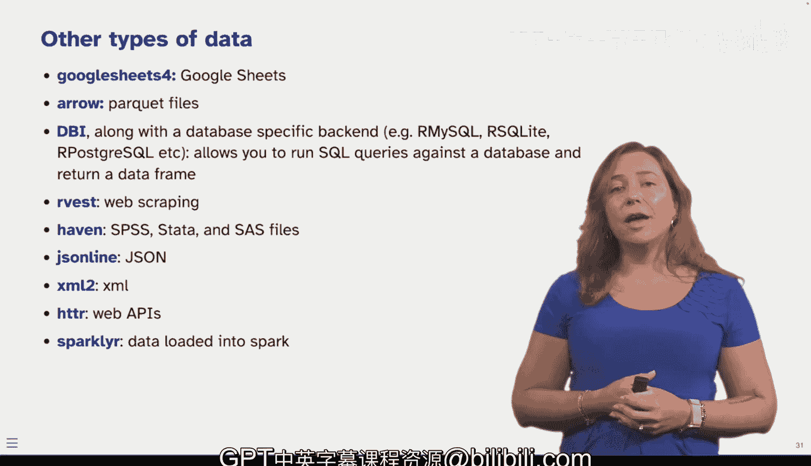

# 杜克大学《R语言数据科学｜Data Science with R》中英字幕 p27 11_02_01_数据导入.zh_en -BV1Zpv6BaEkB_p27-

🎼。

In this video we're going to talk about importing data into R which we've done many times before。

 however， this time we're actually going to take a deeper look at how we do it。

 the various types of data we can import and what we should pay attention to when we import data into R Let's start with rectangular data perhaps the most common way to store rectangular data is an SCSv file where CSv stands for comma separated values In this case。

 the delimiter or the separator is a comma。Other common delimiters are tabs or semicollonons。

 The readar package， which is part of the tidyverse。

 so we can just load it with library tidyverse offers a variety of functions for reading in tabular delimited data read underscore Cv for reading Cv read underscore cv2 is for reading semicollon separated files。

 Read underscore Tsv is for reading tab separated files。

 read dilim allows you to define the delimiter in a function call and read underscore FwF is for reading fixed with files where you need to provide a schema for how many characters are in each column。

 Another common storage method for tabular data is spreadsheets and perhaps the most commonly used spreadsheet software is Microsoft Excel。

 The read Excel package， which is not part of the core tidyverse。

 but it is designed to work well with all tidyverse packages and has been。

Designed with the same design philosophy offers the read， underscore Excel function。

This is for reading data from Excel files。 Both readar and read Excel offer many more functions。

 but we'll stick with the basics in this video。 So let's start with reading and writing CV files。

 Here I have a CV file called Nobel stored in a folder called data that I want to read。

 These are information on Nobel Prize winners。 We'll use the read underscore CV function to do this。

 The first argument for that function is called file。

 and oftentimes you'll see me omit this first argument when we write code。

 Then we give it the full path of where we can find this file。😊。

We want to use an organizational structure where it's very clear where we're placing our files in our projects。

 we've called the folder data and our data set lives in that folder。When we read it in。

 we're saving this object as an object called Nobel in R。

 There is no requirement for the name of the object in R to match the name of the data file。

 Often they can be different by a little bit。 but keeping them similar will help you keep things straight。

 So try to do that as much as possible。 The result of reading a data file using read underscore CSv is a Tiple。

 The implementation of data frames in the tidyverse。

 It nicely prints out the number of rows and columns for you。

 and it also doesn't try to print out the entire data set， which would be overwhelming。 Instead。

 it prints out whatever fits on your screen with the rest summarized by saying that we have 990 more rows and 13 more variables than what's shown。

We can also write out CV files to exemplify that。 I'm going to create a data frame or more precisely a tibble first。

 and then write it out。 We're going to create the tibble using the triple function。

 which is just a take on Tibble。 This function allows me to create a data frame by typing it out row by row。

 which， as you can imagine， would get extremely tedious。

 If we were writing a meaningful large data set here， though， since I'm just making a small example。

 it comes in pretty handy。 I often use this function for making small code examples for debugging or for sharing with others。

 I'm creating a data frame called D F that has two columns。 X and Y X has the values  one through3。

 and Y has the values A， B and C as character strings。 Once I have this data frame created in R。

 I can write it out using the right underscore CV function。😊。

The first argument is a data frame we're writing out， just like any other tidyverse function。

 and the second argument is where we want to place that data frame。

 I want to create a file called Df。csv and place that in a folder called data。

We can then read it back from the same location and inspect it to make sure that it looks exactly as we intended it to。

In addition to printing the data， R has also printed some information on the dataset set itss reading。

 that it has three rows and two columns that the delimiter is a comma。

 and that the names and types of those columns are x and y and character and double。

It also has added some information about how to retrieve the full column specification。

 in other words， full information on the types of columns。

 as well as how to turn off showing these messages。This is an informative message， though。

 can make your analysis output appear cluttered。 So oftentimes we'll turn off the message in printing in our quota documents by setting the code cell option message to false。

Next， let's talk about variable names。 It's very common to get a data set where the names of the variables are not very user friendly or coder friendly Here。

 I have a data set called Eddybn B bad names CS Sv， a data set on Airbnb listings in Edinburgh。

 Scotland。 When I read the data frame into R and inspect the column names using the names function。

 We can see that some of them are in capital letters， Some have spaces in the variable names。

 some follow the snake case convention that we've been using and others use various other structures。

 While R is perfectly happy handling variables， variable names like this。

 you're often going to run into issues。 If you want to use the variable names as is。 For example。

 if I wanted to plot the number of bathrooms， and the price of the listing from this data frame。

 and I type number of bathrooms in my aesthetic mapping。😊。

The same way as it appears in the data frame， it won't work because R doesn't actually allow spaces in variable names。

One option is to quote that variable name so that it knows it's a character string to look for in the headers of your data。

 I find this option to be error prone and tedious to work with。

 as it's something you'll need to remember to do every time you use this data frame。

 So my recommendation for when you get a data frame with such bad names is to clean up the names early on in your analysis and reap the benefits of a well organized data frame later。

 There are various ways you can do this， but I'm going to show you two of them。

One option is to define the column names as you're reading them in。 Obviously。

 before you read in your data， you have no idea what those variable names will be。

 so you might want to read it in the same way we did before。

 note what they were and decide on what you actually want to name them。

Sometimes the variable names given to you might be very long。

 but you can come up with something much shorter。 For example。

 we had number of bathrooms as one of the variable names。

 But I decided that labeling it simply as bathroom would suffice。

You can do this within the Read CSV function using the call underscore names argument by giving it a vector with the variable names you want to assign。

You need to ensure that the length of this vector is equal to the number of columns in the data frame you're reading in。

And then it's good practice to check that you end up with exactly what you intended。

Another option is using another package called janitor。 This isn't necessarily a tidyverse package。

 but it is tidyverse friendly and works nicely with other tidyverse functions。

 especially within a pipeline。 It is a function called clean underscore names that I really like。

 It takes a data frame。 and using some heuristics， turns the column names into snake case。

 It won't simplify them for you。 if you have something really long as a variable name。

 It simply makes everything lowercase and replaces any spaces with underscore。

 So it gives you less customization than the previous option， but if you have many。

 many variables to work with。 you may not want to write out names for every single one of them。

 This would give you something quicker to work with。

 and you end up with variable names with no spaces allowing you to use them more easily in your downstream analysis。

😊，Next， let's talk about variable types。 We've seen an example of what happens when we read data into R and R make some guesses about the variable types performing some type coercsion for us。

 That was the cat lover's example we looked at earlier。

 and we addressed how we would fix this after reading the data into R。 Next。

 I'll present other options for addressing similar problems。

 Take a look at this tiny data frame with three columns。 If I read this into R。

 What will R assign as the column type of X。 and why。Think about it for a second。

 pauseuse the video if you like。And let's take a look at whereas R decides to do。

 It makes X a character variable， even though all the values in there are numbers and there's just one and A。

 Oh， and one period， which probably stands for N A or missing。 We humans could guess that。

 but R won't make such an assumption。So one option for reading in a dataset where there are various ways nas are indicated is to specify the ways in which they're indicated by default。

 the read CSV function will convert empty cells and the character string NA in capital letters to true Ns In this dataset set。

 we would also like any periods， not applicables and probably the number 99，9，9。 Yes。

 some people will use a large number like this to indicate an na as Ns We pass these as a vector of characters to the NA argument of the read underscore CSV function。

And the result looks much better。 X is now read in as a double， as we would like。

And the other N strings are properly converted to true Ns as well。

Another option is to specify column types with the Co types argument。

 This can be helpful when you don't know what to expect of various N strings。

 but you have some expectation about column types， probably because you've worked with a version of this data before。

We define these types in the call underscore types argument of the reads CSV function as a list to indicate a double。

 we specify call underscore double to indicate a character， we specify call underscore character。

 etc， we'll see a full list of these options in a second。

 but let's take a look at how this option reads in the data。

The variable types are indeed what we asked for。In X。

 anything that wasn't a number is coerced to a double like the period in row 6。

 And that's what this warning is about。 It's basically telling us that R made some decisions on our behalf。

Which of these options you choose for cleaning up your RNAs depends on the context of your analysis and your analysis aims。

 but both are good tools to have in your toolkit。And here is a list of possible column types for the read CSV function。

 The goal of this slide is not to give you a long list of memorize。

 but more to remind you that this is a type of information you can find in the function documentation。

 you want a logical column， specify call logical， you want to skip a column， specify， call， skip。

 so on and so forth。Finally， let's talk about importing data into R from Excel。

We'll reuse the same data examples from earlier in this video。

 but read in Excel versions of these spreadsheets。 For instance。

 if I have an Excel file called Nobel do XlsX stored in a folder called data。

 I can read it in using the read underscore Excel function the first argument is the file path to where the data are stored。

After reading the Excel file into R， the resulting object is a Tibble。

 similar to reading CSV files with3ar。 We can inspect the Tbble to see the number of rows and columns。

 and R will print the tibble nicely showing only what fits on the screen and summarizing the rest。

If our Excel spreadsheet has bad names， like in the Edinburgh Airbnb listing examples。

We can apply the exact same fixes such as specifying column names with the Co_ Na argument。

Or using the clean names function from the janitor package after reading in our spreadsheet。

If your spreadsheet has many ways in which Ns are defined。

 we can use the NA argument of the Read underscore Excel function to specify them in the same way as we did with Read_ CSV。

Or by specifying call types。 however， note that how we specify column types is not the same as we did before。

 And neither is the warning we get， even though the result is the same。

 The warning is saying that in cells A 3 and A 7， there were data that were not numeric。

 So they got coerced to Ns， which is exactly what we wanted。

The column types are specified as character strings in the read Excel function。

 and there are fewer options to choose from， but the functionality is very similar to the Co underscore functions we used in read CSV。

Once again， the goal of this slide is not to give you a list to memorize。

 but to show you that there are a variety of options and that you can always access this information in the function documentation。

😊，Al right， we talked about CSV files and Excel spreadsheets and depth。

 these are probably the most common data types you'll encounter。

 especially as you start your data science learning journey。

 but of course there are many other types of data you could be reading into our。

And for just about any type of data， there's an R package that's been designed to help you read it。

 For example， the Google Sheets 4 package allows you to read in data from Google sheetets。

 The arrow package allows you to read parquet files， a common storage type for large data。

 The DBI package allows database connections， and the R package allows you to scrape unstructured data off the web。

While these packages are not all in the core tidyverse。

 they're all designed to work nicely with the tidyverse。

 So the jump from one of the data import packages we introduced in detail in this video to one of these shouldn't be a huge leap。

 and you shouldn't feel like you need to learn about all of these packages。

 when you encounter a data set of a specific type。 it's good to know a solution exists as in our package。

 and you can learn about using that package then。To summarize， when importing data into R。

 it's important to pay attention to the file format， variable names and variable types。

 we can use readR and read Excel packages for importing rectangular data specify column names and types using coal names and call types arguments and utilize functions like clean names from the janitor package to clean variable names by understanding these concepts we can effectively work with data in R and make our data analysis process smoother and more efficient。

