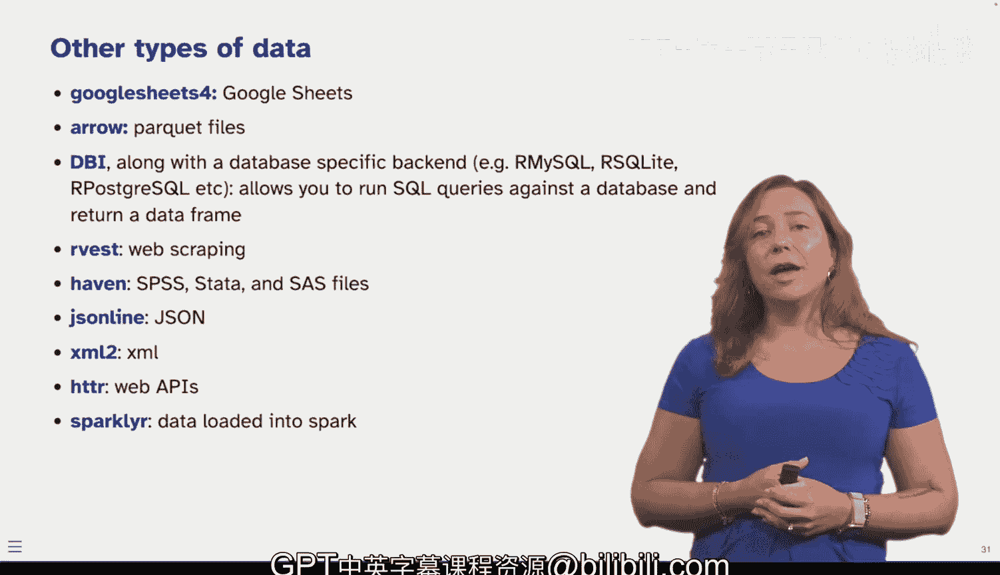

# R语言数据科学：11：数据导入


## 概述
在本节课中，我们将深入学习如何将数据导入R。我们将探讨可以导入的数据类型，以及在导入数据时需要注意的关键事项，包括文件格式、变量名称和变量类型。

## 矩形数据与CSV文件
矩形数据是最常见的数据存储形式之一。CSV文件是存储矩形数据的常用方式，其中CSV代表逗号分隔值。在这种情况下，分隔符是逗号。其他常见的分隔符包括制表符或分号。

`readr`包是`tidyverse`的一部分，它提供了一系列用于读取分隔表格数据的函数。

以下是`readr`包中的一些核心函数：
*   `read_csv()`：用于读取CSV文件。
*   `read_csv2()`：用于读取分号分隔的文件。
*   `read_tsv()`：用于读取制表符分隔的文件。
*   `read_delim()`：允许在函数调用中自定义分隔符。
*   `read_fwf()`：用于读取固定宽度文件，需要提供每列字符数的模式。

## 读取与写入CSV文件
上一节我们介绍了`readr`包，本节中我们来看看如何使用它读取和写入CSV文件。

假设我们有一个名为`Nobel`的CSV文件，存储在名为`data`的文件夹中。我们可以使用`read_csv()`函数读取它。

```r
nobel <- read_csv("data/nobel.csv")
```

使用`read_csv()`读取数据的结果是一个`tibble`，这是`tidyverse`中数据框的实现。它会清晰地打印出行数和列数，并智能地显示适合屏幕的内容。

我们也可以将数据框写入CSV文件。首先创建一个小的示例数据框。

```r
df <- tibble(
  x = 1:3,
  y = c("a", "b", "c")
)
```

然后使用`write_csv()`函数将其写入文件。

```r
write_csv(df, "data/df.csv")
```

之后，我们可以从同一位置读回该文件以进行验证。

```r
read_csv("data/df.csv")
```

## 处理变量名称
导入数据时，变量名称可能不友好。例如，一个数据集中的列名可能包含大写字母、空格或不同的命名约定。

虽然R可以处理这样的变量名，但在使用它们时可能会遇到问题。例如，如果变量名包含空格，在代码中直接使用会导致错误。

一个解决方案是在读取数据时定义列名，使用`col_names`参数。

```r
new_names <- c("id", "name", "bathrooms", "price")
data <- read_csv("data/bad_names.csv", col_names = new_names)
```

另一个便捷的选项是使用`janitor`包中的`clean_names()`函数。该函数可以将列名转换为蛇形命名法（全部小写，空格替换为下划线）。

```r
library(janitor)
data_clean <- data %>% clean_names()
```

## 处理变量类型
R在读取数据时会尝试猜测变量类型，有时需要进行类型转换。例如，一个本应是数值型的列，如果其中包含非数字字符（如“N/A”或“.”），R可能会将其读取为字符型。

处理缺失值表示的一种方法是指定`na`参数。默认情况下，`read_csv()`将空单元格和字符串“NA”视为缺失值。我们可以指定其他表示缺失值的字符串。

```r
data <- read_csv("data/file.csv", na = c("", "NA", ".", "N/A", "9999"))
```

另一种方法是使用`col_types`参数直接指定列的类型。

```r
data <- read_csv("data/file.csv", col_types = cols(
  x = col_double(),
  y = col_character(),
  z = col_logical()
))
```

选择哪种方法取决于你的分析背景和目标，但两者都是工具箱中有用的工具。

`read_csv()`函数支持多种列类型指定方式，详细信息可以在函数文档中找到。

## 从Excel导入数据
除了CSV文件，电子表格（如Microsoft Excel文件）也是常见的表格数据存储方式。`readxl`包提供了`read_excel()`函数来读取Excel文件。

```r
library(readxl)
nobel_excel <- read_excel("data/nobel.xlsx")
```

读取Excel文件的结果同样是一个`tibble`。对于具有不良名称或多种缺失值表示方式的Excel文件，我们可以应用与处理CSV文件相同的修复方法。

*   使用`col_names`参数指定列名。
*   使用`clean_names()`函数清理列名。
*   使用`na`参数指定缺失值字符串。
*   使用`col_types`参数指定列类型（注意，在`read_excel`中，类型是作为字符串指定的，例如“numeric”、“text”、“date”）。

与`read_csv`一样，`read_excel`函数的具体选项可以在其文档中找到。

## 其他数据源
我们深入讨论了CSV文件和Excel电子表格，它们可能是你最常遇到的数据类型。当然，还有许多其他类型的数据可以读入R。

对于几乎任何类型的数据，都有一个R包可以帮助你读取它。例如：
*   `googlesheets4`包允许你从Google Sheets读取数据。
*   `arrow`包允许你读取Parquet文件（一种常见的大数据存储格式）。
*   `DBI`包用于数据库连接。
*   `rvest`包允许你从网页抓取非结构化数据。

这些包虽然不都在核心`tidyverse`中，但都设计为能与`tidyverse`良好协作。因此，从本节课详细介绍的数据导入包过渡到这些包并不困难。



## 总结
本节课中，我们一起学习了如何将数据导入R。重要的是要注意文件格式、变量名称和变量类型。我们可以使用`readr`和`readxl`包导入矩形数据，使用`col_names`和`col_types`参数指定列名和类型，并利用`janitor`包中的`clean_names()`等函数来清理变量名。通过理解这些概念，我们可以有效地在R中处理数据，使数据分析过程更加顺畅和高效。