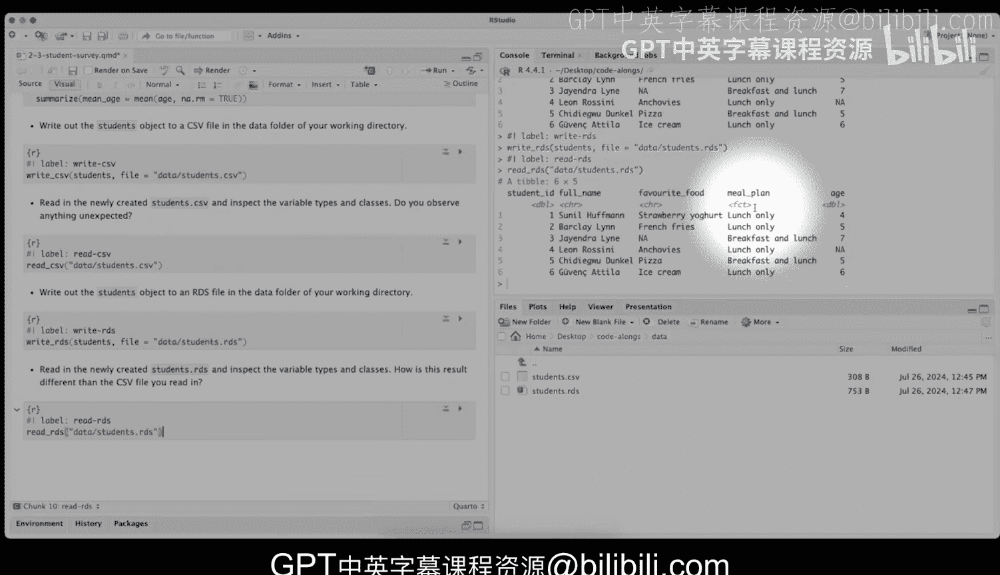

# 杜克大学《R语言数据科学｜Data Science with R》中英字幕 p28 12_02_05_代码演练：导入与重新编码.zh_en -BV1Zpv6BaEkB_p28-

In this code along， we'll work with a small but pretty messy survey data on favorite foods and some other information on school age children。

 we're going to use the tidy verse for our analysis， so let's start by installing that。

 and the data that we're going to use as synthetic as an I made them up。

 but the reason for that is so we can make a few points pretty quickly。

 And since the goal of this code along is to talk about importing data。😊。

We'll do that as part of our analysis so the data are hosted on the GitHub repository that has all the data sets for this specialization and the data set is called students dashra。

csv I usually like naming my raw data if I get a chance to name it myself with dash raw so that once I do a little bit of data cleaning which is what we're going to show here I can actually go ahead and save it with name that's a bit more informative like just students。

Let's go ahead and read that in and take a look at this data set。 And once again。

 my output is in my quao document。 We can see what it's looking like there， but I am going to。

Go ahead and say I want to see my chunk output in console。

 remove the output and let's try this one more time。

 so here is our data set we have six students that we have collected data from we know their student ID one through6。

 their full name， their favorite food， their meal plan and their age。

There's a lot going on in this data set Every single variable is using a different naming scheme there are sometimes periods with favorite food for how we are separating the two words versus meal plan is using CAl case age is all capital so things are a little bit all over the place so first we're going to clean up this data a little bit let's start with the students' raw data set and start by cleaning the variable names。

In order to do this， I am going to use the janitor package。

And use the clean names function from that。 So if I do that。

 you can see that each of the variable names have now been converted to Sna case。

 which is something that I like the janitor packages clean names function does not think about how to make changes。

 It just makes everything lowercase and replaces any periods or spaces with underscores。

 So if you wanted to give these more informative names， you would have to manually do that yourself。

 And I've used sort of a syntax here， I'm saying janitor colon colon to say this function comes from the janitor package and then the clean names function。

 The reason why I needed to do that is that I had not yet loaded the janitor package。 Now。

 the reason why you might want to do that is if you're going to use a one-off function from a different package that you don't otherwise know a lot about or your collaborator does not need to know a whole lot about。

It's useful to call it out as such， but I would recommend even if you're doing that to go back to the top of your document and load the package here as well。

 just for completeness， if you will so that when somebody is looking at your document they're able to see what all the package is needed are Now there may be other reasons why you may not want to do that。

 maybe you really don't want everything that comes with that package in sort of your working environment。

 And if that is the case， you might choose to leave that out for this small analysis。

 it really has no harm to us， so for full transparency if you will， and good record keepinging。

 I am actually going to load the package but I am going to call out that function with the colon colon syntax because everything else that we're going to use is from the tidyverse。

 just this one function is from a different package。

Now that we know what the output of this looks like we're told handle N。

 so let's take a look at what is happening with our Ns here。 we have under favorite food。

 the character string N slash A。We also have under age a true NA。

 so that may have been an empty cell in our original data set。

 so we need to make sure that both of these are in fact being identified as true NAs how do we go about doing that。

Let's go ahead and take what we have started with。And pipe that into so there are two ways actually。

 we can do that。 We can either do a mutate here and then fix things up in the favorite food column saying if you see this character string make it a true and A。

 or actually we can go one step back。 we can actually go back to our。😊，U。

Reading the data in function to read CSV and then say that we are going to have some N strings。

 Anything empty should be N and anything that is， that is the character string N slash A should be N。

 So let's go ahead and do that。And what I'm going to do here is instead of assigning this to students raw。

 I'm then going to pipe the result of this to the clean names function and let's take a look to see how things appear It is nice that because NAs are special data types are actually highlights them differently so we can see that we are doing something right here that both of these are now being interpreted as true NAs。

Next， we're asked to inspect variable types and apply fixes where appropriate Student ID is a double。

 Sure full name is character that makes a lot of sense。

 favorite food is character that makes a lot of sense meal plan is character we'll get to that in a second an age is character Well。

 do we believe that age should be character or why is it coming out to be a character The reason why age is coming out to be a character here is that one of the students fill their age in as5 so the character string 5 as opposed to the number5 So that is something we would want to fix and in order to be able to do that that's something we're going to need to fix after we bring in the data So let's copy everything that we have so far。

And pipe this into mutate。And the column that we want to mutate is the age column。

And then we want to say we can use an if else statement here because there's really only one condition we're looking for。

 if else age is equal to five， make it five， otherwise leave it as is， so whatever ages。

 so if we take a look now everything is numbers， but we still have a character string for the variable type for age。

 and so we're going to need to do that in a second step。

We can say then age is just the numeric version of8， because once we have just numbers in there。

 even if they happen to be quoted， R we happily convert them to numbers and now age is double we don't have decimal points for these ages so we could first force them to be integers as well。

 but there's no harm in leaving them as the default numeric double。In the next exercise。

 were asked to inspect variable classes and apply fixes where appropriate。 So for now。

 we can see the types of these variables in our Tal output so we might think about are there any categorical variables that we would want to apply a factor class to And the one categorical variable where that might make sense is the meal plan because we can imagine categorizing these students and calculating some statistics on them based on whether theyre lunch only or breakfast and lunch。

 How would we go about doing that， we can take our pipeline。And keep adding to our mutate statement。

 say meal plan is as that factor meal plan。And now we can see that we have a factor variable。

 It's hard， though， to see the impact of this。 Where is this going to actually be something we might care about。

 Let's think about some very simple analysis we might do with these data。

 Let's go ahead and save this data set as students as instructed in the exercise。

 And let's say that for the students data set， I want to group by the meal plan variable。

And then I want to do something like。Find the mean ages。

Of the students and since one of them had an NA， I would want to add an NARM equals true argument here。

 so those with breakfast and lunch are average six years old and those with lunch only are on average five years old。

Maybe we're happy with this order of the levels。 It happens to be the alphabetical order。

 That's why breakfast and lunch came from a cane before lunch only。

 If we're not happy with that order， we could go back to our data prep and say that we want meal plan to be re leveled。

And put lunch only as our first level。And put breakfast and lunch as our second level。

And now when we do run an analysis on it， we can see that the order of the levels have been flipped。

So we have a student data that we seem to be happy with and what we might want to do at this point is to write out this data so that before we continue on to further analysis。

 we have a version that is clean that is ready to be analyzed the first exercise is asking us to write this object to a CSV file in the data folder of your working directory so look in your working directory and if you don't have a data folder。

 create a data folder so I did that by clicking on new folder here。

And let's go ahead and say we're going to write this file。Cllold students。

So I write this object called Students to a file in the data folder called students。csv。

So we can see this in this folder now we have a csv file called students。

csv and if I was to inspect that briefly we can see that it has the cleaned up variable names that we had and the proper Ns as well。

Next， we want to read in this newly created students dot cv file。

 and we want to inspect the variable types and classes。 So let's go ahead and say。

That I want to read the CSV file。From my data directory called students。csv。

And the variable names look good。 The Ns look good。 Some of the variable types look good。

 but we have lost that factor designation of meal plan。 Why C SV files are。

Plain text files the notion of a factor， a data class is something that exists in R。

 and it is not something that can be an attribute that gets assigned to a column of data and SESV file。

 So what we're doing here is that the hard work we put in to convert this meal plan variable into a factor。

Its now poof gone away because once we save the data set， we have actually sort of lost that work。

 so if I actually wanted to work with mealal plan as a factor variable continuing on in my analysis。

 I would need to make that conversion again。So if there are data class changes that you are wanting to keep in your data。

 writing it out as a CSV file is not useful， we can think about another file format though called RDSR data storage and we can write RDS files the same way we can write CSV files。

 so I'm just going to say write RDS。And we're going to change the data type to RDS。

And now we can see that that new file has been created in our data folder with the appropriate suffix。

rdS and it gets a different icon as well it's not a spreadsheet anymore and if I was to read that file back。

Just like read CSV， but I'm going to say read RDS。Let's read that file back。

 we can see that that meal plan variable is still a factor。

For maintaining data classes between your cleaning step and your analysis step。

 if you are saving this interim file， it's important to think about not saving it as a flat file like our plain text file like CSV。

 but actually leverage our's data storage system。

