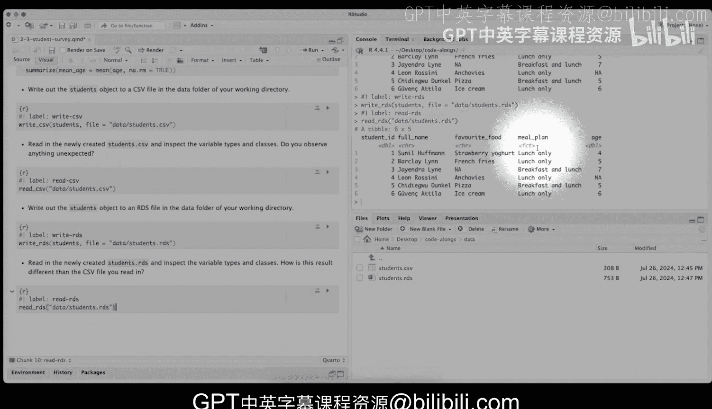

# R语言数据科学：12_02_05：代码演练：导入与重新编码 📊


在本节课中，我们将学习如何导入一个略显混乱的调查数据集，并进行数据清洗和重新编码。我们将使用 `tidyverse` 套件，并重点关注变量名的标准化、缺失值处理、变量类型转换以及分类变量的因子化。

## 概述

我们将处理一个关于学龄儿童最喜爱食物及其他信息的小型调查数据集。此数据集虽小，但包含了多种数据格式问题，非常适合演示数据导入和初步清洗的完整流程。

## 数据导入与初步查看

首先，我们需要安装并加载 `tidyverse` 套件。我们将从一个GitHub仓库导入名为 `students-raw.csv` 的原始数据。

```r
# 安装并加载 tidyverse
# install.packages("tidyverse")
library(tidyverse)

# 从指定URL读取原始数据
students_raw <- read_csv("https://raw.githubusercontent.com/your_repo/students-raw.csv")
```

读取数据后，我们查看其结构。数据集包含6名学生，变量包括学生ID、全名、最喜爱的食物、用餐计划和年龄。每个变量的命名规则都不一致，这是我们首先要解决的问题。

## 清洗变量名

变量名混乱不利于后续分析。我们将使用 `janitor` 包中的 `clean_names()` 函数将所有变量名转换为统一的小写蛇形命名法。

```r
# 加载 janitor 包
library(janitor)

# 清洗变量名
students_cleaned <- students_raw %>%
  clean_names()
```

`clean_names()` 函数会自动将变量名转为小写，并用下划线替换空格和句点。虽然这简化了命名，但若需要更具描述性的名称，仍需手动修改。

## 处理缺失值

检查数据发现，`favorite_food` 列中存在字符型缺失值 `"N/A"`，而 `age` 列中有一个真正的 `NA`。我们需要统一将它们识别为R中的标准缺失值 `NA`。

我们可以在读取数据时通过 `read_csv()` 函数的 `na` 参数来指定哪些字符串应被视为缺失值。

```r
# 在导入时指定缺失值字符串
students_raw <- read_csv("https://raw.githubusercontent.com/your_repo/students-raw.csv",
                         na = c("", "NA", "N/A"))

# 随后清洗变量名
students_cleaned <- students_raw %>%
  clean_names()
```

现在，两种形式的缺失值都被正确识别为 `NA`。

## 修正变量类型

接下来，我们检查各变量的类型。`age` 列本应是数值型，但由于其中一条记录被填写为字符 `"five"`，导致整列被识别为字符型。我们需要将其转换为数值型。

```r
# 修正年龄变量：将字符“five”转换为数字5，然后转换为数值型
students_cleaned <- students_cleaned %>%
  mutate(
    age = ifelse(age == "five", 5, age), # 替换特定字符串
    age = as.numeric(age) # 转换为数值型
  )
```

现在 `age` 列已变为 `double`（双精度浮点数）类型。虽然年龄通常是整数，但保留为 `double` 类型并无大碍。

## 处理分类变量

`meal_plan`（用餐计划）是一个分类变量。为了便于进行分组统计，我们将其转换为因子（factor）类型。

```r
# 将用餐计划转换为因子
students_cleaned <- students_cleaned %>%
  mutate(meal_plan = as.factor(meal_plan))
```

转换为因子后，我们可以进行分组分析。例如，计算不同用餐计划学生的平均年龄：

```r
# 按用餐计划分组并计算平均年龄（忽略NA）
students_cleaned %>%
  group_by(meal_plan) %>%
  summarise(mean_age = mean(age, na.rm = TRUE))
```

默认情况下，因子水平按字母顺序排列。如果我们希望改变顺序（例如将“lunch only”设为第一水平），可以使用 `fct_relevel()` 函数。

```r
# 重新设定因子水平的顺序
students_cleaned <- students_cleaned %>%
  mutate(meal_plan = fct_relevel(meal_plan, "lunch only", "breakfast and lunch"))
```

## 保存清洗后的数据

数据清洗完成后，最好将干净的数据集保存下来，以供后续分析使用。通常我们会保存为CSV文件。

```r
# 确保工作目录下存在‘data’文件夹
if (!dir.exists("data")) {
  dir.create("data")
}

# 将清洗后的数据保存为CSV文件
write_csv(students_cleaned, "data/students.csv")
```

## 读取保存的数据与数据类型的丢失

现在，我们读取刚保存的CSV文件，并检查变量类型。

```r
# 读取保存的CSV文件
students_reloaded <- read_csv("data/students.csv")
```

我们会发现，之前辛苦转换的 `meal_plan` 因子类型丢失了，它又变回了字符型。这是因为CSV是纯文本格式，无法保存R特有的数据类型信息。

## 使用RDS格式保存数据类型

为了在保存和重新加载时保留所有变量类型（如因子），我们可以使用R的专用数据存储格式 `.rds`。

```r
# 将数据保存为RDS文件
saveRDS(students_cleaned, "data/students.rds")

# 重新读取RDS文件
students_from_rds <- readRDS("data/students.rds")
```

读取 `.rds` 文件后，`meal_plan` 变量仍然保持为因子类型。因此，在需要保留复杂数据结构的清洗步骤与分析步骤之间，使用RDS格式是更佳选择。

## 总结

本节课中，我们一起完成了一个完整的数据导入与清洗流程：
1.  **导入数据**：使用 `read_csv()` 并指定缺失值。
2.  **标准化命名**：使用 `janitor::clean_names()` 函数。
3.  **处理缺失值与类型**：修正了错误的字符型数据并将其转换为正确的数值型。
4.  **因子化分类变量**：使用 `as.factor()` 和 `fct_relevel()` 处理分类数据。
5.  **保存数据**：学习了CSV格式会丢失数据类型，而RDS格式可以完整保留R对象的所有属性。




掌握这些基本的数据准备技能，是进行任何深入数据分析的坚实基础。