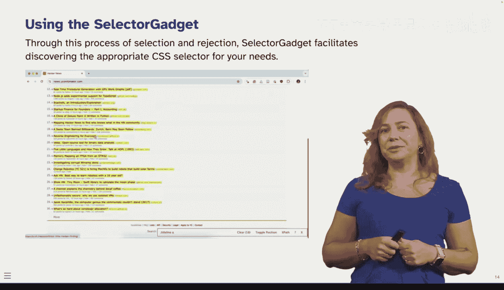

# 杜克大学《R语言数据科学｜Data Science with R》中英字幕 p29 13_03_01_网络爬取.zh_en -BV1Zpv6BaEkB_p29-

So far， we've imported nicely organized rectangular data that was already in rows and columns into our。

 Sometimes though the data come in an unstructured format， for example， on a web page in this video。

 we're going to talk about tools and techniques for scraping data off the Web。

 So what do we mean by scraping the web。 Let's start with the what and why。

 There's an increasing amount of data available on the web。

 and these data are usually provided in an unstructured format。

 you can always copy and paste these data， but this can be quite time consuming。

 especially if you have to do it across multiple pages。 and it can also be prone to errors。

 Web scraping is the process of extracting this information automatically and transforming it into a structured data set。

 There are two different scenarios。 and we're going to focus on the first。

 But I want to say a few things about the second as well。😊，The first scenario is screen scraping。

 We're extracting data from the source code of the website with an HTML parser。

 which is what we're going to use。 Another option would be to use regular expressions and manually extracting pieces of the website source code that contain the data that we need from it While this might sound tedious。

 there's actually no way to avoid tedious textparing when working with any text data。

 particularly website source code。The second scenario is getting data from Web APIpis。

 API stands for application programming interface。 This is when a website offers a set of structured HP requests that return to us files generally in JSON or XML format in the scenario。

 you don't directly deal with the source code of a website but you make requests to the website and get realtime feedback。

 Let's give an example。 Suppose we want to scrape some data from a static webpage like a Wikipedia page。

 It changes a little bit from time to time， but for the most part， the text there is static。

 You can do this with the help of an H parser using an R package that will help you to do that and get the data out of there。

 versus think about getting data out of a social media platform like Tiktok or blues sky。

 The timeline is constantly changing in such platform。

 So if you want to get data from a particular person's timeline or at a particular time。

 Instead of trying to scrape what's on the screen。😊，That you're seeing with your human eyes。

 you might prefer to make requests through their API directly to their database saying。

I want posts from this particular person at this particular time。

Many websites offer an API service to make such data available。

 some offer it for free and others charge for it。 You can imagine that many of the apps you use on your phone。

 for example， something like your weather app uses these web APIs for the purposes of this course。

 we're going to focus on screen scraping。 and we're going to do this with using in our package called Ar。

 But before we get into what Ar is， I want to say a little bit about what a web page looks like。😊。

If you have ever made a web page or even a very， very simple one。

 you're probably familiar with the letters HTML， which is short for hypertext markup language。

 Most of the data on the web is largely available in HTML format HTML is structured or you can say it's hierarchical or tree based。

 but it's often not available in a form useful for analysis in a tidy format。

This is usually what a web page in HTML format looks like。 It starts and ends with a tag called HTML。

 Note that the end HTML is denoted with a forward slash within these， there's an element called head。

 which is usually the title of your web page， and there's an element called body。

 which contains the rest of the content in the body of this page we have a paragraph identified by the P tag where text is center aligned and says hellello world with an exclamation point at the end。

If we wanted to bring the information on this page into R as a tidy data frame。

 we could place the head contents into the header row and the body contents into a cell。

 So we need some tools that will make that translation for us。 enterter Ar。

 Ar is a package that makes basic processing and manipulation of H data quite straightforward。

 So you yourself don't have to understand very well how H works。 You want to have an idea of it。

 Just enough to be able to extract things out of it。 But that's generally it。

 Ar functions We'll read in the page and then extract pieces out of it for you。😊。

And they're designed to work with pipelines built with a pipe operator。

 so it's very tidy versus friendly。There are a handful of core harvest functions that you will use regularly once you start web scraping with it。

 The goal of this slide is not to give you a list to memorize。

 but instead so you can get a sense of the package functionality。

 Read HTML M is what we are often going to start with。

 and it just looks like read underscore Csv or read underscore Excel that we've seen。

 It's the first step in reading the data。 The website source code in from a URL。

 Since your data in this case is not in a rectangular format。

 the rest of the artist functions are going to allow you to take the website source code and extract pieces of it that you're interested in。

😊，Read HTML simply grabs the source code of the website and stores it as an object in R that's accessible by other our functions。

The rest of the functions HTML element selects a specified element from an HTML document HTML elements selects multiple specified elements at once HTML table is for grabbing a table as a whole HTML text is for extracting out the text from any node that you have grabbed HTML name extracts the tags names HTML ATR and HTRS。

Extract each of the tag's attributes or their value by name。Now。

 I've read these function names to you， and there's a good chance many of them does not make a lot of sense yet。

 but the thing I would like you to keep in mind is that all of these functions start with HTML underscore except for the read HTML。

 the first one。 and that some of these functions are just the plural versions of another one like element versus elements。

 So if you want to extract one thing， use element versus if you want to extract many things。

 use elements。Another tool we'll use to facilitate scraping data off the web is the selector gadget。

 While web scraping doesn't require knowing HTML， you need to be able to identify the pieces of information you're interested in by their tags in the source code of a website written in H。

 The selector gadget is an interactive tool that facilitates discovery and selection of tags for elements on a page。

 And it's an open source tool that's free to use。 You can add it to your browser as an extension。

And the harvest package vignette on using the selector gadget walks you through everything you need to know to successfully use it。

Here's how it all works。 Suppose you want to get data from Hacker News。

 Hacker News actually has an API， so you might prefer to use that， but for now。

 we'll exemplify using the selector gadget on the hackcker News homepage as of today。

 Note that if you try this out while watching the video。

 the posts you encounter will be different as these posts change over time。

Once you install the selector gadget extension on Chrome。

 you should be able to see right next to your search bar an icon for the app。

 which looks kind of like a plug。 When you click on it。

 it says no valid path found at the bottom because you have not selected anything just yet。

Then when you click on an element on the page， such as the title of a post。

 what you clicked on turns green and other elements with the same tag turn yellow。

 The selector gadget also generates a minimal CS selector for that element。

 C SS stands for cascading style sheets。 A style sheet language for specifying the styling of a web page。

 like saying every element with a given tag will be bolded or left aligned， etc cetera。😊。

In that bar at the bottom of the screen that says a and the number 224 is shown in parentheses。

 meaning 224 elements with the same tag were selected。

 That's everything in yellow plus the one you actually clicked on in green。

If you then click on a highlighted element to remove it from the selector。

 the selection will turn red， then you click and unclick until you find the right selector for the items you want。

 and if you can't find a single selector for exactly the things you want。

 you can extract more than you need and then clean the data using other data cleaning tools we've learned so far and some new ones will introduce for working with text data。

This is the general process of working with the selector gadget。

 which helps you come up with the appropriate tags for the elements you are interested in without having to dive into the website source code。

 when working with the selector gadget， you shouldn't expect to get things right on the first try。

 You should expect to click around a few times before landing on the selector that gives you all the elements you want from a page。

 And if this fails， you might need to dive into the website source code。

