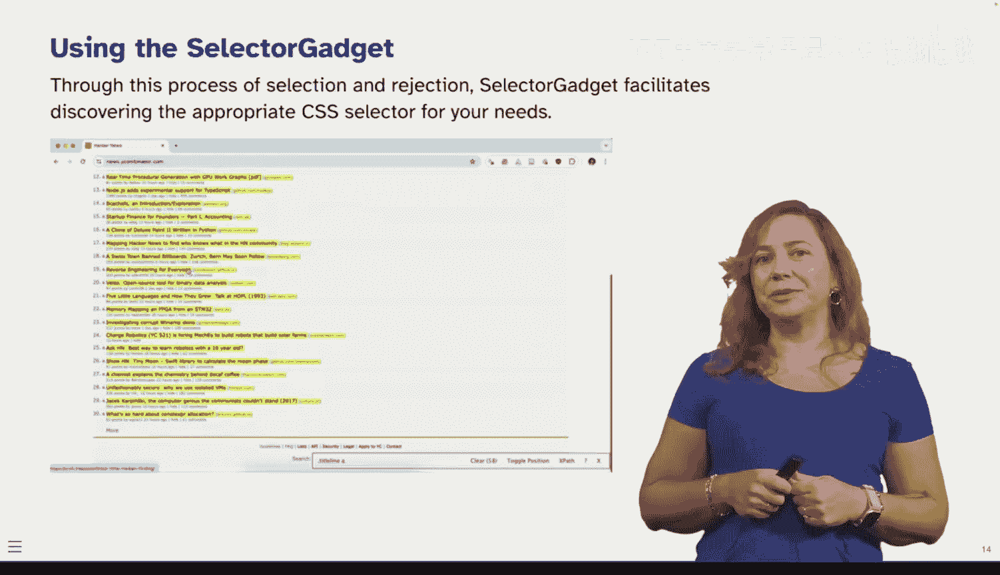

# R语言数据科学：13：网络数据爬取

## 概述
在本节课中，我们将学习如何从网页上自动提取数据，即网络爬取。我们将了解网络爬取的基本概念、两种主要场景，并重点介绍如何使用R语言的`rvest`包和Selector Gadget工具来从静态网页中提取数据。

## 什么是网络爬取？
到目前为止，我们导入的都是已经整理成行列形式的规整矩形数据。然而，有时数据以非结构化格式存在，例如在网页上。网络爬取就是从网络上自动提取信息并将其转换为结构化数据集的过程。

网络上可用的数据量日益增长，但这些数据通常以非结构化格式提供。虽然可以手动复制粘贴，但这非常耗时，尤其是在需要处理多个页面时，并且容易出错。

## 网络爬取的两种场景
网络爬取主要有两种场景。我们将重点介绍第一种，但也会简要提及第二种。

第一种场景是**屏幕抓取**。我们使用HTML解析器从网站的源代码中提取数据，这也是我们将要使用的方法。另一种选择是使用正则表达式，手动从包含所需数据的网站源代码片段中提取。虽然这听起来繁琐，但在处理任何文本数据，特别是网站源代码时，繁琐的文本解析是不可避免的。

第二种场景是**从Web API获取数据**。API代表应用程序编程接口。当网站提供一组结构化的HTTP请求，并通常以JSON或XML格式返回文件时，就属于这种情况。在这种场景下，你无需直接处理网站的源代码，而是向网站发出请求并获得实时反馈。

## 举例说明
假设我们想从一个静态网页（如维基百科页面）上抓取一些数据。它的内容会偶尔变化，但大部分文本是静态的。你可以借助HTML解析器，使用一个R包来完成此操作，从中获取数据。

相比之下，考虑从像TikTok或Bluesky这样的社交媒体平台获取数据。这些平台上的时间线在不断变化。因此，如果你想获取特定人物在特定时间的时间线数据，与其尝试抓取你人眼所见的屏幕内容，不如通过其API直接向其数据库发出请求，说明你想要特定人物在特定时间的帖子。

许多网站提供API服务来提供此类数据，有些免费，有些则收费。你可以想象，你手机上使用的许多应用程序，例如天气应用，就使用了这些Web API。出于本课程的目的，我们将专注于屏幕抓取。

## 网页的结构：HTML
在深入了解`rvest`包之前，我们需要先了解一下网页的构成。

如果你曾经制作过网页，哪怕是一个非常简单的网页，你可能对HTML（超文本标记语言的缩写）这几个字母很熟悉。网络上的大部分数据主要以HTML格式提供。HTML是结构化的，或者说它是分层的、基于树的，但它通常不是以适合分析的整洁格式呈现。

一个HTML格式的网页通常如下所示。它以`<html>`标签开始和结束。注意，结束的`</html>`标签用一个斜杠表示。在这些标签内，有一个称为`<head>`的元素，通常是网页的标题；还有一个称为`<body>`的元素，包含页面的其余内容。在`<body>`中，我们有一个由`
`标签标识的段落，其中文本居中对齐，内容是“Hello world!”。

如果我们将此页面上的信息作为整洁的数据框导入R，我们可以将`<head>`的内容放入标题行，将`<body>`的内容放入一个单元格。因此，我们需要一些工具来为我们进行这种转换。

## 介绍 `rvest` 包
`rvest`是一个R包，它使HTML数据的基本处理和操作变得相当简单。因此，你本人不需要非常了解HTML的工作原理，只需要有一个大致的概念，足以从中提取内容即可。

`rvest`函数会读取页面并为你提取其中的片段。它们的设计旨在与使用管道运算符构建的管道配合使用，因此非常“整洁”且用户友好。

## 核心 `rvest` 函数
一旦你开始使用`rvest`进行网络爬取，有几个核心函数会经常使用。本幻灯片的目的不是让你死记硬背一个列表，而是让你对这个包的功能有一个大致的了解。

*   **`read_html()`**：这通常是我们开始的第一步，它看起来就像我们见过的`read_csv()`或`read_excel()`。它是从URL读取网站源代码的第一步。
*   **`html_element()`**：从HTML文档中选择一个指定的元素。
*   **`html_elements()`**：一次选择多个指定的元素。
*   **`html_table()`**：用于抓取整个表格。
*   **`html_text()`**：用于从你抓取的任何节点中提取文本。
*   **`html_name()`**：提取标签名称。
*   **`html_attr()` 和 `html_attrs()`**：按名称提取每个标签的属性或其值。

现在，我已经向你介绍了这些函数名，很可能其中许多对你来说还不太明白。但我想让你记住的是，除了第一个`read_html()`，所有这些函数都以`html_`开头，并且其中一些函数只是另一个函数的复数版本，例如`element`与`elements`。因此，如果你想提取一个东西，使用`element`；如果你想提取多个东西，使用`elements`。

## 使用 Selector Gadget 工具
我们将使用的另一个促进网络数据抓取的工具是Selector Gadget。虽然网络爬取不需要了解HTML，但你需要能够通过HTML编写的网站源代码中的标签来识别你感兴趣的信息片段。

Selector Gadget是一个交互式工具，有助于发现和选择页面上元素的标签。它是一个开源工具，可以免费使用。你可以将其作为扩展程序添加到浏览器中。`rvest`包中关于使用Selector Gadget的指南会引导你了解成功使用它所需的一切知识。

## Selector Gadget 工作流程
以下是它的工作原理。假设你想从Hacker News获取数据。Hacker News实际上有一个API，因此你可能更愿意使用它，但就目前而言，我们将以今天的Hacker News首页为例，演示如何使用Selector Gadget。

请注意，如果你在观看视频时尝试此操作，你遇到的帖子将会不同，因为这些帖子会随时间变化。

1.  在Chrome上安装Selector Gadget扩展程序后，你应该能在搜索栏旁边看到一个应用图标，看起来有点像插头。点击它时，底部会显示“未找到有效路径”，因为你还没有选择任何内容。
2.  然后，当你点击页面上的一个元素（例如帖子标题）时，你点击的内容会变成绿色，而具有相同标签的其他元素会变成黄色。Selector Gadget还会为该元素生成一个最小的CSS选择器。CSS代表层叠样式表，是一种用于指定网页样式的样式表语言，例如规定具有给定标签的每个元素都将加粗或左对齐等。
3.  在屏幕底部显示“a”的栏中，括号内会显示数字224，这意味着选择了224个具有相同标签的元素。这包括所有黄色的元素加上你实际点击的绿色元素。
4.  如果你随后点击一个高亮显示的元素以将其从选择器中移除，该选择将变为红色。然后，你通过点击和取消点击，直到找到适合你所需项目的正确选择器。
5.  如果无法为恰好是你想要的东西找到一个单一的选择器，你可以提取比你需要的更多的内容，然后使用我们迄今为止学过的其他数据清理工具以及我们将介绍的用于处理文本数据的新工具来清理数据。

这就是使用Selector Gadget的一般过程，它帮助你在无需深入研究网站源代码的情况下，为你感兴趣的元素找到合适的标签。

## 总结
在本节课中，我们一起学习了网络爬取的基础知识。我们了解了从网页提取数据的两种主要方式：屏幕抓取和使用Web API。我们重点介绍了如何使用R语言的`rvest`包来读取HTML页面并提取特定元素。此外，我们还探讨了Selector Gadget这个强大工具，它可以帮助我们直观地识别和选择网页上的元素标签，而无需手动解析复杂的HTML源代码。记住，使用Selector Gadget时，不要期望第一次尝试就能成功，通常需要多次点击尝试才能找到能准确抓取页面所有所需元素的选择器。