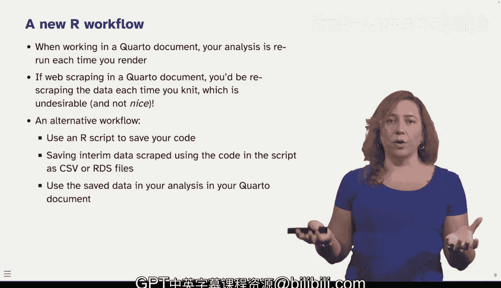

# R语言数据科学：14.03.02：网络爬取注意事项 🕸️

在本节中，我们将探讨进行网络爬取时需要考虑的几个关键方面。这包括伦理考量和技术挑战，以及一个推荐的工作流程。

## 伦理考量 ⚖️

上一节我们介绍了网络爬取的基本工具，本节中我们来看看首先需要考虑的伦理问题。你能爬取数据与你是否应该爬取数据，这是两个不同的问题。对于某些数据源，答案可能一致，但对于其他数据源，尤其是涉及私人个人数据时，答案则截然不同。

这里引用一篇来自Fox.com的文章，标题为《研究人员未经许可发布了7万名OK Cupid用户的个人资料数据》。这个2016年的案例描述了一组研究人员如何从一个当时非常流行的在线约会网站OK Cupid爬取数据。文章指出，这次数据泄露违反了社会科学研究伦理的基本规则，它在未经许可的情况下获取了可识别的个人数据。

研究人员辩称数据已经是公开的，他们并未做错任何事。但细读文章会发现，虽然他们发布的数据集中没有用户的真实姓名，但包含了用户名。有些人使用真实姓名作为用户名，有些人也可能在其他关联其真实姓名的场合使用相同的用户名。诚然，这些用户选择向OK Cupid提供其个人身份信息，但目的是为了参与交友，而非为了让自己的信息以更易搜索的方式作为数据集向公众发布。

当时，这些研究人员的所作所为并不违法，但从伦理上讲，这是错误的。类似案例比比皆是，这促使我们思考数据伦理与行为合法性之间的关系。鉴于法律往往滞后于技术发展——正如我们在当前人工智能发展浪潮中所经历的——对于数据科学家而言，秉持良好的伦理准则行事，而不仅仅依据是否合法，显得尤为重要。数据科学、机器学习和人工智能的伦理是正在发展的研究和政策领域，我们将在后续课程中进一步讨论。但我们可以在教授网络爬取工具的同时，强调这些重要的伦理考量。

## 技术挑战 💻

接下来，我们将讨论网络爬取可能遇到的技术层面的挑战。

### 数据源格式不一致

首先，我们可能面临数据源格式不可靠的问题。以下是杜克大学知名校友页面的截图。可以看到，有些校友有照片，有些则没有。因此，使用相同的选择器，我们获取到的每条条目的信息可能不同。我们或许可以围绕这个问题编写一些额外的逻辑代码，但当数据源格式不可靠时，这类问题会使网络爬取变得具有挑战性。

### 数据分页

另一个潜在问题是数据被分割到多个页面。例如，我访问Yelp并搜索北卡罗来纳州达勒姆的素食餐厅，Yelp的搜索结果每次只显示10条列表，结果分布在许多页面上。为了从这些页面爬取数据，你需要学习编写函数并在多个页面间进行迭代。这是一个可以解决的问题，但无疑增加了另一层挑战。

### 动态内容

此外，这类网站通常包含动态内容，这带来了其特有的挑战，需要学习一套新的工具与之交互。

## 推荐工作流程 📁

在结束之前，让我们对工作流程做最后一点说明。到目前为止，我们一直在Quarto文档中工作。当你在Quarto文档中工作时，每次渲染文档都会重新运行分析。如果在Quarto文档中进行网络爬取，每次渲染时都会重新爬取数据，这既不可靠也不友好。你会不断请求网站提供商的服务器，更重要的是，数据可能会在你操作过程中发生变化，而这可能并非你所愿。

因此，我们将介绍一种替代工作流程：使用R脚本从网络获取数据，然后将其保存为CSV文件或RDS（R数据存储）文件。之后，你可以在Quarto文档的分析中使用这些已保存的数据。在本课程中，到目前为止，你使用的是提供的数据文件，并学习了分析这些数据的工具和技术。通过网络爬取，你将有机会成为收集数据并将其组织成表格格式的人，之后的工作流程与之前相同：在Quarto文档开头读入数据，然后进行分析。我们不希望在每次渲染时重复爬取部分，但我们确实希望Quarto文档中的其余分析是可复现的。

## 总结

本节课中，我们一起学习了网络爬取的重要注意事项。我们首先探讨了爬取数据时的核心伦理问题，强调了“能够”与“应该”之间的区别。接着，我们分析了可能遇到的技术挑战，包括数据源格式不一致、数据分页和动态内容。最后，我们介绍了一个推荐的工作流程，即使用R脚本独立完成数据爬取和保存，再在Quarto文档中进行可复现的分析，以避免每次渲染时重复请求网站并确保数据稳定性。理解这些考量是成为一名负责任且高效的数据科学家的关键一步。