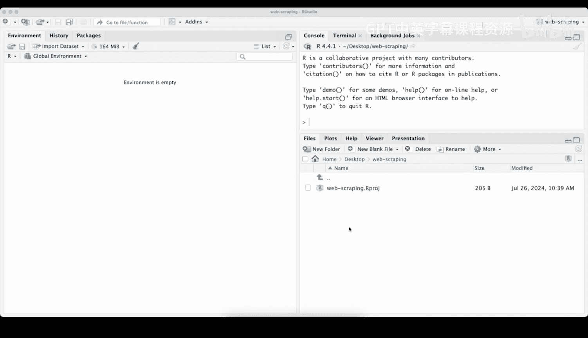
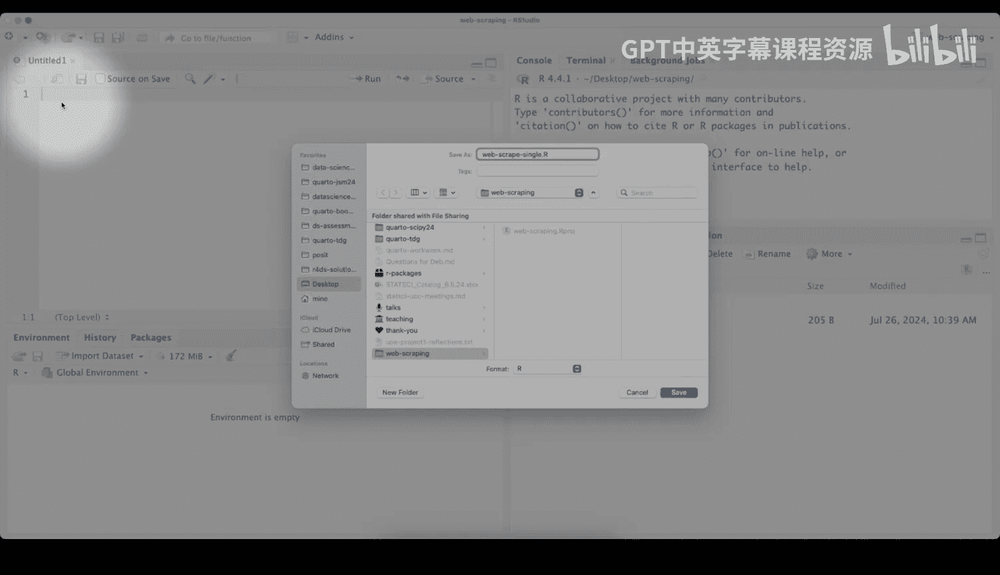
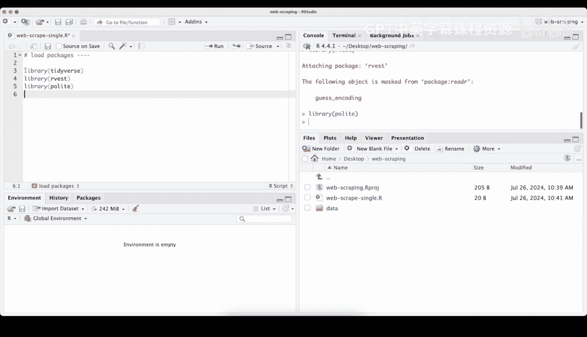
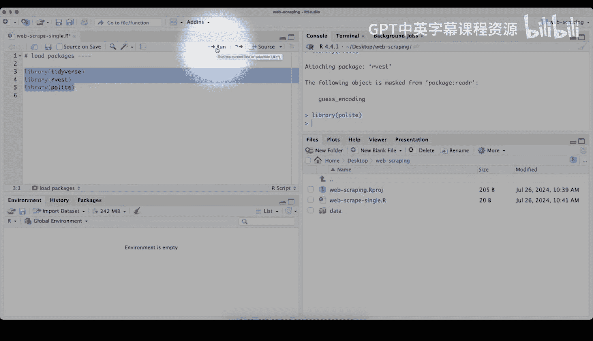
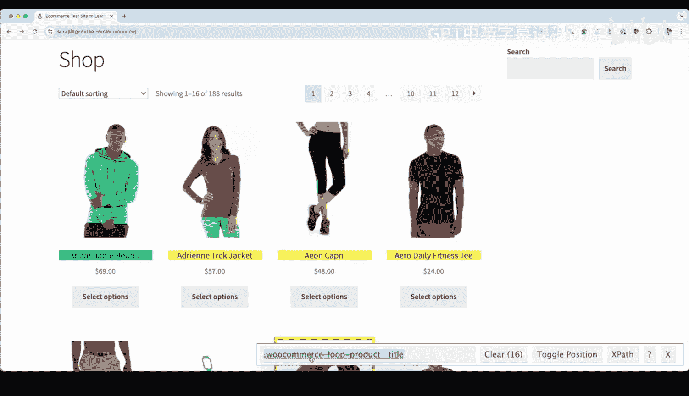
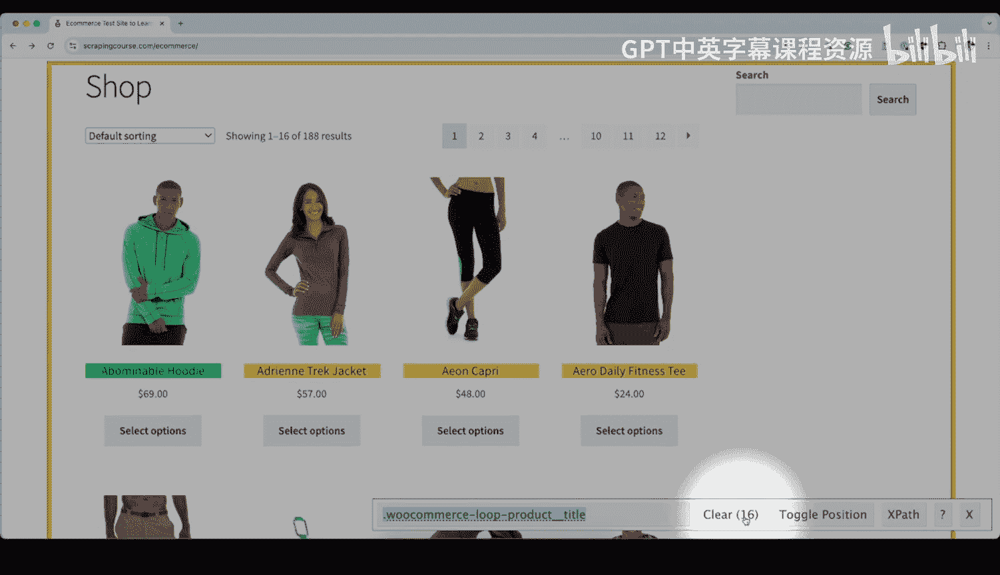
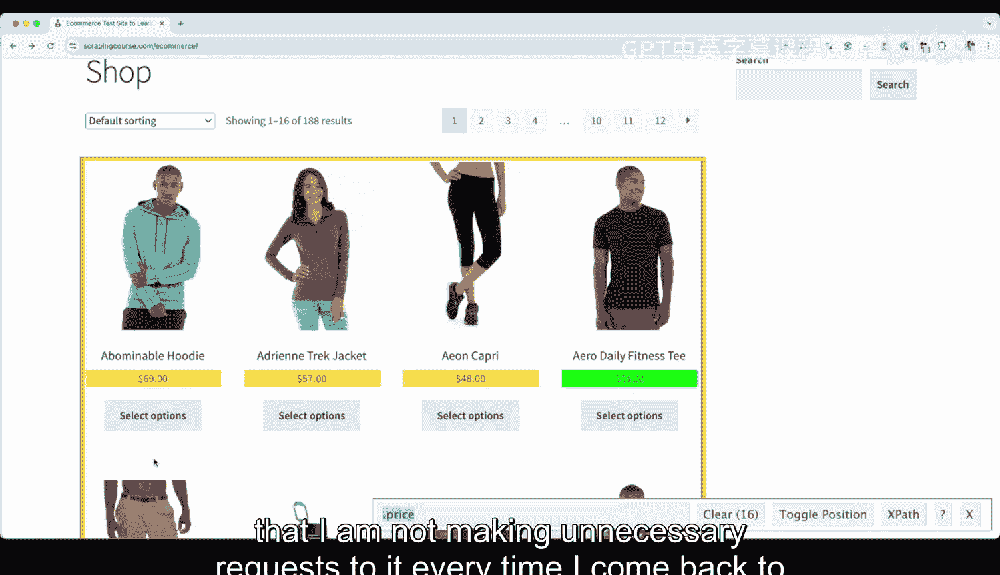

# 杜克大学《R语言数据科学｜Data Science with R》中英字幕 p31 15_03_03_代码演练：爬取电商页面.zh_en -BV1Zpv6BaEkB_p31-

In this video， we're going to actually do some web scraping and introduce you to a workflow where we're writing our code in an R script and then writing the data out that we scraped off the web。

To get started， I am going to start a fresh our studio project。 So in our studio。

 I am going to go to file new project。😊，And I want to create a whole new directory。

Just an empty project。And I might put that on my desktop。

And let's call the directory name web scraping。Once I'm in my R studio project。

 I'm going to create an R script， I can do this with the green icon over here that creates a new file or I could go to file and then new file。

 let's go ahead and do this。

And let's go ahead and give this file a name。 We're going to web scrape from a single page for the time being。

The reason why I started with creating an our studio project is that now my current working directory is this directory。

 In fact， in my console I can type get working directory and you'll see that I am on my desktop in a folder called web scraping so later on when I have a data file that I have scraped off the web I can create a new folder in here called data and put that new data file into this folder I generally want to make sure that each one of my projects are encapsulated in our studio projects like this so that whenever I start up a new project。

 my current working directory is always the folder for that project。All right。

 now we're ready to write some code。First， let's go ahead and load our packages。 General。

 when I'm writing code in an R script， I like to add some comments。

 so I'm going to say my first step is loading packages。

 and we know that in R we can write comments following the hash sign or the pound sign。

One thing I would recommend doing once you write a comment like this is to add four dashes next to it once you hit enter after that。

 you will see that Rt starts this little navigator for you so as you build into this R script and you section your code with these comments you can easily jump between them So what are the packages we're going to use As usual。

 we're going to make use of the tidy verse。We've also introduced the ourV package for doing web scraping。

 and we're going to introduce one more package。Called polite。

 And we are going to use the polite package to check if the website provider has even allowed us to scrape off the Web。

 Let's go ahead and load these packages。 And the way I'm doing that is I'm putting my cursor on any of the lines of code that I want to run。

 And then I'm hitting command and return。 I can also do things like highlight the code and click on the run button here。

 But I like using the keyboard shortcut for this。😊。

So once we have loaded our packages， let's start another section and check。For scrapability。1，2，3，4。

 I have a new section， and the function that we're going to use is。

And the function that we're going to use is F because we're polite And what we want to do is go and grab the URL of the web page that we want to scrape from。

 So let me introduce you to the web page。 We are actually going to use a web page that has been designed to learn web scraping。

 The reason why I'm referring to this particular website is that I feel pretty certain that the website is going to stay the same between when I record the video And when some of you might be watching the video。

 And therefore， we're going to use this to learn how to do things。😊。

So the URL for the homepage for this is called scrapingCse。 co。

 let's go back to our studio and paste that and run this code。

 So what this function is doing is it is looking at what is called the robots TxT file on a website every single website has or should have a file like this It's not a file you as a website user would ever encounter。

 but it is what website crawlers， for example， the search engine crawler by Google encounters and finds out if it is okay to scrape or crawl this page。

We are told that we are actually allowed to scrape this to give you an example。

 some websites don't let you so let's for example， try one。Facebook dot com。

 Facebook actually does not want you to scrape data from it。 And so if you encounter such a website。

 it would say it's not scrapable。 So we feel good that we are allowed to scrape this page。

 And so we are going to go ahead and。😊，Read the page。

I generally like giving my URL a name that I can refer to so I'm going to copy that of my search bar。

 this is going to be the character string， the URL that I'm going to work with and we read this page using the read HTML function in Ar。

Let's go ahead and read it and let's see what our returns to us。

 We had looked at what an HTML page looks like and we said that it's usually comprised of two components a head and a body。

 so what Read HTML gives us is the entire source code for this page and you can see there's a lot going on and we can't even print the whole thing here in our console and we don't need to we are going to go through it with the help of the selector gadget and only grab the pieces that we do need。

So let's go ahead and save this as page。And we can see。That this page object is a list in R。

 and if I take a look at the class of it， it is an XML document。

 so that is basically what we have gotten from the website。At this point。

 I need to figure out which components of this website I'm interested in。

 so let's go back to the website itself。The types of things we're going to want to scrape are the titles of the items。

 their prices。 and also just like many ecommerce-commerce websites， if you click on an item。

 you get sent to another page and usually on this other page。

 you have other options you can work with。 like I could choose a size or I could read the description of the item that I'm interested in。

 So what we might also want to do is grab the URL。 So if I was to click on that title。

 where would I be sent to because I could potentially write additional code later on to allow me to then visit these pages and grab additional information from them。

 So our goal is to get titles prices and the URLs of each one of these items。

 Let's start with titles。What I need to know now is where are the titles stored on the website coat with my human eyes。

 I can see where they are。Using the selector gadget and clicking on a title。

 I can then grab the tag associated with that title and note that when I'm using the selector gadget。

 I can also note how many items are selected on a page and particularly for smaller pages or pages where you know the number of items like many pages will allow you to set。

 for example， how many results you want to see。

You can use this as sort of a correctness check of。

 I wonder if that's the right thing that I'm looking for。 So it looks like this tag does， in fact。

 give us the title。 So I'm going to go ahead and copy that。And I'm going to say start with the page。

And。Grab。Now， the question is， do I want to grab one thing or many things。

 There are 16 of these titles， So I want to grab many things。 grab these elements from it。

 So let's go ahead and run this code。 And I can see， In fact。

 let me make my console a little bit bigger in order to be able to see the full thing。

 I can see that I was able to grab all 16 of the titles。 I grabbed more than that， though。

 I also grab some of the H code to go along with it。 And that's probably not what I'm interested in。

 So I can use yet another R function。 H text to say now strip off all the other stuff。

 I just want the text。 And here we go， I have a vector of 16 titles for the items on my page。😊。

This seems like what I exactly want。 I'm going to call this object， titles。And say going forward。

 we're going to store the result of what we got out of the page in an object called titles。 Now。

 our goal is to create three such vectors， one for titles， one for prices and one for the URLs。

 And once we have all three， we're going to put everything into a data frame。

So let's go ahead and get the URLs next。We're going to start with our page again。

 and then we're going to get some elements out of it， but let's see where the prices are stored。

Or sorry， where the URLs are stored。Going between one selection and another。

 I usually like to click on clearear so that we can start fresh。

And then let's go ahead and see what do I need to click on in order to be able to grab the full URL If I click on this。

 that seems to only give me the images。 If I click on。 so now I've clicked on too many things。

 let's unclick the images。 this seems to give me only the titles。

 but I can also see that there is this bigger area。 Oh， now I've selected 32 things。

 that seems too many。 so let's clear again。 let's try to grab that bigger area。

 Now I have 16 of these bigger things that are selected。

Where the tag is telling me that it might be the product link。I don't know if it is。

 but it seems worth a try。 so let's go ahead and copy that。And see what that gives us。 That seems to。

 in fact， be giving us the URLs for each of the individual items。 In fact， we can go back to that。

Abbominable hoodie。Click on it and confirm for ourselves that， in fact。

 that is the right URL that we want to extract。 So you can see there's a lot of like manual intervention here。

 I'm checking my work as I go。 I'm clicking around on a web page。

 but ultimately I'm not having to copy and paste 16 separate URLs。

 So now what I need to do is grab just those URLs， not this entire junk。Earlier。

 we said that when we want to get the text out， we can use HTML text。

 We're going to need a different tool now what we want is actually an attribute。

 So here these URLs are saved in an attribute called H ref and it's only a single attribute for each one of these elements。

 so I want HTML attribute。And a ref， which stands for hyperlink reference。

 will give me the URLls for each one of these items。 Now that I have a vector of 16 URLls。

 let's say that as URLs。 So going forward， if I want to place that into a data frame or a tibble。

I can refer to it as URLs。And the last thing we said that we're going to get are prices。

So let's go back to the page。Go back to our homeage。

 turn on the selector gadget again and try to go fishing for prices。 That was easy enough。

 That was dot price， we have 16 selected that is probably the right thing and again。

 every time I think I might be getting it right， I'm not really sure if I am， but it is worth a try。

 So instead of trying to guess I recommend selecting something that you think looks reasonable going back to your code。

And letting our vest help you figure out if you have the right thing。I don't know。

 Do we have the right thing。 I'm not really sure， because I can't see the text yet。

 Let's give ourselves a bit more space。 I still have no idea。

 I'm not seeing those dollar amount numbers。 But there was a trick I used earlier with the titles。

 There was a lot of junk in each one of the elements that I was able to extract。 And I said。

 just give me the text values associated with them。

 So let's try to see if that gets us where we want to go。In fact， that seems to be the case。

 so we could have gone exploring more and looking into each one of those items or we can really give it a try。

 it costs you exactly $0 or whatever your local currency is to run the code so you might as well give it a try and if that fails。

 you can go investigating more。Now we have the dollar amount。

 but there's something peculiar about them。 They're all quoted。

 and there's a little dollar sign in front of them。 That makes a lot of sense。

 That's exactly how you would want to see prices listed on a website， however。

We probably want these as numeric data。 We probably are going to want to do things like let's find the average price of an item on this page。

 or let's make a histogram of all the item prices。 So what do we need to do in order to get there。

 I have some text where I want to get rid of the dollar signs。

 And then I want to convert the type to a numeric。One of the packages that will be helpful for doing this sort of text manipulation is string R in which all of the functions start with STR underscore so you can do this and you can take a look at your options。

 there is a function called STR remove that seems to do exactly what we want to do we want to remove anything that matches a particular pattern that we don't want in this case。

 the dollar sign and it replaces them with an empty space so it basically deletes them。

 So let's say STR remove。And I want to remove the dollar signs from it。Now， that didn't work。

 it looked promising， but it didn't work， why not？Because the thing that we are trying to remove is a special character。

 Let me show you if I said， remove all occurrences of 6， it actually does do the trick。

 You can see the 69 now became a 9。 So it looks like the SR remove function is the right thing。

 but we need a special treatment for any special characters。😊。

And that special treatment is called escaping。 Since dollar sign is a special character。

 we need to escape it with two back slashes。To say don't think about it as a special character。

 Just use it as a character。 We want to get rid of。

 So now we are able to get back to a point where we have just the numbers and our is kind enough that once you have just numbers in a text string。

 you can actually run as numeric on that and get a numeric value back。

 So let's go ahead and save this as prices。 And I can print these out I can take a look at the。😊。

Type of these prices。And see that， in fact， we have numeric or double data in this case。

So the three things I wanted are all here， all I need to do is bring them into a data frame or a tablebble。

So let's go ahead and say that I want to make a Tibble。Now， in the Tple function。

 I need to specify the column name。 and then what goes into that column。

 The three column names that I want are title。URl。And price。What goes into the title。

 this vector called titles？What goes into the URL column。

 this vector called URLs and what goes into the price column， this vector called prices。

 So if I run this， I have a data frame with 16 rows， one row per item and three columns。

 the three attributes of these items that we have scraped off this page。

 and now that I have this Tbble。I can actually save it as something。 I've called it items。

 And now I have a data set that I can work with。 At this point， I feel good about my web scraping。

 I usually tend to do one last thing。 I usually tend to say。

 let's do select all and run this whole code one more time。

 just to make sure that as we were developing it。 We didn't introduce any bugs。

 Maybe I didn't leave any straggling code there or something。

 And let's confirm that the result is something we are happy with。😊，Now that that is the case。

 I want to make sure that I can stop interacting with this live website that might change outside of my control。

 or even if it doesn't change that I am not making unnecessary requests to it every time I come back to an analysis of these items。

 so I want to store a copy of this in my data folder。

So I can say I'm going to write these items and the function that I'm going to use is write underscore CSV。

 the data frame or the object that I want to write out is called items。

And the file that I want to write it to is going to be called items。 csv。

 but at this point I need to think about where do I want to put this file。

 I actually want to put it into my data folder， so let's go ahead and do that data forward slash items。

And I can see that that appears in my。In my files pane。 And again。

 all of this is made possible by having created this ourud project at the beginning that says our current working directory is this web scraping folder。

 so then when I refer to a folder called data。 It knows to go into this folder。 We have a C SV file。

 We know what to do with it going forward。 I could read this file in in a quaro document。

 I could visualize things I could summarize things。

 And I could basically do any analysis that I want on it。

 We started a video without a data set available to us。

 And now we have a data set that we can apply all the tools we've learned so far to。😊。

