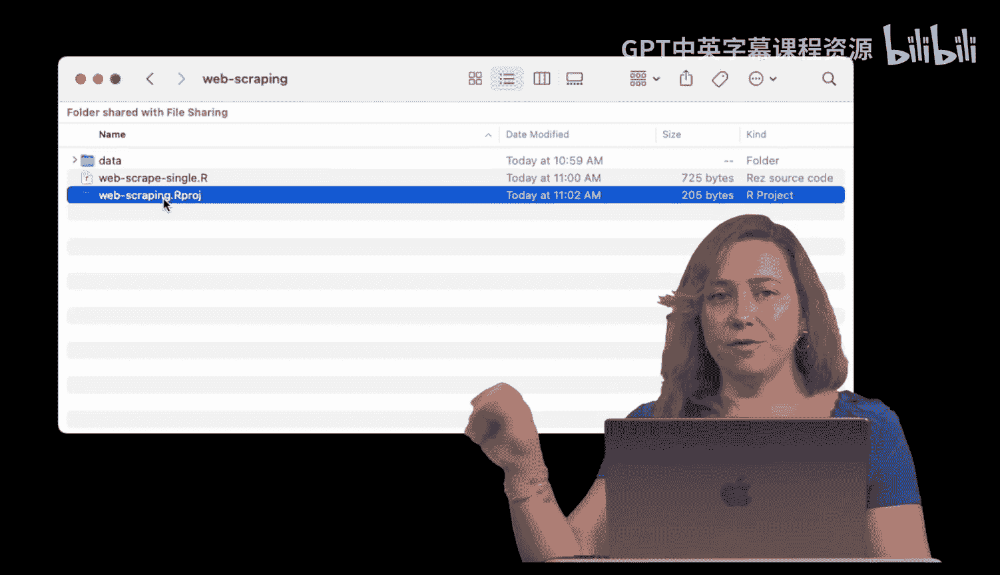
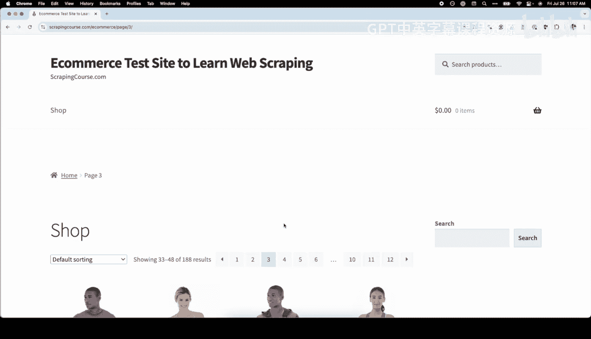
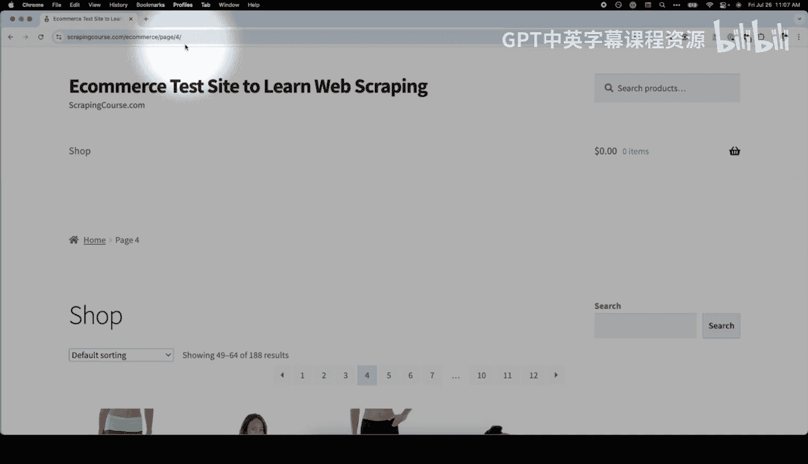
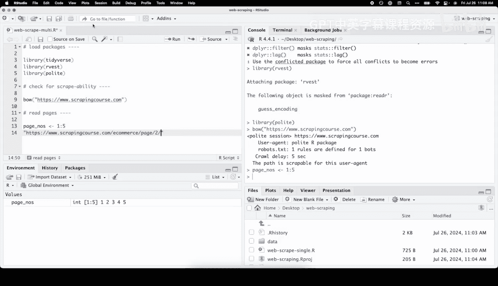
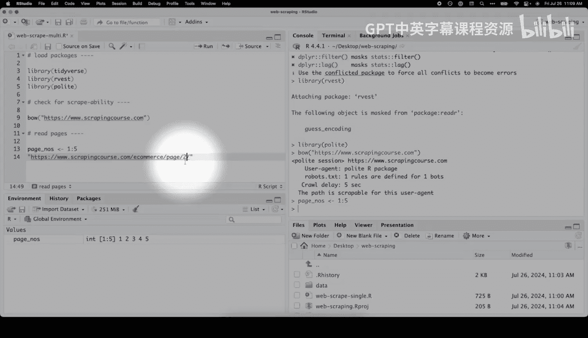
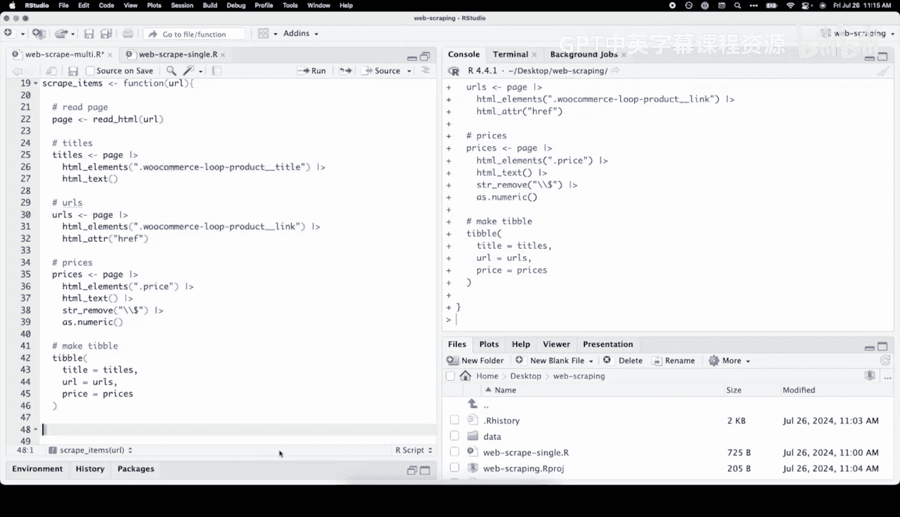
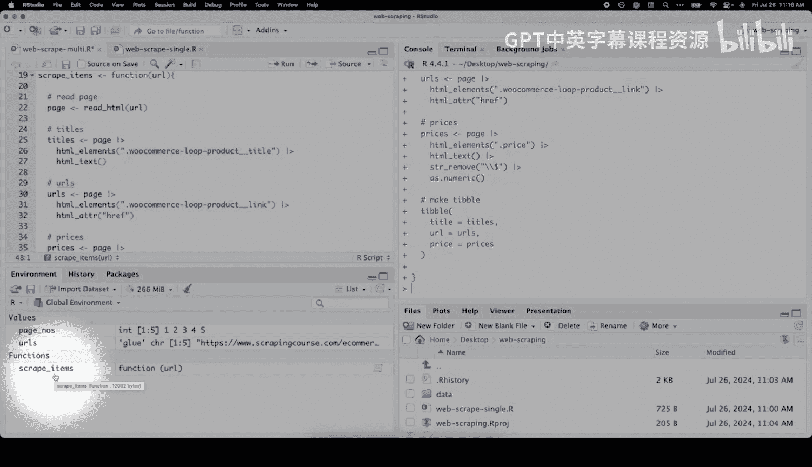
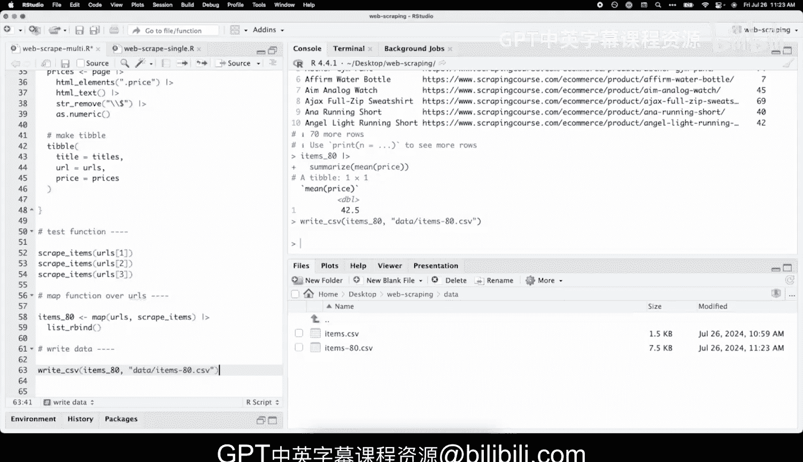

# 杜克大学《R语言数据科学｜Data Science with R》中英字幕 p32 16_03_03_代码演练：爬取多个电商页面.zh_en -BV1Zpv6BaEkB_p32-

So far we've learned how to scrape data from a single page and in this video we're actually going to build on what we've done before。

 go back to that e-commerce website and scrape data from many many pages。

 so instead of being limited to just those 16 items that we scrape。

 we're going to be able to scrape across many pages we're going to stick to five to keep things manageable and end up with about 70 items。

 but let's get started and see how we get there。I had created an Rud project in the previous code along video。

 I want to go back and continue exactly where I started in order to be able to do that。

 I'm going to go to my finder to that folder that I created。

 and I am going to double click on what is called the dot Rproage file。 So that is the Rud project。

 and that is going to launch an Rud instance for me。 not only does it launch this instance for me。

 but we can check that the working directory is again， that folder so that when I do things。

 I can refer to anything in this folder。 And if I want to write my data out again。

 I can go ahead and refer to that data folder easily。😊。

Let's go ahead and create a new R script we had called our earlier R script web scrappe single。

 we're going to call this web。Scrape multi。And you can see that I am avoiding spaces and file names。

 you are allowed to have spaces and file names when working with R。

 but it is generally good practice to avoid them just like with variable names。

 so that's why we're going to do that。At the beginning of every R script you're going to have。

A note for loading your packages once again， we're going to use comments to separate our code into sections and we're going to add four dashes after them so that we can use this handy navigator to go between the sections。

The packages that we're going to use are tidy verse。UmAr。

And let's go ahead and remind ourselves the polite package one more time。

So remember what we use the polite package for， we use it for checking for scrapability。

If you are watching these videos one after another， chances are you're thinking we just check this。

 we're good。 but when doing a realistic web scraping project。

 if you are going to be working on something for a while and then maybe coming back to working with that same data at a later time。

 you are probably going to want to check this again because things may have changed。

 we're going to use the Bow function， and let's go ahead and go to our browser。

Grab the URL for the website。Oh， I did not load my packages。

 Let's go ahead and load our packages first and see that we are， in fact， able to scrape from here。

 so we're good to go。Alright， now let's go ahead and read the pages this time。

 so last time we only read a single page this time we're going to read multiple pages。

 let's take a look at what those pages are so I'm on page one of my items there were 16 items here and once I'm done scrolling through if I don't like any of these shorts or t-shirts I can move on to page number two。

 if I don't like any of these or want to see more， I can move on to page number three。

Let's pay attention to what is happening in our search bar over here。

I'm on page three and my URL has changed to slash page slash3。If I go back to page 4。

 it goes to slash page slash4。 So it looks like there is a formula to how these URLls are generated。

 I can start with the first one and let's I could go back to the first one。

 The first one does not follow that but this might be a good opportunity to see if we can get away with it。

 So I'm going to go to page 2 and say what if I manually make this number one。

Will it actually just redirect me to that page and in fact， it does。

 So it looks like if I want to scrape contents from the first five of these pages。I need。

My URL and then append it with  one，2，3，4，5 to get to that。 So what was my URL。

 let's go ahead and grab one of these pages。 for example， page number two。

 this is what things look like and this is where we want to have a variable that we can play with。

 and that variable that I've created is page nose because it has these five integers in there。

 and I want to say I want a list of URLs。

That I can sort of like scroll through as I'm scraping from each page。

There are many ways in R for constructing these。 We are going to use a package called glue。

 So let's go ahead and add that to our packages as well。 So this also is a very realistic workflow。

 I started my work by saying I know I'm going to use these three packages。

 So let's load them at the beginning。 But as I start writing code。

 I realize actually that toolkit isn't enough， I'm going to go ahead and bringing in another package。

 instead of bringing that package in where I am in my code。

 I go back and add that library call to the beginning of my document。

 So if I share this code with somebody else with a collaborator。

 it is very clear what are the functions or the packages that I'm using。 So I've loaded my package。

And what I get to do with the glue function。From the glue package is that I get to use these curly braces to say anything inside of these curly braces can be R code。

 So I refer to that object here and say this is not just a character string called Page nose。

 I actually want you to refer to the object and fill that in。So if I run this。

 you can see that now I have a vector of5 and each one of these are the URLs that I want to scrape。

 I'm going to save this。As URLs， so going forward， once I write some code。

 I can say go back and apply to URL， the first element in URLs， then the second element。

 then the third element， so on and so forth。Now let's open up the R script that we had written previously。

 this was the Web scrappe single R script。 What we had done here is that we started by reading a page so that URL here could be the first item in our URLs vector from that page we extracted three items。

And then place them into a tablebble。 What we need to do next is to write some code that applies this process to all five pages。

 We could copy and paste things。 but soon as you start copying and pasting。

 you want to be asking yourself， is there a way that I can avoid repeating myself。

 and in R and in many computing languages， that is by writing a function。

So let's say a few words about functions。So let's say right or function。To scrape a page。

 So we're going to write a function that scrapes a single page。

 So instead of me running these three pieces of code separately and then bringing them together as a tibble。

 I am going to write a function that does all of that for me。 We're going to call this function。

 scrape items， you can call a function， just like you can call any object whatever you want in R。

It's nice to keep it short， but evocative， so something that says what this function is doing and sticking to the snake case paradigm that we've been using for variable names makes sense here as well。

So we're going to say scrape items is going to be a function。

So you can see that R recognizes that word function as a function itself。

 and inside of it is what we're going to apply this function to。 So this could be an X。

 this could be a Y。 I'm going to call it URL as the name of my argument。

 and then we open and close curly braces。 So what these curly braces are saying is that。

Whatever is being defined between them is what the function is going to do。

 So what do we want this function to do， We want the function to go to a URL and read the page。

We then want to take that page and extract the three pieces of information。

 and then we want to spit out a data frame of 16 items from each of the pages。

Ultimately we're going to need to do one more step where the function spits these out。

 but also combines them into a much bigger data frame， so let's focus on page one first。

 then test our function on page two and 3 and once we feel happy about that we can talk about how do we iterate this function over the five pages that we're interested in。

And in order to do this， I don't have to reinvent the wheel， I can go back to my web scraping。

Coode that I've developed previously。And I can go ahead and copy everything that I had done and bring them into here。

 Now， I'm going to need to modify them a little bit， but。I have something that I can start with。

 So the first thing that I'm doing inside of my function。

 And you can see that things are indented here is。Read a page and that page is going to be the argument that is going to be read from the URL argument that we passed to the function。

 so that sounds good。Then read the titles or sorry， extract the titles。

 I usually then remove these dashes once they're in a function unless your function is really。

 really large and you need to be able to navigate inside of it。

 they may sort of like clutter up your。They may clutter up your navigator here。

 So since I already have a section where I'm defining my function。

 I'm saying I don't need further subsections underneath it。 So read the page。Extract the titles。

 We're gonna check that this still works， but we feel pretty good about it coming into it。

 extract the URLs， extracttract the prices and spit out a tibble。 So right now。

 this function is not spitting out a tibble。 It is making a tibble and saving it as an object called items。

 What I can do is say do not save it When I run the function just print it out to me。

 because ultimately， I can assign the result of this function to an object that I can name myself。😊。

So let's go ahead and define our function， which means we need to run the code。

 And you can see that I didn't need to highlight this whole thing and run it soon as I run my code with my cursor at the beginning of my function。

 Our studio knows that this code starts with this curly brace and ends with this curly brace and hence run everything underneath it。

 And in my environment， I now have a new section called functions which has a function that I have defined。

 So far in the course， and in the sequence of courses in this specialization。

 we have made use of functions。 others have made this time， we are writing our own function。 Why。

 because probably nobody wrote a function to scrape this particular web page。 Now。

 I should not say no one has ever written a function and put it in a package to scrape any website。

 In fact， some most commonly used websites might have our packages out there。 so you may not need。😊。

To reinvent the wheel at all。 So before you write some custom functions like this。

 I encourage you to just， you know Google and see if you're able to find an R package that already does the thing that you want。

 But if you're using a bespoke website or someone hasn't done it before。

 this is how you would go about it。So we have a function called scrappe items。

 let's go ahead and test it。What does that mean， Let's go ahead and say。

 I want to use the scrape items function， and I wanted to use it on the first element in my Us object。

 What was the first element in my URL's object。The first page， right。

 So let's go ahead and see if that works。 In fact， it made the hall call and return those 16 items to me。

Let's go ahead and try it for the second one， as well。Now， I have a new list。

 And here I am getting a bit lucky， perhaps， because even though I haven't tested the individual components of this function on the second page。

 it looks like things just worked out。 And that's exactly what you would expect or hope to happen。

 But sometimes you've probably seen。 and we've talked about some of the challenges with web scraping that across pages you may have differences in formatting。

 not ideal， but it can happen。 So you may find yourself needing to tweak your function for it to work nicely for all of the pages of interest to you for a good measure。

 Let's try it for one more。😊，This seems to be doing the trick。

 So what I am able to show here is that not only did we learn some code to scrape some data off the web。

 but we've been able to functionalize that code and say， if I give you a URL。

 apply that function to it and give me the result back。😊，One thing， though。

 is that I am now starting to repeat myself again in the name of testing this function。

 I am now copying and pasting code where I am incrementing The item number in the URLs vector by one。

 And sure， I'm only going to do five of these。 What does it cost me to just copy and paste this two more times。

 store them as separate objects and row bind them。 But what if I wanted to actually I don't know。

 Scpe data from all of the available pages。 It looks like this goes on for some time。

 or 188 results that I could be scraping。 So I want to make sure that I learned to write some code that can grow with me。

😊，So the last thing that we're going to do then is we're going to map this function over the URLs。

 which means we don't want to rely on ourselves copying and pasting and applying the function to the different items in the URLs object。

 but we wanted to automatically be mapped over each one of the elements in URLs and in order to do that。

 we're going to use a function called map， which we haven't introduced previously in the course and we're not going to do a whole lot with。

 but it is an opportunity to start learning and thinking about writing functions and iteration。

Map comes from the per package and it basically in a nutshell takes two arguments。

 it has other arguments that it can take optionally as well， but at a minimum it takes two arguments。

 The first one is what you want to map over that object called URLs and。

The second one is the function that you want to map over them。

 So what I mean by map over is what this is doing is saying。

Apply the scrape items function to the first item in URLs， then to the second item。

 then to the third item， so on and so forth。 And I am not having to manually tell R how many items there are。

 It's going to keep doing it。 So let's go ahead and see what happens。 when I run this code。

 And I want expected to take a little bit longer than each one of these。

 because it's actually going to do things five times。

 And it should be spitting them out into my console as I do。So we can see that it did it further。

Let's see for the first page， the second page， the third page， the fourth page， and the fifth page。

 I have these all separate。 So what I need to do is try to rowb these。

 and in order to do that I am going to pipe this into a function called list R bind also from the tidyverse and right now I have a list of five elements。

 and I'm saying just rowb them into a single data frame for me。

So now I have everything in a tibble with 80 observations。 that's 16 times 5。

 And I can see the first 10 rows here。 So it looks like things are working。

 I am going to call this items 80 just night to。 I had called something items previously。

 So I'm going to call this items 80 and run my code one more time。

 Now I should note that every time I run this code， I am actually hitting the the website server。

 So I probably don't want to do this over and over again many， many times。

 but just enough so that I know that my code is working。

 So this items 80 object is now a tibble that I know how to work with， that I know how to analyze。

 For example， I could do something like。😊，Items 80 and say， summarize and find the mean price for me。

It looks like the mean price of an item on this website is $42。50， for example。

We have this item we have this items 80 object， we have scraped it。

 and now we want to be done with the scraping portion so that we can move on to you know interesting analyses like this。

 What do we need to do， We want to write the data。And I am going to write this again as a CSV file。

 The object I want to write is items 80， and I want to put it in my data folder。

Let's call it items80 do csv in order not to overwrite something that already exists in that folder。

 so let's go ahead and take a look at what's there。

 We already havet a CSV file called items in there。 So when I run this I can see that my items 80。

Data frame has been stored there。 So the next step would be to open up a quoo document or another R script。

 read the CSV file in and carry on with my analysis。

