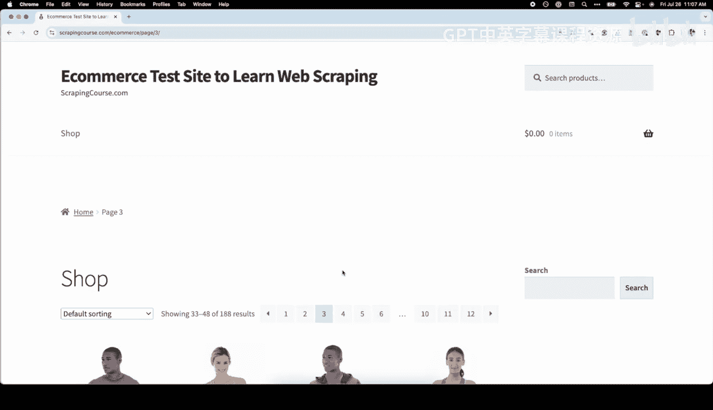
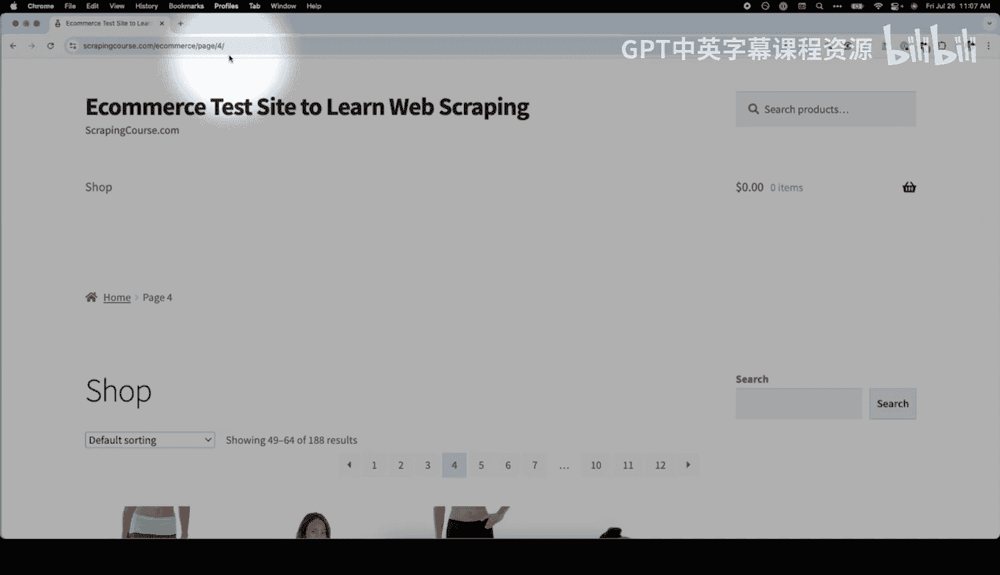
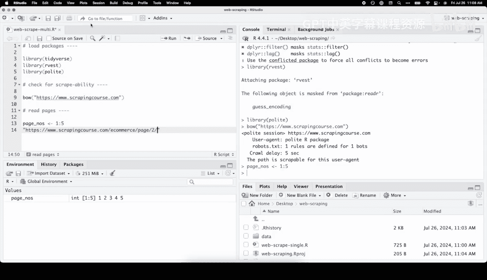
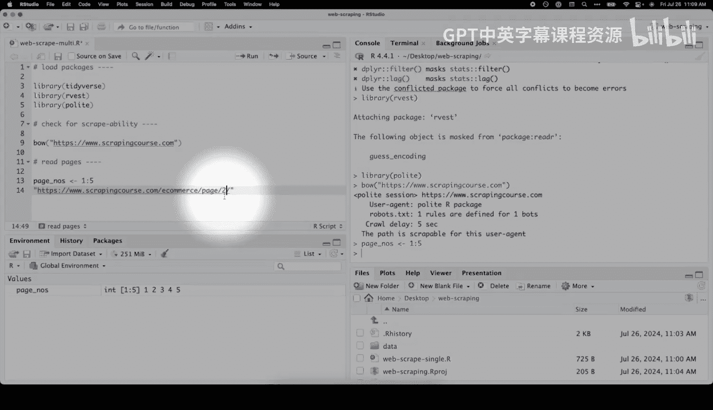
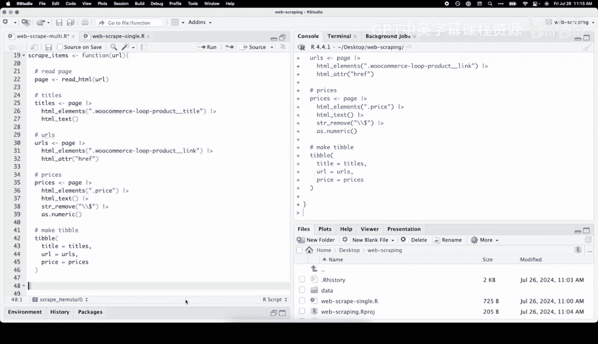
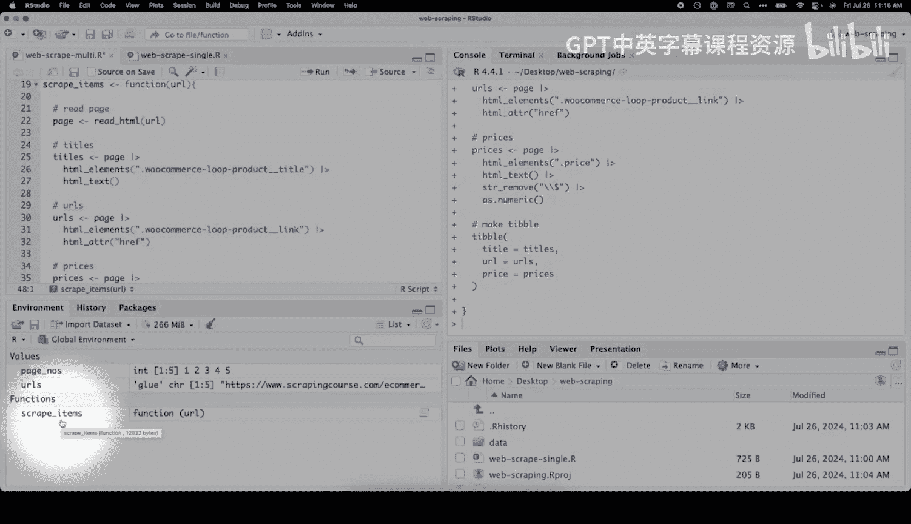
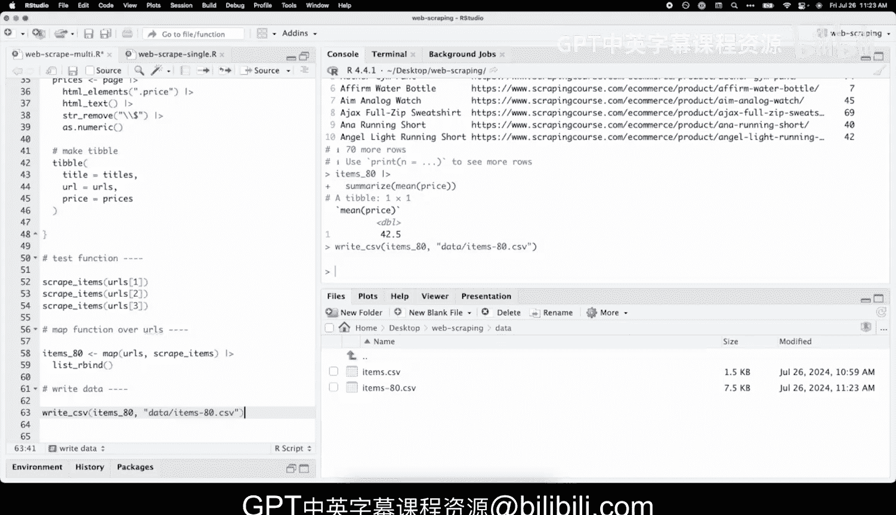

# R语言数据科学：16_03_03：代码演练：爬取多个电商页面


在本节课中，我们将学习如何从多个网页中爬取数据。我们将基于之前从单个页面爬取数据的知识，扩展到从一个电商网站的多页产品列表中提取信息。通过本教程，你将学会如何构建URL列表、编写可复用的爬取函数，并使用迭代方法高效地收集数据。

---


## 加载必要的R包

首先，我们需要加载完成此任务所需的R包。我们将使用 `tidyverse` 进行数据处理，`rvest` 进行网页抓取，以及 `polite` 包来礼貌地检查网站的可爬取性。在编写代码的过程中，我们意识到还需要 `glue` 包来帮助构建动态URL，因此也将其加入。

```r
# 加载所需包
library(tidyverse)
library(rvest)
library(polite)
library(glue)
```

---



## 构建多页URL列表

上一节我们介绍了如何从单个页面爬取数据。本节中，我们来看看如何系统地访问多个页面。观察目标网站可以发现，不同页面的URL遵循一个简单的模式：基础URL后附加 `/page/{页码}`。



例如：
- 第2页: `https://example.com/page/2`
- 第3页: `https://example.com/page/3`



我们的目标是爬取前5页的数据。以下是构建这5个URL列表的方法：

```r
# 定义要爬取的页码
page_nos <- 1:5



# 使用glue包动态生成完整的URL列表
base_url <- "https://example.com/page/"
urls <- glue("{base_url}{page_nos}")
```

运行上述代码后，`urls` 变量将包含5个完整的URL，分别对应第1到第5页。

---

## 编写可复用的爬取函数

为了对每个URL执行相同的爬取操作，避免代码重复，最佳实践是编写一个函数。这个函数将接收一个URL作为输入，执行爬取操作，并返回一个包含该页面产品信息的数据框。

我们将这个函数命名为 `scrape_items`。其内部逻辑与我们之前编写的单页爬取代码类似，但被封装成了一个独立的单元。

```r
# 定义爬取单个页面的函数
scrape_items <- function(url) {
  # 1. 读取网页内容
  page <- read_html(url)
  
  # 2. 提取产品标题
  titles <- page %>%
    html_elements(".product-title-class") %>% # 请替换为实际CSS选择器
    html_text2()
  
  # 3. 提取产品链接
  links <- page %>%
    html_elements(".product-link-class a") %>% # 请替换为实际CSS选择器
    html_attr("href")
  
  # 4. 提取产品价格
  prices <- page %>%
    html_elements(".price-class") %>% # 请替换为实际CSS选择器
    html_text2() %>%
    parse_number() # 将文本价格转换为数字
  
  # 5. 将提取的信息组合成一个数据框（tibble）并返回
  tibble(
    title = titles,
    link = links,
    price = prices
  )
}
```

**代码解释**:
- `function(url)`: 这定义了一个名为 `scrape_items` 的函数，它接受一个参数 `url`。
- 函数体内的步骤与单页爬取完全一致：读取HTML、提取元素、清理数据、组合成表。
- 函数最后返回一个 `tibble`，无需在函数内部将其赋值给一个变量。

定义函数后，我们可以对其进行测试，确保它在单个URL上工作正常。

```r
# 测试函数：爬取第一页
test_page1 <- scrape_items(urls[1])
print(test_page1)
```

---

## 将函数映射到所有URL

手动对每个URL调用函数是低效的。我们需要一种方法，能自动将 `scrape_items` 函数应用到 `urls` 列表中的每一个元素上。在R中，我们可以使用 `purrr` 包中的 `map` 函数来实现这种迭代操作。





`map` 函数的基本思想是：对列表中的每个元素应用指定的函数。

```r
# 使用map函数迭代爬取所有页面
all_items_list <- map(urls, scrape_items)

# 将列表中的多个数据框合并成一个大的数据框
all_items <- list_rbind(all_items_list)
```

**代码解释**:
- `map(urls, scrape_items)`: 这行代码对 `urls` 向量中的每个URL执行 `scrape_items` 函数，结果是一个列表，其中每个元素都是一个包含单页数据的数据框。
- `list_rbind()`: 这个函数将这个列表中的所有数据框按行（row-wise）合并，生成一个最终的统一数据框 `all_items`。

现在，`all_items` 数据框包含了从前5个页面爬取的所有产品信息（约80件商品）。

---

## 保存与分析爬取的数据

数据爬取完成后，我们应该将其保存到本地文件，以便后续分析，并避免因重复爬取而给网站服务器带来不必要的负担。

```r
# 将数据保存为CSV文件
write_csv(all_items, "data/items_multipage.csv")
```

保存数据后，我们就可以像处理任何其他数据集一样对其进行分析。例如，计算所有产品的平均价格：

```r
# 计算平均价格
mean_price <- all_items %>%
  summarise(avg_price = mean(price, na.rm = TRUE))
print(mean_price)
```

---

## 总结



本节课中我们一起学习了如何从多个网页爬取数据。我们首先通过观察URL规律构建了目标页面列表，然后编写了一个可复用的函数来封装单页爬取逻辑，最后使用 `map` 函数将这个过程自动化地应用到所有页面上，并将结果合并保存。这种方法不仅高效，而且代码结构清晰，易于维护和扩展。掌握这些技能后，你将能够应对更复杂、规模更大的网络数据抓取任务。