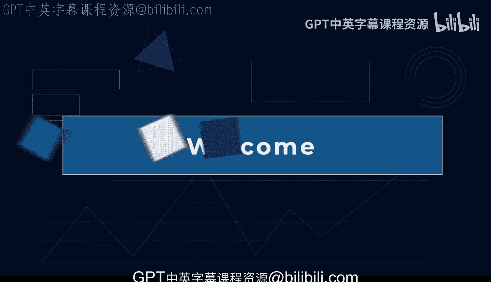
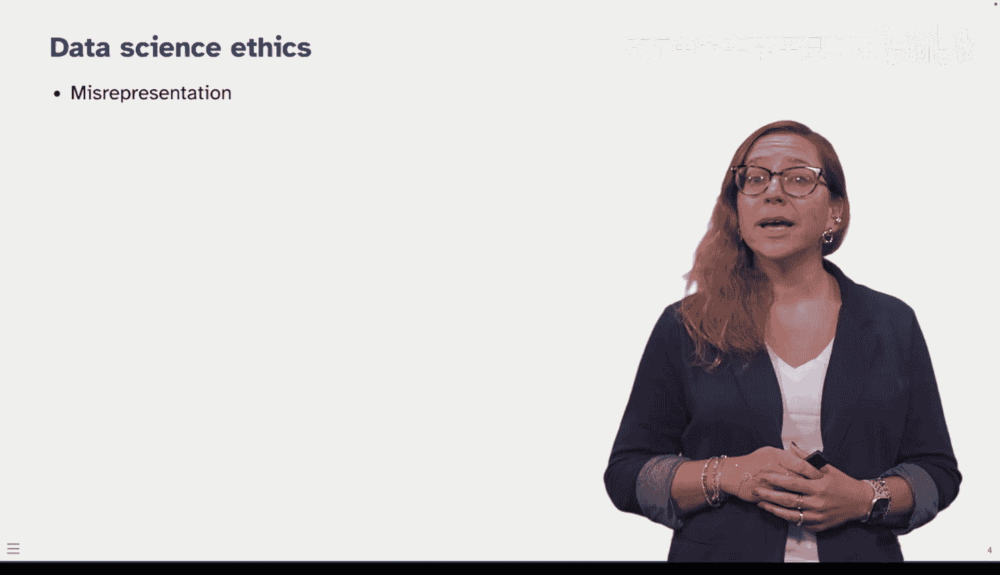
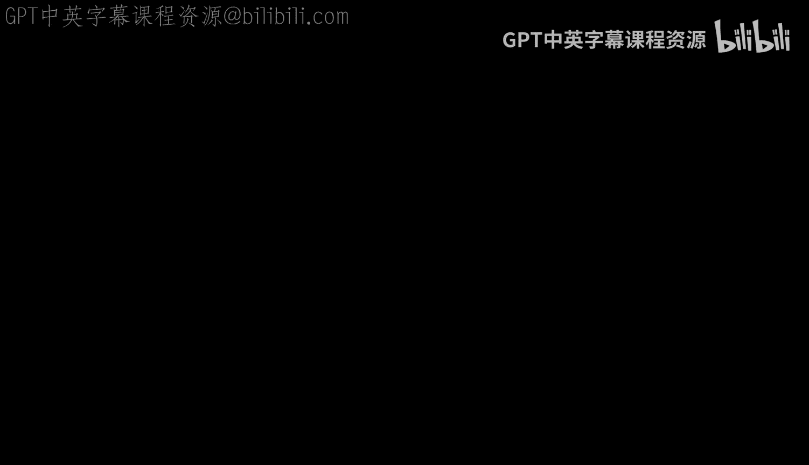

# 杜克大学《R语言数据科学｜Data Science with R》中英字幕 p33 1_01_03_欢迎3.zh_en -BV1Zpv6BaEkB_p33-

🎼。

Hello and welcome。 My name is Minet Tiincaranddell。

 and I will be your instructor for this specialization titled Data science with R。

 This is the third course in the series。 Data science Ethics In the first course。

 we introduce the data science cycle with this figure from the book R for data science。

 In the second course， we dove deeper into data transformation。

 formally introduce data tiddying via reshaping and joining data and then took one more step back and learn to import data sets from Cv files and Excel spreadsheets。

 as well as scraping unstructured data off the Web。 and reorganizing them into data frames in R。

 In this course， we'll take a bit of a break from how to do this task in R and ask。

 should we do this task， specifically， we'll discuss topics in data science ethics such as misrepresentation of data science results。

 data privacy and algorithmic bias。 Let's get started。😊。

