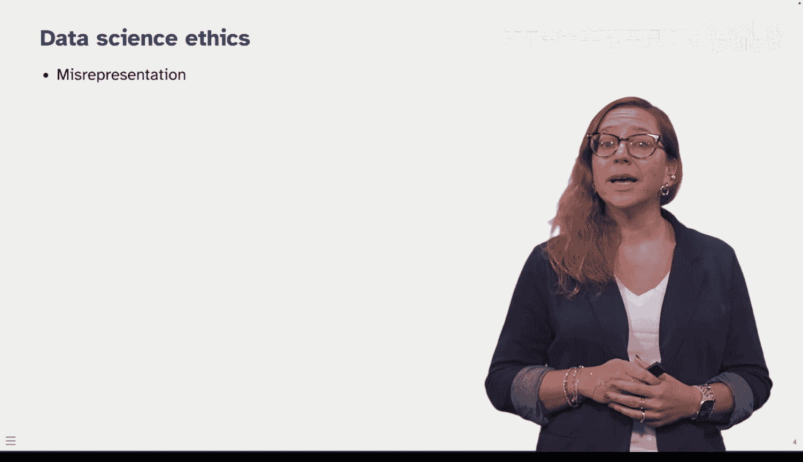
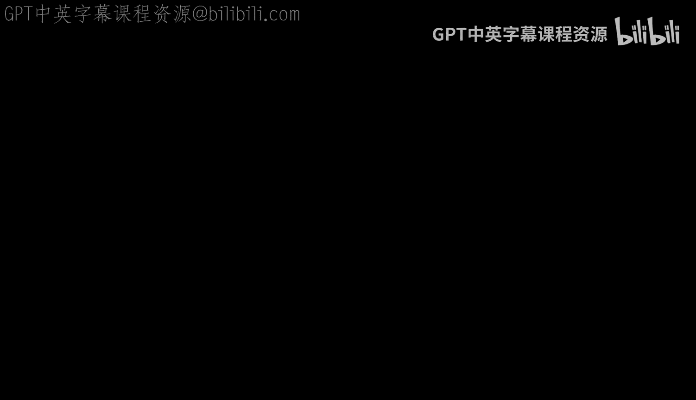

# R语言数据科学：3：欢迎与课程概述

在本课程中，我们将学习数据科学伦理，探讨在应用R语言进行数据分析时，我们“是否应该”执行某些任务，而不仅仅是“如何”执行。

## 课程回顾与引入

上一节我们回顾了前两门课程的内容。本节中，我们将正式开启本课程的学习。

大家好，欢迎来到本课程。我是Minet Tiincaranddell，我将担任这门名为“Data Science with R”专项课程的讲师。

这是系列课程中的第三门课，主题是“数据科学伦理”。

在第一门课程中，我们通过《R for Data Science》一书中的图表，介绍了数据科学周期。

在第二门课程中，我们更深入地探讨了数据转换，正式介绍了通过重塑和连接数据来进行数据整理。然后，我们退后一步，学习了如何从CSV文件和Excel电子表格导入数据集，以及如何从网络上抓取非结构化数据，并在R中将其重组为数据框。

在本课程中，我们将暂时搁置“如何在R中执行任务”的问题，转而探讨“我们是否应该执行这项任务”。具体来说，我们将讨论数据科学伦理中的主题，例如数据科学结果的误传、数据隐私和算法偏见。

让我们开始吧。