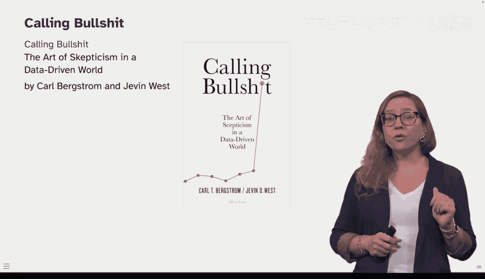

# 杜克大学《R语言数据科学｜Data Science with R》中英字幕 p34 2_01_01_虚假陈述.zh_en -BV1Zpv6BaEkB_p34-

🎼。

In this video， we're going to talk about misrepresentation of data and data science findings。

 Sometimes this is unintentional， and sometimes it might be intentional Throughout the examples we'll introduce in this video。

 I encourage you to think about whether the folks who created the misrepresentations may have done so intentionally or unintentionally。

Missrepresentation can happen in a variety of ways。

 Let's overview the few we'll discuss in this video。

 So how might one misrepresent data science results。 First。

 one might be misrepresenting their findings when they are claiming causality where it's not in the scope of inference of the underlying study。

 Like when they really should be only talking about a correlation。Next。

 distorting axes and scales can be a way to make the data tell a different story。

 This can happen from oversight or from intentional manipulation。

Visualizing spatial areas instead of human density for issues that depend on and affect humans is another way we can create visualizations in these case maps that invoke a much different finding than the data support。

Finally， omitting uncertainty in reporting a mistake many who don't have proper background or consideration for statistics make can lead to misleading conclusions。

Let's start with causality。Take a look at this coverage of a study on exercise and cancer risk in Time magazine。

How plausible is the statement in the title of this article。

 Exerse can lower risk of some cancers by 20 per cent。 At a first glance。

 this might seem plausible exerciseerse good Can bad。

 We often hear of exercise being associated with good health outcomes。

 and it's hard for us to judge how plausible that 20 per cent estimate is。

 but that's a pretty big effect。Let's take a look at the coverage of the same article on the Los Angeles Times。

Exercising drives down risk for 13 cancers。 Research shows。

 What does research shows mean in this context， It's a catch all phrase to use all too commonly in coverage of research findings。

 but doesn' it mean research suggests research proves it's unclear it does give legitimacy to the preceding statement。

 though。Now， finally， let's look at the original study that's covered in these two popular media pieces。

 This study is titled Association of Leisure Time Physical Activity with Ri of 26 types of cancer in 1。

44 million adults。 First， huge sample size。 but remember， huge sample size doesn't imply causation。

 If we want to infer causation like exercise lowers risk of cancer。

 We need a randomized control study， not an observational one。😊，In this study。

 volunteers were asked about their physical activity level over the preceding year。

 It was found or observed that half exercise less than about hundred and 50 minutes per week。

 half exercise more。😊，Compared to the bottom 10% of exercises。

 the top 10% had lower rates of a variety of cancers。

And researchers found no association between exercising and 13 other cancers。 For example。

 pancreatic， ovarian and brain cancer。Compare the titles of the news pieces。

Exercising drives down risk for 13 cancers， or exercise can lower risk of some cancers by 20%。

Those sound a lot more definitive and causal than what this study states。

 Simplification of research findings can be good and necessary for popular media coverage。

 But examples like these where simplification， either accidentally or intentionally。

 resulting in causal language being inserted， were not supporting by the underlying study are。

 unfortunately all too common。Next， let's talk about misleading visualizations。

 particularly with reference to axes and scales。Take a look at these two figures。 It's from 2019。

 but the point still stands。 Both show what would happen now or back in 2019 if Bush tax cuts expire。

 The difference between these two pictures is that in one， the y axis starts at 0。

 While in the other， the y axis starts right below what would happen at that time point。

 The change in tax cuts seem a lot more extreme in the plot where the y axis doesn't start at 0。

 compared to the other one。 you'll find some data visualization pure So say every single axis must start at 0。

 I'm not one of them。 But I do agree that if the axis is not going to start at 0。

 there should be a very good reason and an acknowledgment of that should be in the plot。

Here's another one。 I'll give you a moment to look at the plot carefully。

 What's wrong with this picture， And how would you correct it。

If you said the X axis looks out of whack， you're right。 the differences between last year。

 last week and current should not be equal。Here is what the same data look like on an axis with the correct scale。

 a much different story。And here's another one。 Once again。

 I'll give you a moment to look at the plot carefully。

 What's wrong with this picture and how would you correct it。And once again。

 if you said the X axis looks out of whack， you're right。 The dates are not in order。

 And it's so easy to miss if you're not looking carefully。

 These are Covid counts from 2020 at the height of Covid concerns。

 So decreasing bars look good until you realize they're not telling the story over time。😊。

Here are the same counts this time in chronological order， a much different story again。And one more。

 looking at services provided by Planned Parenthood。

 showing an increase in abortions provided and decrease in cancer screening and prevention services。

 Once again， I'll give you a moment to look at the plot carefully。 What is wrong with this picture。

 And how would you correct it。😊，Look at the same numbers on the correct scale。 Yes。

 there's a decrease in cancer screening and perversion services。

 but this decrease is not overtaken by the number of abortions。

Each of these were examples of misrepresenting results and visualizations。

 Our goal in this video is not to judge whether these are intentional or into unintentional misrepresentations。

 but I hope we can all agree that it's possible and all too easy to tell a misleading story。

 even with the correct numbers， if axes and scales are chosen and appropriately。Next。

 let's talk about how results can be misleading in maps， particularly maps that show areas。

Do you recognize this map， What does it show， I'll give you a moment to think about it。

It's a map of the United States， and the areas outlined our counties。

 there are about 3000 counties in the US。 The colors indicate whether the majority vote in the county was expected to go to the Republican presidential candidate in red or Democratic presidential candidate in blue in the 2016 election。

And here's a book cover from those days titled Citizens for Trump showing the same map。

 It says citizensize for Trump。 But the colors really do indicate the county level vote。 In fact。

 if we were to look at the share of popular vote， the election results would look a lot different。

 as shown in the bar charts here。We can think of other adjustments to the visualization as well。

 We could color based on states or even better， maybe based on state size adjusted by electoral votes that contributes to the election。

 If you' are not familiar with the US presidential elections， this metric might make no sense。

 And even if you are， it's not an easy one to digest， even though it is a better representation。

So that's another line we need to walk when considering how to visualize data and make sure we're not misrepresenting the results。

 We want simplicity， but we don't want our visualizations to be misleading。And finally。

 let's touch on uncertainty。Here's a summary from a survey finding from Al Pais。

 a Spanish national newspaper， and it shows responses to a question that asks participants whether they want Catalonia to become an independent state。

 The yeses and nos are pretty close。 and the newspaper headline read Catalan public opinion swings toward no for independence says survey。

 But note， the margin of error at the bottom of the plot，2。95 per cent。

 What does that mean If we take that into consideration and mark the estimated proportions from the survey with the margin of error bounds around it。

 The picture is a lot different。 There's a huge amount of overlap。 And it it's definitely not one。

 we would summarize as a swing from one response to another。😊。

You've seen a few examples that will hopefully help you be critical of data science results you encounter in the wild and also help you make the right decisions when making your own visualizations and summaries。

 If you're interested in seeing more examples。 I highly recommend two books。

 How charts lie by Alberta Cairo， where some of the examples I gave in this video come from and calling bullshit by Carl Bergstrom and Jan West。

 They're both pretty informative and interesting reads。

 I hope you can find the time to dive into them。😊。

