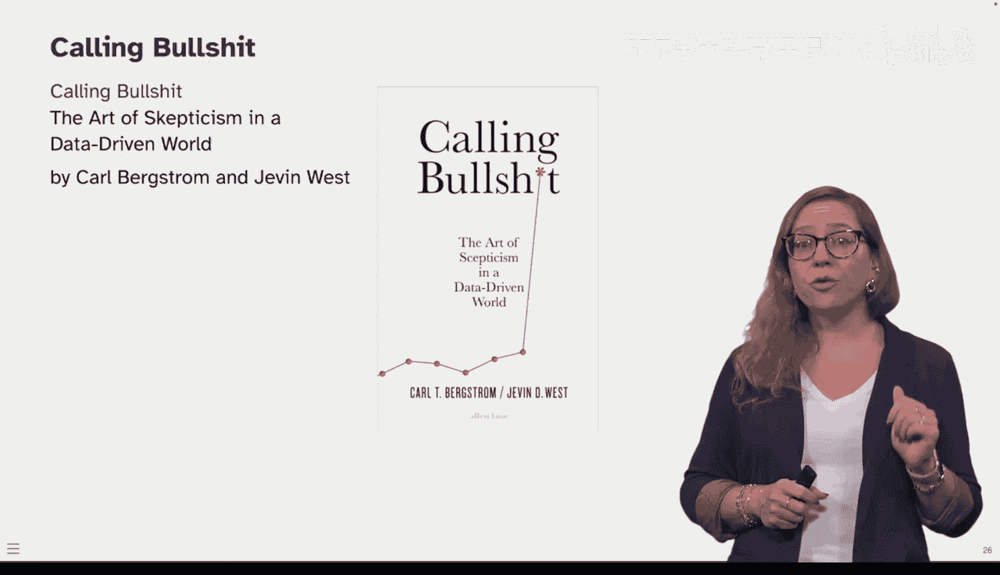

# R语言数据科学：2.01：虚假陈述

在本节课中，我们将探讨数据科学中常见的虚假陈述问题。虚假陈述可能是有意或无意的，它会导致对数据结果的误解。我们将通过具体实例，分析几种主要的虚假陈述方式，并学习如何识别和避免它们。

## 虚假陈述的几种方式

虚假陈述可以通过多种方式发生。以下是本视频将讨论的几种主要方式。

*   **因果关系的误述**：当研究本身只能证明相关性时，却声称发现了因果关系。
*   **坐标轴与尺度的扭曲**：通过调整图表坐标轴的起点或刻度，使数据呈现不同的故事。
*   **空间地图的误导**：在涉及人口的问题上，使用地理面积而非人口密度来绘制地图，从而产生误导性结论。
*   **不确定性的忽略**：在报告结果时忽略误差范围或不确定性，导致结论过于绝对。

## 因果关系的误述

上一节我们概述了虚假陈述的几种方式，本节中我们来看看第一种：因果关系的误述。

请看《时代》杂志对一项关于运动与癌症风险研究的报道。文章标题称“运动可将某些癌症风险降低20%”。这个说法乍一看似乎合理，因为我们常听说运动与健康益处相关。然而，20%是一个相当大的效应量，我们需要谨慎判断。

接下来，我们看看《洛杉矶时报》对同一研究的报道，标题是“研究表明，运动可降低13种癌症的风险”。这里的“研究表明”是一个在科研报道中常用的笼统短语，它可能意味着“研究提示”或“研究证明”，但具体含义并不明确，却为前面的陈述增添了权威性。

最后，让我们审视这项研究本身。原始研究的标题是“休闲时间体力活动与144万成年人中26种癌症风险的相关性”。首先，样本量很大，但请记住，大样本量并不意味着因果关系。如果我们想推断“运动降低癌症风险”这样的因果关系，需要进行随机对照试验，而非观察性研究。

在这项研究中，志愿者被问及过去一年的体力活动水平。研究发现，与运动量最低的10%人群相比，运动量最高的10%人群多种癌症的发病率较低。同时，研究也发现运动与其他13种癌症（如胰腺癌、卵巢癌、脑癌）没有关联。

对比新闻标题“运动可降低13种癌症的风险”或“运动可将某些癌症风险降低20%”，这些说法听起来比研究本身所陈述的（相关性）要确定和因果得多。简化研究发现对于大众媒体报道是必要且有益的，但像这样在简化过程中（无论有意或无意）插入因果性语言，而底层研究并不支持的情况，实在过于常见。

## 具有误导性的可视化

在讨论了因果误述之后，我们接下来看看另一种常见的虚假陈述方式：具有误导性的数据可视化，特别是与坐标轴和尺度相关的扭曲。

以下是两个图表，它们展示了如果布什减税政策在2019年到期会发生什么。这两个图表的区别在于，其中一个的Y轴从0开始，而另一个的Y轴起始值紧贴当时的数据点。在Y轴不从0开始的图表中，减税政策的变化看起来要极端得多。有些数据可视化纯粹主义者坚持每个坐标轴都必须从0开始。我并非其中之一，但我同意，如果坐标轴不从0开始，必须有充分的理由，并且应在图中予以说明。

再看另一个例子。请仔细观察这个图表，它有什么问题？你会如何修正？

如果你说X轴看起来不对劲，那就对了。“去年”、“上周”和“当前”之间的间隔不应该是相等的。下图展示了相同数据在正确尺度坐标轴上的样子，讲述了一个截然不同的故事。

还有一个例子。再次请你仔细观察，这个图表有什么问题？你会如何修正？

同样，如果你说X轴看起来不对劲，那就对了。日期没有按顺序排列。如果不仔细看，很容易忽略这一点。这些是2020年新冠疫情高峰期的病例数，递减的柱状图看起来是好事，直到你意识到它们并没有按时间顺序讲述故事。下图是按时间顺序排列的相同数据，再次呈现了完全不同的情况。

再看一个关于计划生育服务提供的图表，它显示提供的堕胎服务增加，而癌症筛查和预防服务减少。请再次仔细观察，这个图表有什么问题？你会如何修正？

下图展示了相同数字在正确尺度上的样子。是的，癌症筛查和预防服务有所减少，但这种减少并没有被堕胎数量的增加所超越。

以上每个例子都是结果和可视化的虚假陈述。本视频的目的不是判断这些是有意还是无意的误述，但我们都可以同意，即使数据正确，如果坐标轴和尺度选择不当，也很容易讲述一个误导性的故事。

## 地图中的误导

在探讨了坐标轴扭曲的问题后，本节我们来看看结果如何在地图中产生误导，特别是那些展示地理区域的地图。

你认识这张地图吗？它展示了什么？给你一点时间思考。

这是一张美国地图，轮廓线表示县，美国大约有3000个县。颜色表示在2016年大选中，该县多数选票预计会投给共和党总统候选人（红色）还是民主党总统候选人（蓝色）。

当时有一本书的封面名为《公民支持特朗普》，展示了同样的地图。它写着“公民支持特朗普”，但颜色实际上表示的是县级投票结果。事实上，如果我们看普选票的份额，选举结果会看起来非常不同，如下方的条形图所示。

我们也可以考虑对可视化进行其他调整。我们可以按州着色，或者更好的是，根据各州选举人票数（影响选举结果）调整州的大小来着色。如果你不熟悉美国总统选举，这个指标可能没有意义。即使你熟悉，它也不容易理解，尽管它是更好的表示方式。

因此，在考虑如何可视化数据并确保我们没有虚假陈述结果时，我们需要走另一条路线。我们追求简洁，但又不希望我们的可视化产生误导。

## 忽略不确定性

最后，让我们谈谈忽略不确定性的问题。这是西班牙国家报纸《国家报》的一项调查结果摘要，显示了参与者对“是否希望加泰罗尼亚成为独立国家”这一问题的回答。“是”和“否”的比例非常接近。报纸的头条写道“调查显示，加泰罗尼亚公众舆论转向反对独立”。但请注意图表底部的误差范围：2.95%。这意味着什么？

如果我们考虑这一点，并在调查估计的比例周围标出误差范围边界，情况就大不相同了。两者存在巨大的重叠。这绝对不是一个我们可以总结为从一种回答“转向”另一种回答的情况。

## 总结与推荐

本节课中，我们一起学习了几种数据科学中常见的虚假陈述方式，包括因果关系的误述、坐标轴与尺度的扭曲、空间地图的误导以及不确定性的忽略。希望这些例子能帮助你在遇到数据科学结果时保持批判性思维，并在制作自己的可视化和摘要时做出正确的决策。

如果你有兴趣查看更多例子，我强烈推荐两本书：阿尔贝托·开罗的《How Charts Lie》（本视频中的一些例子来源于此），以及卡尔·伯格斯特龙和杰文·韦斯特的《Calling Bullshit》。这两本书都信息丰富且有趣，希望你能找时间深入阅读。