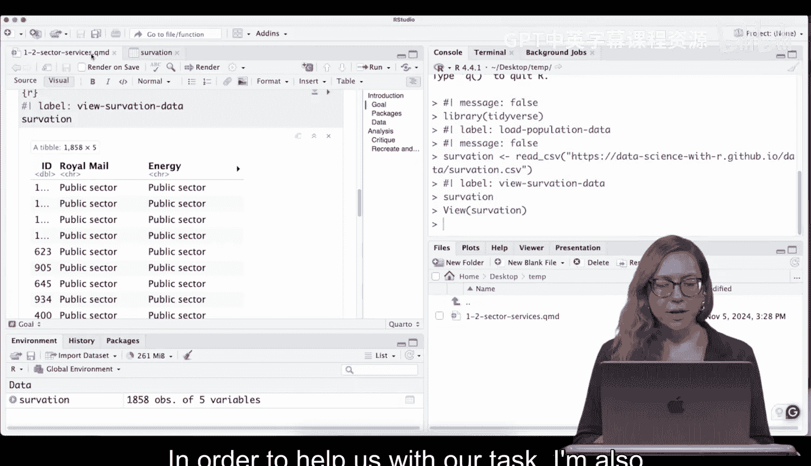
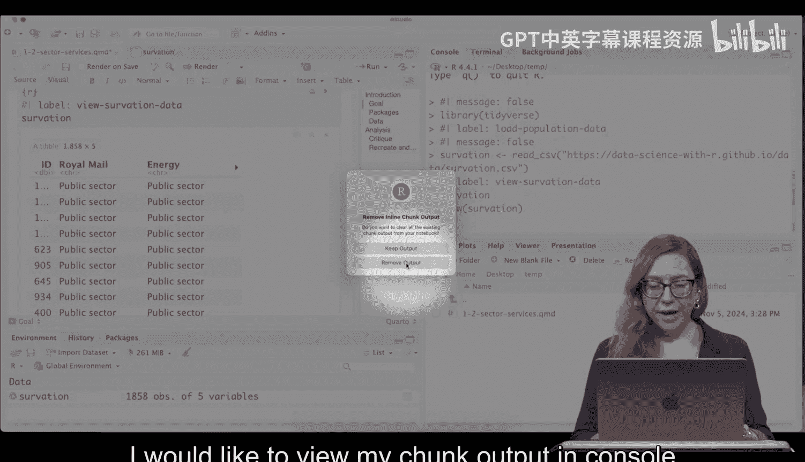
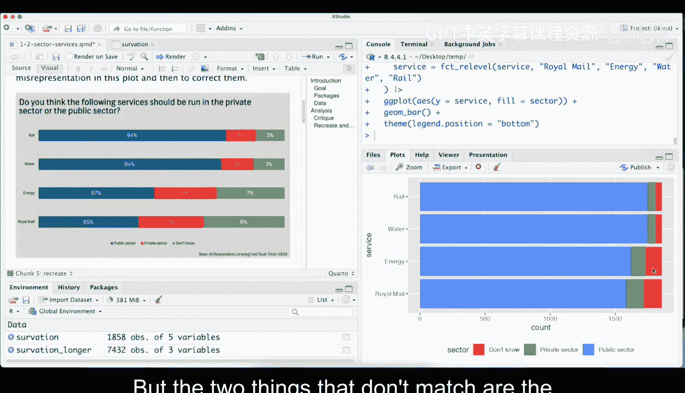
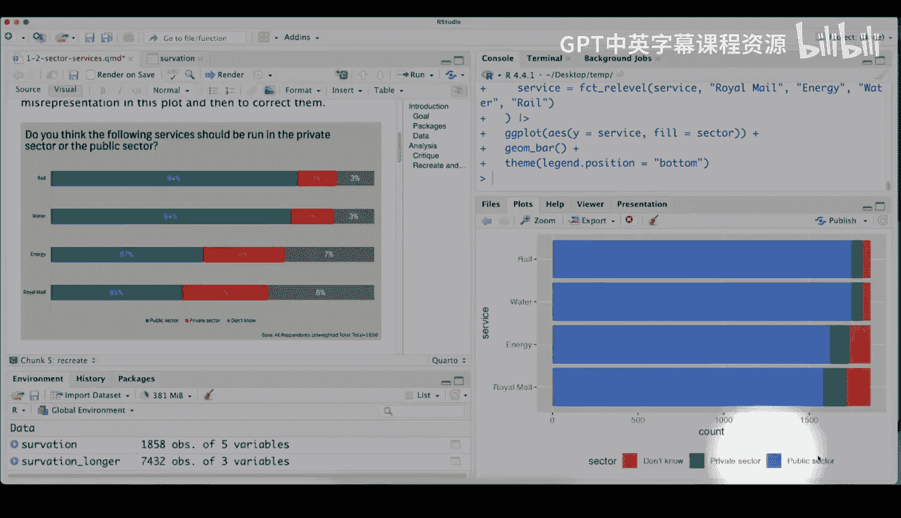
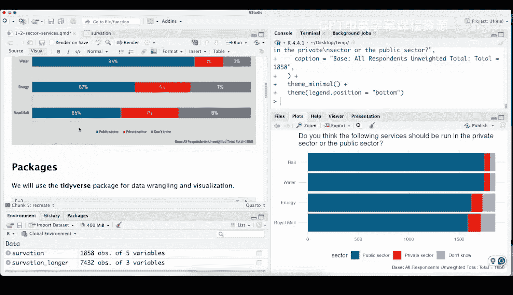
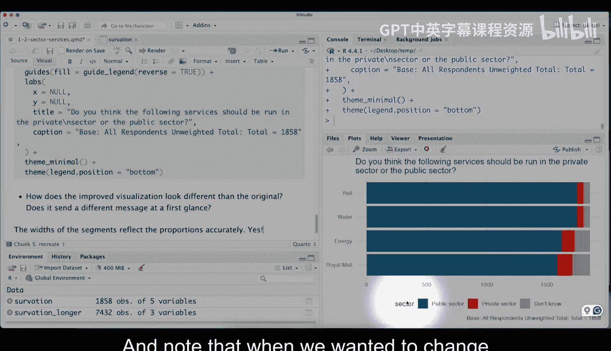
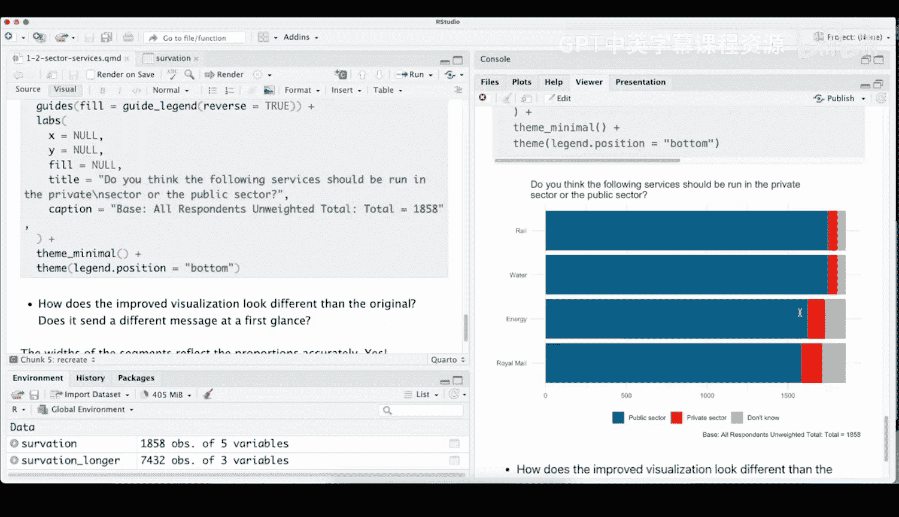

# 杜克大学《R语言数据科学｜Data Science with R》中英字幕 p35 3_01_03_代码实践-行业与服务.zh_en -BV1Zpv6BaEkB_p35-

Hello， in this code along video， we're going to take a look at a graph that was shared on social media。

 but that was also published based on some survey results ran in the UK where the respondents were asked whether they think some services should be run in the private sector or the public sector。

 This graph was shared by graph crimes on X or Twitter。

 and they tend to share lots of interesting plots like this where things went haywire， Again。

 sometimes intentionally， sometimes unintentionally。 In this case。

 the respondents of the survey were asked for services like rail， water， energy and Royal mail。😊。

Whether they should be run in the private or public sector or they didn't know。

 And the blue indicates public sector。 red indicates private sector and the gray indicates don't know。

 Now， the percentages shown in the graph are accurate。 These are the real data。 However。

 when we take a look at this graph we start seeing some things not going so well。 Now。

 before we go into the critique， let's go ahead and get the data。

 So our ultimate goal is to identify aspects of misrepresentation and then try to address them。

 But in order to be able to do that。 we're going to turn back to some of our handy tools like the tidyverse package for data wrangling and visualization。

 So I'm just running that code here。 And also the data set as well。

 I've provided the data set to you as a Cv file。 So let's take a look at what it looks like here。

 We can see that we have Id numbers for each of the respondents。 And then we have a bunch of columns。

 I'm actually going to go ahead。To my environment and open this up in the data viewer so that we can see all of the columns in one place。

One for Royal mail， one for energy， one for water， one for rail。

 and each row indicates a respondent and we have their responses in terms of which sector or whether they don't know for each of these services。

In order to help us with our task， I'm also going to click on this gear icon to say that I would like to view my chunk output in console。

And remove any of the output from my quato document just so next time I run anything。

 things print out in the console。

So let's go back to this graph， though。 What is misleading about it。

 Take a look at these percentages on the top row with rail。

 we have 94 per cent of public sector votes，3 per cent of private sector and 3 per cent of don't know。

Now， in the next for water， those percentages are exactly the same。

 but we're already seeing something not going so well here， the blue is even smaller。

And when we go down to the next one to energy， the drop from public sector to the drop in public sector answers is only from 94 to 87。

 But at this point， almost 50% of this bar is not blue。 So that is either private or don't know。

 These percentages are definitely not represented accurately in these segments。

 So there is a scaling issue here。 So I would characterize this as saying that the。

Scaes of the percentages。Don't match up。With。The segments。And the bar plot。And ultimately。

 what we're seeing here， if we don't pay attention to the percentages is that。

It looks like the public is quite happy with these services not being in the public sector。 In fact。

 in some cases， it looks like a good number of the public is O with the private sector as well。

 But when you look at the actual numbers， that's not the story that they tell。😊。

So how can we recreate and improve this。 First， let's confirm that the data match the percentages from the visualization。

 That is， we want to calculate the percentages of public sector。

 private sector and don't know for each of these services。

 The problem is that currently our data is in a wider format。

 where each of these columns are basically where each of these sectors are represented at columns。

 And if we actually have sector as one variable。 and the response of the individual as another variable。

 we would have a much easier time calculating these。 Thankly。

 we know how to go from wider data to a longer data set。

 So we're going to start with the survey data， which is a data set that we brought in。

 And then we're going to pivot it longer。😊，So we know how to go from wider data to a longer data set。

 The first thing we need to indicate is which columns we want to pivot。

 If we take a look at our dataset， we can see that we want to pivot everything other than that I column。

 and we can indicate it with an exclamation point to say not I D。

And then we take a look at the names of these columns， so the words Royal Ma， energy。

 water and Ra each of the services and say names too。

 so these names will go to a new column called service。And the values。

That is everything that's in the data set。Is going to go to a new column called sector。

If I go ahead and run this， I can see that I end up with a much longer data set。

 so now each row indicates not just I responded to the survey。

 but also their combination of answers for each of the services。

And let's go ahead and save this resulting data set asserv longer。

So that we can use it in our next analysis。 Next， what we want to do is find the percentages of each of the sector answers within each of the services。

 So I want to look to see。For each of the services。

 how many answers were given for each of the sectors。

I can do that by starting with my survey longer data set and then saying that I want to count。

Each service and within each service， each sector answer。

So that tells me that for the Energy service， 130 people said I don't know。

 112 people said private sector and 16，16 people said public sector。

What we not now need to do is define each of these percentages。 So in other words。

 what does  hundred and30 make out of all of the answers for energy or what does 56 make out of all of the answers for rail。

 so on and so forth。 And since I'm saying that I want to find these percentages within each of the services。

 I need to group these data。By service。So if I just run this， I get the same results。

 but I can see that I now have this grouping attribute。

 and then I can add a new column and adding a new column will require a mutate。

Where let's say we can call this a P for proportion， for example。

 and let's find the value in the n column。 So that's something like  hundred and 30 divided by sum of Ns。

 And remember， since we have grouped by service， the sum of n is not going to be all of the Ns。

 but just the ends for that group。So that gives me 7% for don't know for energy。

3% for don't know for rail， so on and so forth。 Those seem to match the numbers we've seen before。

 Now， these are proportions， not percentages。 So if we actually want to find the percentages。

Maybe I can call that percentage in that case， I can say。

I could say something like we are going to then multiply these by 100， for example。

 Or if I want to find the proportions。Let's get rid of that。

And maybe let's make sure just so we can match the plot， really。

 that we get rid of some of the decimal points we're not going to use。

 So I might want to round this answer。To the second decimal point。Oops， let's try this again。

 I'm missing Er Close's parentheesis。So now I have 7，6 and 87% for energy。

 let's go back to our original visualization for energy  87， 6 and 7。

 so we can see that these numbers actually match for rail， we have 94，3 and  three。

 so on and so forth。Well， what do we do next from here。

 we're actually going to go ahead and create an improved version of this visualization Now that we know we have the right data set。

 we can go ahead and create the visualization。 It says that this improved version should also be a segmented bar chart。

 should have the same legend location should have the same title and caption。

 It does not need to have a bolded title or a gray background。

 And it does not need to show the percentages in the segments。

 So that will make our lives a little bit easier。All right。

 so the first thing we're going to do is let's start with that Ser longer data set。And。

Let's go ahead and make a G G plot of that。 where on the y axis。 So for my aesthetic mappings。

 on the y axis， I want to have the。Service variable。

And I want to fill things in with the sector variable。And let's make a bar plot out of this。

This is already looking a lot like my plot and not looking anything like my plot at all。

 I do have a segmented bar plot。And importantly， you can see how much bigger those segments are for the public sector。

 which is something we had identified as an issue with the original plot。

 But let's go ahead and see how we can make it look a lot more like our original plot。

 One of the ways the plot that I have is different from the original plot is that the services are not in the right order here。

 So I want Royal mail， energy， water and rail in that order。

I have a categorical variable on my y axis。And I want to change the order of its levels。

I can go ahead and before I make my plot， say I'm going to modify this data frame。With a mutate。

 and I am going to overwrite my service variable。Releveing that factor。

And the order I want these things in is。Royal mail note that I'm using the same capitalization scheme as the words appear in the data。

 they really need to match。Oh no。 yes， Royal mail。 the next thing we wanted。

 let's go back to our plot， energy， water and rail。Energy。Water。And。Rail。

Let's go ahead and do this again。 So now our Y axis matches。

Another thing that we saw was that the legend was at the bottom of our plot。

 so let's go ahead and move it to the bottom。So that's a theme element and I'm going to move the legend position to the bottom of my plot。

And what we're seeing is that the order in the bars。 so within the bars。

 the segments actually do match what we have in our original visualization as well。

 it's public first， then it's private， and then it's the don't know。

 but the two things that don't match are the colors。

 and then also the order in which these appear on our legend。

So。Let's start with the colors because we have some hints about that。

 We're given some hints about what each of these colors are。

 although we're going to find out what the colors that are other than the gray actually correspond to。

 So if I want to change the colors， that is a fill aesthetic。

 So I'm going to manually change the fill scale。And in order to do this。

 let's say the values that I want are。The ones that were given to me here。

And let's see if these match。 Oh， and thankfully， our studio tells us which one is which And what we might want to do here is to actually use a named vector。

 so we can say that。😊，Don't know is going to be gray。And the red was。Private sector。And the blue was。

Public sector。And let's make sure that we add another plus sign here so that we can see the entire plot together。

 So that's looking a lot more like our original plot as well。

And what we're going to need to do next is to swap the order in the legend。Now。

 this is important because earlier when I said we want to change the order of the levels。

 we actually touched the data frame itself and used a mutate to change the level order in the factor variable。

 but we can see that the order is correct in our plot。

 So I think we are actually our variable might be using the right order in terms of how the plot is being made。

 but our legend is not behaving as we would want it to。

 so that something we need to address at the legend level as opposed to at the data set level。

And we can do that in the guides layer。I want to change the fill guide。

 So Digi Pla2 calls legendds guides， and it's the fill legend that I'm changing and we'll say guide legend and we'll say that we want to reverse。

The various sectors here。 So now what we can see is we are getting a lot closer to our original plot。

 We may want to change a few other things。 First of all， we had a title for our plot。

 We did not have X and Y axes and we did not have these counts either。 So let's go ahead and。

Try to adjust those as well。 So in terms of the labels， I don't want anything on my X axis。Actually。

 that should not be a character string， Just a null。 I don't want anything on my Y axis。

And I want a title。And I want a caption， as well。Let's go ahead and see what our title was。

 Do you think the following services should be run in the private sector or the public sector。

And our caption。sad。Base， all respondents unweighted total。1858。All right。

The cap the title is running off and so we can add a line break here。

 maybe right after the word private， and we can do that with a back slash and an n。

And we're looking pretty close to it。 The final thing I might want to add is a different theme。

 like a theme minimal to get rid of some of the other background elements。

 And you can see that soon as I did that， I broke my plot in some other way。

 So sometimes or with some layers in Giji plot  too， the layer order doesn't matter。

 But with some layers， it does。 So let's go back and see what's happening here。 theme minimal。

 by default places the legend on the right of the plot。 But we wanted it at the bottom。

 So our definition for where the legend should go gets overwritten。If we want to get back to it。

 we can go back and bring that layer to the end of our plot。 And in fact， in general。

 when I'm making a plot like this， and I'm sort of done。 And I have exactly what I need。

 I like to look back at my code and think about， is there anything I can do to reorganize things a little bit。

 So I have my G G plot then comes my Ges， then comes any scales， then comes any guides。

 than my label。 And finally， I adjust my theme。 So the order now makes a little bit more sense in terms of like things being around each other。

 and the plot seems to meet the guidelines that we had wanted。

So how does the improved visualization look different than the original Now。

 what we are seeing here is that the widths。Of the。Segments reflect the proportions。Accurately。

And does it send a different message at a first glance， I would say， yes， absolutely。

 This particular visualization is showing that there is still strong support for the public sector。

One last thing I'm seeing that we should adjust here is that our legend also has a title。

 but our original plot。Did not have a title here， so we need to get rid of this word sector here as well。

And note that when we wanted to change the labels for the X and the Y aesthetics。

 we simply went to the labs layer and then targeted those X and Y aesthetics。

 If you want to change the label for a legend。 then you need to think about what was the aesthetic that created that legend。

 So since this was the fill aesthetic。 I can set that to null as well。 And now my plot looks great。

 Now that I am basically done with this analysis， what I'd like to do is to go ahead and render my document。

 This will ensure that my code runs。 from beginning to end and I can go back and take a look to see what my visualization looks like。

😊，The aspect ratio also seems pretty decent here， so I don't think there is any further improvements I need to make to it and with access to the original data I was able to not just confirm the cited percentages。

 but I was also able to go ahead and improve on the plot as well。

