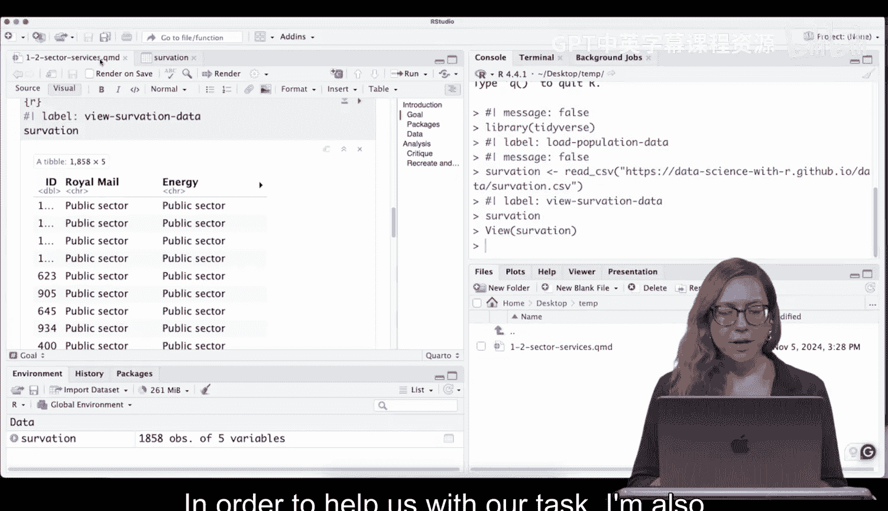
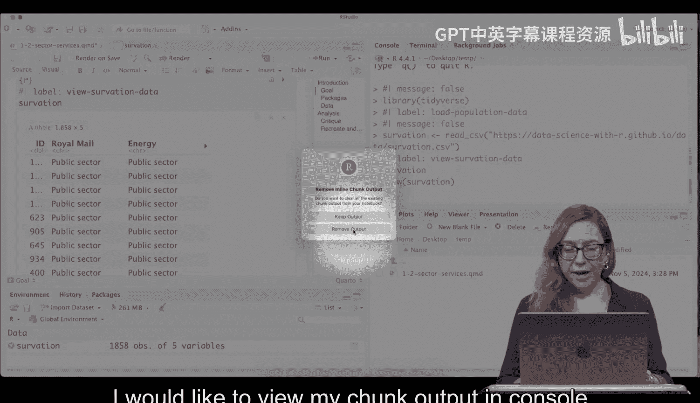
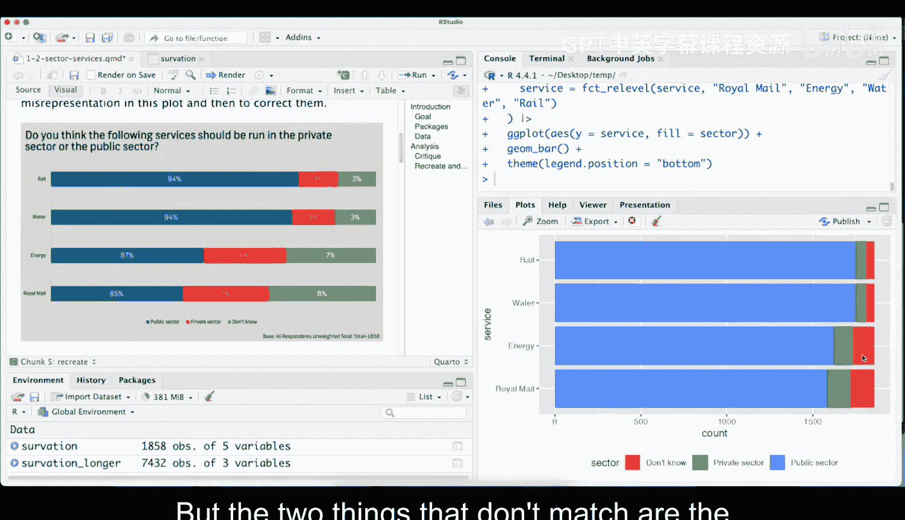
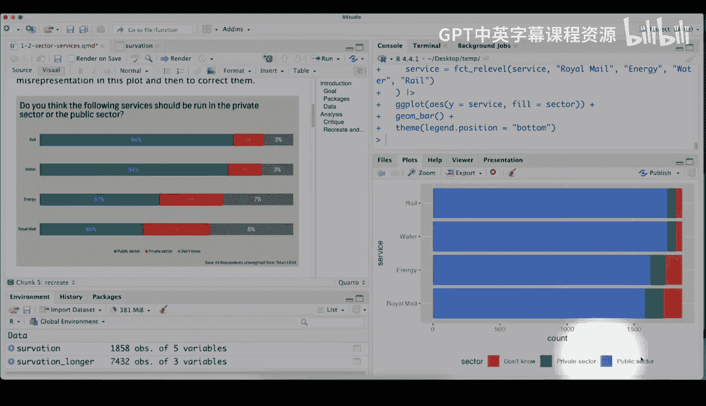
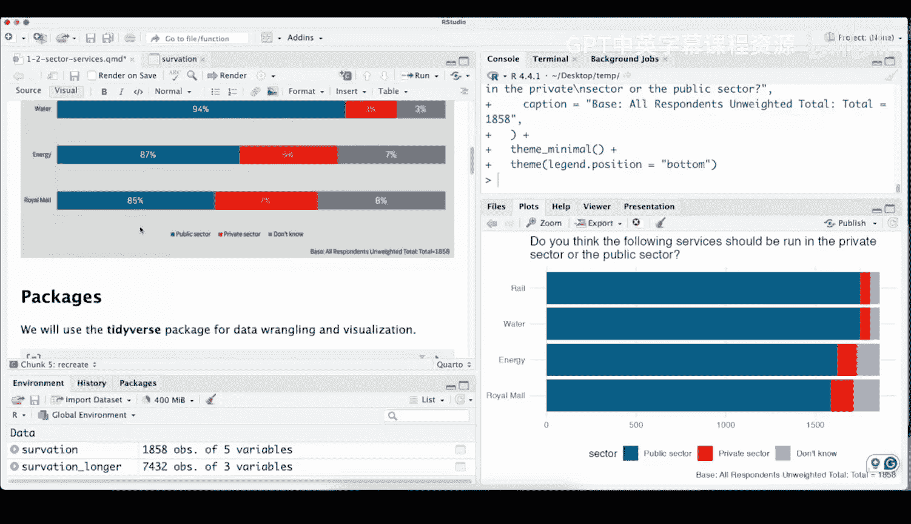
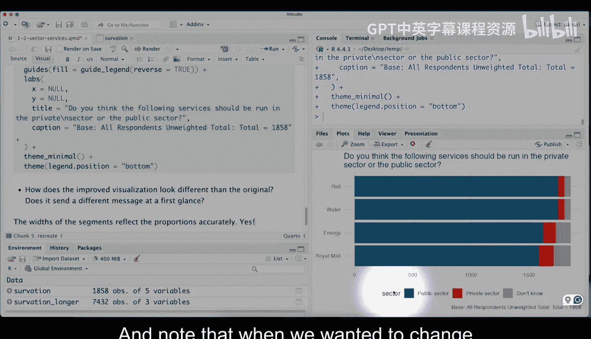
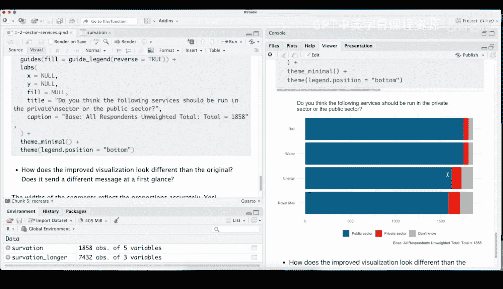

# R语言数据科学：3.01.03：代码实践-行业与服务 📊


在本节课中，我们将学习如何识别并修正一个在社交媒体上分享的、存在数据可视化问题的图表。我们将使用R语言和`tidyverse`包来处理数据，并创建一个更准确、更清晰的改进版本。

## 概述与问题识别

首先，我们来看一下原始图表。该图表基于一项英国调查，受访者被问及他们认为铁路、水务、能源和皇家邮政等服务应由私营部门还是公共部门运营。





图表使用蓝色代表公共部门，红色代表私营部门，灰色代表“不知道”。虽然图表上显示的百分比数据是准确的，但其视觉呈现存在严重问题。

上一节我们介绍了图表背景，本节中我们来看看具体的问题所在。

图表中，每个服务对应的条形图被分割成三段，分别代表三种回答的比例。然而，这些分段的长度与其所代表的百分比并不匹配。例如，在“能源”服务中，公共部门支持率为87%，但蓝色分段看起来却不足条形图的一半。这表明**条形图分段的尺度与百分比数据不匹配**。

这种误导性的视觉呈现，如果不仔细看数字，会让人误以为公众对公共部门运营这些服务的支持率很低。我们的目标就是纠正这个问题。

## 数据准备与处理

为了分析和改进，我们首先需要获取并整理数据。数据以CSV文件提供，每一行代表一位受访者，每一列代表其对一项服务的回答。

以下是数据处理的步骤：

1.  **加载必要的库并读取数据**：我们使用`tidyverse`进行数据整理和可视化。
    ```r
    library(tidyverse)
    survey_data <- read_csv("survey_data.csv")
    ```

2.  **转换数据格式**：原始数据是“宽格式”，每个服务占一列。为了便于计算百分比，我们需要将其转换为“长格式”，即创建一个`service`列（服务名称）和一个`sector`列（回答选项）。
    ```r
    survey_longer <- survey_data %>%
      pivot_longer(cols = -ID,
                   names_to = "service",
                   values_to = "sector")
    ```

3.  **计算百分比**：接下来，我们按服务分组，计算每个回答选项（公共、私营、不知道）的比例和百分比。
    ```r
    survey_summary <- survey_longer %>%
      count(service, sector) %>%
      group_by(service) %>%
      mutate(percentage = round((n / sum(n)) * 100, 0))
    ```
    运行此代码可以验证，计算出的百分比（例如能源：公共87%，私营6%，不知道7%）与原始图表上的数字完全一致。

## 创建改进版可视化

现在我们已经有了正确的数据摘要，可以开始创建改进版的图表了。改进版的目标是：创建一个分段条形图，确保分段的长度精确反映百分比，同时保持与原始图表相似的图例位置、标题和说明文字。

以下是创建可视化图形的步骤：

1.  **调整服务顺序**：首先，我们需要确保Y轴上的服务顺序与原始图表一致：皇家邮政、能源、水务、铁路。
    ```r
    survey_longer <- survey_longer %>%
      mutate(service = factor(service,
                              levels = c("Royal Mail", "Energy", "Water", "Rail")))
    ```

2.  **绘制基础图形**：使用`ggplot2`创建分段条形图，将`service`映射到Y轴，用`sector`填充颜色。
    ```r
    p <- ggplot(survey_longer, aes(y = service, fill = sector)) +
      geom_bar(position = "fill")
    ```





3.  **自定义颜色**：根据原始图表的信息，手动设置填充颜色：蓝色代表公共部门，红色代表私营部门，灰色代表不知道。
    ```r
    p <- p +
      scale_fill_manual(values = c("Don‘t know" = "gray",
                                   "Private sector" = "red",
                                   "Public sector" = "blue"))
    ```

4.  **调整图例顺序**：原始图例的顺序是“公共部门”、“私营部门”、“不知道”。我们需要反转图例项的默认顺序。
    ```r
    p <- p +
      guides(fill = guide_legend(reverse = TRUE))
    ```

5.  **添加标签与标题**：添加图表标题、说明文字，并移除坐标轴标签。
    ```r
    p <- p +
      labs(title = "Do you think the following services should be run in the private sector or the public sector?",
           caption = "Base: All respondents. Unweighted total: 1858",
           x = NULL,
           y = NULL,
           fill = NULL) # 移除图例标题
    ```

6.  **调整主题与图例位置**：使用简洁的主题，并将图例放置在底部。
    ```r
    p <- p +
      theme_minimal() +
      theme(legend.position = "bottom")
    ```

运行以上所有代码，即可生成改进后的可视化图表。

## 总结与对比

本节课中我们一起学习了如何批判性地评估数据可视化，并动手改进一个有缺陷的图表。

我们首先**识别了原始图表的问题**：条形图分段的视觉长度未能准确反映其代表的百分比，导致了严重的误导。



接着，我们**处理了数据**：将数据从宽格式转换为长格式，并计算了每个服务下各回答选项的准确百分比。



最后，我们**使用`ggplot2`重新创建了图表**，通过调整因子顺序、手动设置颜色、反转图例顺序、添加标签和应用主题，确保最终的可视化结果能够**准确地用分段宽度反映数据比例**。



改进后的图表清晰地表明，公众对于这些服务由公共部门运营仍然有很强的支持度，这与原始图表给人的第一印象截然不同。通过这个实践，我们巩固了数据整理、转换以及创建准确、有效可视化的技能。