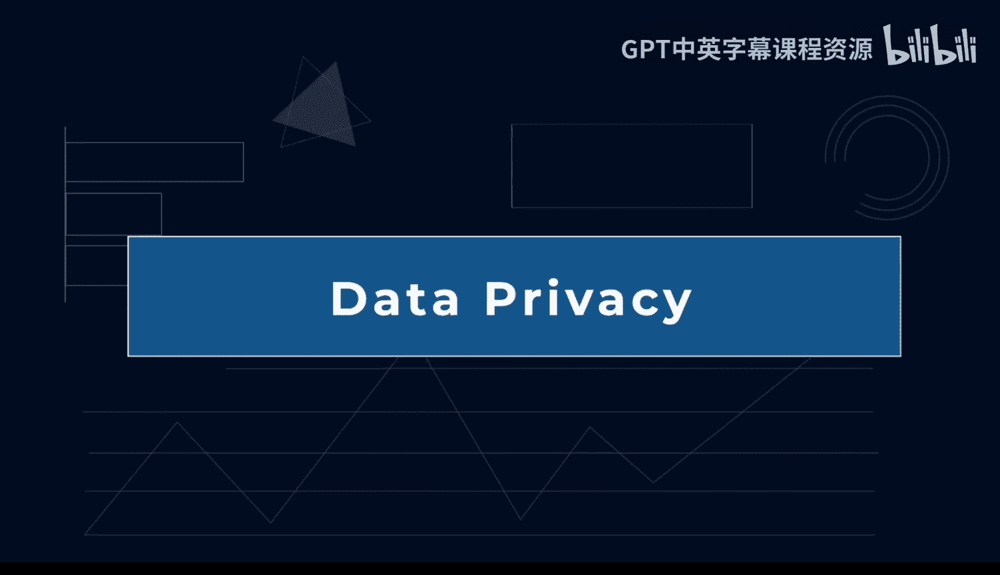
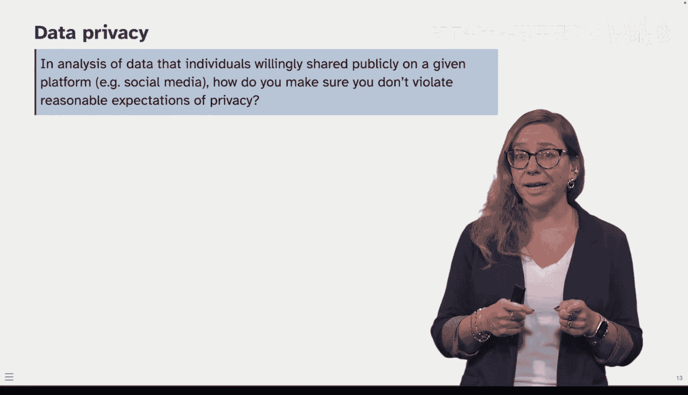

# 杜克大学《R语言数据科学｜Data Science with R》中英字幕 p36 4_01_01_数据隐私.zh_en -BV1Zpv6BaEkB_p36-

🎼。

In this video， we're going to talk about data privacy。 So let's touch on this idea of your data。

Every time we use apps， websites and devices， our data is being collected and used or sold to others。

 More importantly， decisions are made by law enforcement。

 financial institutions and governments based on data that directly affect the lives of people。

Think about what pieces of data you have left on the Internet today。

 Think through everything you've logged into， clicked on。

 checked in either actively or automatically。 That might be tracking you。

 Do you know where that data is stored， Who it can be accessed by， whether it's shared with others。

 Do you know the answers to all of these questions， If no， Are you okay with that。Now。

 let's think about sharing your data。 What are you O with sharing your name， your age， your email。

 phone number， list of every video you watch list of every video you comment on。

How you type like your speed and accuracy。How long you spend on different content List of all your private messages。

 date， time， person sent to。Information about your photos， how it was taken， where it was taken。

 The GPS coordinates may be， and when it was taken。 I feel like the list gets scarier and scarier。

Let's try another one。 Have you thought about why you're seeing an ad on Google。

 Feel free to pause the video and Google it and try to figure out if you have ad personalization and how your ads are personalized Then come back for the rest。

 Here's another reflection question， Which of the following。

 Are you O with your browsing history to be used towards for serving you targeted ads。😊。

To score you as a candidate for a job。To predict your race and ethnicity for voting purposes。

Or suppose you create a profile on a social media site and share your personal information on your profile。

 Who gets to use that data， companies the social media company has a connection to。

 That's sort of a given in this day and age， I think。

 What about companies the social media company sells your data to。

That's something we're used to at this point。 And what about researchers in the name of science。

 That sounds non threatening， no。Frankly， I'd love to say yes。

 but let's take a look at this case study on O Cupupid。

 O Cupupid is one of the earliest dating platforms， and back in 2016。

 researchers published data of 70000 okay Cupupid users， including username， political leanings。

 drug usage and intimate sexual details。These data were freely provided by the users to the company。

 O K Cupupid for their profiles。 But these researchers。

 even though they didn't release the real names and pictures of O K Cupupid users。

Perhaps did not realize that their identities could easily be uncovered from the details provided。

 For example， do use your username in multiple places。

 Could there be a certain number of features about you that could allow others to help identify you。

Here's a screenshot of an online conversation between one of the researchers and someone who had accessed the data。

The person said that the data set is highly reidentifiable。 It even includes user names。

 Was any work done to anonymize it。 And the researcher said， no， the data is already public。

Do you agree with the researchers。They said some may object to the ethics of gathering and releasing this data。

 However， all the data found in the data set are or were already publicly available。

 So releasing this data set merely presents it in a more useful form。

 but useful could also mean recoverable in a way where you can actually identify the people。

So let's think in an analysis of data that individuals willingly shared publicly on a given platform。

 for example， their social media profile， how do you make sure that you don't violate reasonable expectations of privacy？

I unfortunately don't have concrete answers for you here。

 but it's something I encourage you to be thinking about when it comes to your data and when it comes to others as data you're using as well。

