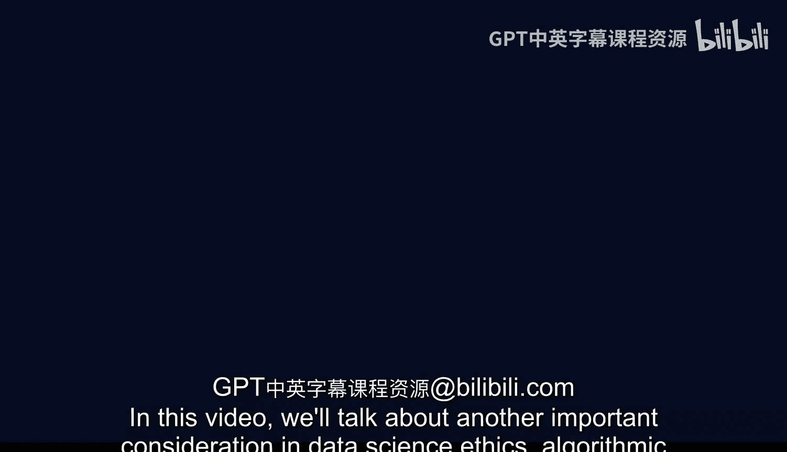
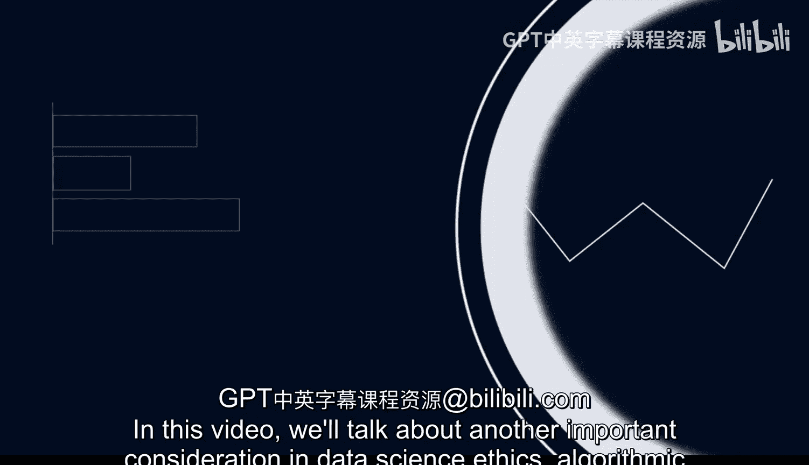
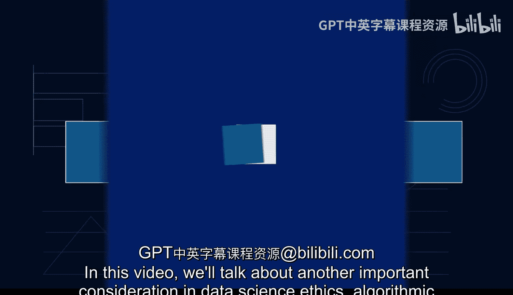
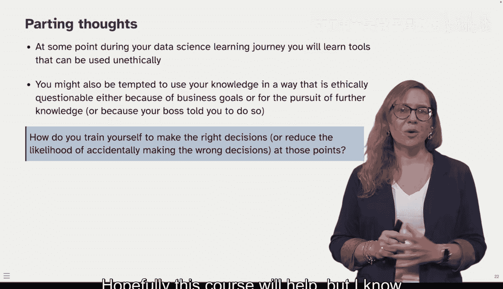

# 杜克大学《R语言数据科学｜Data Science with R》中英字幕 p37 5_01_01_算法偏见.zh_en -BV1Zpv6BaEkB_p37-

🎼。

In this video， we'll talk about another important consideration in data science ethics。

 Alic bias in statistics， we have a principle garbage in， garbage out。

 This means if you don't have good and by good， I mean random and representative data。

 Reult of your analysis will not be reliable or generalizable。

 A corollary to this is bias in bias out。 Let's start with algorithmic bias and gender。

Take a look at these translations provided by Google。These are going from Turkish。

 my native language， which doesn't have a gendered third pronoun to English。 The sentence Ob doctor。

 which I translate as this person is a doctor， is given as he's a doctor。 but it's she's a teacher。

There's a pattern here。 Certain professions are assigned a male pronoun and certain ones a female。

 What might be the reason for Google's gendered translation and how do ethics play into this situation。

These are probably driven by the data that exists out there on the web。

 and translation is perpetuating what it sees in the biased data。

Ggle has actually addressed this issue in most， if not all translation cases。

 This is what it looks like to day when you try to translate from Turkish to English。

 But you can imagine these biases exist elsewhere as well。

Here's another example about Amazon's experimental hiring algorithm。

 Amazon used AI to give job candidates scores， ranging from one to five stars。

 much like shoppers rate products on Amazon。However。

 Amazon's system was not rating candidates for software developer jobs and other technical posts in a gender neutral way。

 It taught itself that male candidates were preferable because a lot of the existing folks in those positions were male。

In fact， further look into it revealed that gender bias was not the only issue。

 Problems with the data that underpinned the model's judgments meant that unqualified candidates were often recommended for all manners of jobs。

 the people said。Next， let's turn to algorithmic bias and race。

 Our first example is about facial recognition。 Researchers identified gender and skin type bias in commercial artificial intelligence systems used in facial recognition software。

 Ex of facial analysis software showed an error rate of only 08% for light skin men versus 34。

7% for dark skinned women。 In fact， they found that a major US technology company that designs facial recognition software claimed an accuracy rate of more than 97%。

 but the data set used to assess its performance was more than 77% male and more than 83% white。

 So not representative at all。😊，Race， unfortunately。

 plays an important factor in criminal sentencing as well。

Even when this is supported by an allegedly impartial algorithm in 2016。

 Proublica wrote an extensive article on an algorithm used for rating a defendant's risk of future crime。

Take a look at these photos。 What is common among the defendants who were assigned a high risk or a low risk for reoffending。

If your answer is race， you're indeed right。The propublica analysis on risk scores assigned to over 7000 people arrested in Broward County。

 Florida and whether they were charged with new crimes over the following two years showed that 20% of those predicted to commit violent crimes actually did。

The algorithm had higher accuracy that 61% when full range of crimes were taken into account。

 including misdemeanors。In addition， the algorithm was more likely to falsely flag black defendants as future criminals at almost twice the rate as white defendants。

 and white defendants were mislabelled as low risk more often than black defendants。

So how can an algorithm that doesn't use races and input explicitly be racist。

I'll link to this article at the end of the video so you can dive deeper into answering that question。

 but remember， bias in， bias out。Researchers who built this algorithm wroteIn both political behavior。

 research and voting rights litigation， turn out and vote choice for different racial groups are often inferred using aggregate election results and racial composition。

Over the past several decades， many statistical methods have been proposed to address this ecological inference problem。

 We propose an alternative method to reduce aggregation bias by predicting individual level ethnicity from voter registration records。

 building on the existing method methodological literature。

 We use Bes rule to combine the Census Bureau's surname list with various information from geocoded voter registration records。

 We provide an open source software to implement the proposed methodology。

 The open source software is available for implementing this methodology。

The open source software is great， but what they've done is provide a tool anyone can use to predict someone else's race from their last name alone。

Is it possible this algorithm could be used for the wrong reasons。

If you're interested in said software， it's the WRU package in R。

Do you have any ethical concerns about installing this package。

And was the publication of this model ethical， Does the open source nature of the code affect your answer。

 Is it ethical to use this software， And does your answer change depending on the intended use。

Regardless of my own personal answers， I've used the software briefly here so I can show you how it works。

 It comes with a list of sample names， which is what we're using on the slide。

 And based on those names alone， it predicts the race of the individual。Hopefully。

 this video was eye opening in terms of the biases that can creep into algorithms and how they can affect or derail and。

 of course， sometimes help people's lives。 If you' are interested in diving further into this topic。

 I highly recommend a few readings。 The machine bias article from Proublica。😊。

The book Ethics and Data Science。The book Weapons of Math destructionstruction。

 how big Data increases inequality and threatens democracymo。And the book algorithms of oppression。

 How search engines reinforce racism。And in fact， there was a more recent interview with the author of this book on how AI discriminates and what that means for your Google habit that might be of interest to you as well。

At some point during your data science learning journey。

 you will learn tools that can be used unethically。

 You might also be tempted to use your knowledge in a way that's ethically questionable either because of business goals or for the pursuit of further knowledge or simply because your boss told you to do so。

So I hope you keep asking yourself how you can train yourself to make the right decisions or at least reduce the likelihood of accidentally making the wrong decisions at those points。

 Hopefully this course will help， but I know it's a tiny fraction of the work we all need to be doing。

