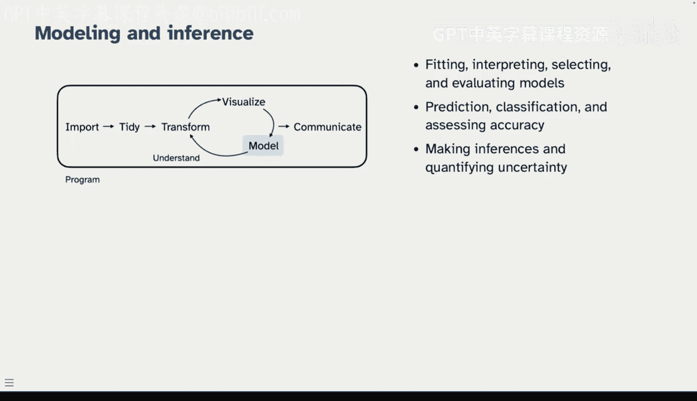

# 杜克大学《R语言数据科学｜Data Science with R》中英字幕 p38 01_01_03_欢迎4.zh_en -BV1Zpv6BaEkB_p38-

🎼，Hello and welcome， my name is Mina Tiinica Rde and I will be your instructor for the modeling and inference course in the data science with our specialization。

In the first course of the specialization， we introduced the data science cycle with this figure from the book are for data science。

 and we learned about data visualization and transformation。In the second course。

 we introduced data tidying， which involved reshaping and joining data。

 as well as importing data into R。Then we took a break from how to do a task in R and asked。

 should we do this task in the course focusing on data science ethics， specifically。

 we discussed misrepresentation of data science results。

 data privacy and algorithmic bias In this course， we'll dive into modeling。

 We'll discuss how to fit interpret， select and evaluate models。

 how to do prediction and classification and assess the accuracy of our predictions and classifications。

 and finally， how to make inferences from samples for a target population and how to quantify the uncertainty of our estimates from samples。

 Let's get started。

