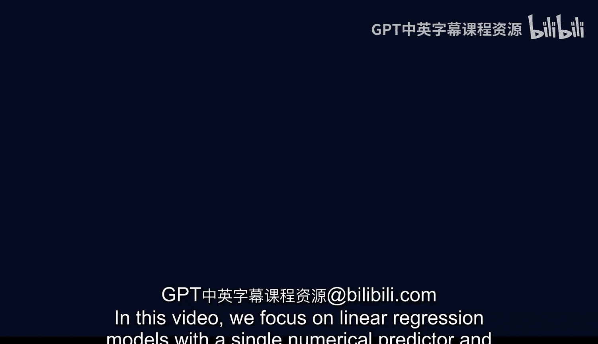
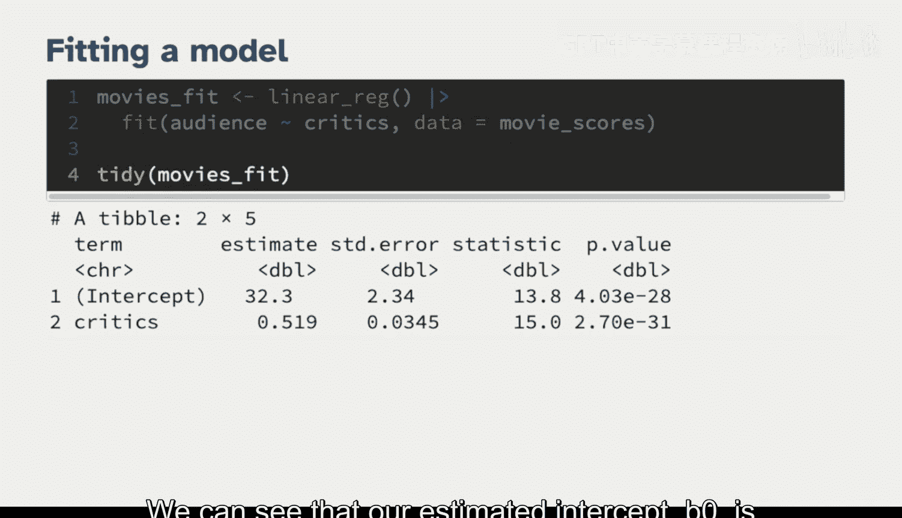
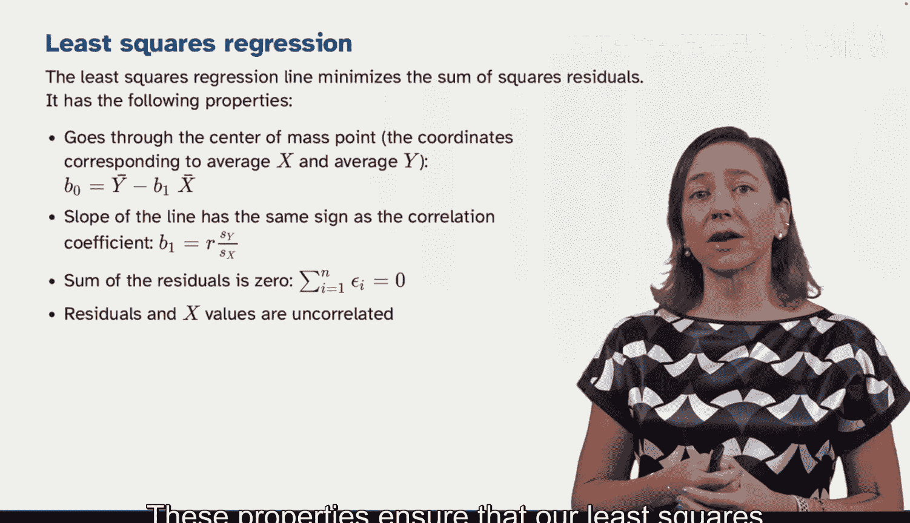
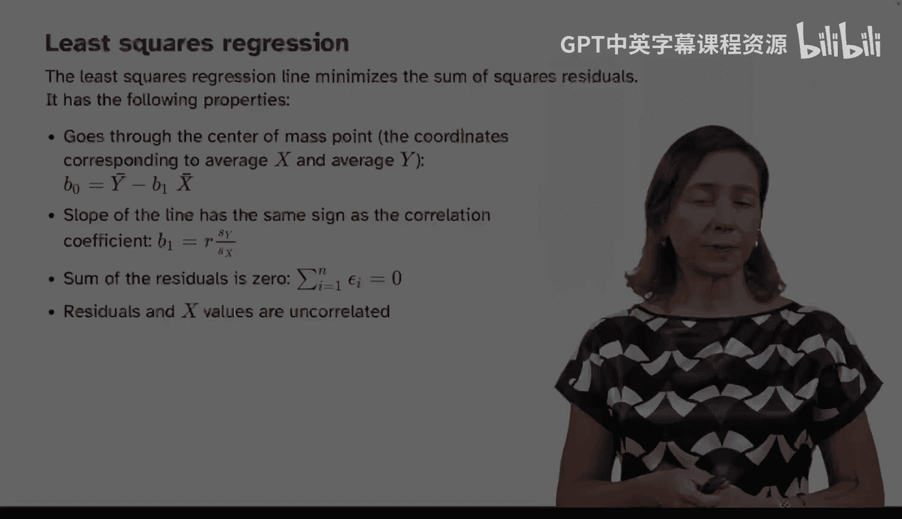

# 杜克大学《R语言数据科学｜Data Science with R》中英字幕 p40 03_01_01_使用数值预测变量的线性回归.zh_en -BV1Zpv6BaEkB_p40-

🎼。

In this video， we focus on linear regression models with a single numerical predictor and give a concrete example of fitting and interpreting such models with data on movie ratings。

 Before we begin， let's talk about the tools we will be using。

 We'll need three keyr packages for this analysis。 The 538 package provides us with the movie ratings data that we will use the tidyverse package gives us powerful tools for data wrangling and visualization and the tidy models package provides a consistent framework for statistical modeling。

😊。

Our data comes from 538s analysis of movie ratings。

 we're going to focus on the relationship between critic scores and audience scores from an online movie rating website called Roten Tomatoes to make our analysis clearer will rename the columns of their from their original names to something more intuitive Critics for critictic scoreore and audience for the audience score。

We'll also rename our data set to movievie underscore scores to make it easy to work with。

Let's look at our data here we can see the structure of our two main variables。

 critictics scores and audience scores， each row represents a different movie and we can see the range of scores for at least a first few cases。

 both for critics and audiences notice that both variables are numerical。Before we start modeling。

 let's visualize our data to understand the relationship we're trying to model。

 This scatter plot shows critic scores on the X axis and audience scores on the y axis。

 We're going to use critic scores to predict audience scores。

 as critic scores tend to come out earlier and can be indicators of how well a movie will do in the box office。

 They also can directly influence audience scores， Of course， but in this case。

 we're not evaluating a causal relationship between these two variables。 only in association。

Each point on the plot represents one movie。 We can see there's a general positive relationship。

 Movies that critics rate highly tend to also be rated highly by audiences。 However。

 there's also quite a bit of scatter around this trend。

 which suggests the relationship isn't super strong。

This visualization helps us understand what we're working with and tells us what to expect。

 like a positive slope before we start building our model。

Now let's formalize what we mean by a regression model。

A regression model is a function that describes the relationship between our outcome variable Y and our predictor variable X。

 We can write this relationship as y equals model plus error。 The model part shown here as F x。

 represents the systematic relationship we're trying to capture。

 This is also written as mu of y given x， which represents the expected value of y for a given value of x。

 The error term epsilon represents the part of y that our model can't explain the randomness or the influence of other factors that aren't in our model。

😊，Here's what this looks like visually， the blue line represents our model。

 the systematic relationship between x and y， each individual point represents an actual observation and the vertical distance between each point and the line represents the error or residual for that observation。

The model gives us the expected value of y for any given x。

 but individual observations will vary around this expected value。

We'll use a simple linear regression model to model the relationship between our numerical outcome Y and our single numerical predictor X。

 The equation for simple linear regression is y equals beta 0 plus beta 1 times x plus epsilon。😊。

Here， beta 1 represents the true slope of the relationship。

 how much y changes for each unit increase in x。Beta 0 represents the true intercept。

 the expected value of y when x equals 0。An epsilon represents the error term。

 the part of why that our linear model can't explain。

These beta values represents the true unknown parameters in the population。Of course。

 we don't know the true beta values。 We have to estimate them from our data。

 When we estimate these parameters， we use a different notation。 Y hat equals B0 plus B1 times x。

 Here。 B1 is our estimated slope and B0 is our estimated intercept。

 Not there's no error term in this equation。 That's because y hat represents our predicted value。

 not the actual observed value。 The difference between our predicted values and the actual observed values gives us our residuals。

 So how do we choose the best values for our slope and intercept。

 We could draw many different lines through our data。

 The blue line represents what we think might be the best fit。

 but the gray lines show other possible relationships。 Some lines fit the data better than others。

 We need a systematic way to determine which line is best。

 And that's where the method of least squares comes in。😊，Let's focus on residuals。

 the differences between our observed values and our predicted values。 in this plot。

 the blue vertical lines show the residuals for each data point， Some are positive。

 where the observed values above the predicted line and some are negative。

 where the observed value is below the predicted line。

The least squares method gives us a systematic way to find the best fitting line for each observation I。

 the residual is denoted as EI， and it equals Y I， the observed value of the outcome， minus y hat I。

 the predicted value of the outcome。The sum of squared residuals。

 e squared1 plus e squared2 plus all the way to e squared n。

The least squares line is the one that minimizes this quantity。 The sum of squared residuals。

 We square the residuals to get rid of negative sign。

 So positive and negative residuals don't just cancel each other and place higher value on the residuals with larger magnitudes。

 This method is the most commonly used method for determining the best fit line。😊。

Now let's actually fit this model to the movie ratings data， we'll use the tidy models framework。

 so we start with specifying our model with linear Re。Then we fit the model with the fit function。

 and we supply the model formula in the firm outcome Tilde predictor。So audience Tilde critics。

 and then the name of the data frame these variables come from， movie underscore scores。

We store the model object as movies underscore fit。 We can use any name for the model object。

 but you'll see me always using something underscore fit for these。

We can then use the ti function to print the model summary， which shows the slope and the intercept。

 as well as their standard errors， test statistics and P values。

 which we'll learn more about later in the course in the inference unit。

 We can see that our estimated intercept B0 is 32。3。 And our estimated slope B1 is 0519。😊。

Let's make sure we can interpret the slope and the intercept correctly。

The slope is about the rate of change in the outcome when the predictor is higher by one unit。

 and the intercept is the predicted value of the outcome when the predictor is equal to 0。

 Despite these relatively straightforward sounding descriptions。

 it can be easy to get tripped up about what these numbers mean when considering them in context of the data and the research question。

So let's take a look at the slope。 The slope of the model is 0。519。

 Which of these interpretations is best。 I'll give you a bit of time to read over them。

The correct answer is option B for every one point increase in critic score。

 we expect the audience score to be higher by 0。519 points on average。

This interpretation is important because it includes the phrase we expect and on average。

 acknowledging that this is what we expect to happen。 On average。

 not every movie will follow this pattern exactly， but on average， this is what we expect to see。

Let's write out our complete model equation， predicted audience score equals 32。3 plus 0。

519 times Cri score。The slope says that for every one point increase in the critic score。

 we expect the audience score to be higher by 0。519 points on average。

The Intercept interpretation says that for movies with a critic score of zero。

 we expect the audience score to be 32。3 points on average。

Notice that the slope tells us about the relationship between our variables。

 while the intercept tells us about the expected outcome when the predictor equals0。

This brings up an important question。 Is our intercept meaningful in this context。

 The intercept is meaningful when the predictor can feasibly take values equal to or near 0。

 or when we have observed data near 0。 In our movie example。

 a critic score of 0 is theoretically possible。 It would represent a movie that critics really did not like。

 So our intercept of 32。3 suggest that even movies with the worst possible critic scores might still receive moderate audience scores。

However， be careful if your predictor can't realistically be0。

 the intercept might not have a meaningful interpretation。

Let's wrap up by reviewing the key properties of least squares regression。

The least squares regression line minimizes a sum of squared residuals。 First。

 the regression line always goes through the center of mass point。

 The coordinateness corresponding to the average x and average y values。

 This means that if we plug an x bar， that's the average x into the regression equation。

 the predicted value of y would be y bar or average of y。Moving things around。

 this property can be used to solve for the value of the intercept B0 equals y bar minus B1 times x bar。

 Not that you ever have to calculate these by hand。

 but this property of regression to the mean is important， nonetheless。Second。

 the slope of the line has the same sign as a correlation coefficient。

 The relationship is B1 equals R， the correlation coefficient times S Y。

 the standard deviation of y over S x， the standard deviation of x。 Once again。

 you won't need to calculate these values by hand。 But knowing these formulas can be helpful for a quick mental check when you see the regression output from R。

Third， the sum of the residuals is always 0。 This means that the positive and the negative residuals balance each other out。

 This is why we don't minimize the sum of residuals， but instead。

 the sum of squared residuals when determining the line of best fit。 Finally。

 the residuals and x values need to be uncorrelated。

 There should be no systematic relationship between the size of the residuals and the x values。

 These properties ensure that our least squares line is not only mathematically optimal。

 but also has desirable statistical properties。

