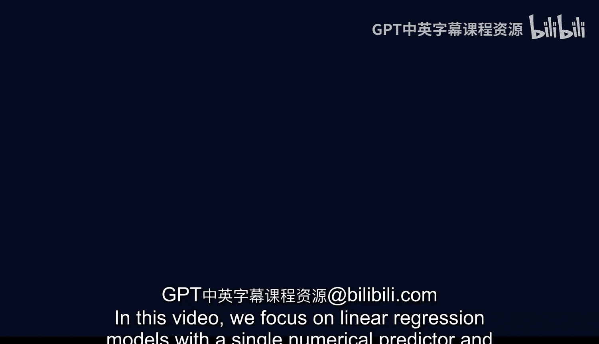
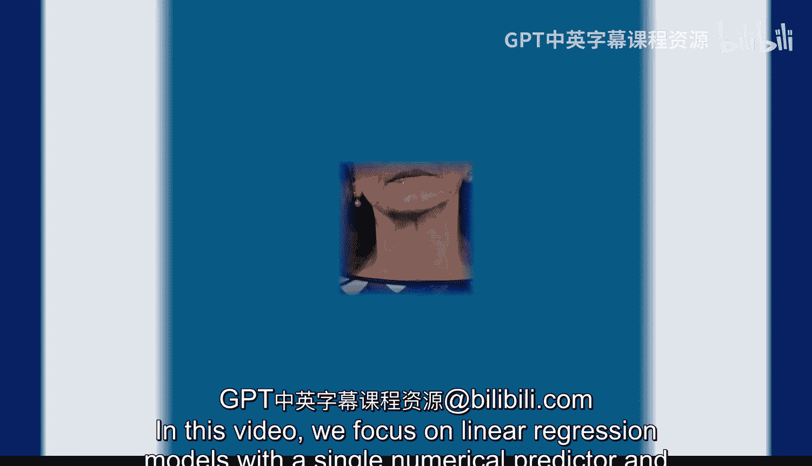
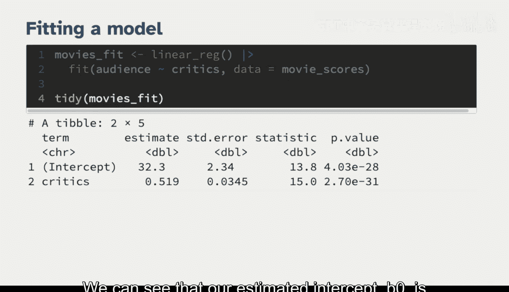
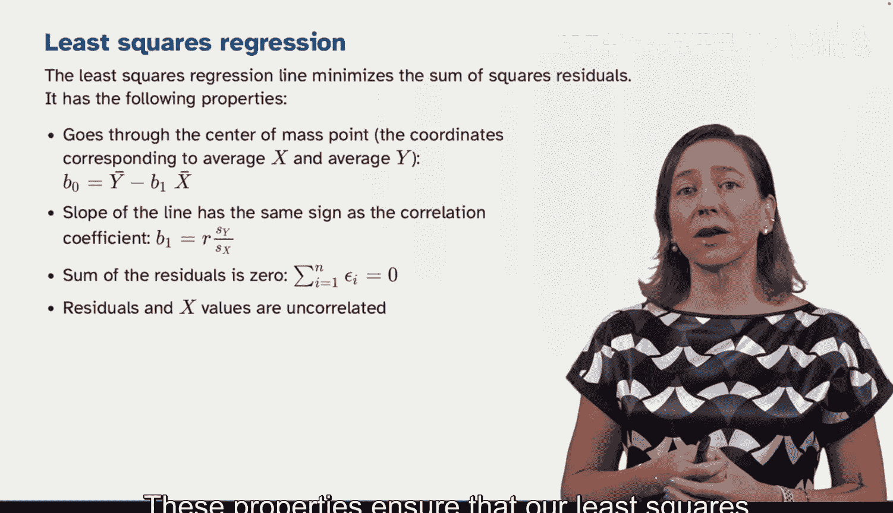
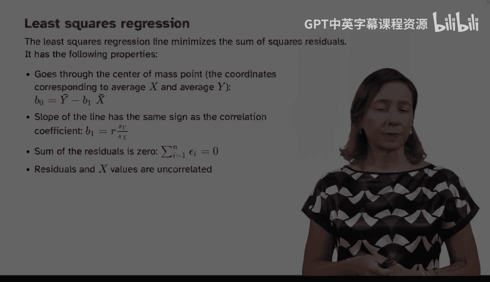

# R语言数据科学：03_01_01：使用数值预测变量的线性回归 📊

在本节课中，我们将学习如何使用单个数值预测变量来构建线性回归模型。我们将通过一个具体的例子——电影评分数据，来演示如何拟合模型并解释其结果。

## 概述与工具准备 🛠️

在开始之前，我们需要准备分析工具。本次分析将使用三个关键的R包：
*   **`fivethirtyeight`**：提供我们将要使用的电影评分数据。
*   **`tidyverse`**：提供强大的数据处理和可视化工具。
*   **`tidymodels`**：提供一套一致的统计建模框架。

## 数据介绍与探索 🎬

我们的数据来自FiveThirtyEight对电影评分的分析。我们将重点关注影评人评分与一个名为“烂番茄”的在线电影评分网站上的观众评分之间的关系。

为了使分析更清晰，我们将数据集的列名重命名为更直观的名称：`critics`代表影评人评分，`audience`代表观众评分。同时，我们将数据集重命名为`movie_scores`以便操作。

让我们查看一下数据。可以看到两个主要变量的结构：`critics`和`audience`。每一行代表一部不同的电影，我们可以看到前几部电影的评分范围。请注意，这两个变量都是数值型的。

## 数据可视化 📈

在开始建模之前，我们先通过可视化来理解我们试图建模的关系。

这张散点图以影评人评分（X轴）和观众评分（Y轴）展示了数据。我们将使用影评人评分来预测观众评分，因为影评人评分通常发布得更早，并且可以作为电影票房表现的指标。当然，它们也可能直接影响观众评分，但在此案例中，我们并非评估这两个变量之间的因果关系，而仅仅是关联。

图中的每个点代表一部电影。我们可以看到一种普遍的积极关系：影评人评分高的电影，观众评分也往往较高。然而，这种趋势周围也存在相当多的分散点，这表明关系并非特别强。

这个可视化帮助我们理解数据，并告诉我们预期的结果（例如，斜率为正），然后我们才开始构建模型。

## 理解回归模型 📐

现在，让我们正式定义回归模型。

回归模型是描述结果变量Y与预测变量X之间关系的函数。我们可以将这种关系写为：**y = 模型 + 误差**。模型部分（此处表示为 **f(x)**）代表我们试图捕捉的系统性关系。这也写作 **μ(y|x)**，代表给定x值时y的期望值。误差项 **ε** 代表我们的模型无法解释的y的部分，即随机性或模型中未包含的其他因素的影响。

从视觉上看，蓝线代表我们的模型，即x和y之间的系统性关系。每个独立的点代表一个实际观测值，每个点与线之间的垂直距离代表该观测值的误差或残差。模型为我们提供了任何给定x值时y的期望值，但个体观测值会围绕这个期望值变化。

## 简单线性回归模型 📉

我们将使用简单线性回归模型来建模数值型结果Y与单个数值型预测变量X之间的关系。

简单线性回归的方程为：**y = β₀ + β₁x + ε**。

*   **β₁** 代表关系的真实斜率，即x每增加一个单位，y的变化量。
*   **β₀** 代表真实截距，即当x等于0时y的期望值。
*   **ε** 代表误差项，即我们的线性模型无法解释的y的部分。

这些β值代表总体中真实但未知的参数。当然，我们不知道真实的β值，我们必须从数据中估计它们。

当我们估计这些参数时，使用不同的符号：**ŷ = b₀ + b₁x**。这里，**b₁** 是我们的估计斜率，**b₀** 是我们的估计截距。注意，这个方程中没有误差项，因为 **ŷ** 代表我们的预测值，而不是实际观测值。预测值与实际观测值之间的差异给出了我们的残差。

## 最小二乘法与最佳拟合线 🔍

那么，我们如何为斜率和截距选择最佳值呢？我们可以在数据中画出许多不同的线。蓝线代表我们认为可能是最佳拟合的线，但灰线显示了其他可能的关系。有些线比另一些线更符合数据。我们需要一个系统的方法来确定哪条线是最好的，这就是最小二乘法的用武之地。

让我们关注残差，即观测值与预测值之间的差异。在这张图中，蓝色垂直线显示了每个数据点的残差。有些是正的（观测值高于预测线），有些是负的（观测值低于预测线）。

最小二乘法为我们提供了一种系统的方法来找到最佳拟合线。对于每个观测值i，残差表示为 **eᵢ**，它等于 **yᵢ**（结果的观测值）减去 **ŷᵢ**（结果的预测值）。残差平方和是 **e₁² + e₂² + ... + eₙ²**。

最小二乘线就是使这个量（残差平方和）最小化的那条线。我们将残差平方以消除负号，这样正负残差就不会相互抵消，并且对幅度较大的残差赋予更高的权重。这种方法是最常用的确定最佳拟合线的方法。

## 拟合模型与解释结果 🎯

现在，让我们将模型实际拟合到电影评分数据中。我们将使用`tidymodels`框架，因此首先用`linear_reg()`指定模型。然后使用`fit()`函数拟合模型，并提供模型公式，格式为`结果 ~ 预测变量`，即`audience ~ critics`，以及变量来源的数据框名称`movie_scores`。

我们将模型对象存储为`movies_fit`。然后可以使用`tidy()`函数打印模型摘要，其中显示了斜率、截距以及它们的标准误、检验统计量和p值。

我们可以看到，估计的截距 **b₀** 是32.3，估计的斜率 **b₁** 是0.519。

## 解释斜率和截距 📝

让我们确保能正确解释斜率和截距。

斜率是关于预测变量每增加一个单位时结果变化率的描述。截距是当预测变量等于0时结果的预测值。尽管这些描述听起来相对简单，但在数据和研究问题的背景下考虑这些数字的含义时，很容易出错。

让我们看一下斜率。模型的斜率是0.519。哪个解释是最好的？正确答案是选项B：**影评人评分每增加1分，我们预计观众评分平均会高出0.519分**。

这个解释很重要，因为它包含了“我们预计”和“平均”这两个短语，承认了这是我们预计平均会发生的情况，而不是每部电影都会完全遵循这种模式。

让我们写出完整的模型方程：**预测观众评分 = 32.3 + 0.519 × 影评人评分**。

斜率表明，影评人评分每增加1分，我们预计观众评分平均会高出0.519分。

截距的解释表明，对于影评人评分为0的电影，我们预计观众评分平均为32.3分。

请注意，斜率告诉我们变量之间的关系，而截距告诉我们当预测变量等于0时的预期结果。

这就引出了一个重要问题：在这个背景下，我们的截距有意义吗？当预测变量可以合理地取值为0或接近0，或者我们在0附近有观测数据时，截距是有意义的。在我们的电影例子中，影评人评分为0在理论上是可能的，它代表了一部影评人非常不喜欢的电影。因此，我们的截距32.3表明，即使是影评人评分最差的电影，仍可能获得中等的观众评分。

然而，如果你的预测变量实际上不可能为0，请小心，截距可能没有有意义的解释。

## 最小二乘回归的关键性质总结 📚

最后，让我们回顾一下最小二乘回归的关键性质。

最小二乘回归线最小化了残差平方和。首先，回归线总是通过质心点，即对应于x平均值和y平均值的坐标点。这意味着，如果我们将x的平均值（x̄）代入回归方程，y的预测值将是y的平均值（ȳ）。通过变换，这个性质可以用来求解截距：**b₀ = ȳ - b₁x̄**。请注意，你永远不需要手动计算这些，但回归到均值的这一性质仍然很重要。

其次，直线的斜率与相关系数的符号相同。关系是：**b₁ = r × (sᵧ / sₓ)**，其中r是相关系数，sᵧ是y的标准差，sₓ是x的标准差。再次强调，你不需要手动计算这些值，但了解这些公式有助于在看到R的回归输出时进行快速的心理检查。

第三，残差之和始终为0。这意味着正残差和负残差相互抵消。这就是为什么在确定最佳拟合线时，我们不最小化残差之和，而是最小化残差平方和。

最后，残差和x值必须不相关。残差的大小和x值之间不应存在系统性关系。这些性质确保我们的最小二乘线不仅在数学上是最优的，而且具有良好的统计特性。

## 总结 🎓

在本节课中，我们一起学习了如何使用单个数值预测变量构建简单线性回归模型。我们从数据准备和可视化开始，理解了回归模型的基本概念，然后使用最小二乘法拟合了模型，并详细解释了斜率和截距的含义。最后，我们回顾了最小二乘回归的关键性质。通过电影评分的具体案例，你现在应该能够理解、拟合并解释一个简单的线性回归模型了。