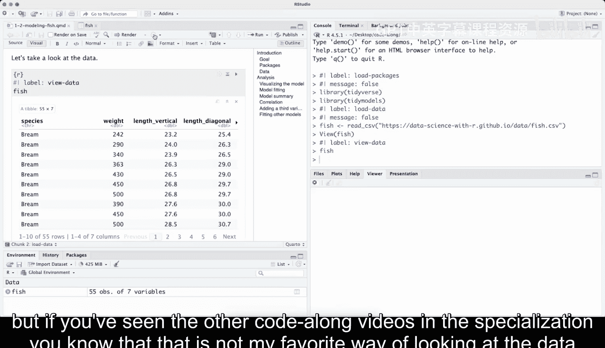
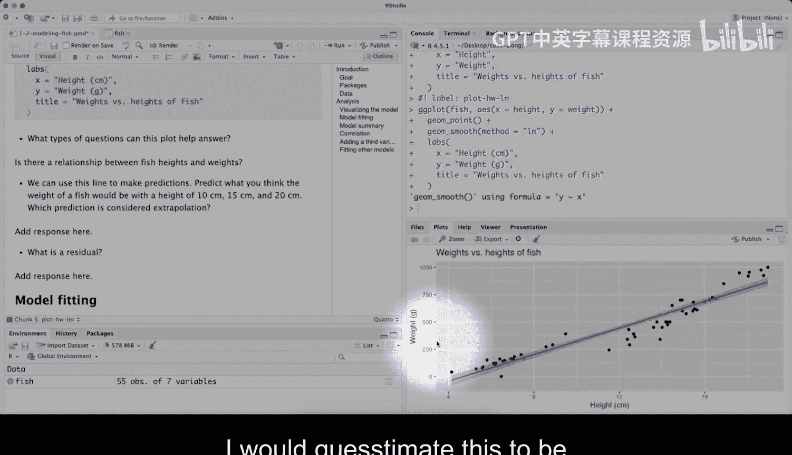
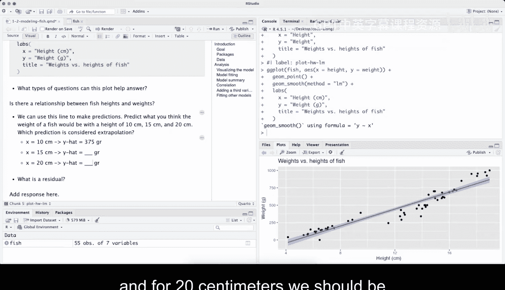
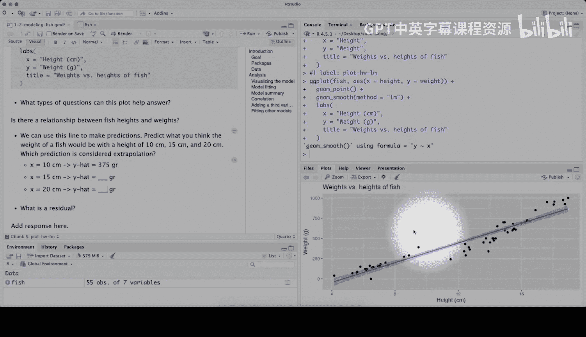
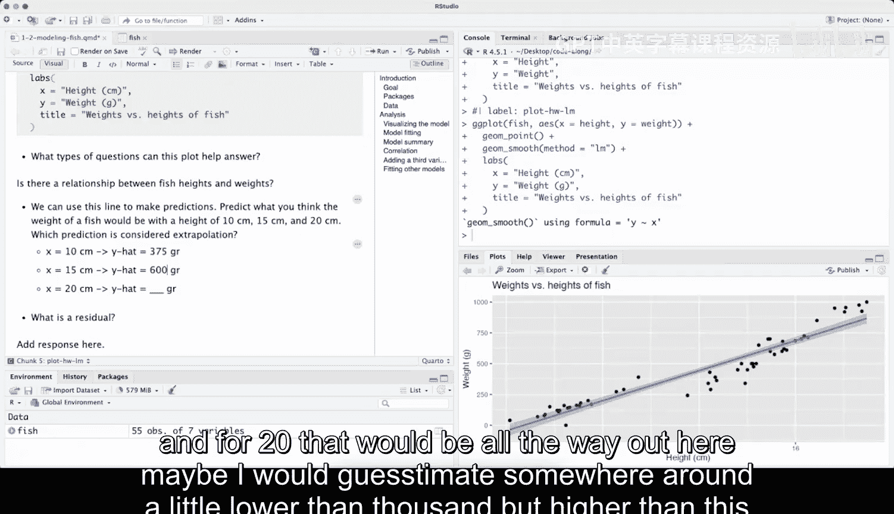
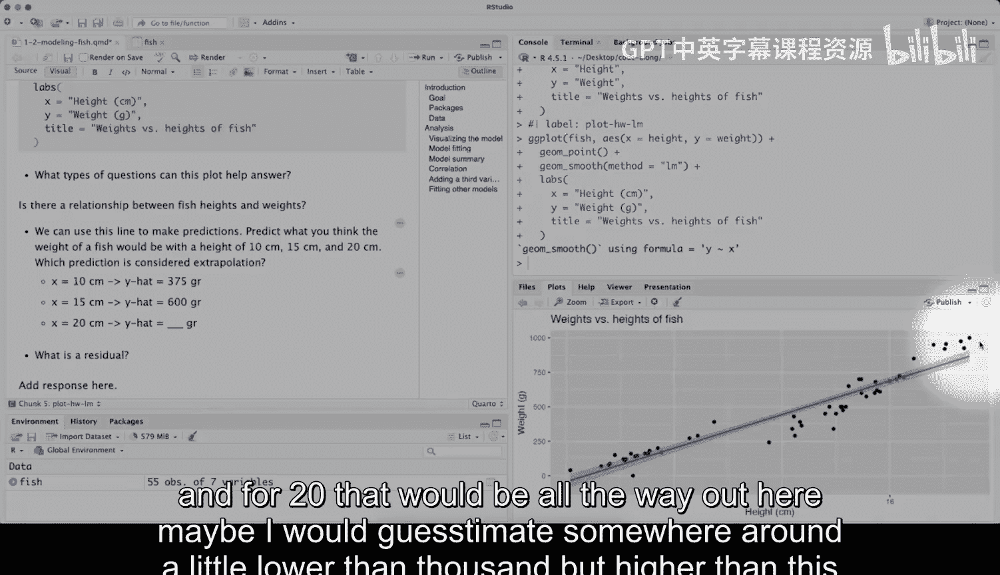
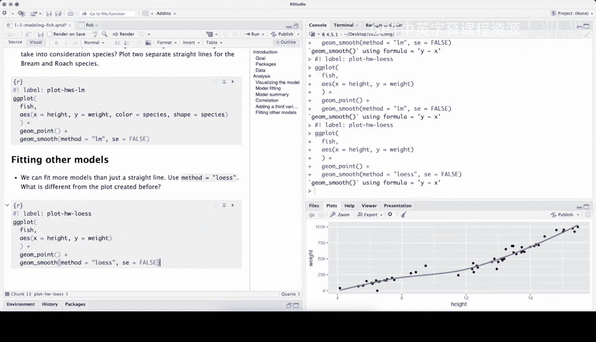

# 杜克大学《R语言数据科学｜Data Science with R》中英字幕 p41 04_01_03_代码实践：鱼类建模.zh_en -BV1Zpv6BaEkB_p41-

Hi， in this code alone， we're going to practice modeling using the fish data set on two common fish species in fish market sales。

 We're going to use a tidyverse package for data wrangling and visualization and the tidy models package for modeling。

 So let's go ahead and run this code cell to load our packages。😊。

And the data that we're going to use actually comes from CAgle a popular online venue for sort of machine learning or predictive modeling contests。

 so you might come across this data in other videos and other people's notebook examples as well Let's go ahead and read the data from where we keep the data for this specialization from our Github repository and take a look at it。

 there are a few ways we can take a look at it I can go to my environment and I can go ahead and click on this data let me zoom in a little bit and we can see that we have 55 entries that's 55 observations in the data。

And seven columns and the species column tells us the various species that we're going to be working with。

 and you can see we also have some body measurements on these species。

Let's take a look at the data dictionary。 We know the species of the fish that's a categorical variable。

 Then we have a bunch of numerical variables， weight in grams， and then in centimeters。

 vertical length， diagonal length， cross length， as well as height and diagonal width of the fish。

We can take a look at the data， we can print it in our notebook environment。

 but if you've seen the other code along videos in this specialization。

 you know that that is not my favorite way of looking at the data so I'm going to go ahead and click on this little gear icon and say that I would like to see my chunk output in the console and say I want to remove all of the existing output and so let's go ahead and print that data set to our console so our goal is to investigate the relationship between weights and heights of fish predicting weight from height。

😊。

First， we want to create an appropriate plot to investigate this relationship and we want to make sure that we add appropriate labels to it as well。

 You've seen this before many times， but this is going to be a nice way to warm up I want to make a plot so I'm going to use the Ggi plot function the data set that I'm using is fish and it says that I want to predict weight from height which means that height needs to go on my X axis and weight needs to go on my y axis If I was to go ahead and run this code。

 I get my empty canvas and I want to represent my data with point so I'm going to use G point for this。

And so this is what our data looks like This looks great。

 we can see a positive relationship between them as well as like clear two clumps of fish here。

 maybe that's going to be explained by the species we're going to find out。😊。

But let's also add some appropriate labels。 What do we mean here by appropriate labels。 I mean。

 the labels that we have here are pretty informative already x is height。Why is wait。

And I might want to add something like a title， something like weights。Versus heights of fish。

 Simply adding these hasn't made anything all that more informative。

 One nice thing you want to do when you're adding labels like this is to actually add units as well。

 So centime。And grams。If you were to draw a straight line to best represent the relationship between the heights and weights of these fish。

 where would it go and why， Let's take a look here。 I sort of。

 if I could draw over my computer would put the line over here somewhere。

 start from the very sort of like bottom corner from the origin of the data and then draw a diagonal line。

 so。Something like。Start from where。X is 4， and y is 0。 the origin and。Diaagonagonal line going up。

We wouldn't want to put a line you know， that has a downward trend or that's actually placed elsewhere in our plot。

It's easy to see where this line would go， given that this scatter is real tight here anyway。

 but let's go ahead and let R draw this for us。 So I'm going to go ahead and copy my code for making this plot。

And all I want is to represent my data in one additional way， I want a smooth curve， so a GO smooth。

 and because I want a line， I'm going to set my method to be LM。

And let's add another plus here to say all of these layers are going to go together。And here we go。

 we have our line here as well。What types of questions could this plot help answer， We could。

 for example， ask the question， is there a relationship between fish heights and weights。

You can also ask what is this relationship， quantify the relationship or make predictions with this relationship。

 So the options are endless and remember that when we fit models like this。

 we could be talking about answering predictive questions or we could be talking about answering descriptive questions。

Let's go ahead as the next prompt says， use this line to make predictions。 Preic what you think。

 So we're just sort of like looking at the visualization here and thinking about this。

 The weight of a fish would be with a height of 10，15 and 20 cm。

 So where would these go on our plot 10 would go somewhere right around here between 8 and 12。

 And if I was to draw a vertical line up to my line and then go across。

I would guesstimate this to be somewhere around maybe 375 grams。

So， let's say。For x equals 10 centimeters， I would estimate Y hat my predicted y to be somewhere around 375 grams。

 and let's see how we might do for the other ones as well， for 15 centimeters and for 20 centimeters。

 we should be seeing sort of a steady increase here， for 20 centimeters or for 15 centimeters。

 let's take a look maybe somewhere a little bit closer here。

 I would guess somewhere around 600 grams。

And for 20， that would be all the way out here， maybe I would guessimate somewhere around a little lower than thousand0。

 but higher than this， maybe let's say 975 grams of so。

Now the next question asks what is a residual， not to calculate a residual。

 because were only  guessimating the predicted values here。

 but the definition of a residual is the difference between the predicted and the observed values。

Observe values of the outcome。Am。And that's usually the vertical distance that we're seeing around the line。

 so if we actually had fish with these heights of 10， 15 and 20 centimeters。

 we could then measure them， get the observed， and compare to the predictions that we make based on our model。

Now that we have a sense of what we can do with this model， let's go ahead and actually fit it here。

 So to fit a model， because it's a linear model， I'm going to start with the linear reg function。

 And then I'm going to pipe that into my fit function。 My outcome variable goes first weight。

 And then verses I use the tilda to say versus height。

 And then the data frame that we're taking these from is called fish。

If I was to simply print this out， R will print out the model object for me。

 It says it's a parsnip model object。 The word parsnip here refers to the package within the tidy models's ecosystem that it's using to do the model fit。

 We are simply going to use the tidy model ecosystem and all the packages that come along with it without focusing too much on which little package does what。

 But sometimes you'll see in the our output the names of these packages。

 And you might also encounter them in errors as well。 So from this output。

 we can see what the intercept and the slope are。 but it's not formatted in a way that we're used to seeing。

 And we've also sort of just like spit it out this output as opposed to saving the model object。

 And we might need to use the model object for other things。 So let's go ahead and give it a name。

 I'm going to name this fish height weight。Fit remember that we get to name our models whatever we want。

 so I could have named this something entirely nonsensical as well。

 but what I generally like to do is to give some notion of what data I'm working with or at a minimum what variables I'm working with and then always use the underscore fit。

To signify or to signal that we have a model fit object here。

And if we want to take a look at the model output， I can use the tidy function。

And we can see those same numbers here， nicely formatted。

 along with some of the other statistics that we're going to refer to later in the course。 Now。

 it says based on this， predict what the weight of a fish would be for a height of 10，15 and 20 cm。

 And in order to be able to do this， we really need to think about what the model formula is。

 So our predicted fish。Weight is negative 288 plus 60。9 times the。

The height that we're making the prediction for， so that is negative。288 plus 60。9 times whatever。

H we want to calculate this for。 So for example， for the first fish， this would be a tent。

For the second fish， this would be a 15。 And for a third fish。 This would be a 20。

 It's a little annoying to have to change these around。

 So something that we might want to do is to create a new。 In this case， let's do a vector。

 I'm going to call them new fishies。And I'm going to create this factor with the C function to concatenate the values 10。

 15， and 20。😊，And then I can simply plug that vector into my equation。

And it will spit out each of the predicted values for me。

It also says calculate the predicted weights for all fish in these data and then visualize the residuals under this model。

 Now for the three new fishies， we created a custom vector and we actually sort of manually calculated their predicted weights。

 but now that we have to do it for 55 of them， let's try to take a more principled approach。

In order to make the prediction for all fish in this data set。

 we're going to leverage the model fit object that we have already created and saved。

 and we're going to use the augment function to go along with that。

So the augment function takes a model object。 that is fish H W fit。

 And then we can say take a new data set， although it's not really a new data。

 I'm going to use my existing data to ask for it to augment the。This data set with the model。

 What does that mean， It means take the data set。 Remember that our fish data set started with the species variable and augment it。

 So add variables to it。 and the two variables that it adds is dot pre for predicted value。

 So these are weight， hats and residuals。 So it actually calculates all the residuals for us as well。

Let's go ahead and save this outcome， and I'm going to use the same name as before or at least the beginning of the same name。

 but I will use AUG as my suffix to indicate augment， so underscore fit for model objects。

 underscore AUG for augmented dataset sets。Now that our data is stored with the additional variables。

 we should be able to visualize the residuals as these segments， so let's go ahead and do that。

Let's create agg plot of this data set。The augmented data set on the X axis。

 we're going to have our height。And on the y axis， let's put our weight from the original data。

 and I'm just going to add a Gm point here just to take a look at my data to begin with。Now。

 another thing that we're going to want to do is add that smooth curve， the linear model。

 we've already done that before， so let me go ahead and do it again。

 geometry smooth method equals a M by default R is going to give this a blue color。

 I want to deemphasize that line a little bit。 So I'm going to change the color to light gray and then the other thing that it does is it adds this gray band around it that gray band is the standard error of the model。

 a measure of the uncertainty in our predictions。 We're not looking at the uncertainty in our predictions yet。

 we're going to look at uncertainty quantification later in the course。

 So let's go ahead and turn that off with the Se argument for standard error set to false。

So our model is now here and what we want to do is we actually want to add the segments of lines to our visualization that show us each of the residuals。

 How might we go about doing that。 We're going to do that with GM segment。

And now let's think about what are the various sort of coordinates we want to use for these segments。

 So in the aesthetic mappings， I can say。If each segment starts at height。

 these are going to be vertical segments。 they should each end at height as well so that we get a bunch of segments that have the same x coordinate。

And if each segment start at the observed value， the height。

 each segment should end on the y axis at the predicted value， and the predicted value， remember。

 in this augmented model object if we printed it one more time。

 is stored in a variable called dot pre。And let's give this。ADifferent color， maybe。

Let's do red for a second just so we can see those segments really easily。Something odd is happening。

 I've gained randomly a legend for my。For my plot where I definitely don't need one。

 the reason for that is that I have accidentally put this definition color red into my aesthetic mappings。

 This is not a mapping， but instead it's just something that I want to set so I'm going to take it outside of my aesthetic mapping。

 so now we can see each of our residuals given in this way as well。

If you are like me looking at this plot closely， it might bother you that those segments are sort of showing up on top of these points。

 so if you wanted the points to be overlaid instead on the segments。

 you can simply achieve that by changing the order of the layers in your plot so we can move the layers around in order to figure out。

What we want at the bottom versus on the top layer of our plot。

 I could now add titles and other labels to this as well。 But let let's go ahead and carry on。

The next thing we're asked to do is to display the model summary。

 including estimates for the slope and intercept， along with measurements of uncertainty around them。

In order to do that， I can simply use the tidy function and remember I'm going to use the tidy function around my model fit object so that fish underscore HW underscore fit。

Deleting this can be taken out as well， continue from here。

If I want to extract these values from the model output， why might I want to do that， For example。

 I might want to write a sentence like the slope of the model is some number I know that that number is 60。

9。 I can hand type it here。 but that doesn't seem like great practice。

 I actually might want to extract that and use some inline code notation in order to be able to get that into my rendered document How would I do that let's go ahead and give that an example in order to do so I'm going to go ahead and insert a new code chunk。

I'll added a label， extract slope。And let's say， my slope is。

The first thing I want to do is to get this tidy model output。And then。

I might want to filter for the appropriate row。 So where term is equal to。Height。Oops。

So if I was to run this。That gives me just a row。 And then since I want to simply extract the column estimate。

 and I don't want it to be in a data frame anymore。 I simply want the number。

 I can say pull the value of the estimate for me。 So going forward。

 slope is actually stored as this number。SoSpe is actually stored out as that number。

 and I can print it out either in my console or I can say that I'm going to use some inline code。

And in order to do this， I could go ahead。And use code formatting so if I was to render my document。

 I should be able to see that number 60。9， but not have it be hand typed in。

 So if my data was to change or my model was to change， I can extract that easily。

 Let's go ahead and find where that is。Now this is looking good ish， it's not looking great。

 it's actually giving us a lot of decimal points， so if I want instead I can add more code here and say we want to round it to the first decimal place and let's go ahead and render that one more time。

😊，And we can see that on the render document， you can't tell where that number is coming from。

 but we know that under the hood， we're doing things in a reproducible way。

Now another thing we're going to do with this model is to write it out using mathematical notation。

In order to do math text in a corto document I'm going to use my insertt Anything tool using the forward slash and say that I want to do not inline math。

 it's not going to be in a sentence but instead display math and our model is weight hat。

 let's say that's the predicted the。Intercept is negative 288 plus the slopeus 60。

9 times the name of the variable height。 you can see here in the sort of the little preview in my editor what this is going to look like when rendered。

 It looks okay。 It just doesn't look great。 So if you're interested in learning a little bit of math notation using latec。

 we can get things to look a little bit prettier。 So in latec， the hat。

We would use a wide hat and then use curly braces to say this should go around the word weight。

 And another thing we can do is to use a proper times sign in order to get an X。

 So if I was to render this document， we're going to see that our。

Model output looks nicely sort of math type set in our document。Next。

 it says we can also assess correlation between two quantitative variables。 First of all。

 what is correlation， Correlation tells us the strength and。Direction。Of the linearar association。

Between two numerical variables。And it can take on the values。Between。Negative one for a negative。

 perfect relation and positive one for a positive， perfect relation。

It's not that easy to guess the correlation between variables。

 Let's take a look at this visualization， maybe something a little cleaner here。 I mean。

 we would want expect this number to be positive。We would probably expect it to be close to one because there isn't a lot of scatter。

 but it's hard to tell07。8。9。99。75， that would be impossible to pin down exactly。

 But as you see more visualizations and train your eye to recognize what the correlation might be between two variables you're looking at。

 you can get a pretty good sense of things which can be helpful for mental checks along the way。

 So if you are interested in giving it a try。 I recommend visiting this site where you can basically play a game where you can create a new data point and then make a guess for a correlation。

 So here I would guess this to be a negative number。 And I'm gonna guess negative 。8， for example。

 And if I guess you can see that I thought it was a lot stronger than it really was。

 the correct answer was negative 0。684。😊，You can do this many。

 many times again just to train your eye to work with it。

 but let's go ahead and take a look at how would I actually calculate this correlation in order to calculate this correlation。

 just like any other summary statistic， I would start with my data frame。

 pipe that into the summarize function。I'll give it a name for the summary statistic give I'll say that is the correlation or maybe just R。

 the notation we've used in the slides and then say this is the correlation between height。

And weight of these fish。 So this comes out to be 0。954 pretty strong correlation。Now。

 let's do one more thing。 It says， does the relationship between heights and weights of fish change if we take into consideration species。

 plot two separate ster lines for the brim and roach species。 How might we go about doing that。

In order to do that， I'm going to actually go back and cheat a little bit。 grab my code， where I had。

May this plot。I can use my original data set。 I don't need the augmented data set。

 and maybe I don't actually need to change the color either。

 but I will keep the Se false because I just want to look at the line and let's go ahead and add our points as well。

If I want two separate lines， it means that I need to bring in another aesthetic mapping。

 So let's go ahead and bring the aesthetic mapping here。 I may want a color by species。

 And whenever we use color to distinguish things， it's good practice to also change the shape as well。

And since things are getting long， I'm going to break up this line of code。or better visibility。

 So this is what things look like now we can see that the fit actually looks a lot better for each of these lines。

 the fit is tighter and that separation that we were seeing in our points in fact。

 can be explained by the species。 So this is setting us up for fitting models with multiple predictors in them In this case。

 both height and species for predicting weight。 we're going to look at that later in the course。

Before we go on now， let's do one more thing。 We can fit more models than just a straight line。

 So this time， we're asked to use a method low S as opposed to L M。

 And let's take a look to see what that does。 I am going to grab this code here。😊。

It doesn't say to consider species， I'm going to take that back out。😊，First。

 let's make our plot and then say I want to change。The method to lowest。

 And you can see that it's starting to create a little bit more of a bend for me to sort of capture that break in the points。

 This is a nonlinear model， not something we're going to directly address in this course。

 but it's important for you to know that there are models other than linear ones and fitting them simply means changing some parameters and the functions that you've already been learning in order to either visualize or summarize them。

