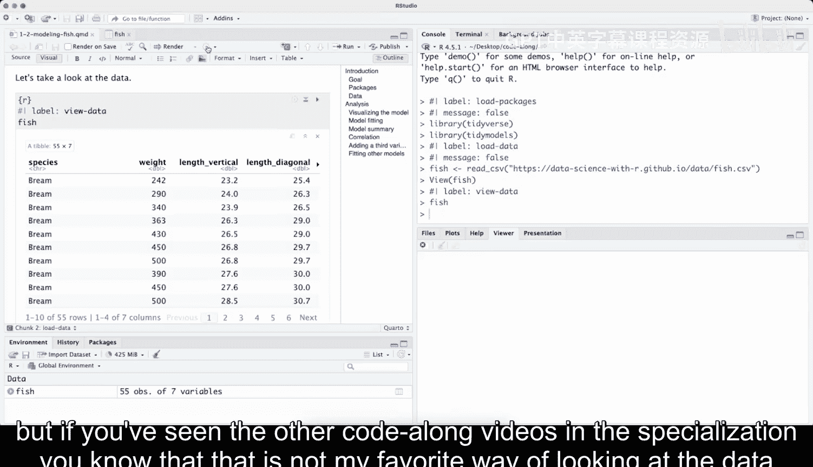
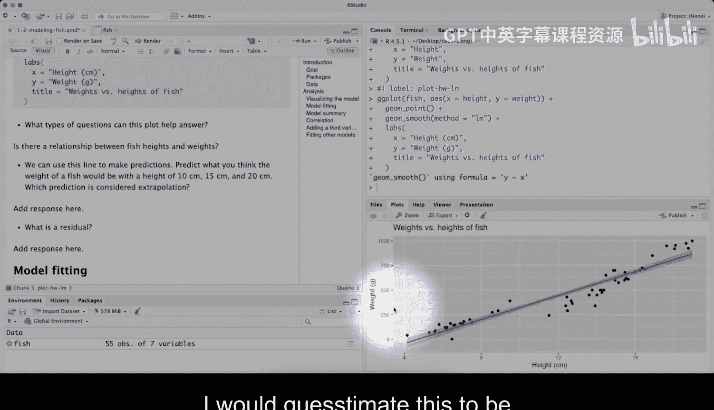
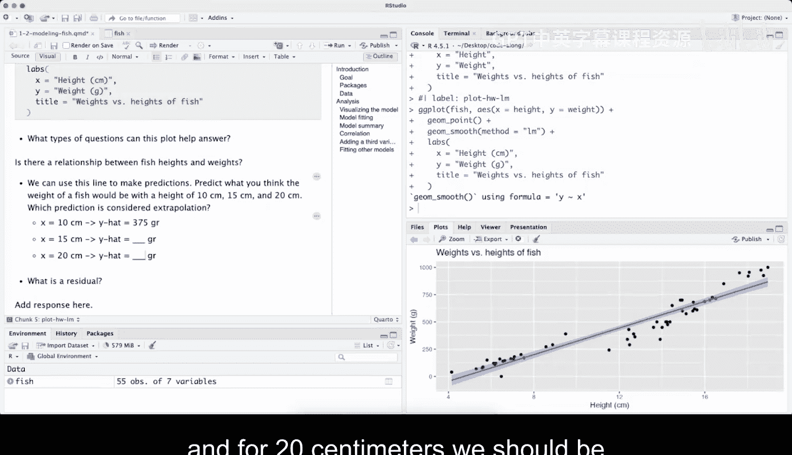
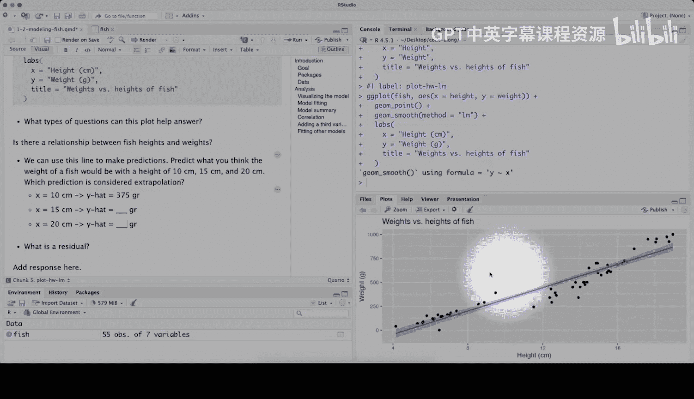
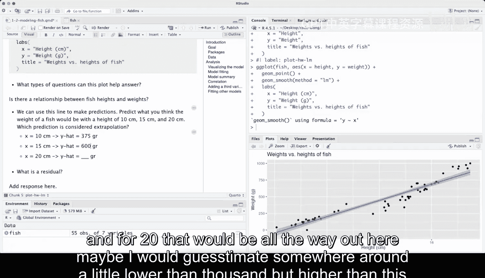
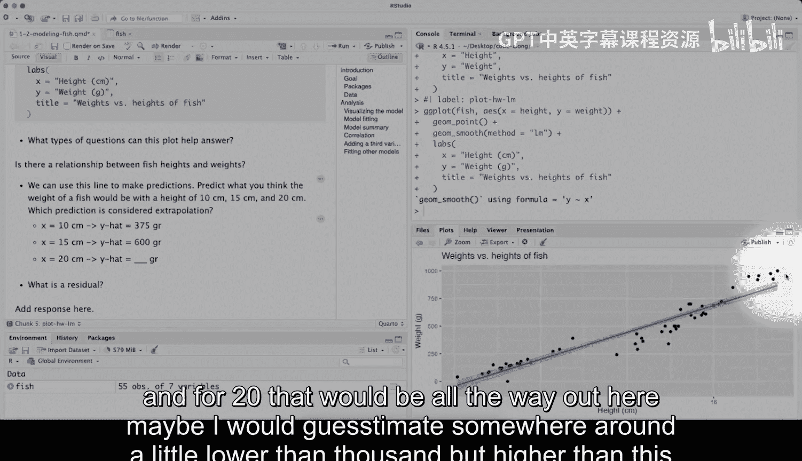
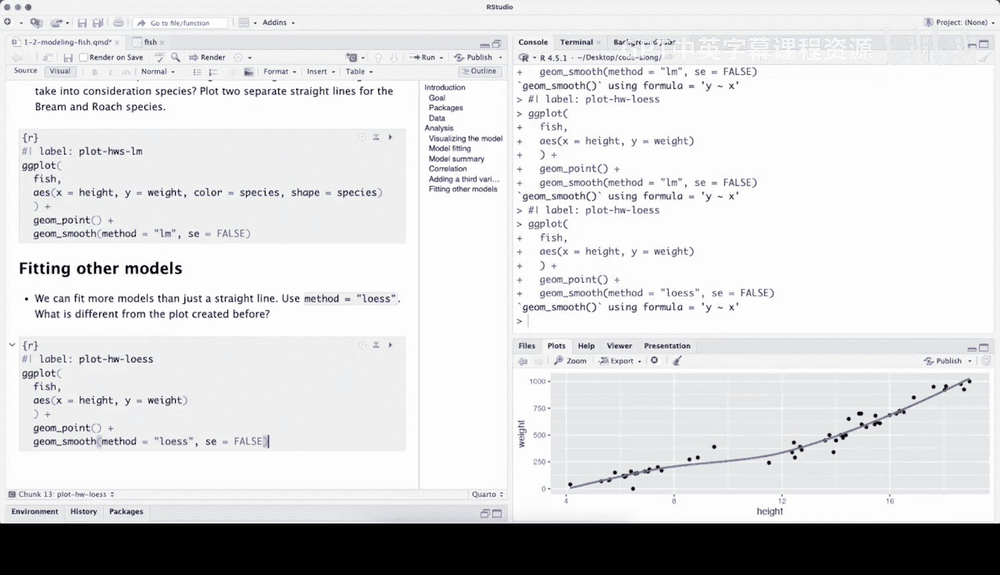

# R语言数据科学：04_01_03：代码实践：鱼类建模 🐟


在本节课中，我们将使用鱼类数据集进行建模实践，重点关注两种常见的市场销售鱼种。我们将使用 `tidyverse` 包进行数据处理和可视化，并使用 `tidymodels` 包进行建模。

## 加载数据与初步探索

首先，我们运行代码单元来加载所需的包。

```r
library(tidyverse)
library(tidymodels)
```



我们将使用的数据来自Kaggle，这是一个流行的机器学习和预测建模竞赛平台。让我们从本课程的GitHub仓库读取数据并查看其结构。

```r
fish <- read_csv("https://raw.githubusercontent.com/your_repo/fish.csv")
```

查看数据有多种方式。我们可以点击环境面板中的数据对象，或者将其打印到控制台。数据包含55个观测值和7个列。`species` 列告诉我们鱼的种类，其他列则是鱼的身体测量值。

以下是数据字典：
*   `species`：鱼的种类（分类变量）。
*   `weight`：重量（克）。
*   `vertical_length`：垂直长度（厘米）。
*   `diagonal_length`：对角线长度（厘米）。
*   `cross_length`：交叉长度（厘米）。
*   `height`：高度（厘米）。
*   `diagonal_width`：对角线宽度（厘米）。

我们的目标是研究鱼的重量与高度之间的关系，即根据高度预测重量。

## 可视化关系

首先，我们创建一个合适的图形来研究这种关系，并确保为其添加适当的标签。

```r
ggplot(data = fish, aes(x = height, y = weight)) +
  geom_point() +
  labs(title = "鱼类重量与高度关系图",
       x = "高度 (厘米)",
       y = "重量 (克)")
```



这段代码创建了一个散点图，其中高度在x轴，重量在y轴。我们可以看到一个正相关关系，并且数据点似乎分成了两个簇，这可能与鱼的种类有关。





为了更清晰地量化这种关系，我们可以在图上添加一条最佳拟合直线。





```r
ggplot(data = fish, aes(x = height, y = weight)) +
  geom_point() +
  geom_smooth(method = "lm", se = FALSE, color = "lightgray") +
  labs(title = "鱼类重量与高度关系图（含线性拟合）",
       x = "高度 (厘米)",
       y = "重量 (克)")
```

参数 `method = "lm"` 表示使用线性模型进行平滑，`se = FALSE` 表示不显示置信区间。

这个图可以帮助我们回答许多问题，例如：鱼的重量和高度之间是否存在关系？这种关系是什么？我们还可以利用这条线进行预测。

## 基于图形进行预测

现在，让我们尝试仅通过观察图形来预测高度为10、15和20厘米的鱼的重量。
*   对于高度10厘米，预测重量约为375克。
*   对于高度15厘米，预测重量约为600克。
*   对于高度20厘米，预测重量约为975克。

**残差** 是观测值与模型预测值之间的差异，在图形上通常表现为数据点到拟合线的垂直距离。

## 拟合线性模型

接下来，我们正式使用R来拟合一个线性模型。

```r
fish_height_weight_fit <- linear_reg() %>%
  fit(weight ~ height, data = fish)

tidy(fish_height_weight_fit)
```

`linear_reg()` 函数指定了模型类型，`fit()` 函数执行拟合。公式 `weight ~ height` 表示用 `height` 预测 `weight`。我们将模型对象保存为 `fish_height_weight_fit`，并使用 `tidy()` 函数以整洁的格式查看模型摘要，其中包括截距和斜率的估计值。

根据输出，我们的模型公式为：
**$$\widehat{weight} = -288 + 60.9 \times height$$**

现在，我们可以使用这个公式进行精确计算，预测高度为10、15和20厘米的鱼的重量。

```r
new_heights <- c(10, 15, 20)
predicted_weights <- -288 + 60.9 * new_heights
predicted_weights
```

## 计算并可视化残差

为了计算数据集中所有鱼的预测值和残差，我们使用 `augment()` 函数。

```r
fish_height_weight_aug <- augment(fish_height_weight_fit, new_data = fish)

ggplot(data = fish_height_weight_aug, aes(x = height)) +
  geom_point(aes(y = weight)) +
  geom_smooth(aes(y = weight), method = "lm", se = FALSE, color = "lightgray") +
  geom_segment(aes(xend = height, y = weight, yend = .fitted), color = "red", alpha = 0.6) +
  labs(title = "线性模型拟合与残差可视化",
       x = "高度 (厘米)",
       y = "重量 (克)")
```

`augment()` 函数将原始数据与模型的预测值（`.fitted`）和残差（`.resid`）合并。我们使用 `geom_segment()` 绘制从每个观测点到其对应预测点的红色线段，这些线段直观地展示了残差。

## 提取模型参数

有时我们需要从模型输出中提取特定数值（如斜率），以便在报告或文档中动态引用。

```r
slope <- tidy(fish_height_weight_fit) %>%
  filter(term == "height") %>%
  pull(estimate) %>%
  round(1)

# 在R Markdown中，我们可以使用内联代码 `r slope` 来输出这个值。
```

## 评估相关性

**相关系数** 衡量两个数值变量之间线性关系的强度和方向，其值介于-1（完全负相关）到1（完全正相关）之间。我们可以直接计算高度和重量的相关系数。

```r
fish %>%
  summarize(r = cor(height, weight))
```

计算出的相关系数约为0.954，表明高度和重量之间存在非常强的正线性关系。

## 考虑物种的影响

之前我们注意到数据点可能按物种聚类。现在，我们分别为 `Bream` 和 `Roach` 这两种鱼绘制单独的拟合线。

```r
fish_filtered <- fish %>% filter(species %in% c("Bream", "Roach"))

ggplot(data = fish_filtered, aes(x = height, y = weight, color = species, shape = species)) +
  geom_point() +
  geom_smooth(method = "lm", se = FALSE) +
  labs(title = "按物种分组的重量与高度关系",
       x = "高度 (厘米)",
       y = "重量 (克)")
```

通过按物种着色并分组拟合，我们可以看到每条拟合线对其对应物种的数据拟合得更紧密。这说明在预测重量时，同时考虑高度和物种可能会得到更好的模型，这为后续学习包含多个预测变量的模型奠定了基础。

## 尝试非线性拟合

最后，我们探索一下线性模型之外的拟合方法。例如，使用局部加权回归（LOESS）来拟合一条平滑曲线。

```r
ggplot(data = fish, aes(x = height, y = weight)) +
  geom_point() +
  geom_smooth(method = "loess", se = FALSE) +
  labs(title = "使用LOESS方法的非线性拟合",
       x = "高度 (厘米)",
       y = "重量 (克)")
```

将 `method` 参数改为 `"loess"` 后，拟合线变得弯曲，更能捕捉数据中的非线性模式。这提醒我们，除了线性模型，还有许多其他类型的模型可供选择。

## 总结

在本节课中，我们一起学习了：
1.  **探索性数据分析**：使用 `ggplot2` 可视化两个数值变量（鱼的高度和重量）之间的关系。
2.  **简单线性回归**：使用 `tidymodels` 的 `linear_reg()` 和 `fit()` 函数拟合模型，理解截距和斜率的含义。
3.  **预测与残差**：根据模型进行预测，并理解残差是观测值与预测值之差。
4.  **模型诊断**：使用 `augment()` 获取预测值和残差，并通过可视化残差来评估模型拟合情况。
5.  **相关性**：计算并解释相关系数，以量化线性关系的强度。
6.  **引入分类变量**：探索了在分析中考虑第三个变量（如物种）的影响，为多元回归做准备。
7.  **模型灵活性**：简要尝试了非线性拟合方法（LOESS），了解了模型的多样性。



通过这些步骤，你实践了从数据探索、模型拟合、结果解释到简单诊断的完整建模流程。