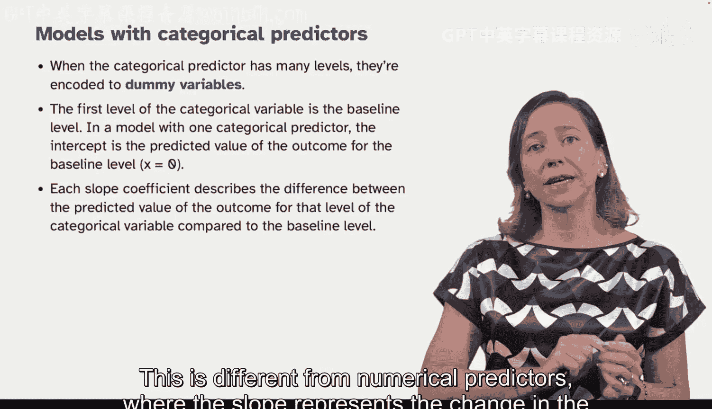
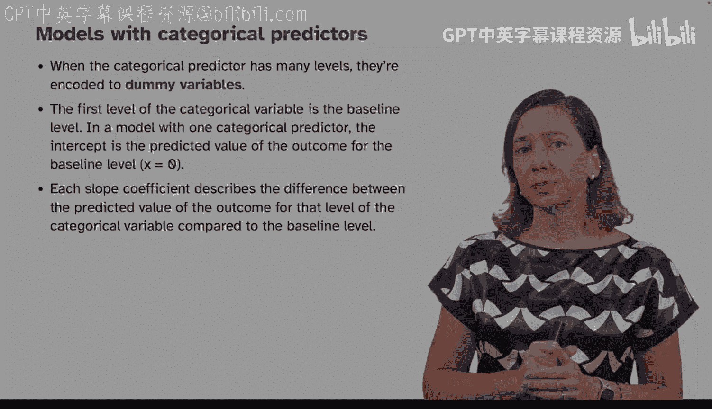

# 杜克大学《R语言数据科学｜Data Science with R》中英字幕 p42 05_01_01_使用分类预测变量的线性回归.zh_en -BV1Zpv6BaEkB_p42-

🎼。

In this video， we'll work through another simple modeling example， predicting a numerical outcome。

 But this time from a categorical predictor， let's start with some setup for this analysis。

 we'll be using three packages。 The Palmer penguins package provides us with a data set about antarctic penguins。

 As always， well use a tidy verse for data wrangling and visualization and tidy models for modeling。

We'll work with the penguins dataset set from the Palmer penguins package。

 which contains information on body measurements of 344 Antarctic penguins from three islands， Bisco。

 Dream and Togerson。 We have measurements for each penguin， including their body mass。

 B length and depth， Fper length and， of course， which island there were observed in。

And Search data allows us to explore how penyan characteristics might differ across different locations。

Here's our research question。 A researcher wants to study the relationship between body weights of penguins based on the island they were recorded on。

 Let's think about how the variables involved in this analysis are different from what we've seen before。

Our outcome variable is body weight。 This is numerical， just like in our previous examples。

 but our predictor variable is island。 and this is categorical。

 Island isn't something we can put on a numerical scale。 Bisco isn't more or less than dream。

 They're just different categories。 This fundamental difference in the type of predictor variable means we need to think a bit differently about our modeling approach。

 But before modeling， let's take a look at the data。

 which requires deciding which type of visualization to make to explore the relationship between body weight and island。

 a scatter plot wouldn't work。 because we can't meaningfully plot island on a continuous axis。

 side by side box plots。 However， are ideal for visualizing the distribution of a numerical variable across the levels of a categorical variable。

 Similarlyly， violin plots and density plots would work well for comparing distributions。

 On the other hand， bar plots and stack bar plots are designed。😊，For categorical data only。

 not for visualizing the relationship between a numerical and a categorical variable。

Here's what the plot looks like。 This box plot shows the distribution of body mass for penguins from each island。

 We can see something in some interesting patterns。

 Penguins from Bisco Island tend to be heavier on average。

 While those from dream and Toguson Islands have similar， somewhat lower body masses。

Now let's fit a model to quantify this relationship。

Let's fit a linear regression model to predict body weight from island。

 The syntax looks very similar to what we've used before。

 we're still using the linear reg function and fitting body mass G as a function of island。

Then we tidy the model output to see the model summary。

 The summary shows something interesting and different from our previous models。

 Despite having a single predictor， Island， the model output shows two slope terms called Island Dream。

 an island Togerson。😊，And Bisco is missing。 Why this is a crucial concept in understanding regression models with a categorical predictor。

 When we fit a model with a categorical predictor， the levels of that predictor are encoded into what we call dummy variables。

 However， we don't need a dummy variable for every level。 We leave out one level。

 which becomes our baseline level。In this case， Bisco is the baseline level。

Each slope coefficient describes a predicted difference in body weight for that particular island compared to the baseline level Bisco。

Let's understand how dummy variables work for our three islands， we create two dummy variables。

 one for dream and one for togerson。When dream equals 1 and togerson equals 0。

 the penguin is from Dream Island。 When dream equals 0 and togerson equals 1。

 The penguin is from Togerson Island。 When both dream and togerson equals 0。

 The penguin is from Bisco Island。 This is why we only need K-1 dummy variables for a categorical predictor with K levels。

 the baseline level is identified by all dummy variables being 0。 An important note， though。

 you don't need to create these dummy variables yourself。

 R does this automatically when you include a categorical predictor in your model。

 whether your categorical variable is stored as a character or as a factor。

 R will handle the dummy coding behind the scenes。😊，Now let's go back to our model。

 our model equation says the predicted body mass equals 4，716 minus 1003 times Island dream。

 minus 1010 times Island togerson。The intercept tells us about our baseline group。

 penguins from Bisco Island are expected to weigh on average 47，16 grams。

The slope for island Dream tells us about the predicted difference between penguins from Bisco and Dream Islands。

 penguins from Dream Island are expected to weigh， On average。

003 g less than those from Bisco Island。 It's less because the sign of the slope is negative。

Similarly， the slopelope for Island Togerson tells us that penguins from Togerson Island are expected to weigh。

 on average，1010 gram less than those from Bisco Island。

 Notice that each slope coefficient tells us about the difference between a given group and the baseline group on average。

We can also use the same model for making predictions using our equation。

 we can calculate the predicted body mass for penguins from each island。 for penguins from Bisco。

 we plug in zeros for both dummy variables。 The predicted body mass is just the intercept，47。

16 grams。For penguins from Dream Island， we plug in one for our island dream and 0 for the other dummy variable and so for the predicted weight。

37，13 G。 And finally， for penguins from Togeren， we plug in one for island togeren and 0 for the other dummy variable。

 Not how the dummy variables turn on for the appropriate island and turn off for others。😊。

And the calculated outcome values are what the model predicts as the average weight of penguins from that island。

We can also use R to make these predictions somewhat automatically or with code。 First。

 we create the data frame with one penguin from each island。😊。

Note that we spell the name of the variable and the names of the islands exactly the same way。

 Theyre spelled in the original dataset set， capitalizations and all。

 Then we use the augment function， where we provide the model object and this new data frame we just created。

 The results match our manual calculations。 Bisco penguins are predicted to weigh 47。

16 G on average dream 37，13 toers and 3706。 This automated approach would be a lot handier if we were doing prediction for a bunch of penguins with a model with a bunch of variables。

😊，As we wrap up this video， let's summarize the key concepts for models with categorical predictors。

 First， when a categorical predictor has multiple levels， they are encoded into dummy variables。

 This happens automatically in R， during model fitting。Second。

 the first level of the categorical variable becomes the baseline level in models with one categorical predictor。

 the intercept represents the predicted value of the outcome for this baseline level。Third。

 each slope coefficient describes the difference between the predicted value for that level of the categorical variable compared to the baseline level。

 This is different from numerical predictors where the slope represents the change in the outcome per unit increase in the predictor。

