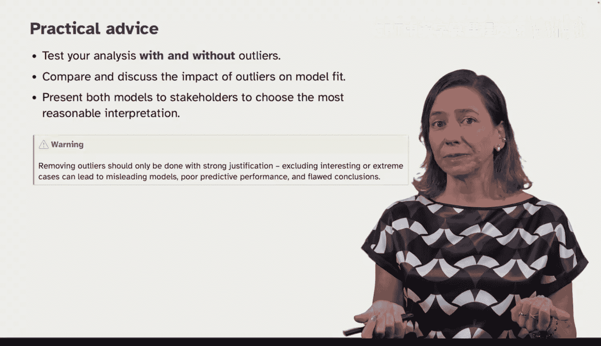

# 杜克大学《R语言数据科学｜Data Science with R》中英字幕 p43 06_01_02_线性回归中的异常值.zh_en -BV1Zpv6BaEkB_p43-

🎼。

In this video， we'll discuss outliers and linear regression， in other words。

 points that fall far from the main cloud of observations。

These points can be outlying in the X direction， the Y direction or both。 However。

 Bak outlying in a univariate sense does not always mean being outlying from the bivariate model。

 Some points may be extreme on the distribution of a single variable。

 but if they fall in line with the overall trend in the relationship between two variables。

 That is with the bivariate model， they might not stand out as outliers in the linear regression。

Points that are in line with the bivariate model usually do not influence the least squares line。

 even if they are extreme in the x direction， the y direction or both。

Let's look at three different scatter plots to understand this better In plot A。

 we've highlighted an outlier that is extreme in the wide direction。

 It's much lower than the rest of the data because it doesn't follow the overall pattern。

 It does slightly influence the regression line。In plot B。

 we see a point far out in x and y directions， but it actually lies very close to the regression line。

 This means it's not influential， the line of best fit would be nearly the same with or without it。

In plot C， the outlying point is far away in both X and Y directions。

 and it's not in line with the rest of the data。 It pulls the regression line upward。

 leading to a worst fit for the majority of the points。 This is an influential point。

 The residual plots below each graph give us another perspective。

 They show how far each point lies from the model predictions。Next。

 let's look at another trio of examples。 In plot D。

 we see a small cluster of points far to the right。 These aren't just outliers。

 They form a secondary cloud that strongly influences the regression line。

 pulling it towards themselves in plot E， a single point is far off to the right。

 and it completely dictates the slope of the regression line。

 creating the illusion of a trend where nonex in the main data。 Finally， in plot F。

 the outlying point is also far out in the X and y directions， but it lies along the existing trend。

 It has high leverage， but does not influence the model。😊，Now that we've seen some examples。

 let's establish the terminology。 Outliers are points that stand apart from the rest in any direction。

 leverageverage points fall horizontally away from the center of the main data cloud。

 and they tend to pull harder on the line。 So we call them points with high leverage or leverage points。

Influential points are those that actually influence the regression model。

We consider a point influential if the slope or position of the line would shift significantly without it。

 So remember， not all outliers are influential， but many influential points are outliers with high leverage。

Here's some practical advice for modeling data with outliers。

 Always test your analysis with and without suspected outliers。

 Compare and discuss the impact of outliers on model fit。

 Pre both models to stakeholders to choose the most reasonable interpretation。 And don't forget。

 Be very careful about removing outliers。 unless theres a strong defensible reason to exclude them like data entry errors。

 removing unusual points can backfire。 It can lead to models that are overly optimistic。

 miscritical cases or even support misleaing conclusions。 Always treat outliers as information。

 not just as noise。 Outliers can be subtle， tricky to work with and sometimes misleading。

 but understanding how they effect your models is a crucial part of sound statistical modeling。

 So always ask， what's this point trying to tell me。

