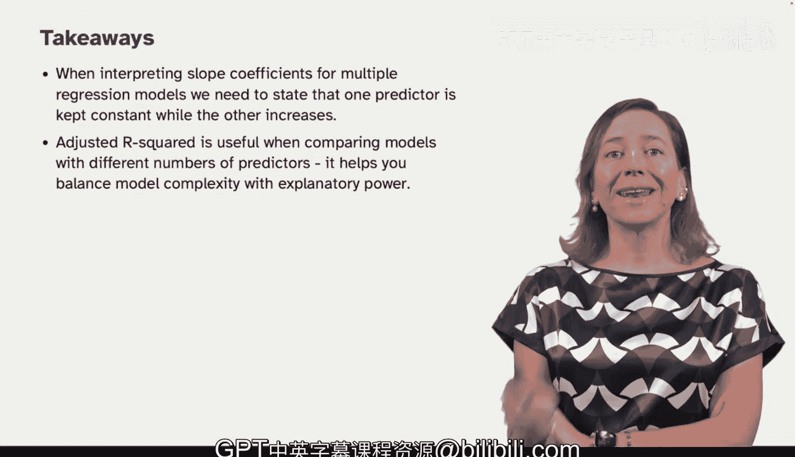

# 杜克大学《R语言数据科学｜Data Science with R》中英字幕 p44 07_02_02_多预测变量的线性回归.zh_en -BV1Zpv6BaEkB_p44-

🎼。

In this video， we're going to introduce building linear models with multiple predictors。

 Before we dive into our analysis， let's load the necessary R packages。

 We'll be using three key packages in this analysis。 D AA G for our data set。

 tidy verse for data wrangling and visualization， tidy models for modeling。

 will analyze the allbacks data frame， which contains measurements on 15 books collected from Professor J H。

 Madonald's bookshelf at Australian National University。 Each book has four key features。

 volumee measured in cubic C area and square centimeters。

 We won't be working with this variable much weight in grams and cover hard back H B or paperback PB。

😊，Let's start with our first model， a simple linear regression predicting weight from volume alone。

 As usual， we use the linear reg function to specify the model。

 and then the fit function to fit it using the model formula weight versus volume and specifying the data frame as allbackax。

 We store the model object as allback1 fit。 and then use the ti function to display the model summary。

😊，Looking at our model output， we can see that the slope coefficient is 0709。

 This means for every additional cubic centimem of volume。

 the model predicts the weights of books to be higher by 0709 G， on average。

The scatter plot shows a clear positive relationship between volume and weight。

 which makes intuitive sense。 Big books tend to be heavier books。

But we know the volume of the book isn't the only thing affecting its weight。

 whether the book is paperback or hard back will also have an effect on the weight。

So let's enhance our model by adding cover type as a predictor。

 This gives us a multiple linear regression model。 The only change in the code is in the fit function where we now add literally using the plus operator cover as a predictor to the model formula。

 So now its weight versus volume and cover。 Not that this not only adds a new slope coefficient。

 but also slightly changes the existing one。 The volume coefficient is now 0718 and the cover coefficient is negative hundred 84。

 Also， note that since cover is a categorical variable。

 A dummy variable for paperback has been created called cover Pb。 and hard back。

 the level that comes first alphabetically is a baseline level and hence not represented on the model output。

 We'll talk about what that number， negative184 means shortly。😊。

The plot still shows the same positive relationship between volume and weight。

 but we can now identify which books are hard back and which are paperback。

The hardback books shown in orange circles tend to be higher on the scatter plot than the paperback books shown in purple triangles。

Let's carefully interpret the coefficients from the multiple linear regression model。The slope of 0。

7184 volume says that keeping cover constant， for each additional cubic centimeter books are larger in volume。

 the model predicts the weight to be higher on average by 0。718 grams。

The slope of negative 184 for cover PB means keeping volume constant。

 the model predicts that paperback books weigh on average， 184 grams less than hard back bookss。

The intercept of 198 represents the predicted weight of hard back books with zero volume。

 which doesn't make practical sense。The notion of holding other variable constant is new。

 and it's here to stay as long as you are working with models with multiple predictors。

 What we mean by that is that the coefficient estimates tell us about the predicted change in the outcome when the given predictor changes while the other stays constant。

In the case of books and their volumes and cover types and weights， this seems conceivable。

 A book's weight can increase as its volume increases， which without changing the cover of the book。

 it's feasible to have pretty large paperback books。 After all。 But sometimes in nature。

 this might be a very unrealistic assumption。 It's very difficult to change the rainfall without changing humidity。

 for example。 So when we're using linear models with independent predictors。

 we need to consider whether these simplifying assumptions we're making are feasible in nature or whether we need to consider the interaction between the predictors。

 That's the topic of the next video。 for now， let's stick to this model。 So far with fit two models。

 One predict predicting weight from volume alone and one predicting weight from volume and cover type。

 How do we know which model is better。😊，Let's examine r squared。

 which measures the percentage of variability in the outcome variable weight that our model explains。

 Our first model， using only volume， explains about 80。3% of the variability in book weights。

 This comes from the R squared value in the output of the glance function。Our second model。

 adding cover type， explains about 92。7% of the variability in weights。

 This is a substantial improvement。 However， there's an important caveat。

 R squared always increases when we add predictors to a model。

 regardless of whether they're truly helpful。This is where adjusted r squared enters the scene。

Adjusted R squared penalizes models for having additional predictors。

 The idea behind it is that if you are complicating how we explain the variability。

 you incur a penalty。 If then the adjusted R squared value is still higher。

 meaning that even with the penalty， the gain in R squared is high enough。

 It means a new predictor does meaningfully add predictive power to the model。 So it's worth keeping。

 This is why we say adjusted R squared is a more objective and hence better statistic for comparing models with different numbers of predictors。

The adjusted r squared of the first model is 0。787。

 The adjusted r squared of the second model with the additional predictor is much higher at 0。915。

 Therefore， Model 2 is preferable for predicting book weights。 before we wrap up。

 let's visualize our models。In Model 1， we see our data points with a single regression line fitted through them。

 The line captures the general upward trend， but notice how the points are scattered around the line。

 This represents the unexplained variability in our model。 with an R squared of 。803。

 We're explaining about 80% of the variation in book weights with volume alone as the predictor。😊。

Our second model tells a much richer story。 We now have two parallel regression lines。

 orange for hard back books and blue for paperback books。

 The parallel lines say that weight increases similarly as volume increases for both hard back and paperback books。

 but paperback books consistently weigh less。 Notice how the points' cluster more closely around their respective lines compared to our first model。

 This visual improvement matches our increase R squared values。

It's very important to note that we didn't discover that weight increases similarly as volume increases for both hardback and paperback books。

 though， instead we have enforced this parallel structure by fitting a model to predict the weights from two independent variables。

The takeaways from this video are that when interpreting slope coefficients for multiple regression models。

 we need to state that one predictor is kept constant while the other increases and that adjusted r squared is your friend when comparing models with different numbers of predictors。

 it helps you balance model complexity with explanatory power。

