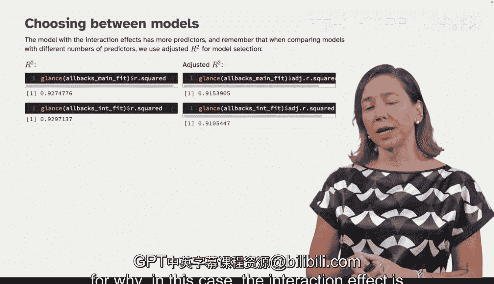

# 杜克大学《R语言数据科学｜Data Science with R》中英字幕 p45 08_02_01_主效应与交互效应.zh_en -BV1Zpv6BaEkB_p45-

🎼。

In this video， we'll discuss when to include interaction effects between your predictors in your models and how to choose between competing models with and without interaction effects using the principle of Aham's Razor。

Before we dive into our analysis， let's load the necessary R packages。

 We'll be using three packages again， DAAG for our data set。

 tidyverse for data wrangling and visualization and tidy models for modeling will once again work with the allbacks data on 15 books predicting their weights from volume and cover type。

Will consider two possible explanations when predicting weights of books from their volume and cover type。

 The relationship between volume and weight doesn't vary by cover type。

 or the relationship between volume and weight does vary by cover type。

 The first one is depicted in the first plot with parallel lines。

 And the second one in the second plot with nonpar lines。 Vily。

 which of these look like a better fit。 It's a little hard to tell。

 And sounds like a subjective question。 So let's try to formalize things a bit more before making a call。

Let's establish our guiding principle， Ahams Razor。

 This principle tells us that among competing hypotheses that predict equally well。

 the one with the fewest assumptions should be selected。

Model selection follows this principle in modeling terms。

 This means we only want to add another predictor to the model。

 If the addition of that variable brings something valuable in terms of predictive power of the model。

 In other words， we prefer the simplest， best model， the parsimonious model。

So let's take another look at these plots， which of these two models is preferable under Oum's Razor。

They don't seem to be very different。 The non parallel lines do not have wildly different slopes。

 Both models seem to fit the data reasonably well， but the parallel lines model is simpler。

 Unless the interaction model provides substantially better predictions。

 We should prefer the simpler main effects model。 Could we come up with a way to quantify this decision。

 though， before making a choice， though， let's pause and review how we fit these models。Model 1。

 what we call the main effects model， the one that considers only the main effects of volume and cover type and no interaction between them is the one we've seen before。

 We use linear reg to specify the model， the fit function to fit the model using the plus operator between the predicted variables and tidy to display the model summary。

 We can also use the glance function to display model level statistics like R squared and adjusted R squared and a bunch of others。

 some of which you'll learn about later in the course and some potentially in future courses。

 If you choose to continue your modeling adventures。😊，In Model 2。

 we add an interaction effect between the predictors。

 allowing the rate of change for weights to vary by cover type as volume increases。

 We once again specify the model with linear reg， but then we add an additional predictor that is a product of volume and cover。

Once again， we use tiy to display the model summary and glance for model level statistics。

A note about R syntax and how ours got your back in statistical modeling。

 If you're including an interaction effect， the main effect should also be included in the model。

 Even if you get sloppy or omit them from your fit function。 R will still add them to the model。

 As you can see from the model summary。 So you might see interaction effect models coded up in this way elsewhere。

 But in this course， we'll choose to be precise and always explicitly include the main and the interaction effects in our fit functions。

😊，Now， to make that choice of whether to include the interaction effect。

 the model with the interaction effect has more predictors。

 And remember that when comparing models with different numbers of predictors。

 we use adjusted r squared for model selection。While the R squared is slightly higher for the interaction effects model。

93% versus 92。7%， the adjusted R squared， which applies a penalty for the added interaction effect is not higher。

91。5% for the main effects versus 91。05 for the interaction effects model。

 This lines up with what we saw in the original visualizations and gives us an object objective measure for why in this case。

 the interaction effect is not worth including among the predictors。

