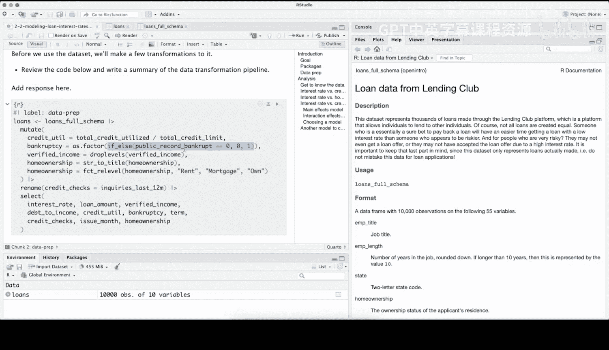
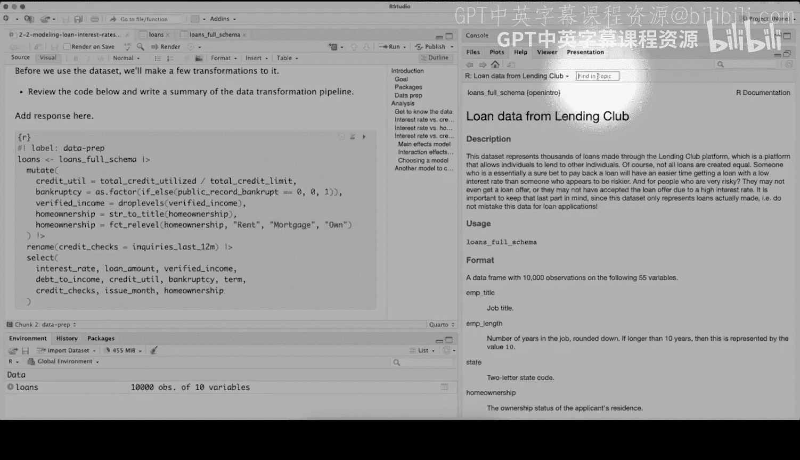
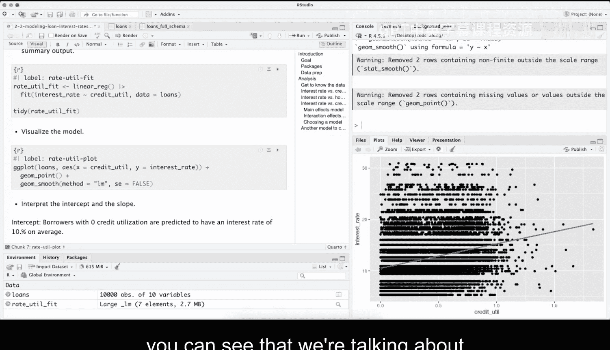
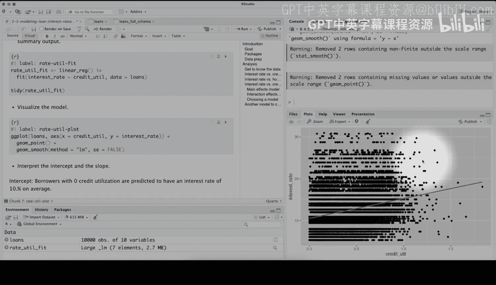
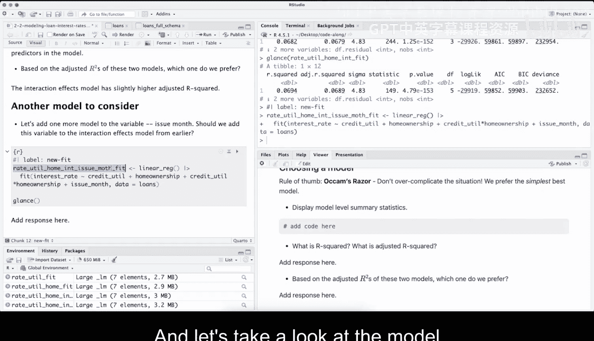

# 杜克大学《R语言数据科学｜Data Science with R》中英字幕 p46 09_02_03_代码实践：贷款利率建模.zh_en -BV1Zpv6BaEkB_p46-

Welcome in this code alone， we're going to practice modeling with multiple predictors using data on loan interest rates。

 We're going to use three packages。 The tidyverse package for data visualization and wrangling the tidy models package for modeling。

 and we're going to take a look at the data set from the open intro package。

 which is a textbook that accompanies this course。 So let's go ahead and load those packages。

 and we're going to do a bit of data prep。 But to save us a little bit of time and give us more bandwidth with for modeling。

 I've done the data prep for you。 The data set in the open intro package is called Lo full schema。

If I was to sort of print this data set out， you'll see that there's a 10，000 observations。

 that's how many loan applications there were that we have information on and 55 variables。

 we're not going to use all 55 variables and we're also going to do a little bit of data cleaning as we go along as well。

We're going to start with a bit of data prep and I've already given you the code for prepping these data。

 let's take a look at what these data look like originally。

 if I print out this Los full schema data set from the open Intro package you'll see that we have 10000 observations。

 We want to work with those but we also have 55 columns。

 not all of which we're going to use so we're going to reduce our data a little bit to be able to view it a little bit more easily and do a bit of data cleanup as well。

So your first task is to look through this code and figure out what in the world is happening。

 and I'll walk you through how to do this as well whenever I have a big chunk of code in front of me that I may have written in the past or maybe a collaborator has written and now I'm sort of like reviewing it to understand it。

 what I like to do in general is first run the whole thing。I want to run the whole thing。

 and then I want to look in my environment to see what I end up with。

 I end up with a data set called Loan makes sense。 That's what we were assigning the Loan full schema data to after that data pipeline。

 and I have 10000 observations， the same number of observations as loans full schema。

 which means whatever is happening in that code cell is not touching my rows。

 we're keeping all of the rows。 we're not filtering the data for anything。

But the number of columns is a lot smaller。 We had 55 columns were down to 10。

 and that is coming from this last line， the select line where it says only keep these variables。

 But before that， I'm also creating some new variables。

 So the mutate function remember is a column operation that is used for either editing or updating an existing column or creating a new column in the loan full schema data set。

 If I was to take a look at the names， you'll be able to see that we have what is this 55 variables。

 but not all of those not all of the variables that we're ultimately going to be working with are represented among them。

 one of them that we want to actually create is a new variable called credit utilization。

 which is something that loan agencies tend to look at when you apply for a loan。

 It looks at how much of。Your total credit is utilized compared to your credit limit。

 say if you have a credit limit of $1，000 and you have $1000 bill on your credit card。

 your utilization is 100% in this case， not a great number to get high。

 you want that number to be low so you don't have which means you don't have a lot of outstanding debt。

So we're using the total credit utilized and total credit limit columns to calculate this credit utilization proportion in this case。

We are creating another new variable called bankruptcy， and it looks like。

 What that is looking at is the column called public record bankrupt。

 So let's take a look to see what that variable looks like。

 I am going to go ahead and maybe pop this out into a data viewer and see if we can easily figure out。

 oh， no， not the loans data set。 I want to pop out the。Loans。

 full schema data set and see if we can figure out what that variable public record bankrupt is about。

It's a little hard to come by when you have a lot of columns。 So here we go。

 It looks like it has some zeros。And some ones， but also twos and three。

 so it's a numerical variable I can take a look at the help file for Lo full schema since it comes from a package。

 I actually have the data dictionary here and I can use the variable name to search in the help。

And it says it's about the number of bankruptcies listed in the public record for this applicant。

 It looks like what we want to do is not worry about how many。

 but whether there are any bankruptcies or not， so if the public record bankrupt is equal to zero。

 make it a zero， otherwise make it a1 and once you do that with this if L statement。

 save it as a factor so that 01 is considered a categorical variable， not a numerical variable。

The verified income variable， if we were to take a look at this loan full schema data set and say something like give me。

They count of different levels of verified income。It has three levels， but if I actually take a look。

At how many levels are stored for this variable。With the levels function。

 you can see that I have an empty level here， something that actually was stored in the data set。

 but that's not being used by any of the observations。 So this drop levels function cleans that out。

 and in this case we're overriding the original variable for homeowner。

 let's take a look to see what homeowner looks like。Mortgage own or rent。

 it looks like they're yelling at us with capital letters， so here we are。Making it title case。

 only the first letters are capitalized。 And then we're doing one more thing。 in the course videos。

 we said that when we have a categorical predictor。

 R will automatically convert it to a dummy variable for you。 Great。

 And then it has to make a decision about which of those levels。

 Morgage owner rent is going to be the baseline level。Usually。

 the choice of the baseline level shouldn't be just left up to R， because if you leave it up to R。

 it's going to select the alphabetically first level mortgage。

 And then each of the slopes in your model is going to be in comparison to those who mortgage their homes。

 Maybe we want a different level to be。Our baseline level。

 if you think about home ownership in terms of sort of where you might be in your life or your earnings。

 it would start with rent and then mortgage。 And then once your mortgage is paid off。

 you are you own the home。 You're not making payments on it anymore。

 So we might want those levels in that order reflecting sort of potential earnings or potential savings as opposed to leaving it up to R to decide what the baseline level is in order to do so。

 we need to convert the variable into a factor and change the level of the。

The change the order of the levels with the factory level function。 and then we feed them。

And the order that we want them， we've learned about this before in a data visualization sense to change sort of order of bars or something in a bar plot。

 Now， we're going to use it not just for visualizations， but for modeling as well。

We're also doing a rename action here。 The variable inquiries last 12 m。 if we look at that in our。

Data dictionary is inquiries into the applicant's credit during the last 12 months。

 I'm just going to name it credit checks because that's basically what those inquiries are and then we select the variables of interest to us so that's what's happening in this pipeline you can go ahead and sort of like take notes for yourself here I won't type this all back out but this is an example of the type of data wrangling and transformation you might do before you dive into modeling Now one thing that's a little bit unrealistic about what's happening here is that I gave you all of this and you sort of didn't have to think through what might be things of interest to me in a more organic sort of data analysis you would maybe go down the steps a bit more make some visualizations。

 maybe fit some models as well but remember that data science cycle diagram we always refer back to we would then go back and transform and wrangle our data get it into the shape we really want for our modeling and then carry on。

嗯。And here is a glimpse at those data， the 10 variables。

 and let's go ahead and move our chunk output to console one more time。

And that's what they look like here， we can see some of them are doubles。

 some of them are integers and some of them are factor variables。Now， before we do the modeling。

 let's get to know our data a little bit。 It says， what is a typical interest rate in this data set。

 What are some attributes of a typical loan and a typical borrower。

 Give yourself no more than5 minutes for this exploration and share one to two of your findings。

 Let's give it a try。 Let's start with the typical interest rate。

So I'm going to take this loans data set。😊，And say maybe we want to do a summary here。

 we may want to do mean。We may want to do median。We may want to do min and Max。

 These could be good things to start with。And let's go ahead and。

Write the functions that will give us these values。And the name of the。

Variable that we're going to look at here is says explore loans that are explore interest rates。

 right， What's the typical interest rate。Let's take a look。 It looks like a typical on average。

 the interest rate is 12。4。 that's pretty high， but this is sort of peer to peer lending for small amounts。

 the median is 12 and the minimum range is from 5。31 all the way up to 30。9。

If we were to look at what interest rate is， this is the overall interest rate of that the loan applicant received sort of when they applied for this loan we may also want to visualize this。

 so let's go ahead and do that as well。I'm going to say on the X axis。

 we want to put interest rate and maybe a histogram can give us a good look at what these interest rates look like。

And it says what are some attributes of typical loan and ay borrower so let's look at our borrowers as well。

 I'm going to glimpse at my loans data set one more time to remind myself of the variables and let's see for example。

 what kind of income verification do we have for these borrowers。

We can make a visualization of the loans data set where we place this variable on the X axis and because it's a categorical variable。

 we may want to make a bar plot There are quite a few with income not verified which means that they actually sort of they stated an income in their application but there's no verifiedification to go with it and then we have other options like source verified or verified as well we can use similar approach for some of our other categorical variables like bankruptcy。

And is shean。And the other one is home ownership。So let's go ahead and create all of those plots and scroll through them Morgage is the most common then we have renters and very few owners maybe the idea is that if you own your home you're not necessarily requesting a peer to peer loan at that point here are the different issue months we can see these are all from the year 2018 between January。

 February and March we may want to reorder those bars if we were interested in sharing this plot out and here we can see that a lot of people thankfully did not have a bankruptcy very few of the applicants did so we can go through and sort of like explore the data more in this way but let's go ahead and actually do some modeling。

I going to stop here。Fix this typo。We're going to stop by fitting a regression model for predicting interest rate from credit utilization and display the summary output。

How do we go about this， We start with linear reg to specify our model。

 then we say that we want to fit。Our outcome variable is interest rate。

We want to predict this from credit utilization。And the data set we're working with is called loans。

We then want to save this。 I'm going to call this rate， u。Fit。

And then I can display a tidy output of this model。

Let's also visualize the model so I can make a plot。On the X axis。

 I'm going to put credit utilization on the Y axis， I'm going to put interest rate。

These are two numerical variables。 So I'm going to make a scatter plot and add another layer。

 Gem smooth。Where method is L M。 and let's go ahead and turn off the standard error as well。

Does not look like a great fit。 And this is very common。

 So it looks like the relationship between interest rate and credit utilization may not be like a very nice linear relationship？

 Does this mean we should stop here。 Does this mean there may be no value to doing linear modeling。

 And the answer is no， what you probably want to do is to think about might I transform some of these variables。

 Could it give me a better fit， Could I maybe work with more complicated models， more complex models。

 Could they give me a better fit。 And we've learned about how to do model selection。Ultimately。

 you can use a statistic like adjusted R squared or something like that to see if the model you have versus another model is better。

But we also know that in general， we prefer simpler models。

 so let's go ahead and keep going down this line of inquiry to see if this simple model gives us good enough predictions that we might be happy with。

Next， we're asked to interpret the intercept in the slope。 In order to do that。

 I'm going to bring back my results from my tidy summary。 My intercept is 10。5。

 so that is about the value of y when x is equal to 0。 so borrowers with0 credit utilization。

Are predicted。To。Have an interest。Rate of。10。5%。On average。

Note that this is not about a single borrower， but instead it's about a group of borrowers。

And for the slope， this is about the rate of change。For each additional point， credit utilization。

Is higher。The interest rate。Is predicted。To be higher， on average， by 4。73%。

Let's stare at this number for a bit。 There are a couple of potentially curious things going on。

 Firsts of all， earlier， I said credit utilization is about how much outstanding debt you have。

 and it looks like in this particular case。As your sort of credit utilization increases。

 your interest rate increases as well。 It's not like you are getting a lower interest rate simply by having lower credit utilization。

 There may be other factors at play I'm not an expert on sort of like loan interest rate determination。

 There may be other factors at play here that are driving this relationship。

 but it is a positive one。 Another one is that we're saying for each point credit utilization is higher。

 We expect the interest rate to be higher by 4。73%。 Remember what our interest rates look like。

 They ranged between 0 and 30%。 So a 4。73% increase is a large number。

Why is it such a large number Because a one point credit utilization increase is really 100% increase。

 So if we were to take a look at this visualization one more time of the model you can see that we're talking about going from all the way here to here and all of these people with credit utilizationization above one basically have more outstanding debt than their credit limits somehow they were approved loans in this case。

 or some sort of debt， maybe credit card debt that somehow exceeds their approved credit limit。

So something we might want to do to put this into better context is to say for each additional percentage。

Point credit utilization is higher， so I'm dividing things by 100。

 We would predict the interest to be higher by。Poin00473%。 So this way。

 we've put the credit utilization into sort of like changes of one percentage point at a time。

 And then the incremental change in the interest rate is much more palatable。

Next we're going to do something similar except we're going to this time predict interest rates from home ownership。

 so let me go ahead and take a look at our code for fitting a model for predicting interest rate from credit utilization。

 I'm going to reuse that except I'm going to update the name of my model object。And the。

Predicor variable I'm using。And here is the tidy model output we're going to look at Home ownership had three levels。

 we put them in the order rent mortgage and own， and R created a dummy variable or actually two dummy variables because it had three levels that's three minus1。

2 dummy variables making the first level rent our baseline level so only mortgage and own are shown here on our model output。

Let's go ahead and interpret each of the coefficient and context of this problem。

 The intercept is about when x is equal to0 here we have two x's right one of them or sorry。

 we only have one x the homeowner ownership so x being equal to zero in other words。

Means your home ownership status is renting。 so for applicants。Am。Who rent their home。

The model predicts。The interest rate。To be 12。9% on average。And remember。

 these are going to be about the change between the baseline level and the given level。

 So with a categorical predictor， we no longer talk about one unit increase in x。 Instead。

 we would say the model predicts。That applicants。Who have a mortgage。For their home。receiveceive。

866% lower。Interest rate。Compared to those who rent their home。 So this rent。

 the level that we're comparing to is our baseline level。And similarly， for the slope for ownership。

 I can go ahead and reuse this sentence except we're talking about 0。611% lower。

And this is for applicants who own their home。So those individual slope coefficients are about the predicted difference between these levels。

Now， finally， we're going to fit a model with multiple predictors。

 something a little bit more realistic。 so we want to fit a regression model to predict interest rate from credit utilization and home ownership without an interaction effect between these two predictors。

 So let's go ahead and grab the code we had before。😊，Pase it into here。

 It's going to be credit utilization and home。 So we can say credit。You tell。😔，Plus。

 homeowner ownership。And let's update the name of the model that we are tidying up。

And here is a summary output， we have an intercept， a slope for credit utilization。

 that value has changed from the model with just that as a predictor and also slopes for the levels of home ownership。

Next， we're asked to write the estimated regression equation for loan applications from each of the homeowner groups separately。

 So instead of writing a single linear model， we are going to write three separate linear models。

 one for renters， one for those who mortgage their home and one for homeowners。

 In each one of these cases， Our left hand side is going to be the same。 That is going to be。

Whide hat。Interest。Right。If we want to do a space here， we can do that with a little tilde。

And then this one is going to be some intercept。Plus， some slope times the credit。Utilization。Okay。😊。

Now for renters， let's start with those。The dummy variable for the value for the dummy variable for homeowner mortgage is going to be0。

 they're not mortgaging and for own is going to be 0 as well。

 So in a way it's almost like these two lines go away。 so our intercept。

 which is about renters anyway， is going to be 9。93 and the slope is 5。34。

For those who mortgage their homes， we actually need to bring in the mortgage variable in as well remember it's almost like these dummy variables turn on so i'm going to go ahead and grab what we wrote here。

Change this with a time sign。 grab what we wrote here for。The renters。

And then think about what happens if this person also mortgages their home。

 then their coefficient would be 0。696。Times one for mortaging。And then 0128。Times a 0。

 because they're not homeowners。 So it's almost like this last one goes away because we're plugging in a 0 for that。

 And so our model comes out to be something like this。 This simply looks a little bit messy。

 We can clean things up a little bit。 So our intercept of 9。

93 now has an additive value for the mortgage as well， of 0696。

And so the new intercept for those who mortgage their homes ends up being。10。69，626。These two lines。

Those for renters and those for who mortgage their homes have the same slope， So parallel lines。

 but different inters。 and we can do the same thing for the homeowners as well。This time。

We're going to start with the renters， our baseline level and say that we simply want to add a one for the the coefficient of home ownership own and we would plug in a zero next to the coefficient for home ownership mortgage so that would go away so the additive value here ends up being。

10。058。And I can go ahead and get this out of here。😔，Again， same slope， different intercepts。

All right。How does a model predict the interest rate to vary as credit utilization varies for loan applicants with different home ownership status。

 either rates the same or different。In this case， because we're doing only main effects。

 the rates are exactly the same。 That's the slopes。But the intercepts。Are different。Right， next。

 we're going to do something quite similar， except we're going to allow for an interaction。

 So this time， we're saying that the relationship between interest rate and credit utilization varies based on whether you are a homeowner or not。

Let's go ahead and grab our。Code from before。Give this model a new name， I'll add int。

And we are going to say that we're going to add a new variable。Credit utilization times。

 homeowner ownership。And let's take a look at。Tidy output for this， as well。Many， many more rows。

 well actually， only two more rows in our output， but we can see that the model is getting more and more complicated。

 So this time， we're going to allow for not just the intercept to change between the levels。

 but the slope to change as well。We're asked to write the。

Estimated regression equation for each one of these groups。 Again。 Let's start with the easiest one。

 the renters。Our predicted interest rate。Is simply the intercept in the model output。Plus。

The slope for the credit utilization。Variable。Everything else would get a 0。 Why is that。

 Let's close this outline， Give a little bit more space for our model output and print it out again so we can read everything。

 If someone is a renter， their homeowner， mortgage status is 0。 Homeship own status is 0。

 and those variables show up here as well as zeros。

 So all of these components of the linear model would simply go away。If on the other hand。

 we have someone who has a mortgage on their home， let's start with the same baseline。

We would then say that there this variable would be multiplied or this coefficient would be multiplied by a one。

 that's 1。39 times1 plus we now have the credit utilization interaction。

 So this coefficient negative 1。64。Would be multiplied by credit utilization。And a one， as well。

Maybe it would be nice if we would just render this document so we can see all of this math text nicely rendered in one place so we can think through what this means a little bit more。

Here is the model that we just wrote。 So what we're saying is that we have an intercept and then a value that we can add to it that's 1。

39 times one， basically just 1。39。 and then we also have a slope coefficient associated with credit utilization and then again。

 a value that we can add to that as well that comes from the interaction effect。

 So if I was to simplify these and just sort of got rid of these times ones one more time and render this document。

 it's going to be a lot cleaner and easier to see what are the various pieces that we want to simplify。

9。44。Plus，1。39。Would get me a new intercept of 10。83 and 6。20-1。64 would get me a new slope of 4。56。

So for these that are morgaging。We can say we have a model that is 10。83 as the intercept plus 4。

56 times credit utilization。And we would basically do the same。

Gymnastics for the home ownership as well。 Start with our baseline。And the multiplier for owners。

 So  point697 would get added to the。Intercept， so our new intercept would be 10。137。

 and the multiplier for the interaction effect， negative 1。

06 would get the same adjustment for the slope as the other one did。 So our new slope here would be5。

14。Let me go ahead and clean up the original calculation for mortgage as well。

 and render this document so we can see everything in one place。 So with the main effects。

We have the different intercepts， but the same slope。With the interaction effects。

 we have different intercepts and different slopes as well。 We've seen this visually in the slides。

 Now， in this code alone， we're getting to actually calculate these values 1 by one to convince ourselves one more time。

 So how does this model predict the interest rate to vary as credit utilization varies for loan applicants with different home ownership status。

 Are the rates same or different， They are different。Now that we have two separate models。

 we can display some model level summary statistics so we can use the glance function for the original model。

 the main effects model that we have named rate U home fit。And similarly， the second model。

The rate you home interaction fit。 And let's take a look at these。We can see that they have。

Slightly different r squares and very slightly different adjusted r squares as well。

Before we go on to comparing them， though， let's take this opportunity to review what is r squared and what is adjusted r squared very briefly r squared is percentage。

Of variability。In the outcome explained by the model， by the model。

 meaning all of the predictors in the model versus adjusted are squared。Is r squared。Ajusted。

With a penalty for the number of predictors。In the model。

You can refer to a textbook to figure out exactly what that adjustment is。

 but the important thing to note is that it is a negative adjustment， so it's a penalty。

 so we like high r squares， but we take away some of that value for additional predictors in the model And based on the adjusted r squares for these models。

 what do we decide The adjusted r squares are similar that is 0。0679 versus 0。0689。

 So it looks like just barely。The interaction。Effect model has。Slightly higher， adjusted R squared。

So it might be the preferable one here would you would probably consider other models in this case as well to see if you're getting some。

 you know，More sort of useful increase in the adjusted r squared between the two。And finally。

 we're asked to add one more variable issue month， so let's go ahead and see if we should add this to the interaction effects model。

 the one that we chose from earlier， so I'm going to go ahead and grab my code one more time。

At this point， the name of the model is getting so long。

 but let's roll with it because we this is the last one that we're doing。Isue month。😔，Fit， and so。

 we're going to add。Isshuman。And let's take a look at。

The model level statistics for this model as well。

So our original or the chosen model from one step before our adjusted r squared was 0。0689。

And with the additional issue month， we're down to 00688。 So should we add this variable， no。

A adjusted R squared did not increase。With the addition。Of this predictor。We could keep going。

 We could keep trying other variables here as well。 And if you are doing more modeling。

 you'll see that there are some automated approaches for trying all possible variables and at some point when the number of all possible variables goes up。

 So if you think about our loans full schema data with 55 of them。

 you run into situations where you need to start thinking about computational complexity for trying all of these models。

 So sometimes you can go that route of automated model selection。

 if the question that or the data that you're working with requires that or if your sort of exploration warrants that and sometimes you might take an approach where you're really thinking about each of the predictors think about the research question at hand and only try the predictors that are of interest to your research agenda。

