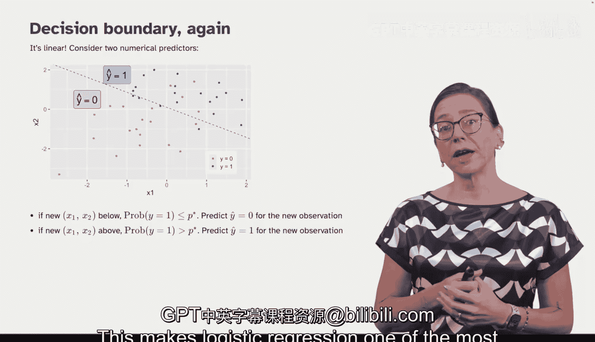

# 杜克大学《R语言数据科学｜Data Science with R》中英字幕 p47 10_03_01_逻辑回归.zh_en -BV1Zpv6BaEkB_p47-

🎼。

Welcome in this video， you'll learn about logistic regression or what's also commonly referred to as classification。

Before we dive into the concepts， let's quickly review the R packages we'll be using。

 We'll work with the tidy verse for data manipulation and visualization and tidy models for our modeling workflow。

 Some of the examples will also use data from Open Intro 538 and palm or Penguins packages。

 and we'll use G G themes for accessibility friendly color scales and plots。

So what types of regression have we learned about so far in simple linear regression。

 we model the relationship between a numerical outcome variable and one numerical predictor。 Here。

 we see an example using movie scores from rotten tomatoes。

 We have critic scores on the X axis and audience scores on the Y axis with a clear。

 linear relationship between these variables that appears to be appropriate to estimate with a linear model。

😊，We've also explored multiple linear regression with a categorical predictor with two levels In this example。

 we're looking at birth weight based on smoking habits of the mother during pregnancy。

 noticeice how we can represent the categorical variable smoking habit as either zero for nonsmors or one for smokers。

 We again fit a linear model to predict the birth weight of the baby and the slope of this model tells us about the estimated or predicted weight of babies born to smoker and non smoker mothers on average。

😊，And， of course， we can combine both numerical and categorical predictors in the same model here here。

 we're predicting body mass of penguins from their flipper length， a numerical variable， an island。

 a categorical variable with three levels。 This plot shows what we would call a main effects model。

 where the relationship between flipper length and body mass has the same slope for all islands。

 but different intercepts， as opposed to an interaction effects model where we would allow the slopes to vary as well。

😊，Now， let's think about a new scenario with a binary outcome。

 What happens when our outcome variable isn't numerical， but binary。

 a binary outcome can only take two values，0 or1。 Think of it as a yes or no， success or failure。

 true or false。 Looking at this plot。 You can see our outcome variable。

 Y only takes values of 0 and1。 But there's clearly a relationship with our predictor x。

 higher values of x are more likely to have a y value of1。

 Low values of x are more likely to have a y value of 0。

 The blue line shows what we call an S curve or sigmoid curve。

 This is the hallmark of logistic regression。😊，You might be wondering， why is this important。 Well。

 if we can model the relationship between predictors and a binary outcome。

 we can do something very powerful called classification。

 instead of predicting exact numerical values， we can predict or at least make decisions about which category or class a new observation belongs to。

Here's a real world example。 Imagine you want to build a spam filter for email。

 Your predictors might be word counts， character frequencies or other features extracted from the email text。

 Your binary outcome is whether the email is spam 1， if it's spam 0， if it's a legitimate email。

 Looking at the sample promotional email。 a spam filter would analyze features like excessive capitalization。

 urgentent language and suspicious links to make its classification。

Or you might consider a medical diagnosis。 You might have various features from a medical image。

 P intensities， texture measures， shape characteristics。

 Your binary outcome is one for cancer0 for healthy tissue。

 This could literally be a matter of life or death。

 or at least a matter of making a decision about the appropriate treatment and treatment level。

 making an accurate classification is a lot more crucial on such a problem。

 And we might think about ethical implications of leaving this to a model alone versus having a human expert in the loop。

 compared to the email example where an automated spam filter is generally good enough。😊，In finance。

 banks use logistic regression to assess loan default risk。

 They put financial and demographic information about loan applicants and the model outputs。

 the probability that the applicant will default on their loan。

 This can help banks make informed lending decisions。 But again。

 we might consider ethical implications of biased data feeding into such models。

 potentially unfairly labeling some applicants with certain characteristics as more likely to default。

 This is why we have rules and regulations about which features are okay to use in decisions like these。

These models can also be used in even more ethically problematic applications。

 like predicting whether someone will reoffend while the mathematics is the same。

 these applications raise important ethical questions about bias and fairness that we must always consider。

 as well as leaving these decisions to models versus training humans who work in this area to understand how to use these models to make better informed decisions。

 This is why learning about statistics is important for everyone。

Regardless of whether they want to be a statistician。So how do we actually model binary outcomes。

 let's look at the scatter plot where our y values are just zeros and ones。

If we tried to fit a straight line to the binary data， we'd get something like this。

 Notice how the line predicts values below 0 and above one。

 which doesn't make sense for probabilities。A straight line simply can't capture the nature of binary outcomes；

Clearly we need a different approach than standard linear regression。Instead。

 we use an S curve that naturally stays between0 and 1， rather than modeling y directly。

 we model the probability that y equals1。Given new email， what's the probability that it's spam。

 given a new image， what's the probability that it's cancer。Given new loan application。

 what's the probability that applicant defaults？You might ask， why don't we just model Y directly。

 Remember， in linear regression， our models don't give guarantees。

 They give predictions that describe average behavior。 Similarlyly， for binary outcomes。

 our models cant guarantee that y will be exactly 0 or one。

 The natural analog to on average for binary outcomes is probability。

 We're asking what's the likelihood of each outcome。So what exactly is this S curve。

 This curve has a specific mathematical form。 The probability that y equals1 is e raised to the power of beta 0 plus beta 1 times x。

 All divided by one plus that same exponential term。 beta 0 plus beta1 times x should feel familiar。

 That's the regression model you're accustomed to seeing by now。

If you set P equal to this probability and do some algebra and don't worry I won't make you do it now。

 you get this much simpler form for the log odds， this is our logistic regression model。

Let me break down these terms。 P is our probability。 A number between 0 and 1。

 P divided by 1 minus p gives us the odds。 Think betting odds， which ranges from 0 to infinity。

 Ta the log of the odds gives us the log odds， which can range from negative infinity to positive infinity。

 So near now we're back in the land where we can be okay with our model。

 making predictions between negative and positive infinity， just like near models we've seen before。

 And we have a way of going from those values back to probabilities by solving for them in these formulas。

So our logistic regression model says that the log odds follow a linear relationship with our predictors。

 The logit function。 That's the log odds transformation。 is what we call a link function。

 It connects our linear model to the appropriate range for probabilities。

 This makes logistic regression an example of a generalized linear model。

 The only one we'll see in this course， but there are other generalized linear models commonly referred to as GLMs for different types of outcomes like counts and rates。

 for example。😊，We estimate the parameters using a technique called maximum likelihood estimation。

 Don't worry about the details。 Just know that it finds the s curve that bets fits our data。

 Our fitted model then gives us this equation with estimated coefficients， beta 0 and beta 1。Next。

 let's think through how we go from these probabilities to our classification。

 Once we have our fitted model， classification becomes a three step process。 First。

 we pick a threshold probability。 Let's call it P star。 In this example， I've chosen 085。

 Our rule is simple。 If the predicted probability is less than or equal to our threshold。

We predict y equals0。 If it's greater than our threshold， we predict y equals1。

Step 2 is finding the decision boundary。 We solve for the x value where our S curve crosses our threshold。

 This gives us a cut off point。 x star Everything to the left gets classified as 0。

 Everything to the right gets classified as one。And step 3 is the actual classification。

 When a new data point is observed with some new value， x new。

 we simply check which side of our boundary it's on。 If it's to the left of x star， we predict 0。

 if it's to the right， we predict 1。Notice what happens when we change our threshold with a lower threshold of 0。

15。 our decision boundary shifts to the left。 Now， more observations gets classified as one。

 This shows how the choice of threshold affects our classification decisions。

 It's a crucial modeling choice that depends on the costs of different types of errors。

Logister regressionion isn't limited to one predictor。

 Here's an example with two numerical predictors and one binary outcome。

 we can see two distinct clusters of points， orange for y equals 0， blue for y equals 1。

With multiple predictors， our probability formula becomes more complex。

 but the log odds remain linear。 We simply add more terms to our linear equation。

 one for each predictor variable， just like we've done before。Here's something beautiful。

 even with multiple predictors， our decision boundary remains linear。

In this two dimensional case is a straight line that separates two classes。

 points below the line gets classified as 0。 points above gets classified as one with three predictors。

 it would be a plane with more predictors， it becomes a hyperplane。

And that's our first step into logistic regression。

 We've seen how it extends linear regression to handle binary outcomes by modeling probabilities instead of raw outcomes。

 We've explored real world applications from spam detection to medical diagnosis under the mathematical foundation with the logit function and log odds and learn the three step classification process。

 The key insight is that by using the right transformation， the logit link function。

 We can apply linear modeling techniques to classification problems。 This makes logistic regression。

 One of the most versatile and widely used statistical methods。😊。

