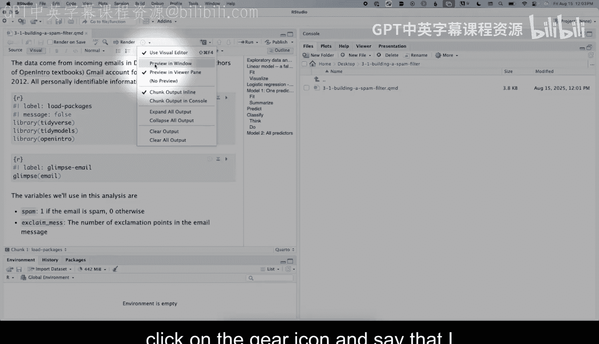
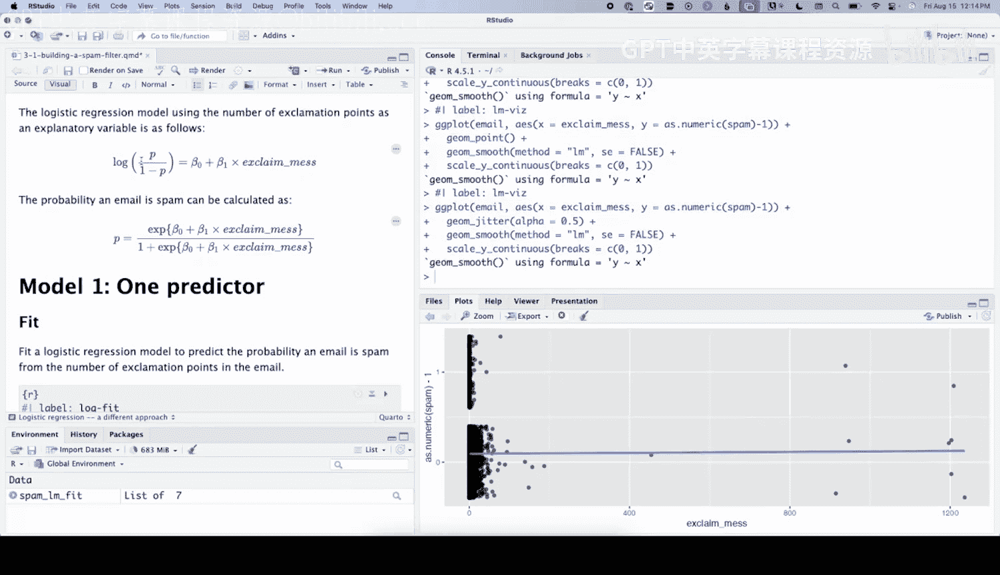
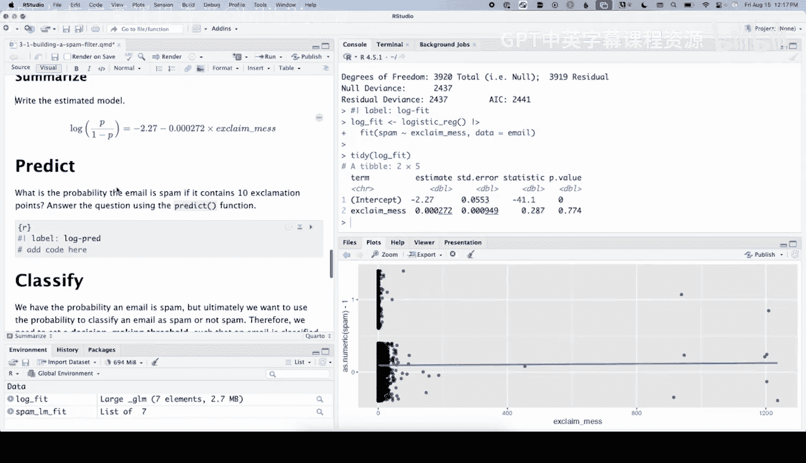
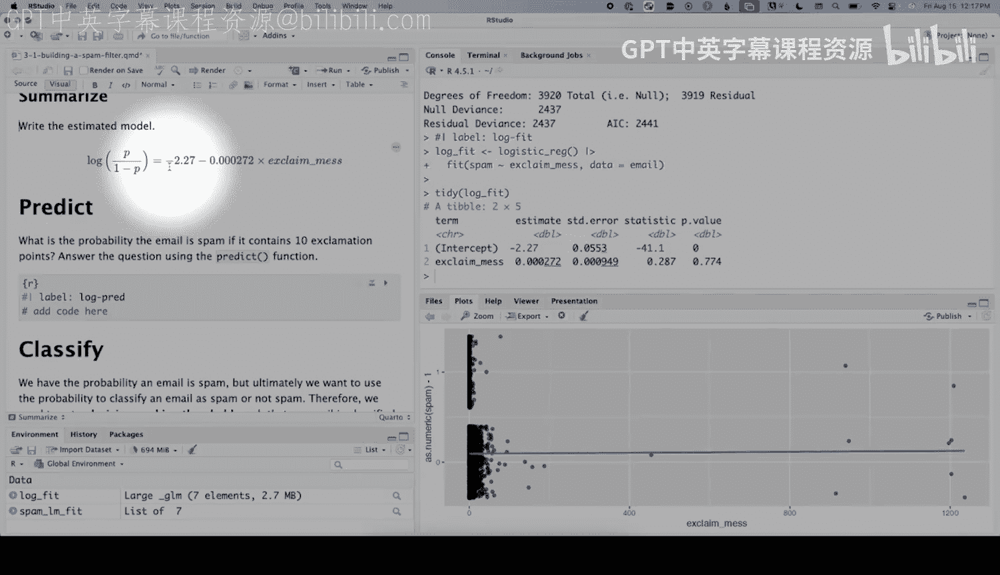
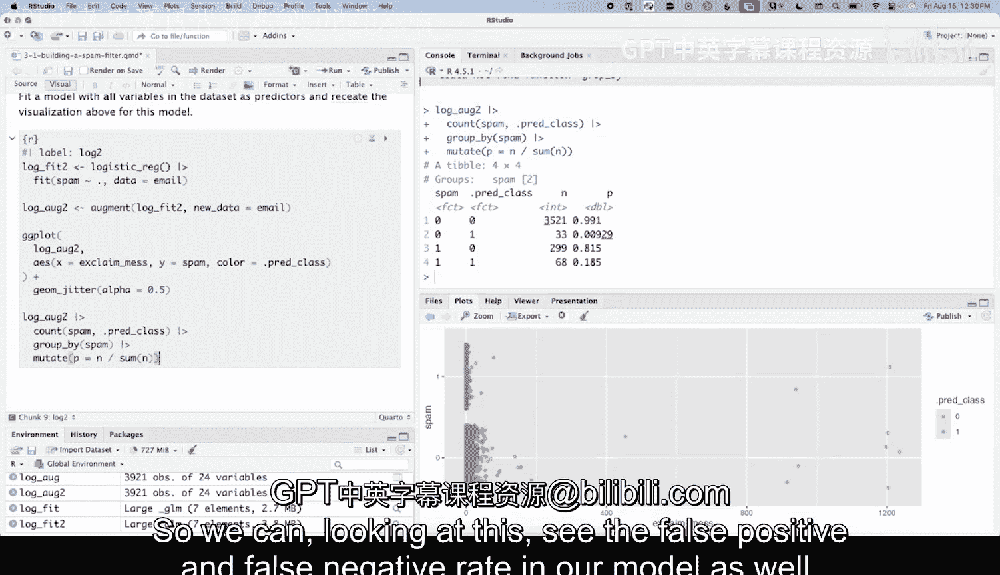

# 杜克大学《R语言数据科学｜Data Science with R》中英字幕 p48 11_03_04_代码实践：构建垃圾邮件过滤器.zh_en -BV1Zpv6BaEkB_p48-

In this code alone， we are going to fit a logistic regression model in R for a binary response variable and use a logistic regression model for classification。

 And to illustrate this， we're going to build a spam filter。

 The data come from incoming emails in David Diaz's inbox。

 This is one of the authors on the open Intro textbooks。 This is from the first three months of 2012。

 So somewhat old data and all personally id information has been removed。

 We're going to use the tidy verse package for data wrangling and visualization。

 tidy models for modeling and the data are in the open Intro package。

 So let's go ahead and run this code cell in order to load our data。

And then let's glimpse at our email data set。 I'm going to， as usual。

 close out of this inline output， click on the gear icon and say that I want my chunk output in console。

Let's remove everything that was there and go ahead and run this one more time。

Let's resize things a little bit for a better output。

And this is what our data looks like We can see that we have almost 4000 rows in our data set and data on 21 columns and our output outcome variable is spam。

 which is a factor variable。Our first goal is to use the number of exclamation points in an email to predict whether or not it's spam。

 Let's start with some exploratory data analysis。Let's create a density plot to investigate the relationship between spam and exclaim mess。

 That's the number of exclamation points in the message。

 And then we're going to calculate the mean number of exclamation points for both spam and non spam emails。

Starting with the density plot， I am going to say this is a G G plot。

 The data set we're using is called email。On the x axis， we want our numerical variable。

 which is exclaim。Mass。And let's make a density plot of this。

So this is what our plot looks like and we might want to see how the density varies by different types of spam or not spam emails。

 So how about we fill with the spam variable。 it's really difficult to see sort of where the spams and non spams are they're really overlapping another way of looking at this could be to facet the plot so we could say we want to facet wrap。

Bye。The spam variable as well。It's a little bit easier to see how the number of exclamation points vary between spam and non spam。

 looking at this faceted plot， though it doesn't look like it's a distinguishing characteristic。

 Let's look at some summary statistics as well。 We can start with our email data frame。

 and then group by。The spam variable and then calculate some summary statistics。

 We were asked to find the mean number of exclamation points。So we can see that we have a。

Lower number of exclamation points on average in emails that are not spam compared to the ones that are spam。

 Maybe this makes a little bit of sense。 spam email tends to have more flowery。

 urgent language in it。 And that might be one of the potential driving factors behind this hire me。

We're going to fit a linear model first。 we've already learned that this may not be the best idea。

 so this is going to be a false start， but it's good to see things in action as well。

So how might we go about doing this， Let's go ahead and fit a linear model to predict the spam variable from the exclaim mess variable。

For linear models， we start with linear rag。And then we can pipe that into our fit function where。

We have spam as our outcome variable and Exclaim mass as our predictor variable。

 and the data that this comes from is email。If we were to try running this， we get an error。

 It says the outcome should be numeric， not a factor object。 Remember， when we glimpsed at the data。

 we saw that the outcome variable， even though encoded as 0 or1 was a factor variable。

 So this is already a hint that the linear model is not a good path to go down。

 But for illustrative purposes， let's go ahead and actually change， the type of the variable。

 the spanm variable to numeric， so that those numbers are indeed considered as a numeric。

 continuous variable。And now the model fits， the model fits。 But what does that tell us。

 Let's go ahead and save this model output。 I am going to save this as。Sm L fit。

And we might take a look at a tidy output of this model， as well。Which gives us。 oops， let's run the。

Model and this again， which gives us an inter intercept and a slope。

 And we could decide if this is useful for us。 One way to decide if this is useful for us would be to visualize the model。

 So let's go ahead and make a plot。I'm going to as usual， start with G plot。On my X axis。 Oh。

 let's put it the name of the data frame email on my X axis， I am going to put my。Predicor variable。

 Exclaim mass on my Y axis。 I'm going to put spam。And let's make a scatter plot。Of these。

This is what a scatter plot of these variables looks like。

 How do we actually overlay the model on top of this， This would be a geometry smooth。

Where we say method is LM。That's not exactly a linear model as we've seen it。

 We can see that here it's fitting a line for each one of these outcomes。

 But remember that in the data frame， our spam variable is encoded as a factor。

 So let's change that up。To be numeric。And now we can see that we actually have fit a model to these data。

But does this make any sense。We can try to make this visualization a little bit more helpful for us。

 First of all， the y axis scale is not really helpful。

 We're seeing values that make no sense in this context。

 so I am going to change the axis y axis scale。Where we can add breaks to 0 and1。

We can see that the data values are actually at one and 2。

 This is coming from the fact that we have encoded the01 variable that was a factor as a now a numeric variable。

 So maybe if we were to just subtract one from that。 we can get them back to0 and1。

 I'm going to get rid of this。The standard error measure around the line as well that's sort of distracting because of very few emails with high numbers of exclamation points that's really sort of like the error on the higher end of the line is increasing making it difficult to see the data there and another thing we might do is we might add a little bit of a jitter to these points and also some alpha level because remember there's thousands of points here and there's so much overlaing happening。

So we can now see a little bit better the number of non spam and spam emails。

 but ultimately what we're seeing is that this line makes absolutely no sense。

 So is the linear model a good fit， No， it's not。It's actually not really giving us a tool for classifying a。

Email as a spam or not spam。 So we're going to try a different approach。

 We're going to do logistic regression next。And in order to do logistic regression， remember。

 we end up modeling the probability that an email is spam。

 and we're going to consider that to be our success。

 Success in this context doesn't have to mean something positive like successful in sort of daily life。

 we denote success as the outcome we're interested in in this case， an email being spam。 So。

In order to do this modeling， we're going to look at the odds P over 1 minus P odds that an email is spam。

 so for example， if p is equal to 0。7， then the odds are 2。33。And then we take the log of this value。

 the log odds or another was the natural log that the email is spam。

 and the logistic regression model is going to be modeling this outcome。

 the log odds using a linear model， beta0 plus beta1 times the number of exclamation points in the message what were used to seeing and then what we can do is ultimately since we want to predict this probability。

 we solve this top equation to leave P alone， and that's how we come up with this exponentd terms on the right-hand side of our formula。

 so we're going to fit the model which is going to give us the log odds and then we'll solve our way through to P and when I say we'll solve our way through。

 we are going to use the appropriate r functions that we'll introduce in this video for R to give us those probabilities。

Let's start with a single predictor， fit a logistic regression model to predict the probability and email a spam from the number of exclamation points in the email。

We've done this before， right， but we started with linear reg in this case。

 we are going to start with logistic Reg since we're fitting a logistic regression model and the next step is just like before we give our model equation。

SM is our outcome variable in logistic regression， we need the outcome variable to be a factor variable and indeed it is。

 and Exclaim mass is our predictor variable and the data frame this comes from is email。

This prints out the model output， but what we might want to do is save the model output。

 So I'm going to call this log fit。 I'm continuing to use my sort of agreed upon naming scheme from before where we use underscore fit to indicate a fit object。

 then we might want to get a tidy summary of this model fit which gives us again。

 a beta0 or B0 an estimated intercept and a B1 and estimated slope negative 2。

27 and here is the slope of this model。 So we can I've already written up the estimated model for you。

 If you are interested in learning about how we can get mathematical notation into our quao documents you can take a peak at this by double clicking on it when this document is open in our studio。

So we're using the frac function in Lic to get these the。Fraction。

 and then we're surrounding it with some big parentheses and then saying we take the log of that。

Using this， let's go ahead and make a prediction。 Remember。

 we make a prediction for the probability that an email is spam。 So the question says。

 what is the probability the email is spam if it contains 10 exclamation points。

Mathematically speaking， what this means is plug in 10 for this number exclaim mess multiplied by this slope adjusted it with the intercept。

 This is going to give us a numeric value， then using the formula we had we had derived above。

 we can solve 4 P。Alternatively， we can simply use some R functions for doing that。 Just like before。

 in order to do a new prediction。 we need to first create a new data frame where this new observation or observations live。

I am going to call this new data frame EP 10 exclamation points， there are 10 of them。

We're making this into a tibble。 And it's really important that in this new data frame。

 no matter what you call it， the name of the variable is spelled exactly the same as it's spelled in the original data frame that was used to fit the model。

 So that's exclaim。Mass equals 10。 So now we have a new data frame for this one new email that has a numerical predictor。

And then I can use the predict function。The model that we had fit。

 the model object that we had stored。The new data。Which is EP10。And if I simply run it with this。

 it tells me that the model would predict this is not spam。

 So it's already done everything that it needs to do and even used a threshold and by default。

 it uses a threshold of 05 to determine whether or to classify a new observation as spam or not spam。

 but we said we were interested in the probability。

 so I can add another argument to this function type。

And its probability is the type of prediction that we want。

 So we can see that the probability that the predicted outcome is 0， not spam is 0。906。

 and the probability that the predicted outcome is 1 is much smaller。

 since this value is greater than 0。5。 the classification is to 0。

So the decision making threshold that is used by default is 0。5。

 but suppose you're a data scientist working on a spam filter and you must determine how high the predicted probability must be before you think it would be reasonable to call it spam and put it in the junk folder。

 which the user is unlikely to check。What might be some trade offs you would consider as you set the decision making threshold？

Pause for a second here and think through this。Point5 seems like a natural cutoff for something like this。

 But you could imagine building a customizable spam filter where if your user。

Is really keen on making sure they don't miss a single email。And they really。

 really do not want any email to be accidentally considered spam。

 They might use a different threshold than a user who might think。

I don't really care if it's a really important email， it will come again。

 I really want to avoid seeing any spam in my inbox。Next。

 we want to classify all of the emails in our dataset as spam or not spam。

 We've learned how to do it with a single email。 We created a new data frame or a new Tbble for it。

 and we sort of like handcrafted that by saying it's going to have a single row。

 It's going to have 10 exclamation points。 We already have our data frame。

 So all we want to do is to add predictions to it， which is something we've done before when we've learned about linear regression。

 This is called augmenting a data frame。 So we're going to use the augment function。

 The first argument is the model object that we had stored earlier。

 And then the new data that we're using。 is the old data， which is the email data set。😊。

If I just run this， you'll see that I get a data frame with all the rows from my original data frame。

 3921 of them and 24 columns and if I was to just review what my original data frame had in terms of number of columns that was 21。

 so I've gained three new columns。The predicted class and then the probabilities based on which that prediction was done。

 the predicted probability that any given email in this data set is 0 versus any given email in this data set is 1。

 and we can see that for the rows， at least the top 10 rows， we can see here。

 the predicted probabilities for0 not spam is much higher。 Therefore， the predicted class is 0。

 and the threshold that the augmentman function is using by default is the 05。

Let's set store this augmented object， so I'm going to call this log O so that we can take a look at this augmented data frame visually as well。

 Take a look at all the decisions that we have made。

I'm going to make a plot this time of this augmented data frame。And in my X axis。

 we're going to put our predictiveor variable， exclaim mass。 and on the y axis。

 we're going to put the true observation。 So spam or not spam。However。

 let's go ahead and color these points by the predicted value or the predicted class。

 So dot pre class is what this column is stored as a quick aside。

 these three new columns that we have gained all start with dot or period at the beginning。

 The reason why this function does that is it doesn't want to these two three variables are always going to be named the same pre class pre 0。

 pre1。 and it's trying to make sure that it would avoid overriding or creating a new variable with the same name as an existing variable。

 So it's creating these dotted variables in order to ensure that there is no name collision with existing variables there。

And let's go ahead and say that we are going to do a GMM point。Lots of overping here。

 So let's go ahead and say we'll do a gm jitter instead。And maybe add some transparency to it。

And what we're seeing is that on the Y axis， remember we have the true spam or not spam observation。

 even though some of the data in our original data frame had spam emails。

 the predicted class is zero for all of them。So this is probably not a great model。

 and you can imagine that simply using exclamation number of exclamation points。

 we probably wouldn't be building a very robust spam filter。So before we wrap up。

 let's do one more thing。 It says fit a model with all of the variables in the data set。

 and in order to do that， we're going to use logistic Regg again to begin with。

 Next up is our fit function。Our outcome variable is spam。

 and what we want to do is to say use all the other variables in the data frame。

 so I'm going to use this notation of period to say everything else and the data is email。

Let's give this a new name。We had named the earlier one log fit。

 So I'm just going to call this log fit2， And it says that some of the probabilities that it predicted are zeroes and wants。

 This is a warning， not an error， but something to keep in mind。

Let's then go ahead and copy our work from before where we do the actual classification。

 but this time I'm going to make sure that I am using the new models。

So create an augmented data frame and go ahead and plot it again and this time we're able to see that some of the emails are being classified as one in the prediction and some are not so。

Other things that we may want to do with this model is to start quantifying。 what is the error rate。

 Is this a good model， or is there somewhere in between using only a single one of the variables or many of the variables。

 We could calculate the error rates based on this model as well。

 It's a little difficult to do so visually， But we have all the information that we need。

 We can take a look at this augmented data frame， and say， I want to count for each type of spam。

 So spam or not spam what the predicted class was。So we can see here that for emails that were not spam。

33 of them were classified as spam。 and for emails that were spam。

299 of them were classified as non spam， meaning that my inbox is flooded。

 I can use this to then actually calculate the probabilities of false positives and false negatives as well。

 So let's group by。The spam variable。And then add a new column called P for proportion or probability of n divided by sum of n。

Oh， group by just a spelling mistake。 So we can looking at this， see the false。

 positive and false negative rate in our model as well。

