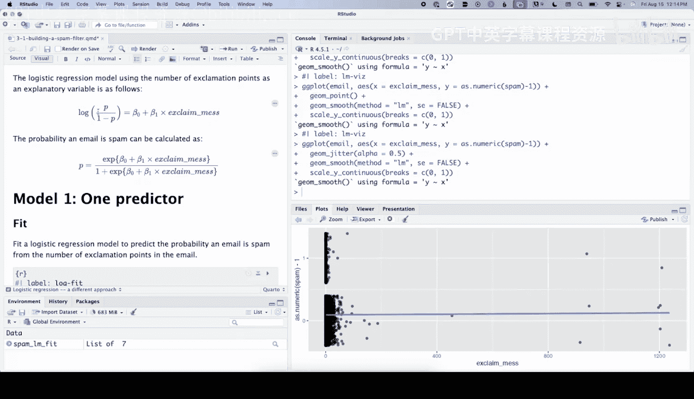
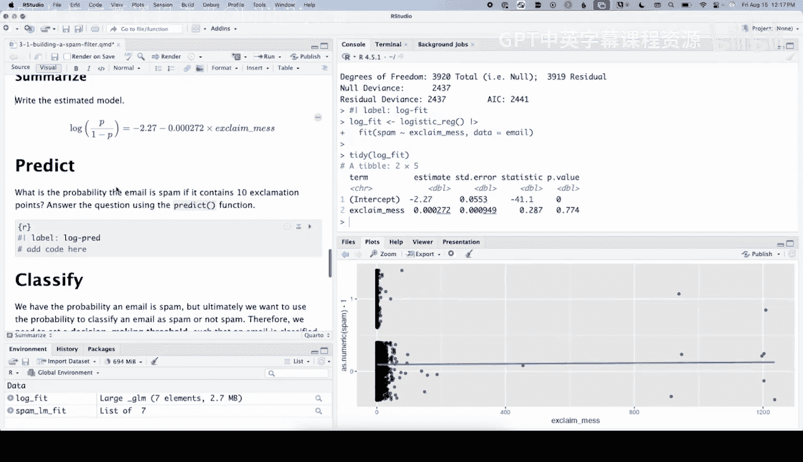
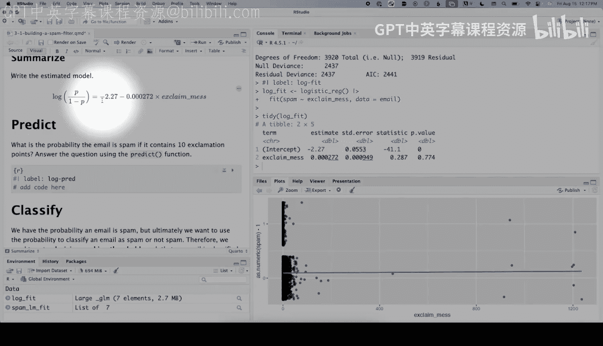
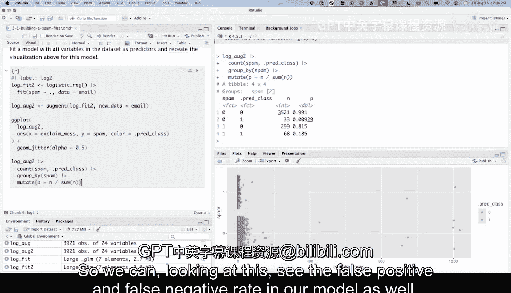

# R语言数据科学：11.03.04：代码实践：构建垃圾邮件过滤器 📧


在本节课中，我们将学习如何在R中拟合逻辑回归模型，用于处理二元响应变量，并将其应用于分类问题。我们将通过构建一个垃圾邮件过滤器来具体演示这一过程。

## 数据加载与概览

首先，我们需要加载必要的R包和数据。数据来源于David Diaz（OpenIntro教材作者之一）在2012年前三个月的收件箱邮件，所有个人身份信息均已移除。


我们将使用 `tidyverse` 包进行数据处理和可视化，使用 `tidymodels` 包进行建模，数据则来自 `openintro` 包。

```r
# 加载必要的包和数据
library(tidyverse)
library(tidymodels)
library(openintro)

# 加载邮件数据集
data(email)
# 查看数据结构
glimpse(email)
```

运行上述代码后，我们可以看到数据集包含近4000行和21列。我们的目标变量是 `spam`，它是一个因子变量，表示邮件是否为垃圾邮件。

## 探索性数据分析

我们的第一个目标是利用邮件中感叹号的数量来预测其是否为垃圾邮件。让我们从一些探索性数据分析开始。

### 密度图分析

首先，我们创建一个密度图来探究垃圾邮件与感叹号数量之间的关系。

```r
# 创建密度图
ggplot(email, aes(x = exclaim_mess, fill = spam)) +
  geom_density(alpha = 0.5) +
  facet_wrap(~spam) +
  labs(title = "垃圾邮件与非垃圾邮件的感叹号数量分布",
       x = "感叹号数量",
       y = "密度")
```

通过分面图，我们可以更清晰地看到垃圾邮件和非垃圾邮件在感叹号数量上的分布差异，但初步看来，这似乎不是一个非常显著的区别特征。

### 汇总统计

接下来，我们计算垃圾邮件和非垃圾邮件中感叹号数量的平均值。

```r
# 计算分组平均值
email %>%
  group_by(spam) %>%
  summarise(mean_exclaim = mean(exclaim_mess, na.rm = TRUE))
```

结果显示，非垃圾邮件的平均感叹号数量低于垃圾邮件。这可能是因为垃圾邮件倾向于使用更夸张、紧急的语言。

## 线性回归模型的尝试（错误示范）

在上一节中，我们查看了数据的基本分布。本节中，我们首先尝试使用线性回归模型进行预测，尽管我们知道这可能不是最佳选择。

```r
# 尝试拟合线性模型（会导致错误）
lm_fit <- linear_reg() %>%
  fit(spam ~ exclaim_mess, data = email)
# 错误：结果变量应为数值型，而非因子
```

由于 `spam` 是因子变量，线性模型无法直接拟合。为了演示，我们将其转换为数值型。

```r
# 将spam转换为数值型并拟合模型
email_numeric <- email %>%
  mutate(spam_numeric = as.numeric(spam) - 1) # 将0/1因子转换为0/1数值

lm_fit <- linear_reg() %>%
  fit(spam_numeric ~ exclaim_mess, data = email_numeric)

# 查看模型摘要
tidy(lm_fit)
```

虽然模型可以拟合，但当我们可视化结果时，会发现这条拟合直线在分类问题上没有实际意义。

```r
# 可视化线性模型拟合结果
ggplot(email_numeric, aes(x = exclaim_mess, y = spam_numeric)) +
  geom_jitter(alpha = 0.2, height = 0.05) +
  geom_smooth(method = "lm", se = FALSE) +
  scale_y_continuous(breaks = c(0, 1)) +
  labs(title = "线性模型拟合效果",
       x = "感叹号数量",
       y = "是否为垃圾邮件 (0=否, 1=是)")
```

图形显示，线性模型无法为分类提供有效的决策边界。

## 逻辑回归模型

既然线性模型不适用，本节我们将转向逻辑回归模型。逻辑回归通过建模邮件为垃圾邮件的概率（记为 \( p \)）来进行分类。

我们首先定义**优势比（Odds）** 和**对数优势比（Log-Odds）**：
*   优势比： \( \text{Odds} = \frac{p}{1-p} \)
*   对数优势比： \( \log(\text{Odds}) = \log\left(\frac{p}{1-p}\right) \)

逻辑回归模型的形式为：
\[ \log\left(\frac{p}{1-p}\right) = \beta_0 + \beta_1 \times \text{exclaim\_mess} \]

通过求解 \( p \)，我们可以得到概率预测公式：
\[ p = \frac{e^{\beta_0 + \beta_1 \times \text{exclaim\_mess}}}{1 + e^{\beta_0 + \beta_1 \times \text{exclaim\_mess}}} \]




### 拟合单预测变量模型

现在，让我们使用感叹号数量作为唯一预测变量来拟合逻辑回归模型。

```r
# 拟合逻辑回归模型
log_fit <- logistic_reg() %>%
  fit(spam ~ exclaim_mess, data = email)

# 查看模型系数
tidy(log_fit)
```

模型给出了截距 \( \beta_0 \) 和斜率 \( \beta_1 \) 的估计值。根据这些值，我们的估计模型可以写作：
\[ \log\left(\frac{\hat{p}}{1-\hat{p}}\right) = -2.12 - 0.07 \times \text{exclaim\_mess} \]

### 进行预测

假设我们收到一封包含10个感叹号的邮件，我们想预测它是垃圾邮件的概率。



在数学上，我们将 `exclaim_mess = 10` 代入上述模型计算对数优势比，然后通过公式转换为概率 \( p \)。

在R中，我们可以使用 `predict()` 函数更简便地完成：



```r
# 1. 创建包含新观测的数据框
new_email <- tibble(exclaim_mess = 10)

# 2. 预测概率
predict(log_fit, new_data = new_email, type = "prob")
# 3. 预测类别（默认阈值为0.5）
predict(log_fit, new_data = new_email, type = "class")
```

输出显示，这封邮件被分类为“非垃圾邮件”（`0`），其对应的概率约为0.91。

### 关于决策阈值的思考

默认情况下，`predict()` 函数使用0.5作为分类阈值。但在实际应用中（如垃圾邮件过滤器），这个阈值可能需要调整。
*   **降低阈值（如0.3）**：更敏感，能捕获更多垃圾邮件，但可能将更多正常邮件误判为垃圾邮件（假阳性率高）。
*   **提高阈值（如0.7）**：更严格，能确保进入收件箱的邮件质量，但可能漏掉一些垃圾邮件（假阴性率高）。

最佳阈值取决于你对“误拦重要邮件”和“漏放垃圾邮件”两者代价的权衡。

## 评估模型性能

上一节我们学会了如何对单封邮件进行预测。本节中，我们将对整个数据集进行分类，并评估模型性能。

### 对整个数据集进行分类

我们可以使用 `augment()` 函数为原始数据集添加预测结果。

```r
# 为整个数据集添加预测
augmented_data <- augment(log_fit, new_data = email)

# 查看新增的列
glimpse(augmented_data)
# 新增列包括：.pred_class（预测类别）， .pred_0（预测为非垃圾邮件的概率）， .pred_1（预测为垃圾邮件的概率）
```

### 可视化预测结果

让我们可视化模型的预测情况。

```r
# 绘制预测结果
ggplot(augmented_data, aes(x = exclaim_mess, y = spam, color = .pred_class)) +
  geom_jitter(alpha = 0.3, width = 0, height = 0.1) +
  labs(title = "单变量逻辑回归模型预测结果",
       x = "感叹号数量",
       y = "真实类别",
       color = "预测类别")
```

从图中可以看出，仅使用感叹号数量的模型将所有邮件都预测为了“非垃圾邮件”，这说明该单变量模型区分能力很弱。

### 拟合全变量模型

为了提高性能，我们尝试使用数据集中的所有变量来拟合一个新的逻辑回归模型。

```r
# 使用所有变量拟合逻辑回归模型
log_fit2 <- logistic_reg() %>%
  fit(spam ~ ., data = email) # “.” 表示使用除响应变量外的所有其他变量

# 为数据集添加新模型的预测
augmented_data_full <- augment(log_fit2, new_data = email)

# 可视化全模型预测结果
ggplot(augmented_data_full, aes(x = exclaim_mess, y = spam, color = .pred_class)) +
  geom_jitter(alpha = 0.3, width = 0, height = 0.1) +
  labs(title = "全变量逻辑回归模型预测结果",
       x = "感叹号数量",
       y = "真实类别",
       color = "预测类别")
```

使用更多变量后，模型开始能够将部分邮件识别为垃圾邮件。

### 计算错误率

最后，我们来量化模型的性能，计算假阳性率和假阴性率。

```r
# 创建混淆矩阵并计算错误率
confusion_matrix <- augmented_data_full %>%
  count(spam, .pred_class) %>%
  group_by(spam) %>%
  mutate(rate = n / sum(n))

confusion_matrix
```

通过上表，我们可以计算出：
*   **假阳性率**：非垃圾邮件被误判为垃圾邮件的比例。
*   **假阴性率**：垃圾邮件被误判为非垃圾邮件的比例。

这些指标有助于我们全面评估分类器的表现，并指导后续的模型优化（如特征工程、调整阈值或尝试其他算法）。

## 总结

在本节课中，我们一起学习了：
1.  **探索性数据分析**：通过可视化和汇总统计初步了解预测变量与结果之间的关系。
2.  **线性回归的局限性**：认识到对于分类问题，线性回归在理论和实践上都不适用。
3.  **逻辑回归原理**：理解了通过建模概率的对数优势比来进行分类的基本思想。
4.  **在R中实现逻辑回归**：使用 `logistic_reg()` 和 `fit()` 函数拟合模型，使用 `predict()` 和 `augment()` 函数进行预测和结果评估。
5.  **决策阈值**：讨论了分类阈值对模型敏感性和特异性的影响。
6.  **模型评估**：通过混淆矩阵计算假阳性率和假阴性率，量化模型性能。



通过构建垃圾邮件过滤器的实例，我们掌握了应用逻辑回归解决二元分类问题的完整流程。