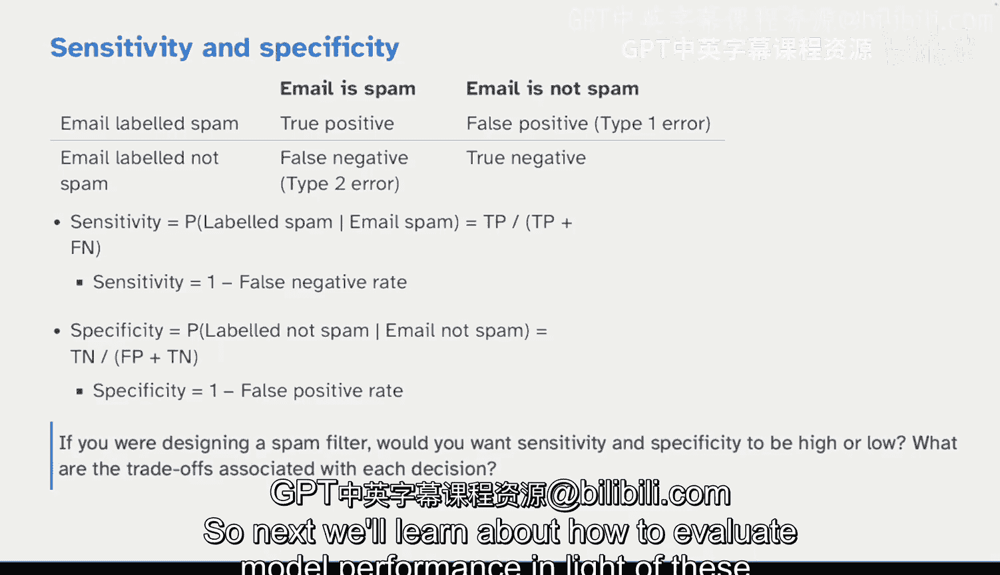

# 杜克大学《R语言数据科学｜Data Science with R》中英字幕 p49 12_03_01_分类与决策错误.zh_en -BV1Zpv6BaEkB_p49-

🎼。

In this video， we'll discuss classification and decision errors。

 what can go wrong in classification and how we quantify performance of models with regards to decisions we can make with them using a practical example of spam email detection。

Remember this promotional email that claimed you've been selected for an exclusive reward。

 we want to build a model， a spam filter that classifies this email as a spam or not。

 based on some of its features like word and character accounts or even more relevant features like word choices。

There are four things that can happen once we make a decision or a classification。

We might label an email that really is spam as spam， which would be a true positive。

Or we might label an email that really is not spam as not spam， which would be a true negative。

 No errors so far。 But， you know， sometimes spam filters into your inbox or real emails accidentally go to your spam box。

 An email labeled as spam when it's not is a false positive。 What we call a type 1 error。

An email labeled as not spam when it actually is spam is a false negative。

 what we call a type 2 error。We'd prefer to never meet Bank either of these errors。

 but as you can imagine， that's not possible， or at least not likely。

The false negative rate of a spam filter is the probability that an email that is spam is labeled as not spam。

 In other words， number of false negatives divided by the sum of the number of true positives and false negatives。

The false positive rate of a spam filter is the probability that an email that is not spam is labeled as spam。

 In other words， number of false positives divided by the sum of the number of true negatives and false positives。

 We would like to keep both of these down。Two other terms of importance are sensitivity and specificity。

 sensitivityitivity is the complement of the false negative rate。

 specificity is the complement of the false， positive rate。If you were designing a spam filter。

 would you want sensitivity and specificity to be high or low。

 and what are the trade offs associated with each decision。We obviously would want these to be high。

 but as you can imagine， as one goes up， the other goes down。

 So next we'll learn about how to evaluate model performance in light of these。

