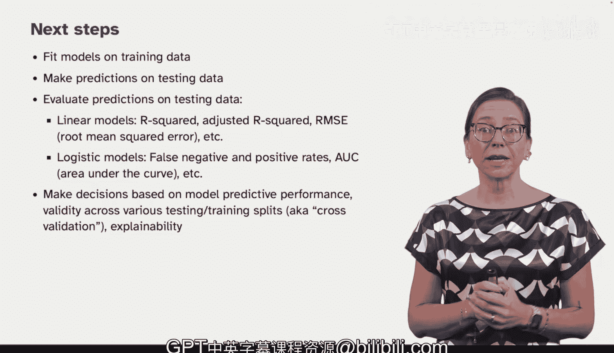

# 杜克大学《R语言数据科学｜Data Science with R》中英字幕 p50 13_03_03_过拟合与数据分配.zh_en -BV1Zpv6BaEkB_p50-

🎼。

So we've been fitting models， But have we been overfitting them？ What do we mean by overfitting。

 And how can we properly spend our data？ That's what this video is all about。Let's set things up。

In this video， we're working with a data set from the US Forest Service。

 the data are in the forested package， well also use the tidyverse and ti models packages as usual。

The US Forest Service maintains machine learning models to predict whether a plot of land is forested。

 and this isn't just academic curiosity。 This information is critical for research。

 legislation and land management decisions。 plotots are typically reme every 10 years。

 and the forested data set in the package with the same name contains the most recent measurement per plot。

We have over 7，000 observations and 19 variables。Our outcome variable is forested， yes or no。

 and the remaining 18 variables are available to us to use as predictors， including weather data。

 topography and classifications from other government agencies。

Here's another peek at the data with glimpse and a list of all the variables in this data frame。

Once again， our outcome is the forested variable with levels yes or no。

Preddiicctorors are 18 remotely sensed and easily accessible variables。

 including numeric variables based on weather and topography and categorical variables based on classifications from other governmental organizations。

You can find out more about this package and the data frame in its documentation。

 which you can access with questiontion mark， Forest it。Before we dive into modeling。

 let's pause for an important question that every data scientist should ask。

 should we include a predictor in our model？Here are three fundamental questions。

 Is it ethical to use this variable， Sometimes it's not just about ethics either。

 It might actually be illegal to use for certain variables。

Will this variable be available at prediction time。

 there's no point building a model with data you won't have when you need to make predictions。

Does this variable contribute to explainability， can you explain to stakeholders why and how your model works？

Now that we've familiarized ourselves with the data， let's split and spend it。

I regret to inform you that we have been cheating in our previous videos。

 we've been using all of our data to build models， then evaluating those same models on the exact same data。

In predictive modeling context， evaluating model performance for predicting outcomes that were used when building the models is like studying for a test with the answer key。

 then taking that same test and claiming your genius。 Why is this a problem。

 We're not actually interested in models that overfit our observed data。

 We want a model that will perform just as well for new data so we can make predictions before there are outcomes to observe。

😊，The solution is something we call data splitting or spending your data wisely。 Here's how it works。

 We split our data into two parts， a training set。 This is where we build our model。

 estimate parameters and make all our modeling decisions。 and a test set。 This stays locked away。

 untouched until we're ready for final evaluation。Think of the test set as your final exam。

 You don't peek at it during your study session if you want the final exam to be a true measure of what you've learned。

 So how much of our data should we spend on training versus testing， It's a classic trade off。

 The more data we spend or use in training， the better estimates we'll get。

Spending too much data in training prevents us from computing a good assessment of predictive performance Spending too much data in testing prevents us from computing a good estimate of model parameters。

The 7525 split is a good starting point， but like many things in data science。

 the best choice depends on your specific situation。

This default split 7525 is what we get with the initial split function so we can split our data with just this one function。

A quick note on reproducibility， you'll notice we use set seed before splitting our data。

This isn't just good practice。 It's essential for reproducible science。

 Our generate pseudo not random numbers。 They look random， but they're actually deterministic。 if。

 you know the seat。 This means anyone can run our code and get exactly the same results。

 In other words， the same split。Just pick any number you like。

 It doesn't matter which seed you choose as long as you don't try multiple seeds and cherry pick the one that gives you the best results。

 that would be cheating again。Next， let's use the training and testing functions to store these splits as two separate data frames。

We have 503030 observations in our training data and all of our original variables。

 shall we look at the testing data too？Nope， we can check how many observations it has， though，1777。

All right， let's explore a bit。 Some good initial questions might include what's the distribution of the outcome Forested。

 What's the distribution of numeric variables like annual precipitation。

 How does the distribution of forested differ across categorical and numerical variables。

Which data set should we use for the exploration， the entire forested。

 the training data forested train or the testing data forested test If you use said training you're right。

 we're not peeking at the testing data。A simple count and proportion table tells us 54。

7% of plots are forested， and the remainder are not in our training data。

 we expect a similar distribution in the testing data as well， but we're not going to look。

Looking at annual precipitation， we see a right skewd distribution。

 fewer years with very high mean annual precipitation。Now。

 let's see how these two variables might be related。

 Forested areas tend to have higher precipitation， which makes sense。 Tes need water。

 This filled histogram makes the relationship even clearer as precipitation increases。

 the proportion of forested land increases dramatically until the very end。

 where the relationship appears reversed， but that's likely due to very few observations of high annual precipitation rates。

And here's another example with the tree or no tree variable。

 This is from satellite imagery classification。 As expected。

 areas classified as having trees are more likely to be forested in our ground truth data。

 But notice it's not perfect。 That's why we need multiple predictors。Finally。

 we can look at geographic patterns。 You can actually see the outline of Washington State here。

 The green dots are forested areas and yellow or gold represents nonforested。

 Forested areas are more likely to be in the northwest than the southeast of the state。

 which makes sense geographically。😊，Let's do a quick recap on terminology and then introduce some new ones。

False negative rate is the proportion of actual positives that were classified as negative。

 False positive rate is the proportion of actual negatives that were classified as positives。

 Sensitivity is the proportion of actual positives that were correctly classified as positive。

 Also known as true positive rate。 And another term for this is recall。

Sensitivity is one minus the false negative rate。 This is useful when false negatives are more expensive than false positives。

Specificity is a proportion of actual negatives that were correctly classified as negative。

 also known as the true negative rate specificity is1 minus the false positive rate。

And here's something new。 A new way to see sensitivity and specificity summarized visually。

 This is a receiver operating characteristic curve commonly referred to as an R O C curve。

 The R O C curve plots sensitivity versus1 minus specificity across different thresholds。😊。

The perfect model would hit the top left corner where all positives are classified as positive and all negatives are classified as negative。

The diagonal line represents random guessing， so we want to be as far above that line as possible。

So what's next， We will fit models on training data， make predictions on testing data。

 evaluate predictions on testing data for linear models。 These were R squared。

 adjusted R squared RMC， the root mean squared error， etc cetera。 for logistic models。

 these are false negative and false positive rates， A U C， In other words。

 area under the R O C curve， etc cetera。Then we make decisions based on model predictive performance。

 validity across various testing and training splits， or in other words。

 cross validation and explainability In this course， we will only learn about a subset of these。

 but you can go further these ideas in other regression and machine learning courses。

