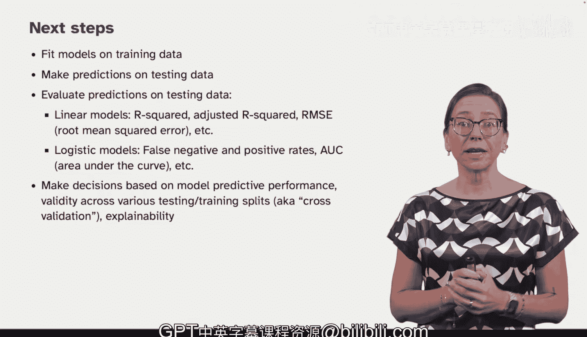

# R语言数据科学：13：过拟合与数据分配

在本节课中，我们将要学习模型评估中的一个核心问题：过拟合。我们将探讨什么是过拟合，为什么它是个问题，以及如何通过合理分配数据来避免它。我们将使用一个来自美国林务局的真实数据集进行演示。

## 数据准备与背景

我们使用 `forested` 包中的数据集，并照常加载 `tidyverse` 和 `tidymodels` 包。

美国林务局维护着机器学习模型，用于预测一块土地是否为林地。这不仅是学术研究，其信息对于研究、立法和土地管理决策至关重要。地块数据通常每10年重新测量一次，`forested` 数据集包含了每个地块最近一次的测量结果。

该数据集包含超过7000个观测值和19个变量。我们的结果变量是 `forested`（是或否），其余18个变量可作为预测变量，包括天气数据、地形数据以及其他政府机构的分类数据。

以下是数据概览和所有变量的列表。

结果变量是 `forested`，其水平为“是”或“否”。预测变量是18个易于获取的遥感变量，包括基于天气和地形的数值型变量，以及基于其他政府组织分类的分类变量。

你可以在包的文档中找到更多关于此数据集的信息。

在开始建模之前，我们需要暂停思考一个每个数据科学家都应问的重要问题：我们是否应该在模型中使用某个预测变量？以下是三个基本问题：
1.  使用这个变量是否符合伦理（有时甚至合法）？
2.  在预测时，这个变量是否可用？
3.  这个变量是否有助于模型的可解释性？

## 数据分割与过拟合问题

现在我们已经熟悉了数据，接下来进行数据分割和分配。

必须指出，我们在之前的视频中一直在“作弊”：我们使用全部数据来构建模型，然后在完全相同的数据上评估这些模型。在预测建模的背景下，这就像用答案钥匙学习，然后参加同一场考试并声称自己是天才。

为什么这是个问题？我们真正感兴趣的并不是对已观测数据过拟合的模型。我们想要的是一个对新数据表现同样出色的模型，以便我们能在观察到结果之前进行预测。

解决方案被称为**数据分割**或明智地分配数据。其工作原理如下：

我们将数据分成两部分：
*   **训练集**：用于构建模型、估计参数和做出所有建模决策。
*   **测试集**：这部分数据被“锁起来”，直到最终评估时才使用。

可以将测试集视为期末考试。在学习期间你不会偷看它，这样才能让期末考试真实衡量你的学习成果。

那么，我们应该将多少数据用于训练和测试呢？这是一个经典的权衡。用于训练的数据越多，我们得到的参数估计就越好。但用于训练的数据过多，我们就无法很好地评估预测性能；用于测试的数据过多，我们又无法很好地估计模型参数。

75/25的分割比例是一个良好的起点，但数据科学中的许多事情一样，最佳选择取决于具体情况。

`initial_split` 函数的默认分割比例就是75/25，因此我们可以用这一个函数完成数据分割。

关于可重复性的一个快速说明：你注意到我们在分割数据之前使用了 `set.seed`。这不仅是良好实践，更是可重复科学的关键。计算机生成的是伪随机数，它们看起来随机，但实际上是确定性的。只要知道种子，任何人都可以运行我们的代码并获得完全相同的结果（即相同的数据分割）。你可以选择任意喜欢的数字作为种子，只要你不尝试多个种子并挑选能给你最佳结果的那个（那又是作弊了）。

接下来，我们使用 `training` 和 `testing` 函数将分割后的数据存储为两个独立的数据框。

我们的训练数据有5030个观测值，包含所有原始变量。测试数据有1777个观测值。

## 数据探索

让我们进行一些探索。一些好的初始问题可能包括：结果变量 `Forested` 的分布如何？数值型变量（如年降水量）的分布如何？林地分布在不同分类和数值变量上有何差异？

我们应该使用哪个数据集进行探索？整个 `forested` 数据集、训练数据 `forested_train` 还是测试数据 `forested_test`？如果你说使用训练数据，那就对了——我们不能偷看测试数据。

一个简单的计数和比例表告诉我们，在训练数据中，54.7%的地块是林地，其余不是。我们预计测试数据中也有类似的分布，但我们不会去看。

观察年降水量，我们看到一个右偏分布，年均降水量非常高的年份较少。

现在，让我们看看这两个变量之间可能存在的关系。林地往往有更高的降水量，这很合理，因为树木需要水。这个填充直方图使关系更加清晰：随着降水量增加，林地的比例急剧上升，直到最后阶段关系似乎逆转，但这很可能是由于高年降水量的观测值非常少。

这是另一个例子，关于 `tree` 或 `no tree` 变量（来自卫星图像分类）。正如预期的那样，被分类为有树的区域在我们的地面实况数据中更可能是林地。但请注意，这并不完美，这就是为什么我们需要多个预测变量。

最后，我们可以查看地理模式。你实际上可以在这里看到华盛顿州的轮廓。绿点代表林地，黄色或金色代表非林地。林地更可能位于该州的西北部而非东南部，这在地理上是合理的。

## 模型评估术语与ROC曲线

让我们快速回顾一下术语，然后介绍一些新的。

*   **假阴性率**：实际为阳性但被分类为阴性的比例。
*   **假阳性率**：实际为阴性但被分类为阳性的比例。
*   **灵敏度**：实际为阳性且被正确分类为阳性的比例，也称为真阳性率。另一个术语是**召回率**。灵敏度等于1减去假阴性率。当假阴性比假阳性代价更高时，这很有用。
*   **特异性**：实际为阴性且被正确分类为阴性的比例，也称为真阴性率。特异性等于1减去假阳性率。

这里有一个新的概念：一种可视化总结灵敏度和特异性的新方法。这就是**受试者工作特征曲线**，通常称为 **ROC曲线**。ROC曲线绘制了在不同阈值下，灵敏度与（1 - 特异性）的关系。

完美模型会击中左上角，那里所有阳性都被分类为阳性，所有阴性都被分类为阴性。对角线代表随机猜测，因此我们希望尽可能远离这条线。

## 后续步骤

那么接下来做什么？我们将在训练数据上拟合模型，在测试数据上进行预测，并在测试数据上评估预测结果。

*   对于线性模型，评估指标包括 R 平方、调整后 R 平方、RMSE（均方根误差）等。
*   对于逻辑模型，评估指标包括假阴性和假阳性率、AUC（即ROC曲线下面积）等。

然后，我们将基于模型的预测性能、在不同训练/测试分割下的有效性（即交叉验证）以及可解释性来做出决策。在本课程中，我们只学习其中的一部分，但你可以在其他回归和机器学习课程中进一步探索这些概念。

## 总结

本节课中，我们一起学习了过拟合的概念及其危害。我们了解到，使用全部数据进行建模和评估是一种“作弊”行为，无法真实反映模型对新数据的预测能力。为了解决这个问题，我们引入了数据分割的方法，将数据分为训练集和测试集。我们还回顾并引入了模型评估的关键术语，如灵敏度、特异性，并介绍了ROC曲线这一强大的可视化工具。最后，我们明确了后续的建模工作流程：在训练集上拟合模型，在测试集上进行预测和评估，并基于评估结果做出决策。