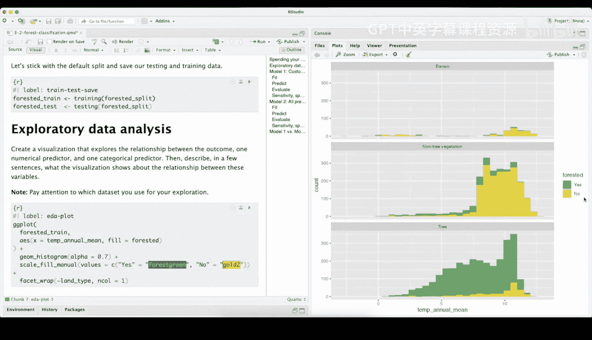
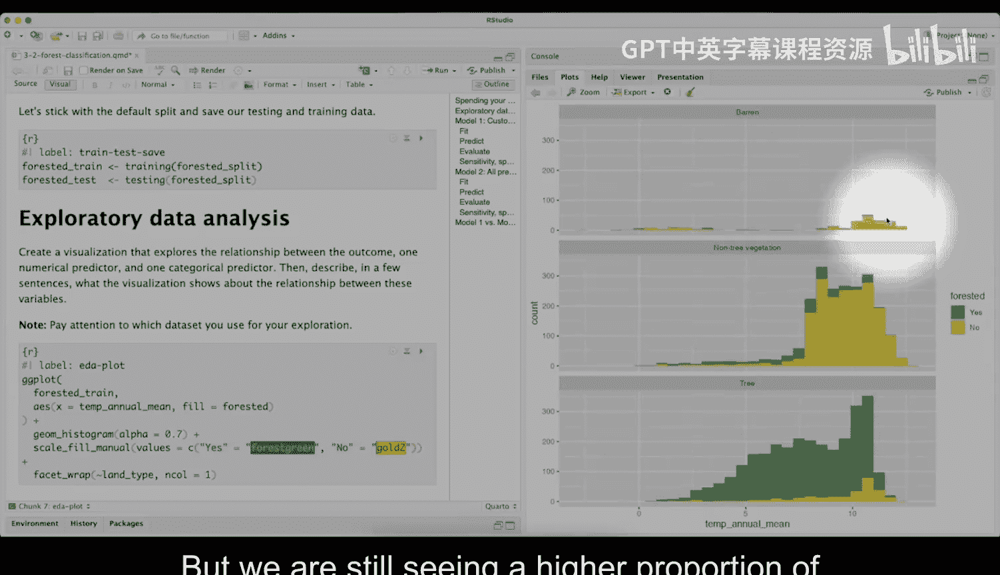
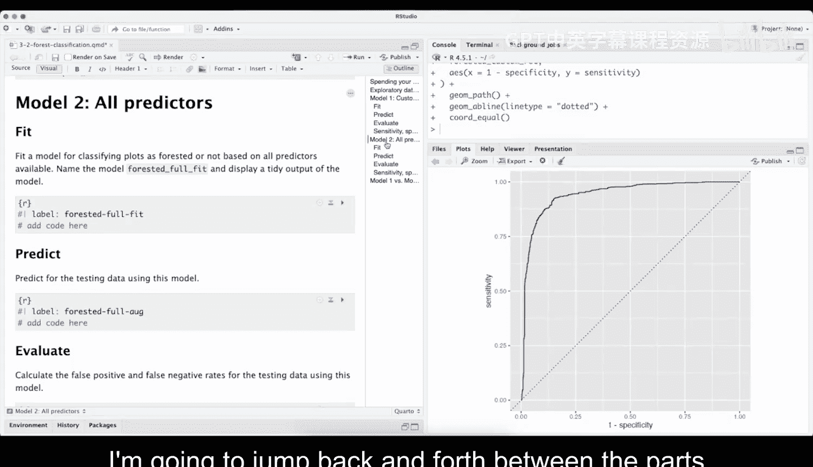
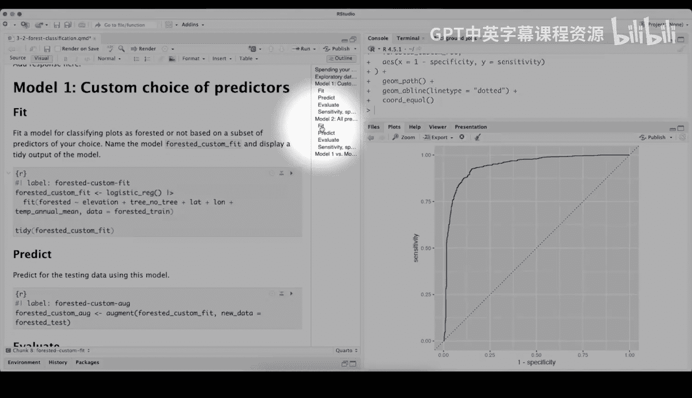
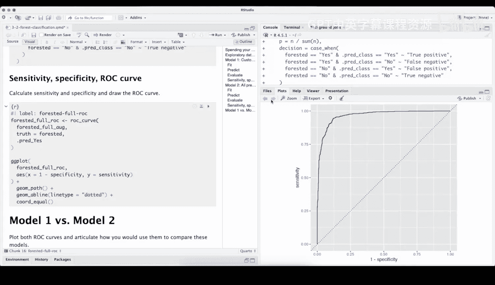
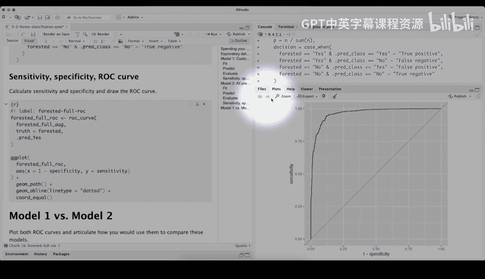
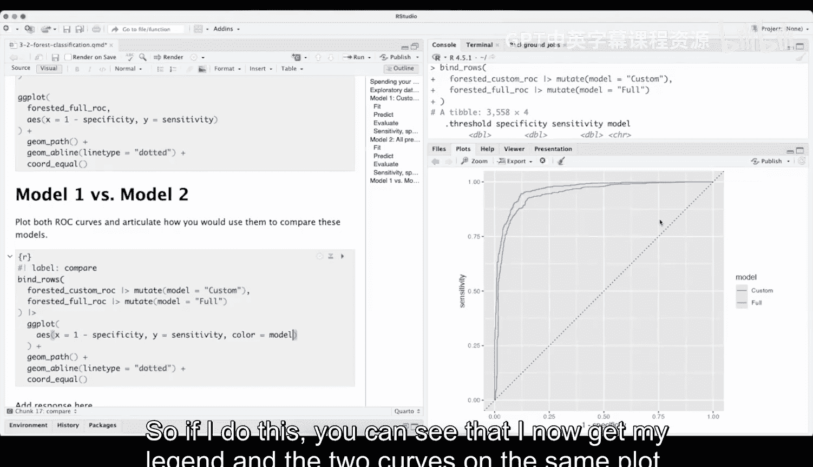
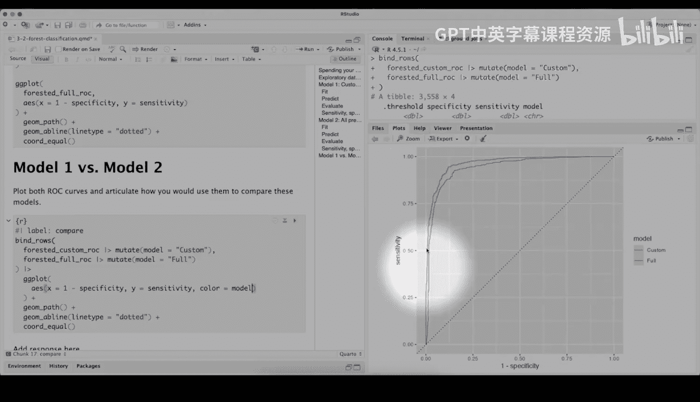
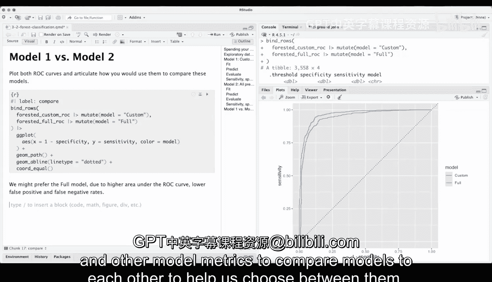

# 杜克大学《R语言数据科学｜Data Science with R》中英字幕 p51 14_03_05_代码实践：森林分类.zh_en -BV1Zpv6BaEkB_p51-

In this code alone we're going to split our data into testing and training。

 we're going to fit logistic regression models to our training data to classify outcomes。

 and then we're going to evaluate the performance of these models on our testing data。

 we're using the tidyverse and tidy models packages for data exploration and modeling。

 and then the data comes from the forested package。

Remember from the video that the forested dataset set contains information on whether a plot is forested。

 so that's yes or not， no， as well as some numerical and categorical features of the plot that the data is collected on。

So let's load our packages， run everything up to this point， and then run this as well。

 I am going to put my chunk output in console again。

So that we can take a look at our variables so forested， which is a factor variable is our outcome。

The first thing that we want to do is to split the data into testing and training。

 and we want to do this in a reproducible manner。 What does that mean， First of all。

 we want to set a seed。And remember， the number you put in there doesn't really matter。

 But what does matter is whether。You set a seat or not in the first place。

 And then we're going to use the initial split function。And provide our data frame to it。

 And let's go ahead and store the result of the split， as forested split。

And we can take a look to see what's in there。 I'm going to run all of these at once。

 And it's important that I am not just running the initial split line on its own。

 but always running it along with the code running it with a line where we have set a seed so that it's always the same split that we're getting。

 So if I was to run this I' over and over again， we're getting the exact same split。

 even though by randomness， we would have expected different ones。 if we had not set a seed。

So what percentage of the original forested data is allocated to training and what percentage to testing。

 We know that our original data frame had 7107 observations。And our training data has 5330。

So this is our train percentage。And our testing percentage， then， is the remaining。

So let's take a look to see what this gets me。 about 75% of my data is。Training and 25% is testing。

 which is exactly what I would expect because that's the default in the initial split function。

Then it asks， how would the code need to be updated to allocate 80% of the data to training and the remaining 20% to testing？

That means that we're going to need to change something in the initial split function。

 If we're not sure exactly what we need to change， what we can do is go ahead and look for some help。

 So I'm going to do question mark initial split。 And let's take a look at the help for this。

 And we can see that in addition to providing the data。

 we can also provide an argument called prop that by default is said to 3 over 4。 So to 75%。

So we could do something like。So this proportion is the amount。

 the proportion we want to allocate to training。Point8 D。

 And this would give us a slightly different split。 We can see different sample sizes here。

 I'm not going to bother with like setting a seed or saving this object because the rest of the instructions say。

 let's stick with the default split and save our testing and training data。

 So we already have that saved。And we can refer back to it here。

Next up we want to do some exploratory data analysis。

 we are asked to create a visualization that explores the relationship between the outcome and one numerical predictor。

 one categorical predictor and then describe in a few sentences what the visualization shows about the relationship between these two variables。

 and we have a note here just pay attention to which dataset set you use for your exploration。

So let's take a look at a few things here。 I'm going to first take a look at the help for the data frame。

 so I'll do question Mike fored。Just to get a sense of some of the variables here。

And one of the variables that might be interesting to look at is the annual mean temperature。

 So that's the mean annual temperature in degrees Celsius for each one of the plots in our data set。

What kind of a visualization would be good to look at this。 We might， for example。

 because it's a category。 it's a numerical variable。 We might make a histogram。

Let's go ahead and do that。And the first decision we need to make is which data frame。

 remember we don't get to peek at our testing data， so we're going to use forested train。

On our X axis， we're going to put temp annual mean。And then we might make a histogram。Oh。

 we actually skipped a step。 We wanted to save our testing and training data。

 We have our split object， but we haven't actually created data sets that are called forested train and forested test。

I like trying to align my arrows here and the functions we will use for those is training。

And testing。So now that we have these two objects， let's make sure that they are indeed in our environment here。

 as we can see in our environment tab， we can go ahead and make the visualization now so this is the distribution of the annual mean temperature。

Something that might be useful is to have some comparative pictures between the forested and non forested plots。

 So for this histogram， I might do fill with the forested。Fill with the forested variable。

And we might maybe wna play around with the colors a little bit。 Let's do scale。Color manual。

And for the values， we're going to use a named list for those that are， yes。

 I'm going to use forest green as the color。And for those that are no， I'm going to use。Gold color。

Right now， we have filled。 Oh， I've used the fill。Aesthetic， so I need to use the fill scale as well。

That looks a little bit better。And another thing that we might want to do is actually facet these so that they're not sort of on top of each other so we can see all of the details。

 So let's go ahead and。We can see that in areas where the。We that's indicated with yellow。

 so not forested plots。 The histogram is the center of the histogram has shifted a little bit。

 So we're seeing higher average annual temperatures compared to the plots that are forested。

 which hopefully makes sense。 Let's also add some transparency here。I we all set an alpha level of 0。

7 so we can see sort of the scales a little bit better。

 and now we can bring in another variable to this exploration going back to the help so that we can see the data dictionary a different variable to bring in could be the land type it says this is a land cover type from the European Space Agency。

 World cover global Land cover product as a factor with level treee， non-tree vegetation and barren。

 so let's see if there's a relationship between the annual temperatures。

 whether the plot is forested or not and land type as well。And says a categorical variable。

 so it makes sense to bring that in as a facet。 So we're going to and since it's a single categorical variable we're bringing in。

 we'll do a facet wrap by land type。And I want to stack these plots up in a single column so that they have a shared X axis。

 so this is what things are looking like。 We can see that in a land where the land type is tree。

 we're seeing a lot more of the forested plots， which makes a lot of sense in land types that's non-tree vegetation。

 we're seeing a lot more of the non-forested plots and then areas that are barren。

 there's not a lot of them where in Washington state after all。

 for this data set but we are still seeing a higher proportion of the notforested compared to the forested。

All right， so let's go ahead and do some modeling。So our first task is to fit a model with a custom choice of predictors so we'm going to sort of randomly select a few predictors。

 but in order to be able to do that， let's go ahead and pull up the data dictionary which is in the help file for this data frame so that we can see the variable names and we can pick some that might be of interest to us。

And remember， we are predicting whether a plot is forested or not， so that is a logistic regression。

Then we have our fit。 Our outcome variable is forested。

 and the variables that we're going to use are。Elevation。Let's use the tree。No tree variable。

We can also use latitude and longitude。And that temp annual mean variable that we used for our visualization earlier。

And the data set that we want to use is the training data， so that's going to be forested train。

And we're going to save this as。Forestted custom fit。

And let's go ahead and take a look at a tidy output。Now。

 if our goal was to fit descriptive models and sort of interpret the quantify and then interpret the relationship between some of these predictors and our outcome。

 we could pause here and take a look at the estimate column and go through some interpretations。

 but our goal for this particular code along is to do prediction。

 so we're going to focus on simply the prediction task and not worry too much about which variables we're using in our model up until the very end where we have two models that we can compare and we can discuss more what are the metrics we can compare them on。

We want to do prediction， so now that we have fit or in other words。

 trained our model with our training data， we can do our prediction with our testing data。

We want to not just do a prediction， but also save our predictions in the same data frame that the data that we're making predictions for our in。

 so we're going to use the augment function。We use the model we develop。

And the new data we bring in is going to be the forested test data。

That gives us a data frame with the same number of rows as our testing data。 But more columns。

 these three new columns that we have gained that give us a predicted class and the probabilities for yes or no。

 And let's go ahead and save this object。As forested， custom Og。

And then we can use this to calculate false， positive and false negative rates。

Before the write though， let's go ahead and count things up。So in this data frame， we have。

Forestted as a variable， which is the truth， the the observed data。

 and then we can see for each level of that variable。How many issses and how many nos we have。

Predicted。Now that we have those counts， we can calculate the rates。

 We can go ahead and group by forested。And then， let's add a new column。

That gives us the number of observations in each row divided by the total number of observations in that group。

 So the total yeses or the total no。These are the rights we're interested in。

Which one of them we can see that this is like true positive， true negative。

 and let's make sure that we can make sense of the false positives and false negatives as well。

 and I'm going to do this in a principled way taking some notes so that I can reuse this code further down when I fit my other model as well。

So in this mutate statement， I'm going to create one more variable。

 we're going to call this decision。And we're going to write a case when statement where if forested is equal to yes and dot pre。

Class is equal to， yes， as well。This is true positive。And let's go ahead and copy this。Four times。

What if this is no， what if when these are no， this is a yes， and this is a no。

 and let's create some blanks for us to reason our way through。All right。So。

How do we fill in these blanks。If forested is yes， but preed class is no。

 we are going to say this is a false negative。Versus a forested is no。

 but we predicted it to be forested。 That's a false positive。And if both are no。

 we haven't made a mistake。 This is a true negative。APread class not found。 Let's take a look to see。

 That should be class with a small sea。Let's go ahead and fix all of those and there should be a period。

The beginning。There we go。So the false negative rate of our model is 0。

106 and the false positive rate is 0。137。Are these good， are they bad， I mean。

 they don't look fantastic， but we can't really evaluate these numbers on their own。

 They're going to be more meaningful when we have another model to compare them to。A quick aside。

 what we're looking at here is commonly referred to as a confusion matrix。

 That's the count of how many corrects and incorrects we've gotten and in which direction。

 So there is a function called Kfmat short for confusion matrix that we can use to calculate these numbers as well。

 and that function as its first argument， takes the name of the augmented data frame。

As its second argument takes the truth。 So that's the forested column has the truth。

 And as its third argument takes which column has the estimate and that's the pre underscore class。

 So we can get those same exact numbers in a matrix format with confmat as well。Next up。

 we're asked to calculate the sensitivity and the specificity。

And then draw the ROC curve in order to do this， we're going to make use of the ROC curve function。

The first argument for this function once again is。Forestted， custom， augmented。

 So that's the data frame that contains the information that we need。

The second argument is the truth， which is forested。

 And then we give it the column that has the probabilities of。Sucsses。 So in this case， yeses。

So this gives us a data frame with three columns， a threshold。

 so remember this is our decision threshold that we had first introduced when we started talking about logistic regression。

And based on each one of those thresholds， sensitivity and specificity。

 so the ROC curve function calculates all of those for us。

 so we don't need to write a bunch of data wrangling code in order to calculate them ourselves。

Let's go ahead and save this data frame so we can use this to make our visualization I'm going to call this forested custom ROC。

And then I can go ahead and make a plot。The first argument is forested custom R O C。

 That's the data frame。On the x axis of an ROC curve， we have one minus specificity。

And on the y axis of an RO C curve， we have sensitivity。

We usually use connect these dots so a geoM path for sort of a stepwise function。

Would look something like this。 This is starting to look like an R O C curve。 Indeed。

 let's go ahead and draw our diagonal， as well。Gome A B line function by default will fit or will draw the diagonal。

And I'm going to go ahead and make the line type。Dashed here。😔，Or maybe even dotted。

So that it's not taking up a lot of visual energy。The one other thing is we want the X and the Y axis to be on the same scale because they both range from 0 to 1。

 and they're both probabilities ultimately。 And instead of having to sort of drag this around until we get to a square shape。

 I can actually add another layer chord equal， which then ensures that these are always plotted as a square plot。

 Now， is this a good model once again， just looking at this curve。

It's not terrible because at least it's above the diagonal。

But it's going to be more meaningful when we have something to compare it to。

So let's go ahead and create that thing to compare it to for the second part of this code along。

 we are fitting a model with all predictors。 So now just a random sampling that I used earlier。

 but instead we're going to use all 18 predictors available in our data frame and in order to go through this second part。

 I'm going to jump back and forth between the parts labeled model 1 and model 2 in our document so I'm using the document outline here。

 And if yours is collapsed， you can open that up by clicking on outline so that you can go back here grab some code that will be of use to us。

Go down to where we're doing the fit。

And go ahead， and paste it。We're going to call this forested full fit is what we're asked to do in the instructions。

And I can say that I want all of the predictors。 So let's go ahead and just use the period notation for the right hand side of the formula。

 We're still using the training data set to do our model fit。

And this is what the model output looks like much longer this time， a lot more predictors。

 some of these predictors are categorical， they yield additional dummy variables as well。

 which all end up as their own line in our tidy model output。

Now let's go ahead and use this model to do prediction。

 So I'm going to jump back up to the predict step。Grab the code I had developed。 Go back down。

Paste the code。 Make sure I still understand the code。

 We are augmented this time using the full fit model。But still the same new data， the testing data。

 and I'm going to call this forested full augmented data。

And I can take a look at that same number of rows， same number of columns before。But it's different。

 hopefully different information in these columns because we're making the predictions with a new model。

And finally， for our evaluation， let's go back and grab the code that we had developed for calculating false。

 positive and false negative rates。 I'm going to go ahead and run the cell here one more time so that that's sitting there as our custom models。

😊，False， positive and false negative rates。 so that when I come back down。Reuse the code。

 And the only thing I should need to change is the augmented data frame that we are doing our calculations on and run。

 We have these side by side to compare it to。 So with the random selection of variables I had determined earlier on。

 we had a false negative of false negative rate of 10。6%。

 That rate is lower here with the full model with more predictors。

 We had a false positive rate of 13。7%。 That rate also is lower。

 So now we have a model that is doing better on false negatives and better on false positives。

If these were the only two models to consider， we would go with the full model。

We have previously talked about the idea of。Making sure that the model we are selecting is the simplest most simplest model with the highest predictive power。

 though。 So comparing the full model to a model where the variable selection was not done in a very principled way is probably not that good an idea。

 But you could imagine if model 1 was developed by experts in forestry using variables that they tend to use to understand how forestation works versus a full model that could be a much fair comparison。

Finally， let's go ahead and create the R O C curve for the second one as well。

 So I am going to go ahead and grab the code we had developed for the first model， the custom model。

 copy that。 Go back down。Paste it here。And calculate the new。ROC curve。Using the new augmented data。

And then use that ROC curve for our visualization， so that's what that looks like。

This was our original one。 This is the new one。 the original， the new。 Remember。

 we want to be as close to this corner as possible。 So this is with the custom model。

 we're a little bit further away in terms of our curve。 And here is the full model。

 we're doing a bit better。 as we would expect， as we had seen from the false positive and false negative rate。

Now it's customary instead of switching between these two plots， try to put everything together。

 though， how can we put these things together， We have a data frame of the everything that goes into the ROC curve for the full model。

We also earlier had a data frame of everything that goes into the ROC curve for the custom model。

I can actually bring these two things together。 How can I bring them together， Firsts of all。

 let's go ahead and add some identifier column to these。 I'm going to do a mutate step here。

And say that I want to add a new column， maybe。Something like model custom。And for the second one。

 let's go ahead and do model full。 So I can see that now I have two data frames with four columns with the same names that I can actually bring together。

One way of bringing those together would be to use the bind row function。 And so in this function。

I'm going to take these two constructions。And add them as to arguments to bind， separated by commas。

Each one of my ROC curved data frames had 1779 rows， if I bind them together。

 now they all come together as this stacked data frame with an identifier。

I can then use everything that I had developed for my G G plot。

So let's go ahead and pipe this into our G G plot function。 I don't need a new data frame anymore。

 that's being piped in。We are using the same sensitivity and specificity。

 except I want to color my lines by this model variable。So if I do this。

 you can see that I now get my legend and the two curves on the same plot and I can see that the full curve that is being denoted by the greener line is actually closer to the edge where we want it to be。

So now that we have a visualization that compares the two of them。How would could we use this。

 Which one of these models might we prefer。We might prefer the full model。Due to higher area under。

The ROC curve。Which is also associated with lower， false positive。And false negative。Rs。

So in this code along， we've put into action what we've learned about building logistic regression models。

 making predictions with them， in other words， classifications。

 and then calculating how wrong we were in our classifications。

 building the models with training data， testing them on testing data。

 and then also using ROC curves and other model metrics to compare models to each other to help us choose between them。

