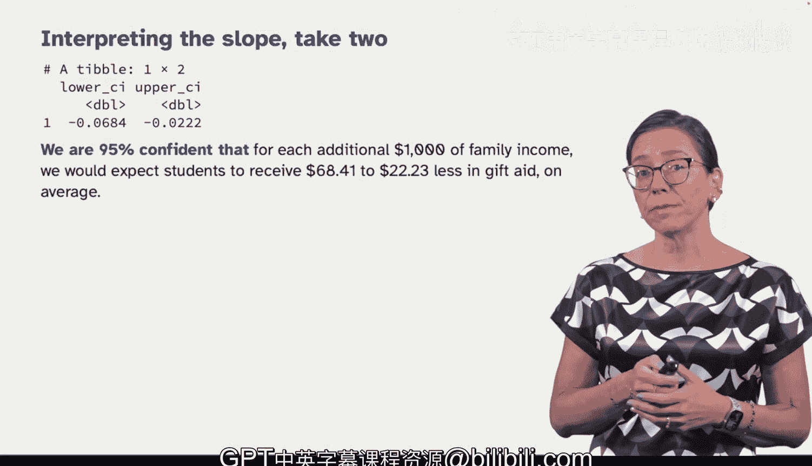

# 杜克大学《R语言数据科学｜Data Science with R》中英字幕 p52 15_04_01_量化不确定性.zh_en -BV1Zpv6BaEkB_p52-

🎼。

This video is our introduction to quantifying uncertainty。

 I'm excited to walk you through one of the most important concepts in statistics and data science。

 how we move from making point estimates to understanding the range of possibilities around those estimates。

 Let's start with our setup。 for this analysis will be using several R packages。

 The tidy verse for data wrangling and visualization， scales for better access labels。

 tidy models for modeling tasks and open intro for the data set。😊，Now， let's look at our data。

 We're examining family income and gift aid data from a random sample of 50 students in the freshman class of Elmhurst College in Illinois。

 Gi aid is financial aid that doesn't need to be paid back unlike loans。On the scatter plot。

 family income is on the X axis and gift aid on the Y axis。

 There appears to be a negative relationship as family income increases， gift aid tends to decrease。

 That makes intuitive sense， from a financial aid perspective。

Let's fit a linear model to quantify this relationship。

 Our linear regression gives us an interceptive of about $24300 and a slope of negative 00431。

So what does a slope mean for each additional $1，000 of family income。

 we would expect students to receive about $43。10 less in gift aid on average。

But here's a crucial question that brings us to the main topic of this video。

 Does this mean we expect exactly $43。10 cents less aid for every single thousand dollar increase in family income for all students at this school。

 Of course not。 This is where uncertainty comes in。 We calculated this slope from a sample。

 And if we took a different sample， We'd get a slightly different slope。 So the question becomes。

 what's the range of plausible values for this slope。😊，This brings us a statistical inference。

 the process of using sample data to make conclusions about the underlying population the sample came from。

Statistical inference provides methods and tools so we can use the single observed sample to make valid statements。

 inferences about the population it comes from。For our inferences to be valid。

 the sample should be random and representative of the population we're interested in。

Sort of like when you're cooking a pot of soup， you add a bunch of veggies。

 add salt and water to your pot。 Then you take a small spoonful and ask， is the salty enough。

 That's similar to exploratory analysis。 Understanding your sample data。 If yes。

 you think the rest of the pot must be good， too。 That's inference。

 using your sample to say something about the population it came from。

 And for that inference to be valid。 You need to stir everything first。

 So you get a truly representative taste of what's in the pot。

 That's like random sampling from your population。So far we've done lots of estimation， mean median。

 slow， et cetera。 We use data from samples to calculate sample statistics。

 which can then be used as estimates for population parameters。

 but what other considerations should we have in going from these numbers calculated on the sample to saying something about the population。

Think about it this way。 If you want to catch a fish， Would you prefer a spear or a net。

 Most of us would choose the net， right？ Similarly， when estimating a population parameter。

 would you rather report a single value or a range of plausible values。

 If we report just a point estimate， we probably won't hit the exact population parameter。

 But if we report a range of plausible values， we have a much better shot at capturing the true parameter。

This range of plausible values is called a confidence interval， but to construct one。

 we need to quantify how much variability we expect in our sample statistic。

So a confidence interval is a plausible range of values for the population parameter。

In order to construct a confidence interval， we need to quantify the variability of our sample statistic。

 For example， if we want to construct a confidence interval for a population slope。

 we need to come up with a plausible range of values around our observed sample slope。

This range will depend on how precise and how accurate our sample mean is as an estimate of the population mean。

Quantifying this requires a measurement of how much we would expect the sample statistic to vary from sample to sample。

Let's ask a hypothetical question that might help build intuition around the idea of variability between samples。

 Suppose we split a classroom in health down the middle of the classroom and ask each student their heights。

 Then we calculate the mean height of each student on each side of the classroom。

 Would you expect these two means to be exactly equal， close， but not equal or wildly different。

 Probably not exactly the same。 but not wildly different either。

 There's no reason why taller people should be sitting on one side versus shorter people on the other side。

Or consider this。 You randomly sample 50 students， and five of them are left handed。

 If you were to take another random sample of 50 students。

 how many would you expect to be left handed， You'd expect around 5。

 but you wouldn't be shocked if it was 3 or 7。 You would be shocked if it was 40。

 This natural sample to sample variability is what we need to quantify。

We can do this using computational methods， in other words。

 simulation with a technique called bootstrapping， which we'll introduce shortly。

 or we can do it with theory， namely the central limit theorem。

 which you might learn about in future stats courses。 but as a sneak preview。

 the calculated standard error values in the regression output you've been seeing rely on calculations based on this theory。

What's bootstrapping Then the term comes from the phrase pulling oneself up by one's bootstraps。

 accomplishing an impossible task without outside help。Our impossible task。

 estimating a population parameter using data from only our given sample。

Here's our observed sample with its slope of negative 。0431。

Boottrapping creates a simulated population by assuming there are more students like the ones in our observed sample。

 We use this to understand the variability we might expect if we could take many samples from the population。

Here's how bootstrapping works in four steps， take a bootstrap sample。

 a random sample taken with replacement from the original sample of the same size as the original sample。

 then calculate the bootstrap statistic， a statistic such as mean， median， proportion slope， etc。

 computed on the bootstrap samples。Then repeat steps 1 and2 many times to create a bootstrap distribution。

 a distribution of bootstrap statistics。 Finally， calculate the bounds of the confidence interval as the middle of the bootstrap distribution。

 whatever confidence level you are looking for。 That's the area in the middle you want to hit the bounds of。

Let's see this in action。 Here's our first bootstrap sample with its fitted line and slope。

 much like the original， but not exactly。 Here's a second bootstrap sample。

 Notice the slope is different。 A third sample gives us yet another slope value and a fourth sample with another slightly different slope When we overlay these samples。

 you can see how the fitted lines vary。 This variation is exactly what we want to capture and quantify。

😊，Of course， we don't stop at just four samples。 We generate hundreds or thousands of bootstrap samples。

 not one by one， like we've done so far， but we can write some code to do this many times Here you can see what happens when we fit lines to 100 bootstrap samples。

 Look at all that variability。When we collect all the slopes from each of the 100 models and plot them as a histogram。

We get our bootstrap distribution of the slope。 This shows us the range of slope values we might reasonably expect to see if we could go back and take many new samples from the population。

From this bootstrap distribution， we can calculate our 95% confidence interval。

 We simply find the middle 95% of the distribution。

Our 95% confidence interval for the slope runs from about negative 0。0699 to negative 0。0217。

So here's our interpretation of the slope that also incorporates a measure of uncertainty。

 We are 95% confident that for each additional00 of family income。

 we would expect students to receive $69。95 to $21。70 in。Less in gift aid， on average。

Notice how much more informative this is than just saying $43。10 less。

 This confidence interval gives us a sense of the precision of our estimate and acknowledges the uncertainty inherent in working with sample data。

To wrap up， point estimates are useful， but they don't tell the whole story。

 Confid intervals help us quantify uncertainty and provide a more complete picture of what we can reasonably conclude from our sample data about our population。

 Boottrapping is a powerful， intuitive and computational method for constructing these intervals。😊。

