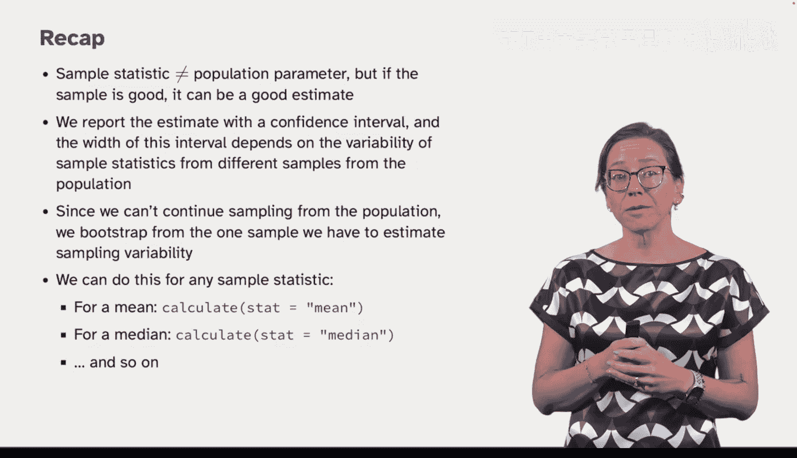

# 杜克大学《R语言数据科学｜Data Science with R》中英字幕 p53 16_04_02_自助法.zh_en -BV1Zpv6BaEkB_p53-

🎼。

We have discussed the motivation for uncertainty quantification and introduced the idea of building confidence intervals to quantify the variability of sampling statistics in the previous video。

 In this video， we revisit bootstrapping with a new example。

 Let's start with our setup For this analysis。 We'll use tidyverse for data wrangling and visualization and tidy models for modeling tasks。

Our data set consists of rental prices for 15， three bedroom flats in Edinburgh， Scotland。

 these were randomly selected from rightmove。co。uk， one of UK's major property websites。

 looking at this data， we can see quite a range of prices from 825 pounds per month to 3。

250 pounds per month。This variation reflects different neighbours。

 property conditions and amenities across Edinburgh。 notice a variety in locations。

 Some flats are in pricier areas like Newtown and George Street。

 while others are in more affordable neighborhoods like Lockend and Burnhead Grove。

 Another thing to note is that the columns are separated by semi Cols。Therefore。

 we'll use the read underscore CSV2 function to load these data。 in this function。

 the delimiter is a semico， as opposed to a colon。 The resulting data frame has 15 observations with information about rent prices。

 titles and addresses for each flat， just like we expected。

And this histogram shows the distribution of our sample data。

 we can see that most flats are priced between 1，500 to 2000 pounds with a few higher priced outliers。

Our sample mean is approximately 1895。 But here's a crucial question。

 If we had randomly selected a different set of 15 flats from Edinburgh。

 would we get exactly the same mean， Almost certainly not。

 This sample mean is our best estimate of the population mean， But it comes with uncertainty？

 The question is， how much uncertainty。This is where bootstrapping comes in。

 We create a hypothetical bootstrap population by imagining there are many more flats out there。

 just like the ones in our sample。If we could sample repeatedly from this larger population。

 we'd get different sample means each time the variability of these sample means would tell us about the precision of our original estimate。

 but we don't actually have this population。 so we're going to simulate it using our sample data。

Here's the step by step process for doing so。 Take a bootstrap sample。

 a random sample taken with replacement from the original sample of the same size as the original sample。

Calculate the Botrap statistic， a statistic such as a mean， median， proportion， slope， etc cetera。

 computed on the bootstrap samples。Repeat steps1 and2 many。

 many times to create a bootstrap distribution。 This is a distribution of bootstrap statistics。

 and then we use the middle， whatever percentage of this distribution to create our confidence interval。

The key insight is that sampling with replacement allows us to simulate the process of drawing different samples from the population。

Now， let's see how to implement this in R using the tidy models framework。

 specifically the inferar package。 We'll build up our bootstrap analysis step by step。 First。

 we set a seat to ensure results are reproducible。Since bootstrapping involves random sampling。

 setting a seed means we'll get the same random sample every time we run our coat。

 This is crucial for reproducibility of our results。

Then we use the specify function to specify our model。 In this case。

 we're only interested in estimating a single population parameter， though。

 So we set response to the rent variable。 Not that the output is the same as the data frame。

 but it has some metadata associated with it printed on top。

The generate function is where the magic happens， We're creating 15000 bootstrap samples。

 each of size 15， same as our original sample。Each bootstrap sample is created by sampling with replacement from our original 15 observations。

 So bootstrap sample mine，1 might contain flat 3 twice， flat 7， three times will be。

 missing flat 12 entirely， so on and so forth。And why 15000 repetitions。

 more bootstpped samples gives us a more stable estimate of the sampling distribution。

 but there are diminishing returns beyond a certain point。Then for each of our 15。

000 bootsottrap samples， we calculate the mean using stat equals mean。Now。

 we have 15000 different sample means， each based on a different bootstrap sample。

 This collection of 15000 means approximates what we would see if we could actually draw 15000 different samples from the population。

We save our bootstrap distribution as Bo disk for further analysis。

Let's pause and think about what we have。 How many observations are in bootist，15000。

 Each observation represents one bootstrap sample mean。 So we start with 15 rental prices。

 Now we have 15000 estimates of what the population mean might be based on difference possible samples we might have drawn。

The visualized function creates the histogram of our bootstrap distribution。

 We could have done this with first principles from G G P 2。

 but tidy models or specifically the infer package tidy models has these handy shortcuts。

 This shows us the bootstrap distribution of sample means。

 Notice the distribution is roughly centered around our original sample mean of 1895。

 but it shows the variability we might expect from sample to sample。

 The range of this distribution tells us about the precision of our estimate。

 A narrower distribution means our sample mean is more precise。

It's also worth noting that the distribution is unimmodal and symmetric。

 That's an idea we're going to revisit。A 95% confidence interval is bounded by the middle。

95% of our bootstrap distribution。 The get C I function with level set to 095 finds the 2。

5 and the 97。5 percentiles of our bootstrap sample means。

The shade C function overlays the bounds of the confidence interval we just calculated on our bootstrap distribution and shades in between them。

But let's finally talk about what these bounds。 the 1601 to 22，16 represent。

 Let's go through a few plausible sounding interpretations and identify if they're correct or not。

95% of the time， the mean rent of three bedroom flats in the sample is between 16 1601 and 2216。

 This makes it sound like the sample mean of this one sample changes from time to time。

 which is not true。 We know what the sample mean is。 We've calculated it。

95% of all three bedroom flats in Edinburgh have rents between 1601 and 2216。

 This is about individual flats， not the mean。 Our confidence interval is about the average rent。

 Not the range of individual rents。 So this is not correct， either。

We are 95% confident that the mean rent of all three bedroom flats is between 1601 and 2216。

 This one is correct。 We are 95% confident that the true population mean the average rent of all 3 bedroom flats in Edinburgh falls within this interval。

And finally， we are 95% confident that the mean rent of three bedroom flats in this sample is between 1601 and 2216。

 Incorrect。 Again， our sample mean is fixed。 We know exactly what it is。 We've already calculated it。

 We don't need bounds around it。😊，Now let's take a step back and say a few words about accuracy and precision of our estimates。

We said we're 95% cent confident。 This has a very specific meaning in statistics。

 If we repeated our entire study many times， collecting new samples of 15 flats and constructing 95% cent confidence intervals each time。

 then about 95% of those intervals would contain the true population mean。

This doesn't mean there's a 95 per cent probability that the true mean is out in our specific interval。

 The one we just calculated。 Rather， it means 95% of the intervals produced by our method would contain the true population parameter in the long run。

Commonly used confidence intervals are 90 per，95% and 99 per cent here。

 they are all overlaid on the bootstrap distribution。

 So which line represents which I'll give you a second to think about it。The green dotted line。

 the narrowest one， represents the 90 per cent confidence interval。

 The blue dashed line in the middle represents the 95% cent confidence interval。

 and the orange dashed dot line。 The widest one represents the 99 per cent confidence interval。

 High confidence levels require wider intervals to be more certain of capturing the true parameter。

 We need to cast a wider net。If we want to be very certain that we capture the population parameter。

 should we use a wider or an narrower interval， If we want to be very certain of capturing。

 we need a wider interval， a wider net。 But wider intervals are less precise。

 they give us less specific information about where the parameter might be， just like in this comic。

 if you predict everything might happen。 you'll never be wrong。

 But your predictions aren't very useful。How can we get the best of both worlds Then。

 We increase our sample size。 Lager samples lead to less variable sample statistics。

 which means narrower confidence intervals for the same confidence level， easierier said than done。

 though。So how do we actually change the confidence level when calculating the bounds of the confidence interval。

 Take a look at this code。 We just need to change the level argument in the get C I function to  point90。

 for example or to 0 99。 Let's recap the key concepts。

 A sample statistic is not equal to a population parameter。 But if the sample is good。

 it can be a good estimate。 We report the estimate with a confidence interval。

 and the width of this interval depends on the variability of sample statistics from different samples from the population。

Since we can't continue sampling from the population。

 we bootstrap from the one sample we have to estimate sampling variability。

We can do this for any statistic for a mean， we set stat equal to mean in the calculate function。

 for a median， we set it to median and the function， just like the bootstrapping method itself。

 works with many other statistics as well。 Just check out the function documentation for more information on how to specify them。

