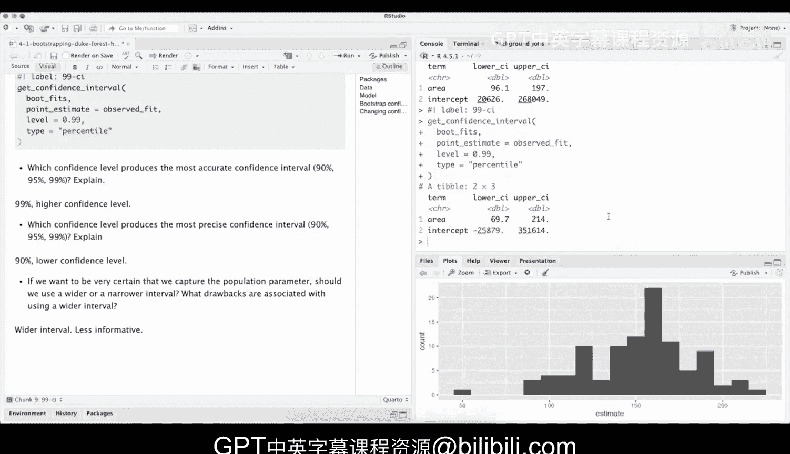

# 杜克大学《R语言数据科学｜Data Science with R》中英字幕 p54 17_04_05_代码实践：杜克森林房屋自助法.zh_en -BV1Zpv6BaEkB_p54-

In this code alone， we will use bootstrapping to construct confidence intervals。

 we're going to use the tidyverse and tidy models packages for exploration and modeling and the open intro package for our data。

 So let's go ahead and load these packages。The data that we're going to be using are on houses that were sold in the Duke Forest neighborhood of Durham。

 North Carolina， right nearby by Duke University， around November 2020。

 It was originally scraped from Zillow， and it can be found in the Duke Forest data set in the open Intro R package。

Let's take a look at that。I am going to go ahead and shoot this off to show our chunk output in console。

And here are our variables and let's get some information on our rows as well。 We have 98 rows。

 that's 98 houses that are on sale at that time on Zillow that are located in Duke Forest。

 and we know some stuff about them， We know their address， we know their price。

 We know how big the houses are， but also how many bedrooms， bathrooms， so on and so forth。

The model that we're interested in is for predicting price of houses from their area。

 You can imagine the bigger the house we might expect it to cost more。

 So let's go ahead and see if that is indeed the case。Our outcome variable is price。

 which is a numerical variable， and our predictor is area， which is also a numerical variable。

 So we are going to be fitting a linear regression。That is linear re。

And we will pipe that into the fit function， where our outcome is the price。 Our predictor is area。

 and our data frame is。Duke forest。Let's go ahead and run this and we might want to store this。

 I'm going to call this DF Fi for Duke Forest Fi， and we can take a look at a tidy output of these data。

Here we go， our intercept is 116652 and our slope for area is 159。This $116。

000 number tells me that if the area of a house is zero。

 the model predicts on average for all of these houses。

 the price to be about that much doesn't really make sense。 Obviously。

 we wouldn't have a house that tiny。 So this is probably an extrapolation。

 but it gives us a good baseline。 and this  hundred59 number is sort of the incremental square foot price associated with the incremental square footage。

 So for each square foot， the house is houses are larger。

 we expect their price to be higher on average by 159。

 A number that real estate agents like to quote quite a lot。But as we know。

 this data comes from a single sample， and it is not the population of all Duke Forest houses。

 So instead of reporting this single number， we might actually want to report a confidence interval。

 How do we go about doing that。Let's go ahead and do this in a step by step way。

 The first step is actually going to get us to exactly where we are already。

 but it's going to help us develop some code that we can use for the remaining steps。

 We are going to first calculate the observed fit。 So this observed model and store it as an object。

😊，I will call that observed。Fit。And in the bootsrapping pipeline， we start with the data frame。

Then we specify our model。Our outcome variable is price。 Our predictor variable is area。

And then we say that we want to fit a model。Let's go ahead and see what this looks like。

This looks just like our regression output， except it doesn't have the additional estimates of uncertainty around it because we are not interested in those additional estimates of uncertainty。

 the standard error， this test statistic and the P value that were calculated using the central limit theorem instead we're going to take these as our starting point and we're going to build bootstrap distribution around it。

 It says take n bootstrap samples and fit models to each one。

 Let's first come up with n I'm going to start small and I'm going to start with the number 10 not that realistic。

 but it's going to allow me to just take a look at my data。

 and then we can go ahead and increase that number to something higher。

 So let's imagine that we want to take 10 bootstrap samples from this original sample。

 The original sample remember had well I don't remember， so let's take a look98 observations in it。

It's almost like I am putting in a bag these 98 houses in Duke Forest。 I am randomly sampling one。

 recording its price， putting it back in the bag until I have created a new bootstrap sample of 98 houses。

 Now， this new bootstrap sample will not be exactly identical to the 1 I started with because I have sampled with replacement。

 So I have allowed myself to grab some houses multiple times。 Some houses may be no times。

 The idea being that if my original sample is representative of the population that I don't actually have access to。

 there should be more houses like it in my population。So how do we go about doing this。

 We start very similarly。 We start with our data frame， Duke Forest。

We specify our model in exactly the same way。But then we say we actually want to generate these bootstrap samples。

 So how many bootstrap samples do we want to generate。

 We said we're going to make 10 of these new samples。 So I'm going to say reps is equal to n。

 That's that 10 number we have already recorded。 And the type of generation we want to do。

Is bootstrap。So far we haven't talked about any other type of generation。

 but next up we're going to be talking about randomization testing so using statistical inference to make decisions as opposed to make estimates and then we're going to talk about different types of randomly generated samples as well so the type of generation we're doing is called bootstrap which has two defining characteristics sampling with replacement and also making sure that that new sample is the same size as the original sample 98。

And then what we want to do， let's actually take a look at what this gives us。

So we can see that this creates a data frame of 980。Observations， where do these come from。

 That is samples of 98。 Each one of these are bootstrap samples， and we have ton of them。

 because that's what we have decided to do to begin with。

 And this replicate variable is tracking which sample， which bootstrap sample we're in。

 So if I was to quickly do something like， let's count。How many times each replicate？

That's a variable， shows up， we can see that each replicate so that's the sample identifier shows up 98 times that's how we make up the 980 but what we want to do is not just have these samples sitting around。

 but from each of these 10 samples， I actually want to fit a model and calculate the slope。

How do we do that？ We fit models to it。So when I do this。

 I end up getting an output that has 20 rows。 Where does the 20 come from， Each time we fit a model。

 we get two estimates， an intercept， which I happen to not be interested in for the context of this code along。

 but I may have been。And a slope， which is exactly what I'm interested in。

 So my original data set had yielded a slope of 1 hundred and 59。

 That was the predicted or estimated incremental price associated with each square foot。

 And this new these 10 bootstrap samples。 each yield their own estimates as well。

 One of the bootstrap samples yielded hundred and 66。 Not exactly the same as what I saw before。

 Not wildly different either。 That's the sampling variability we're looking for。

 or 1 and 32 or 1 hundred and68。 So on and so forth。Now。

 let's run this again and let's try to remember a couple of these numbers， 166，32，13。

 the slopes of the first three bootstrap samples。 if I run this again。

I'm getting slightly different numbers。 If I run it again， I'm getting slightly different numbers。

 Is that bad。Well， bad or good is not the right questionnaire。 Is it incorrect。 It's not incorrect。

 If you're randomly sampling， you're going to get you random samples， and therefore。

 they're going to yield slightly different models with slightly different slopes。

 Is it potentially annoying if you are trying to write up a report about this， Absolutely， yes。

 Is it annoying。 If you are working with a collaborator。 You're developing some code。

 You're passing it on to them。 Maybe they're checking your work and you're building this project together。

 Definitely， yes， So we don't yet have the reproducibility piece of this in our code。

When we're randomly sampling， we want R to be taking random samples。

 but the same random samples each time。So what do we need to do？We need to set a seed。Let's set 1，2。

3，4 for a lack of creativity。 So now if I run this over and over。

 I can see that I am always getting the same estimates。

 These are indeed random coming from randomly generated samples， but the same ones each time。

And in general， we don't want to keep our number of bootstrap samples so small。

 So let's increase that a little bit to 100。You can see that now my the resulting data frame size has grown。

 but it takes just about the same amount of time to create this if I was to increment this to 1 thousand0。

It's going to take a little bit longer。But we get the idea。 we're basically able to generate many。

 many more of these by increasing our number of bootstrap samples。

 I'm going to keep it at00 for illustrative purposes。

 and I'm also going to store this object as bootstrap。Fits。Just so i can refer back to it later。

So why do we set a seat before taking the bootstrap samples because we want to make sure that we get the same random samples each time we run the code or each time we render our document？

Next， we're asked to make a histogram of the bootstrap samples to visualize this bootstrap distribution。

 Let's remind ourselves what these bootstrap samples looked like， this object。

So what we are interested in is just the slopes， and we want to make a visualization of that。

Just the slopes means that I don't want every single row。 Instead。

 I want the rows associated with the term area。Regenerate the bootfis again。

And take a look at what they look like。 We have 200 rows in our data frame。

 and we are going to filter。Where term is equal to area。

 that's going to give us our 00 bootstrap slopes。And then we can pipe this into a G G plot where。

On the X axis， we want the column called estimate。And we are asked to make a histogram。

Now that we have made a histogram and can take a look at it， lets create。

 let's choose a reasonable bandwidth， maybe $20。Maybe $15。Maybe $10。 Any one of these。

 maybe $10 looks good。 It gives me a nice idea of this distribution。

So this is about the variability that we might expect having taken 100 Botrap samples from our original sample。

Next， we are asked to compute the 95% confidence interval as the middle 95% of the bootstrap distribution。

How would we go about doing this， Let's remind ourselves what these values look like。

 So these are the0 observations in our data frame。 If I want the middle 95%。

 I could do something like， let me arrange it by the estimate column。

So now everything is in order and then I would take the middle 95% of these so maybe starting from the third observation all the way to the 97th observation or something。

 but we actually have some tiny models code that we can use with these objects so that we are not having to constantly write data wrangling code and the function that we can use here is called get confidence interval。

The first argument it takes is the bootstrap object， that's the boot fits。The point estimate。

Is the original point estimate。 We have that stored as。Observed fit。

The level of the confidence interval we're interested in is 0。95。

 and the type of confidence interval we're interested in is percentile because we want the middle 95% as opposed to using this distribution to calculate a standard error and use that to create a margin of error around our point estimate。

So we can see a lower bound and an upper bound for our confidence interval，92。4 to 206。

 What do these numbers mean， We are $95% confident that for each additional square foot in Duke Forest houses。

 the price is predicted to be between $92。40 to $206 higher。

If we want to modify our code from this last step to create a 90% confidence interval。

That should hopefully be straightforward enough。 The argument that we would change is point is the level argument going from 95 to 90。

 But before we round that code， let's think about， would we expect that interval to be narrower or wider。

 If the middle 95% of the distribution is from 92。4% to 206。 the middle 90 per should be narrower。

 So giving us a more precise estimate。And that interval is indeed from 96。1 to 197。

If we want to make a 99% confidence interval， we can use the same code again and note that all of these are based on the same bootstrap object。

 So I'm not reampling again。 I'm just using the same bootstrap distribution to find different cutoffs in it。

 And these numbers，90，95，99 are not numbers。 I randomly made up。

 These are confidence levels that are commonly used in literature and in practice。

And if I want the middle 99% of the distribution， now we are giving a much wider interval。

Going from 69。70。$69。70 to $214。How do I choose between these。

 Which confidence level produces the most accurate confidence interval， Is it the 90。

 the 95 or the 99。Before answering this question， let's look at our next question as well。

 Which confidence level produces the most precise。 So what do we mean by accuracy versus precision。

 Precision is around how narrow your interval is。 So how much you can pinpoint down to an answer。

 So the most precise of these intervals is the 90% interval with the lower confidence level。

That's the expense that precision comes as。 I can be more precise， but I'm not as confident。

 And the most accurate， meaning the one that is maybe most likely to capture the true unknown population slope is the 99 per cent confidence interval。

With a higher confidence level。So this， I am more confident。

 it's more accurate because chances are the true population parameter is in there。

 but it is not as precise， so it may not be as informative。Therefore。

 if we want to be very certain that we capture the population parameter。

 should we use a wider or an narrower interval？This is like asking if you want to be very certain that you can catch some fish。

 Should you use a smaller net or a bigger net， A bigger net。

 meaning a wider interval would be preferable。 If I or our goal is to be certain that we capture the population parameter。

 But what drawbacks are associated with this， It's less informative。

Because now we're saying the incremental cost could be anywhere from you know， about $70 to $214。

 which is very different than something a bit more precise that might allow us to make better pricing decisions。

