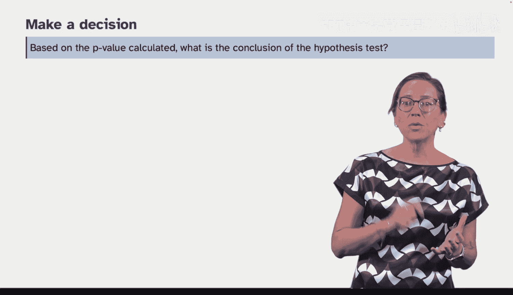

# 杜克大学《R语言数据科学｜Data Science with R》中英字幕 p55 18_04_01_假设检验.zh_en -BV1Zpv6BaEkB_p55-

🎼。

In this video， we're building on uncertainty quantification a bit more。

 This time for making decisions via hypothesis testing instead of estimation via confidence intervals。

 Let's set things up。 We're going to use three packages， Tidy verse， tidy models and open intro。

 which contains our data set， the Duke Forest housing data。Let's dive in。

A hypothesis test is a statistical technique used to evaluate competing claims using data。

This is different from estimation Instead of asking， what is the value of a parameter， we're asking。

 is a specific claim about a parameter supported by our data。

 We always have two competing hypotheses， a null hypothesis， H not。 This represents the status quo。

 or nothing is happening position。 It's an assumption about the population that will' test。

An alternative hypothesis， usually H， this represents our research question or something is happening position。

 it's what we're trying to find evidence for。An important note。

 hypotheses are always about the population parameters， not sample statistics。

 which we can calculate directly。Let's make this concrete with an example。

 Suppose we want to know if house area is related to price in the Duke Forest neighborhood。

 The null hypothesis would state there's nothing going on。

 The slope of the relationship between house area and price is 0。 In other words。

 beta 1 is equal to 0。 This would mean area doesn't help predict price。

Alternative hypothesis says there is something going on。 The slope is different from 0。

 So beta 1 is not equal to 0。 This would mean area does help predict price。

 This is called a two sided test because we're testing whether the slope is different from 0 in either direction。

 We might have some beliefs about whether the slope should be positive or negative。

 bigger house more expensive， right， But we don't bring those beliefs into the hypothesis testing framework。

 And we tend to prefer to set our alternative hypothesistheses as the relationship could go in either direction。

Here's the key mindset for hypothesis testing。 Asume you'll live in a world where the null hypothesis is true。

 So beta 1 is 0。 Then we ask ourselves， how likely are you to observe the sample statistic or something even more extreme in this world。

 In other words， what is the probability of observing a sample slope that is negative  hundred and 59 are lower or positive  hundred and 59 are higher。

 If， in fact， the true population slope is 0。 Remember。

 the hundred and 59 comes from a previous video where we calculated the sample slope。

This might sound like a counter intuitivetuitive way to make a decision。 And if you think so。

 I agree with you。 But it's also a commonly used approach。 It's much like a court trial in the US。

 Actually， the null hypothesis is that the defendant is innocent until proven guilty， right？

 And the alternative hypothesis is that the defendant is guilty。Then we present the evidence。

 we collect data。Like collecting collecting evidence in a trial。Then we judge the evidence。 We ask。

 could this evidence plausibly have occurred by chance if the dependent defendant were really innocent。

 If yes， we fail to reject the non hypothesis and come back with a not guilty verdict。 If no。

 we reject the non hypothesis in favor of the alternative and come back with a guilty verdict。

 Just like in court， we don't prove innocence。 We either find sufficient evidence of guilt or we don't。

So in the hypothesis testing framework， we start with the null hypothesis。

 H not that represents the status quo。 We set an alternative hypothesis H A that represents the research question。

 In other words， what we're testing for， we conduct a hypothesis test under the assumption that the null hypothesis is true and calculate a P value。

 the probability of observed or more extreme outcome， given the null hypothesis is true。

If the test results suggest that the data do not provide convincing evidence for the alternative hypothesis。

 we stick with the null。 If they do， then we reject the null hypothesis in favor of the alternative。

We'd already calculated the observed slope before 1 hundred and 59。

 We then simulate the null distribution to do so。 We first set a seed。

 Then we start with our data frame。 Duke For specify the model price versus area。

 our null hypothesis says independence。 price and area are not related。 or， in other words。

 beta 1 is 0。 Then we generate random samples。 Let's do 1000 of those。

 and the method of generation this time is permutation。Permutation shuffles the y values。

 the prices while keeping the x values， the areas fixed。 This breaks any relationship between them。

 Simulating what we'd see if， in fact， the null hypothesis were true。And finally。

 we fit models to each one of these thousand randomly generated samples。The object。

 null disks that we assign to this pipeline's results， contains 2000 rows。

0 slopes and thousand intersets。 We're really only interested in the slope， though。

 So let's filter for them and visualize them。 We can do this from first principles using geom histogram。

 or we can use the handy visualized shortcut function designed for inference pipelines。

 We're focusing on the top histogram， the null distribution of slopes。 It's centered at 0。

 null hypothesis value。 It's unimmodal and symmetric， again， just like a bootstrap distribution。

The red line is at hundred and 59。 our observed sample slope。

 Our observed slope appears to be way out of the tail of this distribution。 And remember。

 we want to ask ourselves the question。 If， in fact。

 we live in a land where the null hypothesis is true。In other words。

 there is no relationship between areas and prices of houses and the slope is 0。

 How likely is it to get a random sample of 98 Duke For houses where the observed sample statistic is hundred and 59 or something more extreme in either direction。

 In other words， in how many simulations out of the thousand0。

 did we observe a sample statistic beyond the observed value in either direction， just by chance。

In none of them。We can ask R to calculate this probability called the P value explicitly as well。

 And it gives us 0， but also an important warning， saying that this 0 is an approximation based on the number of replics we set。

 Chances are， if we had a higher number of replicates， like 15000 instead of 1000。

 we could observe a few samples with more extreme sample statistics。

 But we expect that number to be very low。Then based on the P value calculated。

 what's the conclusion of the hypothesis test？If the P value is small and we usually use a threshold of 0。

05 to determine small， we reject the null hypothesis。 Our P value is approximately 0。 So small。

 indeed， we conclude there is convincing or statistically discernible evidence that the House area is related to price。

 The relationship we observed in our sample is unlikely to be due to chance alone。If。

 on the other hand， the P value is large， larger than our discernability level of 5 per cent。

 we would fail to reject the nu hypothesis and say we don't have discernible evidence to conclude there's a relationship and that the observed relationship could plausibly be due to chance。

 The beauty of this approach is that we've used the same simulation techniques from bootstrapping。

 But now we're simulating under a specific assumption， the null hypothesis。

