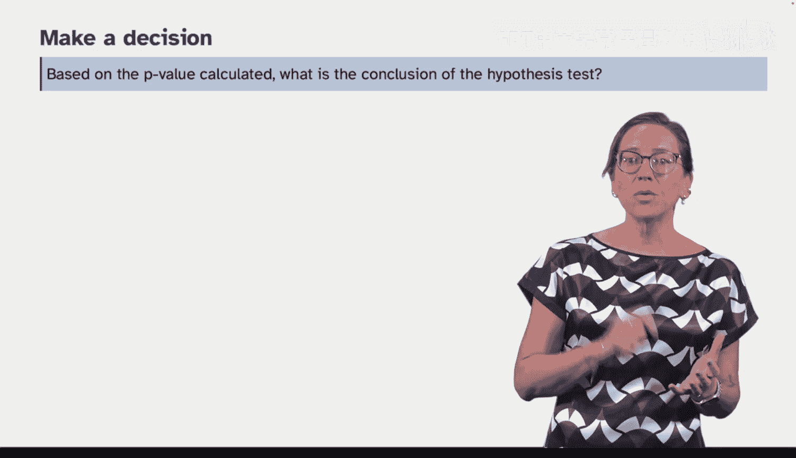

# R语言数据科学：18_04_01：假设检验


在本节课中，我们将学习一种重要的统计推断方法：假设检验。我们将了解如何利用数据来评估关于总体参数的相互对立的两种主张，并学习如何通过模拟来计算P值，从而做出统计决策。

上一节我们介绍了通过置信区间进行参数估计，本节中我们来看看如何通过假设检验来进行统计决策。

## 假设检验概述

假设检验是一种利用数据来评估相互对立的主张的统计技术。这与参数估计不同。我们不再问“参数的值是多少”，而是问“我们的数据是否支持关于参数的某个特定主张”。

我们总是有两个相互对立的假设：
*   **零假设**：通常记作 **H₀**。它代表现状或“无事发生”的立场。这是关于总体的一个假设，我们将对其进行检验。
*   **备择假设**：通常记作 **Hₐ**。它代表我们的研究问题或“有事发生”的立场。这是我们试图寻找证据支持的观点。

一个重要的注意事项是：假设总是关于**总体参数**的，而不是我们可以直接计算的**样本统计量**。

## 一个具体例子

假设我们想知道在杜克森林社区，房屋面积是否与价格相关。

*   **零假设** 将陈述“无事发生”：房屋面积与价格之间关系的斜率为0。换句话说，**β₁ = 0**。这意味着面积无助于预测价格。
*   **备择假设** 则陈述“有事发生”：斜率不等于0。换句话说，**β₁ ≠ 0**。这意味着面积有助于预测价格。

这被称为**双侧检验**，因为我们检验的是斜率是否在任一方向上偏离0。我们可能对斜率应为正或负有自己的看法，但我们不将这些看法带入假设检验框架。我们倾向于将备择假设设定为关系可能朝任一方向发展。

## 假设检验的核心思想

假设检验的关键思维方式是：**假设你生活在一个零假设为真的世界里**。即假设 **β₁ = 0**。然后我们问自己：在这个世界里，观察到我们现有的样本统计量（或更极端的情况）的可能性有多大？

换句话说，如果真实的总体斜率确实是0，那么观察到样本斜率是-159或更低，或是+159或更高的概率是多少？（注：159来自之前视频中计算的样本斜率值。）

这听起来可能是一种反直觉的决策方式。但它也是一种常用的方法，类似于美国的法庭审判。零假设是“被告无罪”，备择假设是“被告有罪”。然后我们出示证据（收集数据），并判断证据：如果被告真的无罪，这些证据是否可能偶然出现？如果是，我们“无法拒绝”零假设，得出“无罪”裁决；如果不是，我们“拒绝”零假设，支持备择假设，得出“有罪”裁决。就像在法庭上一样，我们无法证明无罪，我们只能找到有罪的充分证据，或者找不到。

## 假设检验的步骤

以下是进行假设检验的一般步骤：
1.  从代表现状的零假设 **H₀** 开始。
2.  设定代表研究问题的备择假设 **Hₐ**。
3.  在零假设为真的假设下进行检验，并计算**P值**——在零假设为真的条件下，观察到当前样本结果或更极端结果的概率。
4.  如果检验结果表明数据没有为备择假设提供有说服力的证据，我们坚持零假设。如果提供了，则我们拒绝零假设，支持备择假设。

## 模拟零分布与计算P值

我们已经计算过观察到的样本斜率是159。接下来，我们通过模拟来构建零分布。

我们首先设定随机种子以确保结果可重现。然后从我们的数据框 `duke_forest` 开始，指定模型 `price ~ area`。我们的零假设声明两者独立（即斜率β₁为0）。接着，我们生成随机样本（这里用1000次），这次生成的方法是**置换**。置换会打乱y值（价格），同时保持x值（面积）固定，从而打破它们之间的任何关系，模拟如果零假设为真时我们会看到的情况。最后，我们对这1000个随机生成的样本分别拟合模型。

以下是实现这一过程的R代码：

```r
# 加载必要的包
library(tidyverse)
library(tidymodels)
library(openintro) # 包含数据集

# 查看数据
data(duke_forest)

# 设定随机种子
set.seed(12345)

# 模拟零分布（置换法）
null_dist <- duke_forest %>%
  specify(response = price, explanatory = area) %>%
  hypothesize(null = "independence") %>% # 设定零假设为“独立”
  generate(reps = 1000, type = "permute") %>% # 生成1000个置换样本
  fit() # 对每个样本拟合线性模型

# 查看结果（包含截距和斜率）
null_dist

# 可视化零分布（斜率部分）
visualize(null_dist) +
  shade_p_value(obs_stat = 159, direction = "both")
```

我们主要关注斜率。通过可视化，我们可以看到斜率的零分布。它以0（零假设值）为中心，呈单峰对称分布，就像自助法分布一样。图中的红线标记在159，这是我们观察到的样本斜率。我们的观察斜率似乎远在这个分布的尾部之外。

现在我们要问：如果我们真的生活在一个零假设为真的世界里（即房屋面积与价格无关，斜率β₁=0），那么随机抽取98套杜克森林房屋，观察到样本统计量为159或在任一方向上更极端的情况，可能性有多大？

换句话说，在1000次模拟中，有多少次纯粹由于偶然性，我们观察到了比实际观测值（在任一方向上）更极端的样本统计量？

答案是：**一次也没有**。

我们也可以让R显式计算这个概率，即**P值**：

```r
# 计算P值
null_dist %>%
  get_p_value(obs_stat = 159, direction = "both")
```

R给出的P值约为0，但同时有一个重要警告：这个0是基于我们设定的模拟次数（1000次）的近似值。很可能，如果我们有更高的模拟次数（例如15000次），我们可能会观察到少数几个具有更极端样本统计量的样本，但我们预计这个数字会非常低。

## 做出结论

基于计算出的P值，假设检验的结论是什么？

*   如果P值很小（我们通常使用0.05作为阈值来判断是否“小”），我们**拒绝零假设**。我们的P值近似为0，确实很小。因此，我们得出结论：**有令人信服的（或统计上可辨别的）证据表明房屋面积与价格相关**。我们在样本中观察到的关系不太可能仅由偶然因素造成。
*   另一方面，如果P值很大（大于我们5%的显著性水平），我们将**无法拒绝零假设**，并说我们没有可辨别的证据来断定存在关系，观察到的关系可能只是偶然的。

这种方法的美妙之处在于，我们使用了与自助法相同的模拟技术，但这次我们是在一个特定的假设（零假设）下进行模拟。

## 总结




本节课中我们一起学习了假设检验的基本框架。我们了解了零假设与备择假设的区别，掌握了通过置换模拟构建零分布并计算P值的方法，并学会了如何根据P值做出“拒绝”或“无法拒绝”零假设的统计决策。假设检验使我们能够基于数据，对关于总体参数的特定主张进行严谨的评估。