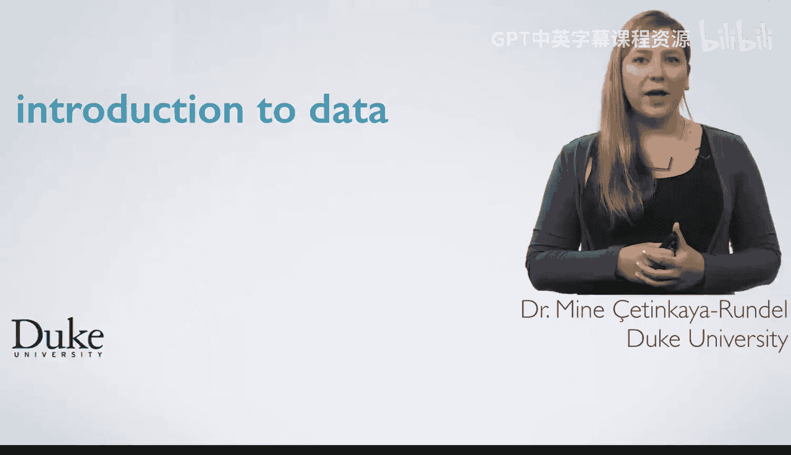
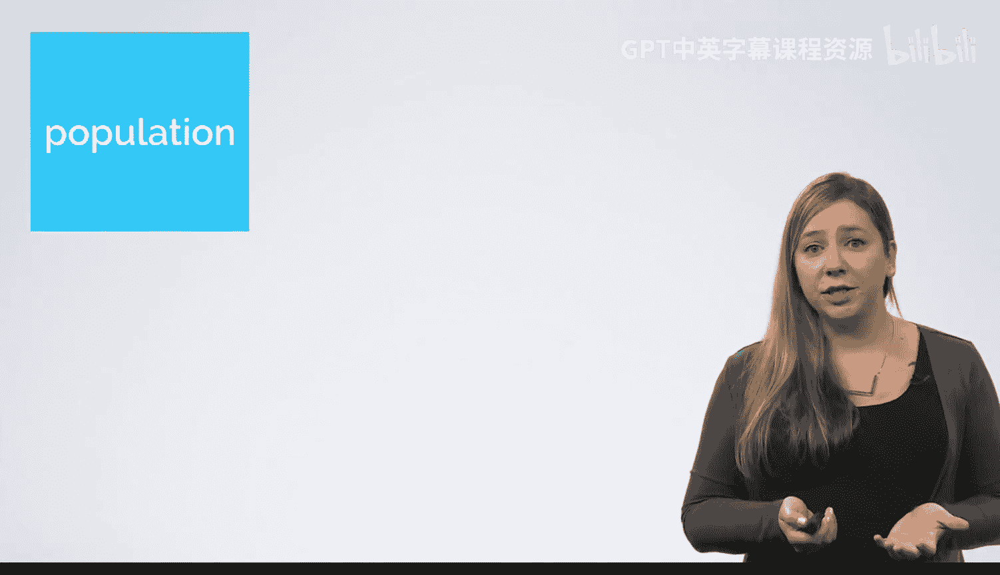
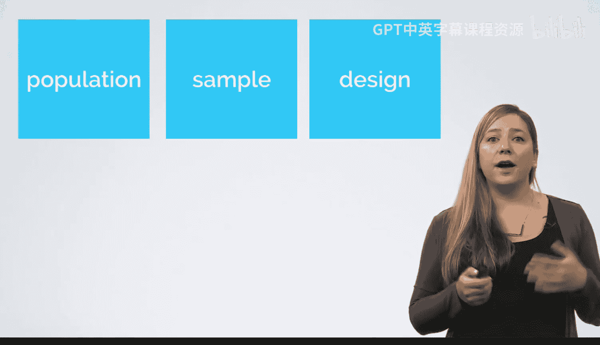
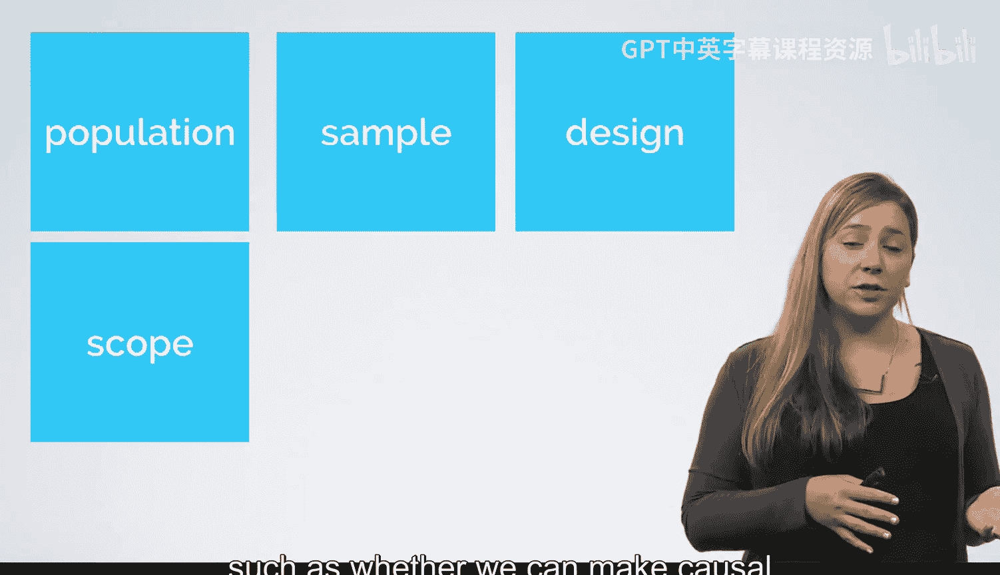
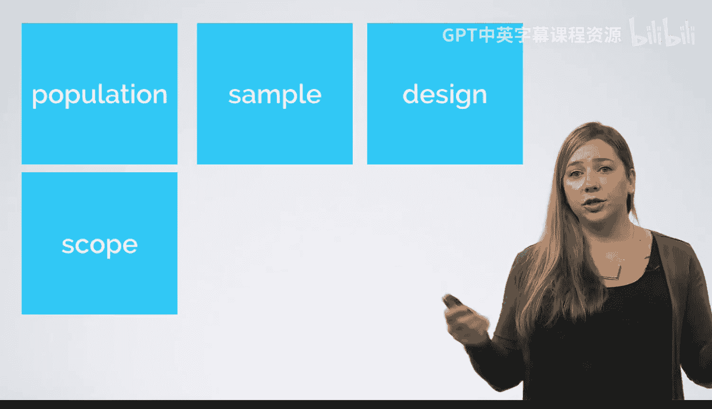
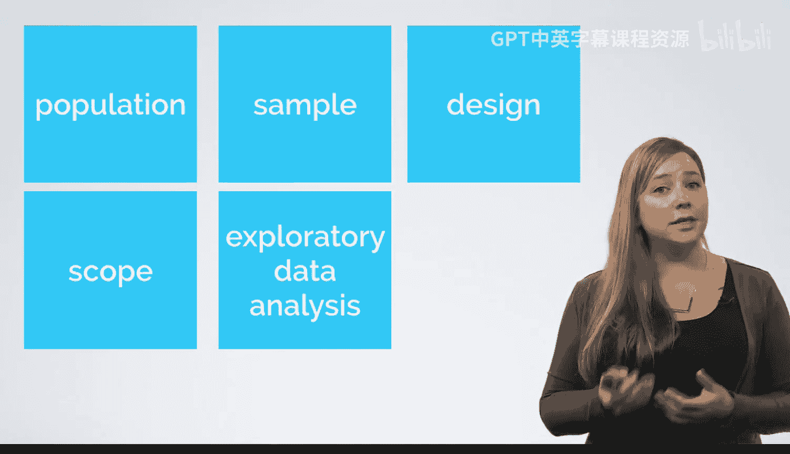
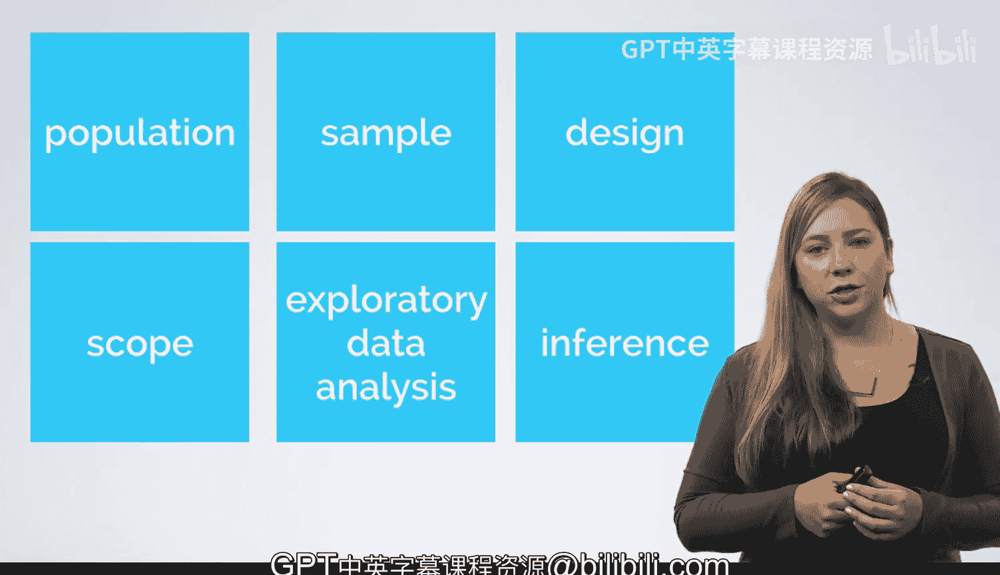

#  002：导论 📊

在本节课中，我们将要学习数据分析的基础知识，包括数据的收集、分析和可视化，以及如何基于数据做出决策。

## 从历史角度看数据作为证据

上一节我们介绍了课程的整体目标，本节中我们来看看数据作为证据在历史上的一个具体案例。

在美国，关于吸烟危害的研究始于20世纪30年代，当时吸烟变得越来越流行。一些吸烟者似乎对香烟烟雾敏感，另一些人则完全不受影响。反吸烟研究当时遇到了阻力，阻力基于诸如“我叔叔每天抽三包烟，身体依然非常健康”这样的说法。这类证据虽然可能是真实的，但基于有限的样本量，可能无法代表总体。我们称这类证据为**轶事证据**。

当时得出的结论是，吸烟是一种复杂的人类行为，其本质难以研究，且受到人类个体差异的干扰。然而，今天我们对吸烟健康影响的理解已大不相同。随着时间的推移，研究人员得以检查更大规模的案例样本，即更多的吸烟者数据。

随着从更大样本中收集数据，显示吸烟对健康负面影响的趋势变得清晰得多。

## 课程目标与核心问题

本课程的目标是教你使用统计工具理解数据，以便能够探索变量之间的关系，并在整个课程中做出明智的决策。你将接触到许多研究，当面对一项新研究或一组数据时，你首先应该问自己的问题是：**研究的总体是什么？样本又是什么？**

例如，让我们考虑2013年发表的这项名为《急诊科中的酒精品牌使用与伤害》的研究。该研究探讨的研究问题是：某些酒精品牌的消费者是否更可能因伤害而进入急诊室？仅从这个问题来看，感兴趣的总体似乎是所有人。换句话说，理想情况下，研究人员希望找到一个能对所有人提出建议的答案。

然而，仔细审视这项研究发现，研究中使用的样本只是美国巴尔的摩市约翰斯·霍普金斯医院的一组急诊室患者。这些是因伤害就诊的患者，酒精品牌消费数据是从那些在就诊前六小时内饮酒的患者中收集的。因此，这项研究的结果实际上只能推广到巴尔的摩的居民，因为某些品牌在该地区可能比其他地区更容易获得，这取决于全国品牌市场份额。同样，该地区居民的饮酒习惯也可能与世界其他地区不同。

## 本单元内容概览

现在你对如何着手处理统计研究有了初步了解，让我们简要概述本单元将要学习的内容。

我们将从定义感兴趣的总体开始，讨论从该总体中抽取样本的方法，以及如何设计能最好地回答特定研究问题的研究方案。

我们还将学习确定一项研究的推论范围，例如我们何时能做出因果性陈述，何时只能做出相关性陈述，以及何时能将结论推广到更广泛的总体。

我们还将学习探索性数据分析的方法，例如数据可视化和汇总统计。

最后，我们将以基于模拟的统计推断入门作为本单元的结束。

以下是本单元将涵盖的主要主题列表：
*   定义总体与样本
*   研究设计与抽样方法
*   因果推断与相关关系
*   探索性数据分析与可视化
*   统计推断基础

## 总结

本节课中我们一起学习了数据分析的入门知识。我们通过吸烟研究的案例，理解了轶事证据的局限性以及大样本数据的重要性。我们明确了面对任何研究时，首先要问的两个核心问题：**总体是什么？样本是什么？** 最后，我们预览了本单元将学习的核心内容，包括从数据收集到统计推断的完整流程。