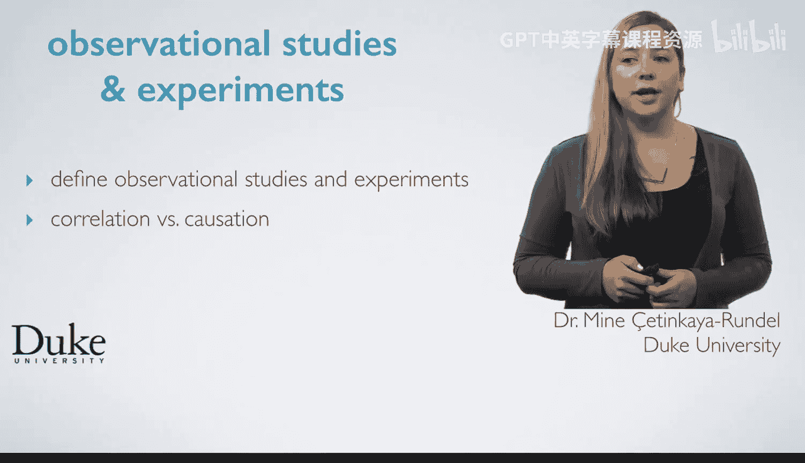
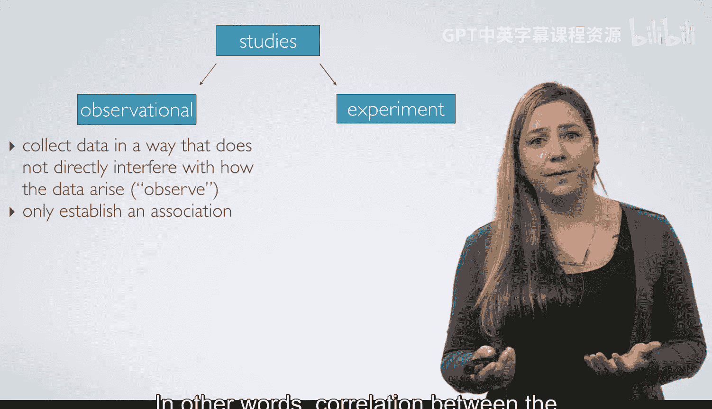
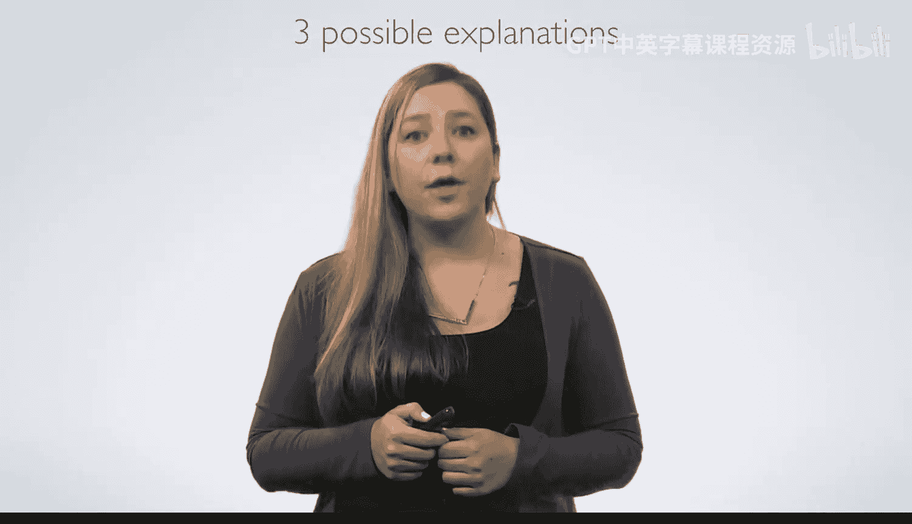
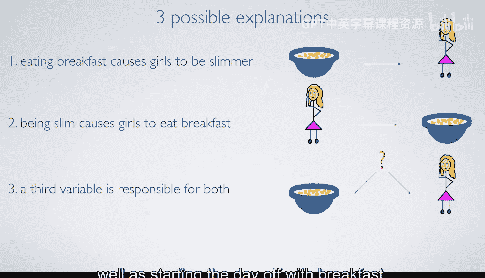

#  004：观察性研究与实验

在本节课中，我们将定义观察性研究与实验，并讨论相关性与因果关系的区别。

## 观察性研究

在观察性研究中，研究者以不直接干预数据产生过程的方式收集数据。换句话说，他们仅仅是进行观察。基于观察性研究，我们只能建立解释变量与响应变量之间的关联，即相关性。

如果一项观察性研究使用的是过去的数据，它被称为**回顾性研究**；如果数据是在研究过程中持续收集的，则被称为**前瞻性研究**。

## 实验研究

另一方面，在实验中，研究者将受试者随机分配到不同的处理组中，因此可以在解释变量与响应变量之间建立因果联系。

让我们暂停一下，通过一个例子来澄清“随机分配”的含义。假设我们想评估定期锻炼与能量水平之间的关系。我们可以将研究设计为观察性研究或实验。

以下是两种研究设计的区别：

*   **观察性研究**：我们从总体中抽样两类人：选择锻炼的人和不锻炼的人。然后我们计算并比较这两组人的平均能量水平。
*   **实验**：我们从总体中抽样一组人。然后我们**随机**将这组人分配到两个组：在研究期间定期锻炼的组和不锻炼的组。关键区别在于，是否锻炼的决定权不在受试者手中（如观察性研究那样），而是由研究者强制规定。最后，我们比较两组的平均能量水平。

基于观察性研究，即使我们发现这两组人的平均能量水平存在差异，我们也不能将此差异完全归因于锻炼。因为可能存在本研究未控制的其他变量，导致了观察到的差异。例如，身体状况更好的人可能更倾向于定期锻炼，同时也拥有更高的能量水平。

然而，在实验中，由于随机分配，那些可能影响结果的变量（如初始身体状况）很可能在两组中均匀分布。因此，如果我们发现两组平均值存在差异，我们确实可以做出因果陈述，将此差异归因于锻炼。

## 案例分析：新闻报道中的研究

接下来，我们将回顾一篇关于公共研究的媒体报道，并尝试判断它属于哪种类型的研究。让我们从新闻文章的节选开始：

> **研究：早餐麦片让女孩保持苗条**
> 吃任何类型早餐的女孩，其平均身体质量指数（一种常用的肥胖指标）都低于那些自称不吃早餐的女孩。自称早餐吃麦片的女孩，其指数甚至更低。该研究由马里兰医学研究所进行，资金来自美国国立卫生研究院和麦片制造商通用磨坊。这些结果来自一项更大规模的NIH调查，该调查追踪了加州、俄亥俄州和马里兰州的2379名9至19岁的女孩。作为调查的一部分，女孩们每年被问及一次她们在过去三天里吃了什么。

文章的标题声称“早餐麦片让女孩保持苗条”。但实际上，这里存在三种可能的解释：

1.  吃早餐确实导致女孩更苗条。
2.  苗条可能导致女孩吃早餐，因此它们的因果关系可能是反向的。
3.  可能存在第三个变量，同时导致了苗条和吃早餐。例如，普遍具有健康意识可能导致身材苗条，以及以早餐开始新的一天。

这种同时影响解释变量和响应变量，并使得它们之间看起来存在关系的额外变量，被称为**混杂变量**。

## 核心结论：相关性不等于因果性

如果你要从这门课中学到一件事，那就是：**相关性不等于因果性**。决定我们能够推断因果关系还是仅仅相关性的，是我们得出结论所依据的研究类型。

在大多数情况下，观察性研究只允许我们做出相关性陈述，而实验则允许我们推断因果关系。我们说“大多数情况”，是因为实际上存在更高级的方法（统称为**因果推断**），允许从观察性研究中做出因果推断，但这些方法超出了本课程的范围。

## 总结

本节课中，我们一起学习了观察性研究与实验的核心区别。观察性研究通过观察收集数据，只能建立变量间的**关联（相关性）**。实验则通过**随机分配**受试者到不同处理组，能够控制混杂变量，从而建立**因果关系**。理解“相关性不等于因果性”这一原则，对于正确解读数据分析和研究结论至关重要。