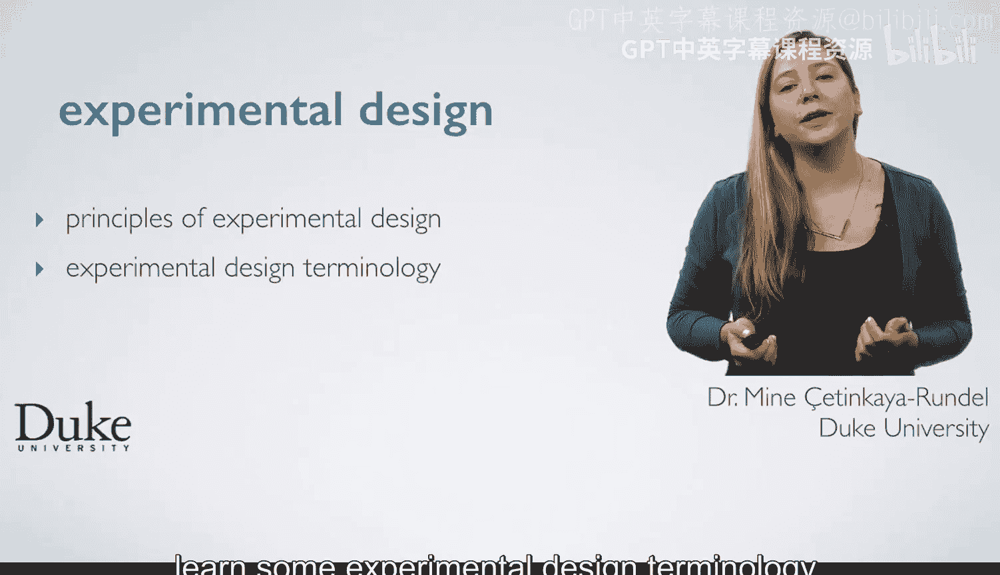
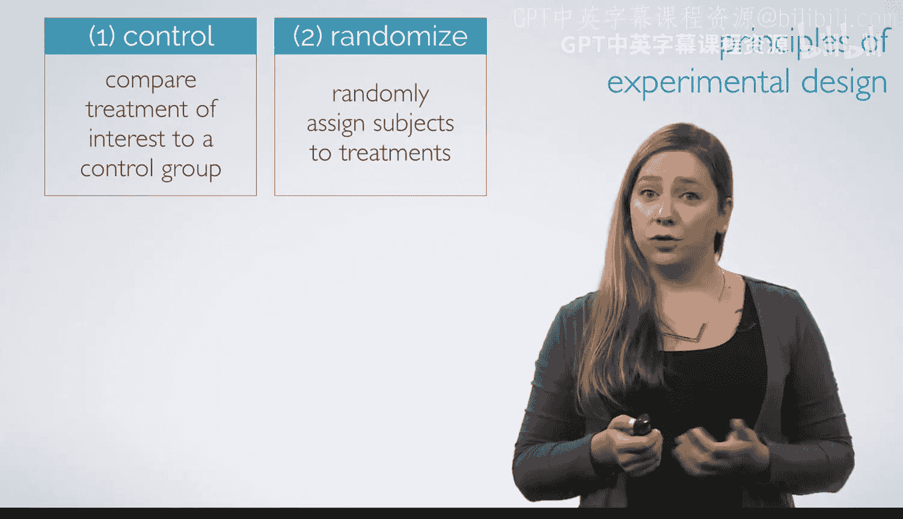
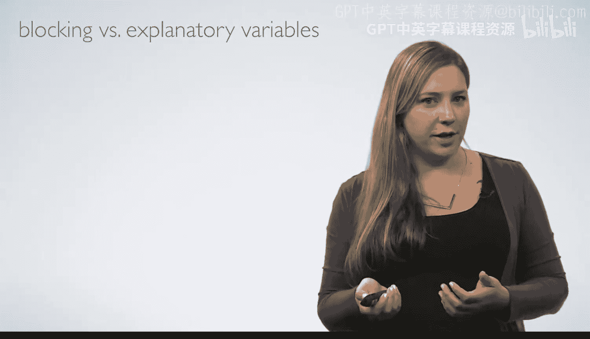
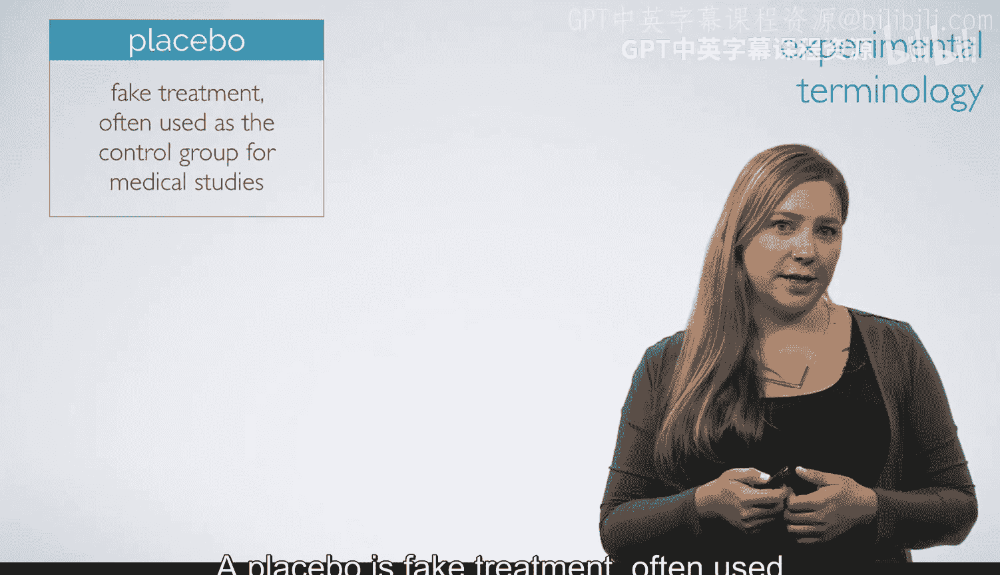
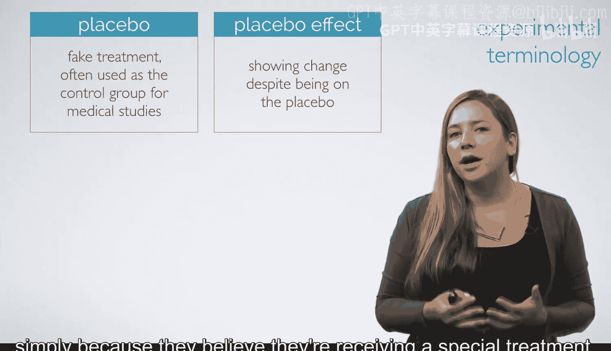

#  006：实验设计原则与术语 🧪

在本节课中，我们将讨论实验设计的基本原则，并学习一些相关的实验设计术语。理解这些原则对于设计有效、可靠的数据分析实验至关重要。

## 实验设计的四项基本原则

实验设计主要遵循四项核心原则，它们共同确保了实验结果的科学性和有效性。

以下是这四项原则：

*   **控制**：将感兴趣的**处理组**与一个**对照组**进行比较。
*   **随机化**：将实验对象**随机分配**到不同的处理组中。
*   **重复**：在研究中收集**足够大的样本**，或者**重复整个研究**。
*   **区组化**：如果已知或怀疑某些变量会影响响应变量，则首先根据这些变量将实验对象分组为**区组**，然后在每个区组内将案例随机分配到处理组。

## 深入理解区组化

上一节我们介绍了实验设计的基本原则，本节中我们来看看**区组化**的具体应用。假设我们想设计一个实验，研究能量胶是否能让人跑得更快。处理组服用能量胶，对照组则不服用任何能量胶。

我们怀疑能量胶可能对职业运动员和业余运动员产生不同的影响。因此，我们需要对“职业状态”这个变量进行**区组化**。

具体操作如下：首先，我们将样本分为职业运动员和业余运动员两个区组。然后，在每个区组（职业组和业余组）内部，再随机将运动员分配到处理组（服用能量胶）和对照组。这样，最终的处理组和对照组中，职业运动员和业余运动员的比例是均衡的。

通过这种方式，如果我们确实发现处理组和对照组在跑步速度上存在差异，我们就可以将这种差异归因于**处理**（即能量胶），并确信这种差异不是由“职业状态”造成的，因为两个组中职业和业余运动员的比例是相同的。

## 区分解释变量与区组变量

那么，如何区分**解释变量**和**区组变量**呢？

*   **解释变量**（有时也称为**因子**）是我们可以施加在实验单元上的**条件**。例如，是否服用能量胶。
*   **区组变量**则是实验单元本身具有的、我们希望加以**控制**的**特征**。例如，运动员的职业状态。

**区组化**本质上类似于抽样中的**分层**，但它应用于**实验设置**中，是在**随机分配**时使用，而非在**抽样**时使用。

## 实验设计相关术语

为了总结我们对实验设计的讨论，让我们回顾几个新的术语。

以下是几个关键术语及其定义：

*   **安慰剂**：一种虚假的治疗，常在医学研究中作为对照组使用。
*   **安慰剂效应**：指实验单元仅仅因为相信自己正在接受特殊治疗而表现出改善的现象。
*   **单盲**：指实验单元不知道自己属于对照组还是处理组。
*   **双盲**：指实验单元和研究人员双方都不知道谁在对照组、谁在处理组的研究。

这些术语在我们后续分析更多研究案例时会非常有用。

## 总结

本节课中我们一起学习了实验设计的核心原则：**控制、随机化、重复和区组化**。我们通过能量胶的例子深入探讨了区组化的应用及其重要性，并区分了解释变量与区组变量。最后，我们介绍了一些关键术语，如安慰剂、盲法等，这些是理解和评估科学研究设计质量的基础。掌握这些概念将帮助你设计出更严谨的数据分析实验。