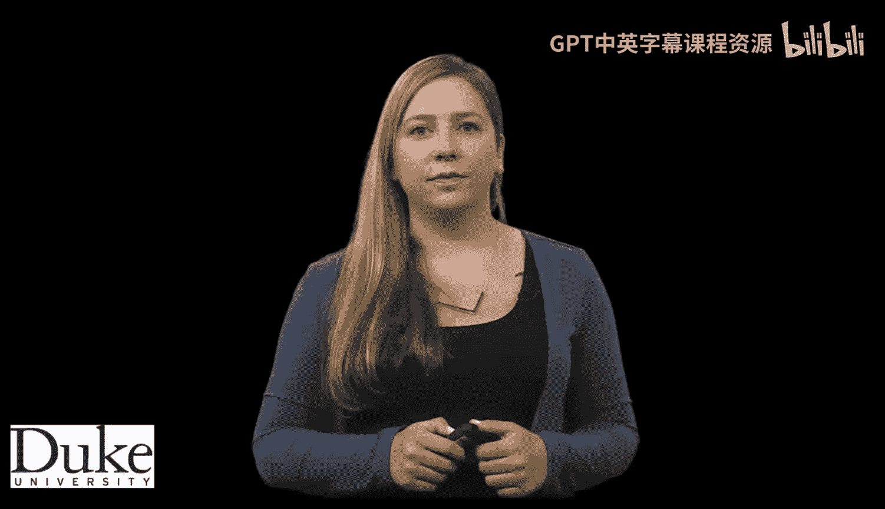
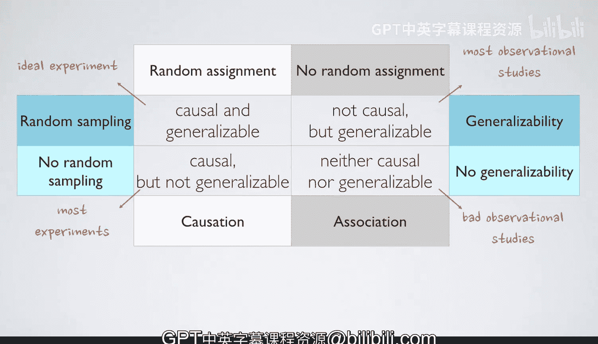

#  007：随机抽样与分配 🎯

在本节聚焦视频中，我们将讨论随机抽样与随机分配。这两个概念听起来相似，但在研究设计中服务于截然不同的目的。

## 随机抽样 📊

随机抽样发生在为研究选择受试者时。如果受试者是从总体中随机选择的，那么总体中的每个个体被选中的可能性相等，由此产生的样本很可能代表总体。因此，研究结果可以推广到更广泛的总体。

**核心概念**：`sample <- population[sample(nrow(population), size, replace=FALSE)]`

## 随机分配 ⚖️

随机分配仅发生在实验环境中，即受试者被分配到不同处理组时。仔细观察我们的样本，通常会看到受试者之间表现出略微不同的特征。通过随机分配，我们确保这些不同的特征在处理组和对照组中得到同等体现。这使我们能够将观察到的组间差异归因于施加在受试者身上的处理，因为除此之外，这些组本质上是相同的。换句话说，随机分配允许我们基于研究做出因果结论。

**核心概念**：`assignment <- sample(rep(c("treatment", "control"), each = n/2))`

## 一个快速示例 📖

假设你想进行一项研究，评估人们阅读衬线字体（serif）还是无衬线字体（sans-serif）更快。衬线是每个字符末端的小装饰笔画。

理想情况下，你首先应从总体中随机抽取研究受试者。然后，你将样本中的受试者分配到两个处理组：一组阅读衬线字体的文本，另一组阅读相同内容但为无衬线字体的文本。通过随机分配，我们确保其他可能影响阅读速度的因素（在此用受试者的不同颜色表示，例如流利度或休闲阅读频率）在两个组中得到同等体现。我们称此类变量为混杂变量。

在这种情况下，如果我们观察到两组平均阅读速度存在任何差异，我们实际上可以将其归因于真正的处理（即字体类型），并知道这很可能不是由混杂变量造成的。

## 回顾与总结 📝

抽样发生在先，分配发生在后。

总而言之，一项采用随机抽样和随机分配的研究可用于做出因果结论，并且这些结论可以推广到整个总体。这是一个理想的实验，但此类研究通常难以实施，特别是当实验单元是人类时，因为从总体中随机抽样并对他们施加处理可能很困难。这就是为什么大多数实验招募志愿者受试者。

以下是不同类型研究设计的总结：

*   **理想实验**：同时使用随机抽样和随机分配。可做出因果结论，且结论可推广。
*   **随机对照实验**：使用随机分配，但不使用随机抽样（例如招募志愿者）。可做出因果结论，但结论仅适用于样本，结果不可推广。
*   **典型观察性研究**：使用随机抽样，但不使用随机分配。结果只能用于做出相关性陈述，但可以推广到总体。
*   **不理想的观察性研究**：既不使用随机分配，也不使用随机抽样。只能用于做出相关性陈述，且结论不可推广。

在本节课中，我们一起学习了随机抽样与随机分配的核心区别及其在研究设计中的关键作用。理解这些概念是进行严谨数据分析的基础。