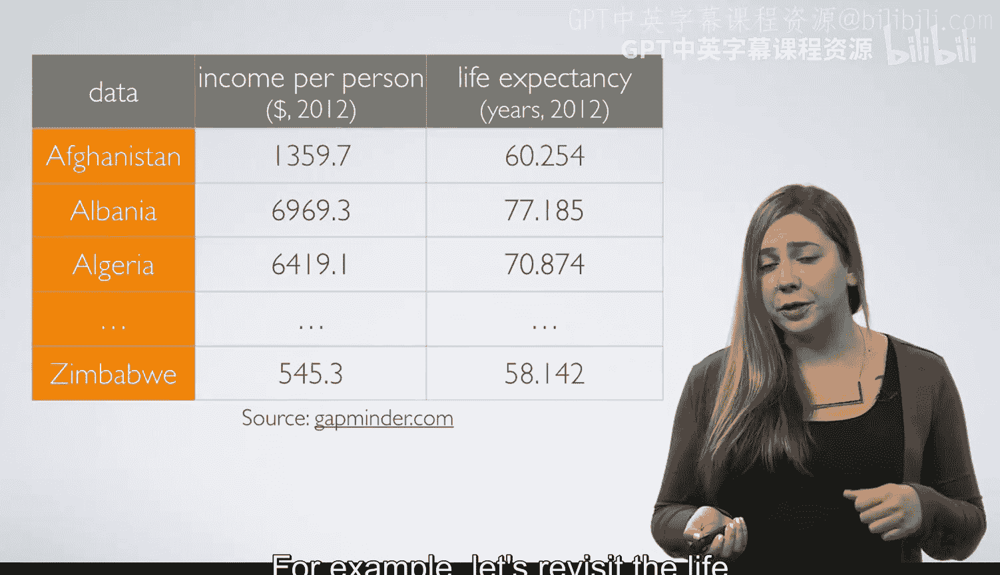
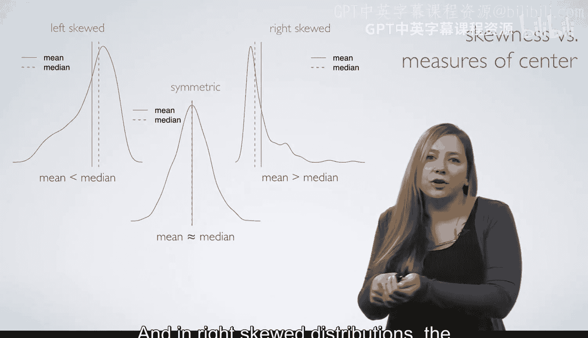
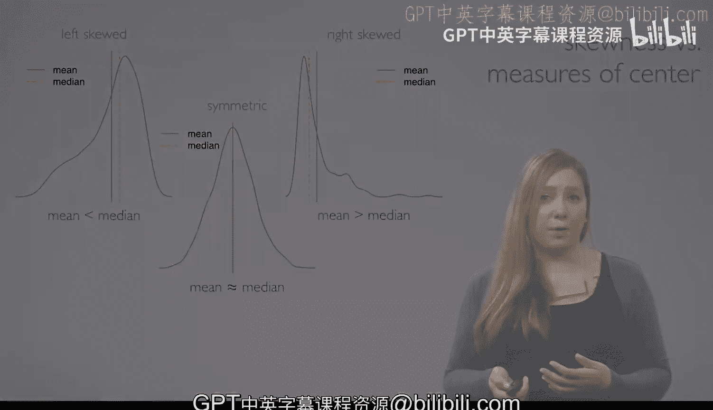

#  009：集中趋势度量 📊

在本节课中，我们将学习如何量化数值分布的中心。我们将介绍三种常用的中心度量方法：均值、中位数和众数，并探讨它们在不同分布形态下的表现。

## 概述

上一节我们讨论了数值变量的分布形状，例如偏态（左偏、对称、右偏）和峰态（单峰、双峰、均匀或多峰）。除了形状，分布的“中心”也是一个关键特征。本节我们将学习如何用具体的数值来描述这个中心。

## 中心度量方法

以下是三种最常用的中心度量方法：

*   **均值**：即算术平均值。其计算公式为：
    `mean = (x₁ + x₂ + ... + xₙ) / n`
    其中 `x₁, x₂, ..., xₙ` 代表每个观测值，`n` 代表观测值的总数。
*   **中位数**：将数据从小到大排序后，位于正中间的那个值。如果数据点个数为偶数，则中位数是中间两个数的平均值。
*   **众数**：数据集中出现频率最高的观测值。

这些度量如果基于样本数据计算，则称为**样本统计量**。它们是未知的**总体参数**（如总体均值μ）的估计值。我们通常用拉丁字母（如 `x̄` 表示样本均值）表示样本统计量，用希腊字母（如 `μ` 表示总体均值）表示总体参数。

## 计算示例

为了更好地理解这些概念，我们来看一个简单的例子。假设有9名学生的考试成绩如下：

`[85, 90, 76, 92, 88, 88, 95, 81, 87]`

以下是计算过程：
*   **均值**：将所有分数相加后除以9，结果为 `87.11`。
*   **众数**：出现次数最多的分数是 `88`，因为它出现了两次。
*   **中位数**：首先将数据排序：`[76, 81, 85, 87, 88, 88, 90, 92, 95]`。中间位置（第5个）的值是 `88`，因此中位数为 `88`。

如果数据量是偶数，例如在上述数据中再加入一个分数 `100`，排序后中间的两个数是 `88` 和 `88`，中位数则为它们的平均值 `88`。

需要注意的是，对于连续型数据，众数可能不太实用，因为很难出现完全相同的值。在实际数据分析中，我们通常使用计算机进行计算，尤其是在处理大规模数据时。

## 分布形态对中心度量的影响

理解了基本计算方法后，我们来看看分布形状如何影响均值和中位数。让我们回顾之前课程中提到的两个真实数据集。

**案例一：各国平均预期寿命分布（左偏分布）**
该分布的均值是 `70.51`，中位数是 `73.34`。均值（图中粉色实线）低于中位数（橙色虚线）。这是因为左偏分布有一个向左的长尾，少数极低的观测值会将算术平均值（均值）拉低。

**案例二：各国人均收入分布（右偏分布）**
该分布的均值约为 `$12,050`，而中位数仅为 `$7,000`。均值远高于中位数。这是因为右偏分布有一个向右的长尾，少数极高收入的观测值会将均值拉高。

## 总结

本节课我们一起学习了量化数据分布中心的三种主要方法：
1.  **均值**：所有数据的算术平均，对极端值敏感。
2.  **中位数**：排序后数据的中点，对极端值不敏感。
3.  **众数**：出现频率最高的值。

关键结论是，分布的形态会显著影响均值和中位数的关系：
*   在**左偏分布**中，均值通常**小于**中位数。
*   在**对称分布**中，均值和中位数大致**相等**。
*   在**右偏分布**中，均值通常**大于**中位数。

理解这些关系有助于我们更准确地解读数据，并选择合适的统计量来描述数据的中心趋势。

