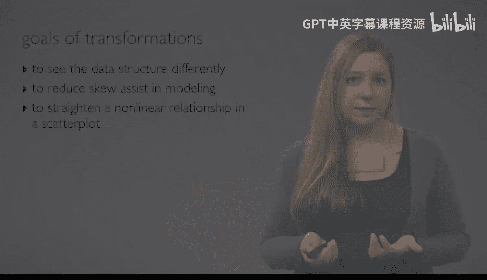

#  012：数据转换 📊

在本节课中，我们将要学习数据转换。数据转换是一种使某些类型的数据更易于建模的有用技巧。我们将首先定义什么是转换，然后回顾在何时应用数据转换可能是有用或必要的。

## 什么是数据转换？

上一节我们介绍了数据转换的概念，本节中我们来看看其具体定义。

数据转换是使用函数对数据进行重新缩放。当数据存在非常严重的偏态时，我们有时会对其进行转换，使其更易于建模。

## 常用的数据转换方法

以下是两种最常用的数据转换方法：

最常用的转换是自然对数转换。这种转换通常应用于数据集中大部分数据相对于较大值聚集在零附近，且所有观测值均为正数的情况。例如，我们之前看到人均收入的分布是严重右偏的，但在应用自然对数转换后，数据变得对称得多。有时这类数据更容易建模，因为它们偏态更轻，异常值通常也不那么极端。

除了对数转换，平方根转换和倒数转换等其他转换也可能有用。让我们看一个新的数据集。这里有一个汽车重量与其城市油耗的散点图随机样本。我们可以看到这两个变量呈负相关，这是预期的。更大的汽车每英里油耗更高，但这种关系不是线性的。

## 转换在散点图中的应用

转换也可以应用于散点图中的一个或两个变量，以使变量之间的关系更线性，从而更容易用简单的方法建模。

例如，这里有一个人均收入与预期寿命的散点图。关系是正向且弯曲的。如果我们对响应变量应用对数转换并再次绘制关系图，关系保持正向，但变得更线性，这使得它比未转换的数据更容易建模。

## 如何选择转换方法？

仅通过观察这些图表很难判断哪种转换效果更好，或者这些转换是否真的比原始数据产生了更好的结果。在本课程后面，我们将更详细地讨论如何做出这样的判断。但现在，重要的是要认识到转换是有用的，尽管它们使解释变得稍微复杂一些。毕竟，收入的**对数**或重量的**平方根**并不容易评估。

虽然我们可以为哪种转换有用制定一些指导原则，但与其专注于一系列规则，不如理解我们为什么首先想要应用转换。因此，让我们再次回顾转换数据的常见目标。

以下是转换数据的三个主要目标：

1.  **以不同视角观察数据结构**：转换可以帮助我们从新的角度理解数据分布。
2.  **减少偏态以辅助建模**：通过转换使数据分布更对称，便于应用统计模型。
3.  **拉直散点图中的非线性关系**：使变量间关系线性化，从而能够使用更简单的方法（如线性回归）对关系进行建模。

## 总结

本节课中我们一起学习了数据转换。我们了解到，数据转换是通过数学函数对数据进行重新缩放，常用于处理严重偏态的数据或使非线性关系线性化。最常用的方法是自然对数转换，但平方根和倒数转换等也各有用途。虽然转换会使结果的解释变得复杂，但它能帮助我们更清晰地观察数据结构、减少偏态，并简化建模过程。理解转换的目的比机械地套用规则更为重要。