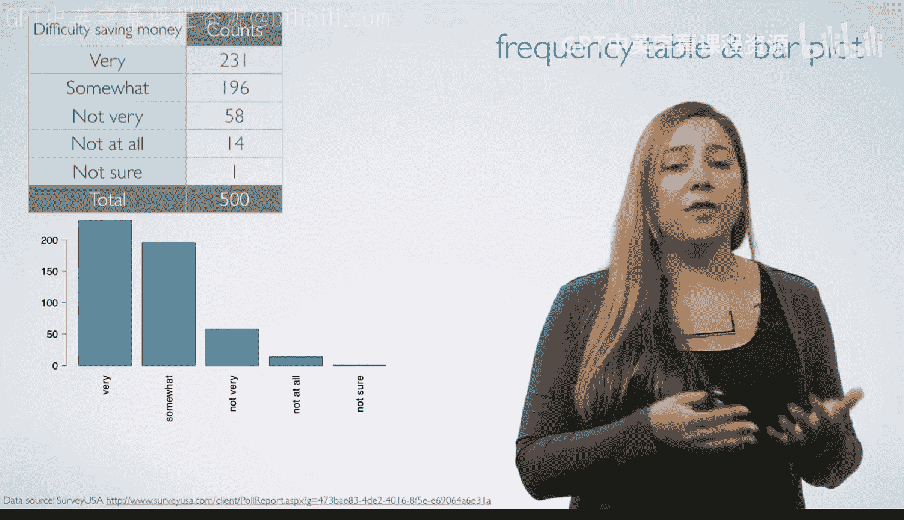
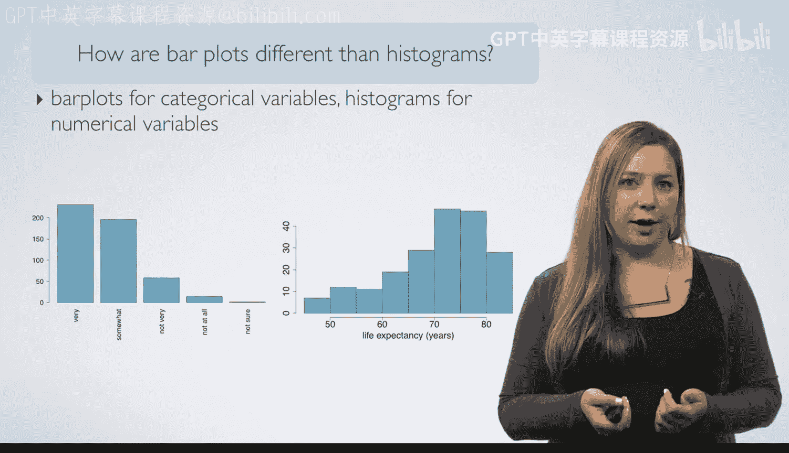
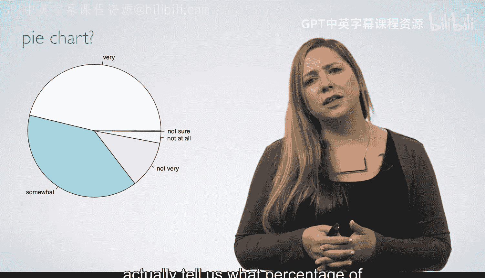
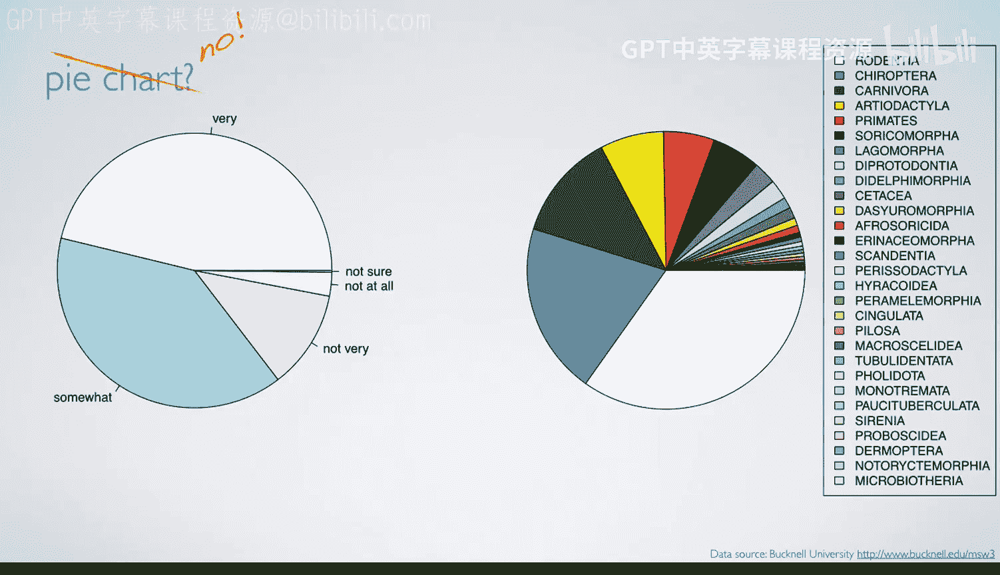
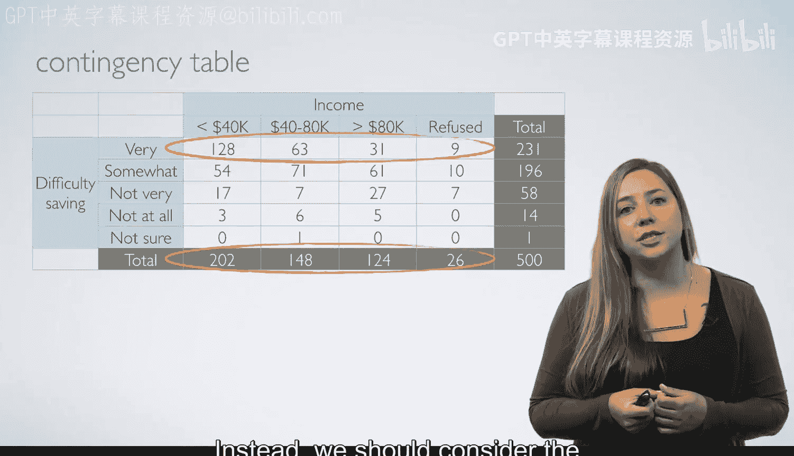
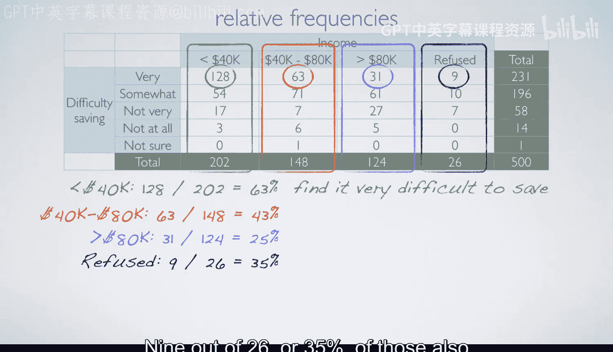
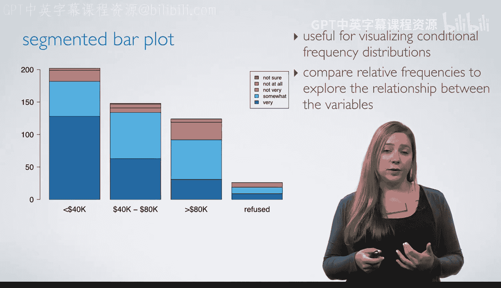
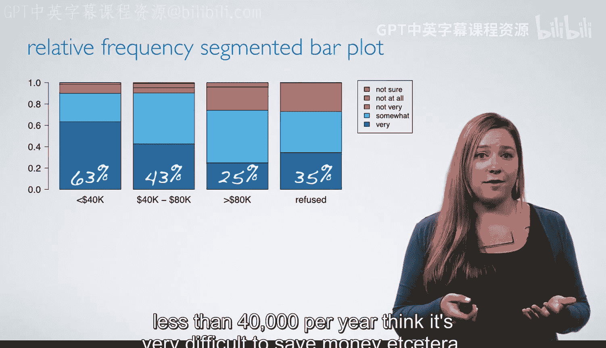
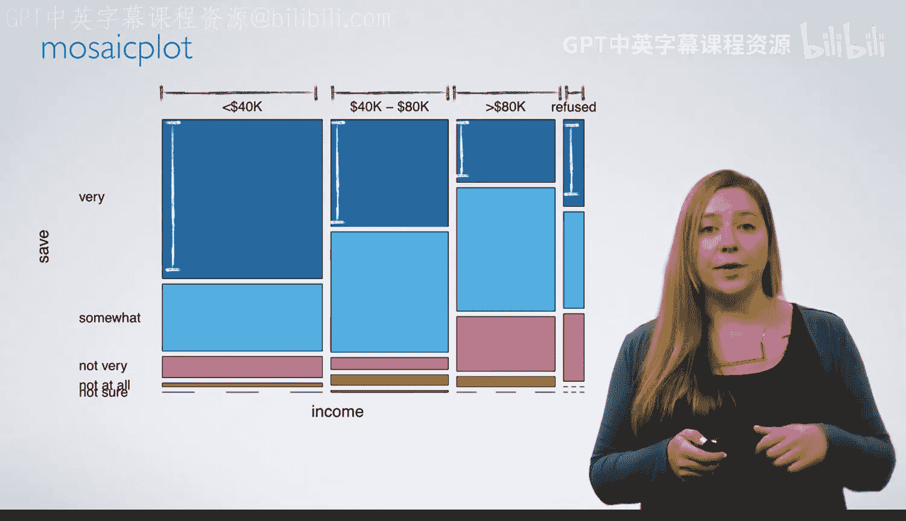
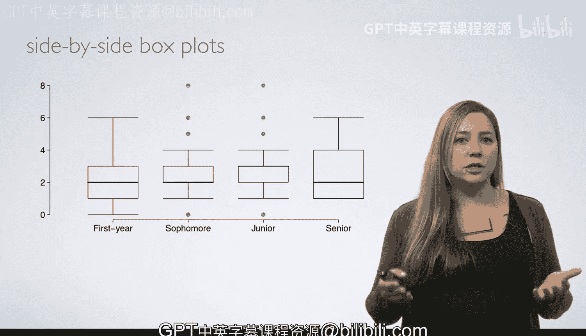

#  013：探索分类变量 📊

在本节课中，我们将学习如何描述单个分类变量的分布，以及如何评估两个分类变量之间、或一个分类变量与一个数值变量之间的关系。

---

## 单个分类变量的分布 📈

首先，我们来看如何描述单个分类变量的分布。一个2014年的美国民意调查询问了受访者认为存钱有多困难。

我们可以用频数表来呈现这项调查中500名参与者的结果：
*   231人认为存钱非常困难。
*   196人认为存钱有些困难。
*   58人认为存钱不太困难。
*   14人认为存钱一点也不困难。
*   1名受访者表示不确定。

---

### 条形图与相对频率

用图形表示这些数据的一种方法是条形图。这些原始计数确实能告诉我们一些信息，例如大多数人认为存钱是困难的。但在评估分类变量的分布时，我们通常更关注相对频率。

我们也可以绘制这些相对频率的条形图。它看起来和原始条形图一样，只是Y轴从计数变成了相对频率。

---

### 条形图与直方图的区别

那么，条形图和直方图有何不同？
1.  **用途不同**：条形图用于展示**分类变量**的分布，而直方图用于展示**数值变量**的分布。
2.  **坐标轴性质不同**：直方图的X轴是数轴，因此条形的顺序不能改变。而在条形图中，类别可以按任何顺序排列，尽管某些顺序（尤其是对于有序变量）可能更有意义。

---

### 为什么不使用饼图？

对于这些数据，可能有人会想制作饼图。但实际上，饼图提供的信息远少于条形图。
1.  饼图虽然能告诉我们各类别的相对大小顺序，但无法直观地告诉我们每个类别具体占多少百分比。
2.  当一个分类变量有很多类别且相对频率相近时，仅看饼图很难判断哪个类别占比更高。

例如，这里有一个哺乳动物物种目级分类的饼图。仅凭观察，你能分辨出哪个目包含的哺乳动物物种百分比最低吗？很难。因此，结论是：**不要使用饼图，坚持使用条形图**。

---

## 两个分类变量之间的关系 🔗

前面提到的同一项调查还询问了每位参与者的收入。我们可能想知道，人们认为存钱难易的看法是否与他们的收入有关。

为了评估这一点，我们将这些变量组织在一个**列联表**中。我们考虑三个收入水平：每年少于4万美元、每年4万至8万美元之间、每年多于8万美元。还有一些受访者拒绝回答收入问题。

为了评估收入和存钱难易看法是否相关，我们需要比较不同收入水平中认为“存钱非常困难”的人数比例。但我们不能直接比较原始计数，因为每个收入水平的样本量不同。相反，我们应该考虑**一个变量在另一个变量条件下的分布**。

---

### 计算条件百分比

以下是计算过程：
*   在年收入低于4万美元的202人中，有128人认为存钱非常困难，占比为 **63%**。
*   在年收入4万至8万美元之间的148人中，有63人持相同看法，占比为 **43%**。
*   在年收入高于8万美元的124人中，有31人持相同看法，占比为 **25%**。
*   在拒绝透露收入的26人中，有9人持相同看法，占比为 **35%**。

由于认为“存钱非常困难”的百分比在不同收入类别间差异很大，这些数据表明，所考虑的两个变量（对存钱难易的看法和收入）是**相关的**，或者说**不独立**。

---

### 可视化方法：分段条形图与马赛克图

可视化两个分类变量关系的一个明显选择是**分段条形图**。分段条形图有助于可视化条件频率分布，即一个变量（响应变量）的分布在另一个变量（解释变量）各个水平下的情况。条形的高度表示各收入类别的受访者人数，条形按颜色分段以表示对存钱有不同看法的人数。但请注意，这里显示的是频数（计数），而非相对频率。

为了探索变量之间的关系，我们需要相对频率的可视化。一种方法是直接绘制相对频率的条形图，这基本上将我们之前计算的百分比（如低收入者中63%认为非常困难）可视化。

另一种方法是**马赛克图**。马赛克图同样展示了在收入条件下，对存钱难易看法的分布。此外，它还显示了收入的边际分布。条形的宽度告诉我们收入的边际分布（例如，收入低于4万美元的受访者最多）。再看每个条形的内部细分：在低收入条形中，代表“非常困难”的段占63%；在中收入条形中占43%；在高收入条形中占25%。这些段的长度因收入水平而异，表明不同收入群体的看法存在差异，从而暗示了两个变量之间的关系。

---

## 分类变量与数值变量之间的关系 📉

到目前为止，我们讨论了如何描述单个分类变量的分布，以及如何评估两个分类变量之间的关系。作为对分类变量探索性数据分析讨论的总结，我们来谈谈最后一种关系：**数值变量与分类变量之间的关系**。

当我们想要比较一个数值变量在某个分类变量不同水平上的分布时，通常会考虑这种关系。

例如，这里有一个关于大学生参与社团数量的箱线图，并按年级分类。中位数基本一致，表明平均而言，无论年级高低，学生参与的社团数量大致相同。一年级和四年级学生的变异性更高，而二年级和三年级学生的变异性则低得多（表现为较小的四分位距）。在二年级和三年级学生中，有一些学生参与的社团数量异常地少或多。总体来看，各年级的分布非常相似，这表明学生参与的社团数量可能与其年级**无关**。

---

### 总结

本节课中，我们一起学习了：
1.  使用频数表、条形图和相对频率来描述**单个分类变量**的分布，并明确了条形图优于饼图。
2.  使用列联表、条件百分比以及分段条形图、马赛克图等可视化工具来探索和评估**两个分类变量**之间的关系。
3.  通过比较数值变量在分类变量不同水平上的分布（例如使用箱线图），来初步判断**一个数值变量与一个分类变量**之间是否存在关联。