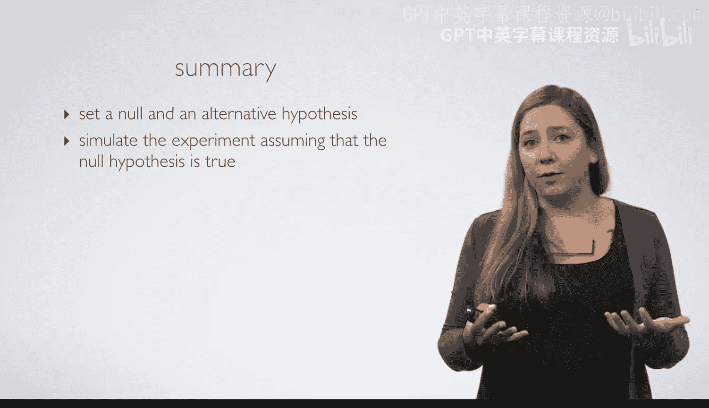

#  014：统计推断导论 🧠

在本节课中，我们将通过一个关于晋升决策中性别歧视的案例研究，初步介绍统计推断的核心思想，特别是如何使用模拟方法进行假设检验。

## 案例背景：性别歧视研究

1972年，一项关于性别歧视的研究中，48名男性银行主管各自收到了一份相同的人事档案，并被要求判断此人是否应被晋升为一个被描述为常规工作的分行经理职位。所有档案内容完全一致，唯一的区别是：一半主管收到的档案显示申请人为男性，另一半则显示为女性。哪些主管收到男性或女性档案是随机分配的。在审阅的48份档案中，共有35人获得晋升。该研究旨在检验女性是否受到了不公平的歧视。

## 数据概览

让我们查看数据。男性晋升比例为 **21/24**，约 **88%**；女性晋升比例为 **14/24**，约 **58%**。在本研究中，男性和女性的晋升比例存在显著差异。

## 两种可能的解释

对于研究中观察到的现象，有两种可能的解释，它们构成了我们相互竞争的两个主张：

1.  **零假设**：没有发生任何特殊事件。晋升与性别**独立**，不存在性别歧视。观察到的比例差异纯粹由**偶然性**导致。
2.  **备择假设**：发生了特殊事件。晋升与性别**相互依赖**，存在性别歧视。观察到的比例差异并非偶然。

## 假设检验的逻辑：法庭审判的类比

假设检验非常类似于美国的法庭审判。零假设相当于“被告无罪”，备择假设相当于“被告有罪”。我们随后会出示证据（即收集数据），并判断这些证据：**如果零假设为真，这些数据是否可能仅凭偶然发生？**

*   **如果数据在零假设为真的情况下很可能发生**，那么我们**无法拒绝零假设**，并声明证据不足以表明被告有罪。注意，此时陪审团的裁决是“无罪”，而非“清白”。统计上，我们**无法拒绝零假设**，但永远不会声称**接受**零假设。
*   **如果数据在零假设为真的情况下极不可能发生**，那么证据将引发我们对零假设的“合理怀疑”，从而我们**拒绝零假设**，支持备择假设。

在假设检验中，举证责任在于提出不寻常主张的一方。零假设代表通常状态（现状），因此我们必须为备择假设这一不寻常主张收集证据。

## 模拟实验：假设无性别歧视

为了检验我们的假设，我们将在零假设（即无性别歧视，差异仅由偶然导致）为真的前提下进行模拟实验。你可以使用一副扑克牌跟随操作。

以下是模拟步骤的简要介绍，我们将使用扑克牌来代表研究中的档案。

### 步骤一：准备牌组

首先，我们需要一副牌来模拟实验。我们让**人头牌**（J、Q、K、A）代表**未晋升**的档案，**数字牌**（2-10）代表**晋升**的档案。

由于研究中总共有48份档案（35份晋升，13份未晋升），我们需要从一副标准的52张牌中移除4张，以匹配这个分布。具体操作是：移除3张Ace和任意1张数字牌。这样，剩下的牌组中正好有13张人头牌（代表13份未晋升档案）和35张数字牌（代表35份晋升档案），总计48张牌。

### 步骤二：模拟随机分配

充分洗牌。洗牌过程模拟了“交由偶然决定”这一思想。然后将牌分成两堆，每堆24张，分别代表男性和女性申请者组。

### 步骤三：计算模拟差异

分别计算两堆牌中数字牌（代表晋升）的数量和比例。然后计算**男性组晋升比例**与**女性组晋升比例**的差值，并记录这个差值。

### 步骤四：重复模拟


重复步骤二和步骤三多次（例如1000次），以构建一个在零假设为真条件下，模拟得出的比例差异的分布。

## 模拟结果与决策

如果我们重复模拟多次，并记录每次模拟中男女晋升比例的差异，就能得到一个类似下图的分布。这个分布以**0**为中心（即零假设所期望的差异值）。

```r
# 模拟分布的中心是零差异
simulated_differences <- c(-0.042, 0.083, -0.125, ... , 0.167) # 示例数据
mean(simulated_differences) # 应接近0
```

从模拟差异的分布中，我们可以看到，**如果性别确实不影响晋升决策**，那么观察到像原始数据中那样高达 **30%** 的差异是**极其罕见**的。

这个事件（或更极端事件）发生的**低概率**表明，晋升决策很可能与性别不独立。因此，我们倾向于**拒绝零假设**。


我们的结论是：这些数据提供了令人信服的证据，表明男性银行主管的晋升决策与性别存在关联。

## 核心概念：P值

**P值**的定义是：在零假设为真的前提下，观察到与原研究数据**至少一样极端**的结果的概率。它是我们在竞争假设之间做出决策的常用标准之一。

```r
# P值的概念性描述
p_value <- Pr(observed_difference >= 0.30 | H0 is true)
```

## 总结

本节课我们一起学习了统计推断的入门知识，重点是通过一个案例了解了假设检验的基本流程：



1.  我们首先设立了**零假设**和**备择假设**。
2.  接着，我们在**零假设为真**的假设下**模拟**了实验过程。
3.  然后，我们评估了观察到**至少与原数据一样极端**的结果的**概率**（即P值）。
4.  由于这个概率很低，我们决定**拒绝零假设**，支持备择假设。

在未来的单元中，我们将继续深入探讨P值和假设检验，并学习针对不同类型数据进行假设检验的各种方法。