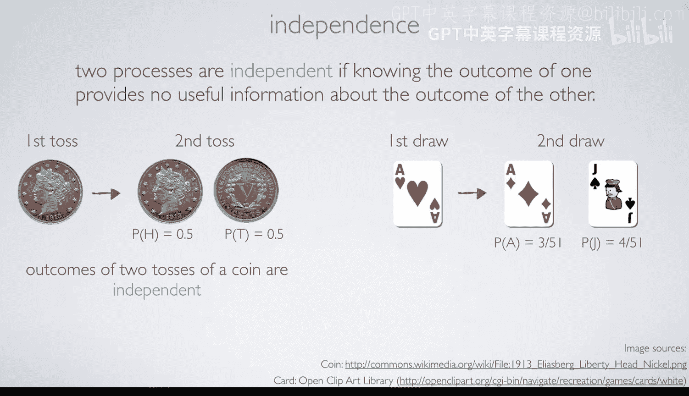
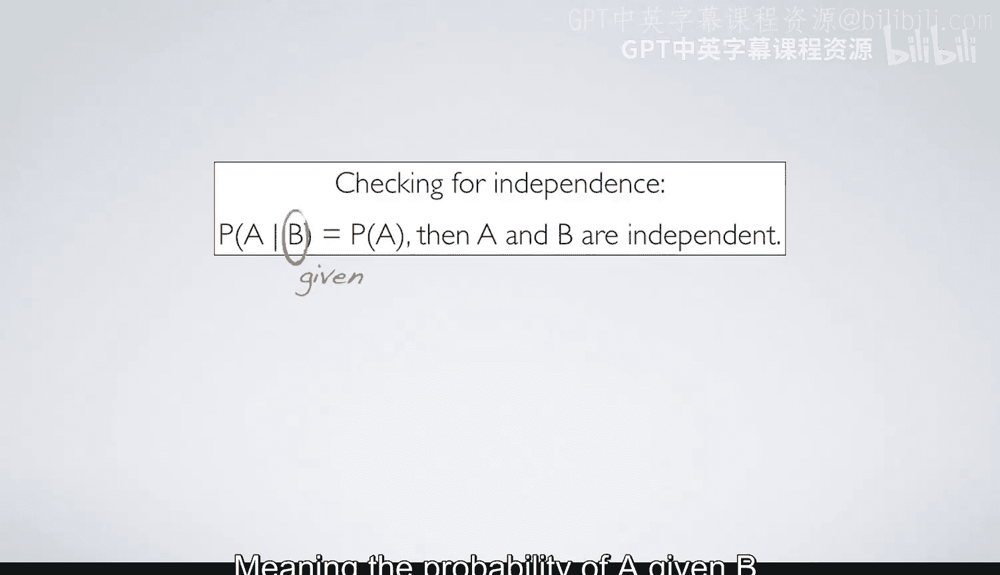
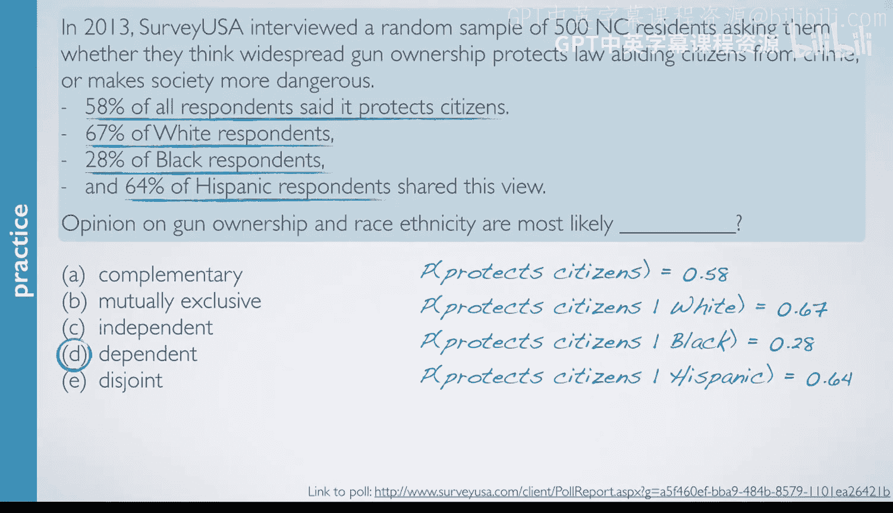
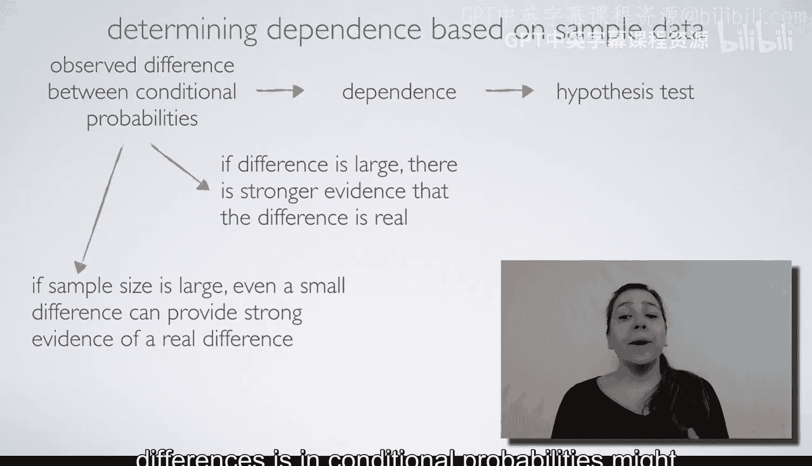
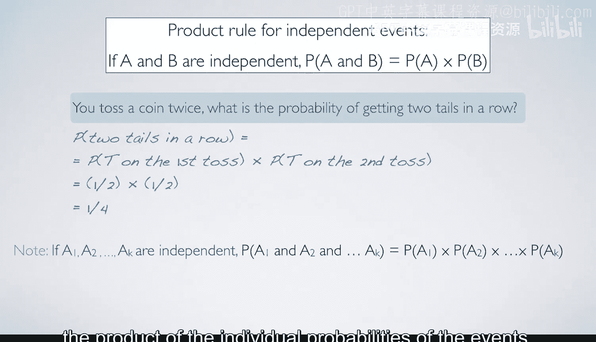
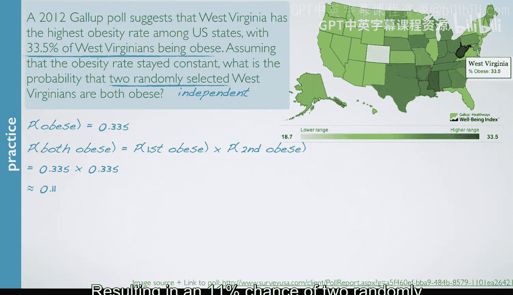

#  017：独立性 🎲

在本节课中，我们将学习独立事件的定义，探讨评估独立性的方法，并介绍独立事件的乘法规则。

## 什么是独立事件？ 🤔

两个过程被称为是独立的，如果知道其中一个的结果，不会为确定另一个的结果提供任何有用的信息。

例如，知道第一次抛硬币结果是正面，并不会为确定第二次抛硬币的结果提供任何有用信息。无论第一次抛掷的结果如何，第二次抛掷得到正面或反面的概率都是0.5。因此，两次抛硬币的结果是独立的。

另一方面，如果知道从一副牌中抽出的第一张牌是A，这确实为计算第二次抽牌结果的概率提供了有用的信息。前提是我们抽牌时**不替换**，即抽出的牌不放回牌堆。例如，再抽到一张A的概率将是3/51（因为牌堆还剩51张牌，其中只有3张是A），而抽到一张J的概率将是4/51（因为牌堆里还剩4张J）。因此，从一副牌中不替换地连续抽两次的结果是**相依**的。

## 如何判断独立性？ 📏

基于这个定义，我们可以制定一个判断随机过程之间独立性的一般规则。

如果事件A在事件B发生的条件下发生的概率，等于事件A本身发生的概率，那么事件A和B就被称为是独立的。这个规则本质上说明，知道B并不能告诉我们关于A的任何信息。我们使用竖线符号 `|` 表示“在...条件下”，即 `P(A|B)` 表示“在B发生的条件下A发生的概率”。

**公式：**
如果 `P(A|B) = P(A)`，则事件A和B独立。

## 实例分析：枪支观点与种族 🧐

让我们快速应用这个规则。2013年，Survey USA采访了北卡罗来纳州500名居民的随机样本，询问他们认为广泛的枪支所有权是保护守法公民免受犯罪侵害，还是让社会更危险。58%的受访者表示它保护公民。67%的白人受访者、28%的黑人受访者和64%的西班牙裔受访者持此观点。

基于这些信息，我们想填写以下句子中的空白：“关于枪支所有权的观点与种族/民族最有可能是______。”选项包括：互补、互斥、独立、相依、不相交。

以下是已知信息：
*   随机选择的居民认为枪支保护公民的概率 `P(保护)` = 0.58。
*   如果居民是白人，则此概率 `P(保护 | 白人)` = 0.67。
*   如果居民是黑人，则此概率 `P(保护 | 黑人)` = 0.28。
*   如果居民是西班牙裔，则此概率 `P(保护 | 西班牙裔)` = 0.64。

由于认为枪支保护公民的概率根据个人的种族或民族差异很大，因此关于枪支所有权的观点与种族/民族最有可能是**相依**的。知道某人的种族/民族可能会为我们提供关于其枪支观点的有用信息，因此我们说这两个变量很可能是相互依赖的。

## 关于样本数据的说明 📊

我们一直使用“最有可能相依”这样的措辞，因为我们处理的是样本数据，并且尚未使用统计推断工具，这些工具允许我们将从样本中得到的结果推广到总体。

如果我们观察到基于样本计算的条件概率之间存在差异，我们说这些数据**提示**了相依性。接下来的自然步骤将是进行假设检验，以查看我们观察到的这些差异是否仅仅是偶然或自然随机抽样造成的，还是总体中确实存在真实差异。

然而，在此之前，我们也可以根据观察到的差异大小以及样本量进行一些推测。例如，如果观察到的条件概率（例如，在白人、黑人、西班牙裔条件下认为枪支保护公民的概率）差异很大，那么就有更强的证据表明差异是真实的。另一方面，如果样本量很大，即使条件概率的微小差异也可能为真实差异提供强有力的证据。

## 独立事件的乘法规则 ✖️

既然我们知道如何检查独立性，那么让我们看看一旦发现事件是独立的，我们可以用它们做什么。

独立事件的乘法规则指出：如果A和B是独立的，那么A和B同时发生的概率就是它们各自概率的乘积。

**公式：**
如果A和B独立，则 `P(A 且 B) = P(A) * P(B)`。

假设你抛一枚硬币两次。连续得到两次反面的概率是多少？这很简单。连续得到两次反面的概率，就是第一次抛得到反面的概率乘以第二次抛得到反面的概率。我们之前讨论过，抛硬币是彼此独立的，因此我们可以应用刚刚学到的规则。任何一次抛掷得到反面的概率都是0.5或1/2，所以总的概率是四分之一，即约25%。

**注意：** 这个规则并不局限于两个事件，实际上可以扩展到任意多个独立事件。因此，如果我们不是抛两次硬币，而是抛100次，我们可以简单地将100个相同的概率相乘。一般来说，如果事件A1, A2, ..., Ak是独立的，那么所有这些事件同时发生的概率就是各个事件概率的乘积。

**通用公式：**
如果 A1, A2, ..., Ak 独立，则 `P(A1 且 A2 且 ... 且 Ak) = P(A1) * P(A2) * ... * P(Ak)`。

## 应用实例：肥胖率计算 📈

让我们用一些真实数据来应用刚刚学到的知识。

2012年的一项盖洛普民意调查显示，西弗吉尼亚州在美国各州中肥胖率最高，有33.5%的西弗吉尼亚人肥胖。假设肥胖率保持不变，随机选择的两名西弗吉尼亚人都肥胖的概率是多少？

我们已知33.5%的西弗吉尼亚人肥胖，可以记作肥胖的概率 `P(肥胖)` = 0.335。像我们在过去几个例子中所做的那样，列出问题中的已知条件通常很有用，这有助于保持条理清晰，并让你在后续计算中更容易引用这些值。

题目说明这两个人是随机选择的，这意味着就他们的肥胖状况而言，他们是彼此独立的。例如，如果我们从同一个家庭挑选两个人，其中一人肥胖，另一人也更可能肥胖，因为住在同一家庭的人更可能有共同的饮食和锻炼习惯。然而，由于我们是随机选择这些个体，我们可以说他们是独立的。

既然两者独立，那么两人都肥胖的概率就简单地等于第一个人肥胖的概率乘以第二个人肥胖的概率，每个概率都是0.335，结果是0.112225，即大约有11%的概率随机选择的两名西弗吉尼亚人都肥胖。

## 结果解读与合理性检查 ✅

这个值，11%（即两人都肥胖的概率），低于其中任何一人肥胖的概率（33.5%）。这从两个方面讲得通：
1.  **数学上**：我们将两个介于0和1之间的值相乘，因此乘积必然是一个低于其中任何一个值的数。
2.  **概念上**：我们希望找到两个同时符合特定标准的人，因此我们得到想要结果的**可能性**应该低于只找到一个符合该标准的人的可能性。

以这种方式推理最终的数值答案通常很有用。它帮助我们真正理解我们使用的公式为何如此工作，而无需深入理论证明。同时，在您所处理的数据背景下检查最终数值答案时，这也很有用。换句话说，这是检查你工作的一个好方法。

## 总结 📝

本节课中，我们一起学习了：
1.  **独立事件的定义**：知道一个事件的结果，不影响另一个事件发生的概率。
2.  **判断独立性的方法**：检查 `P(A|B)` 是否等于 `P(A)`。
3.  **独立事件的乘法规则**：如果事件独立，它们同时发生的概率等于各自概率的乘积，即 `P(A 且 B) = P(A) * P(B)`。
4.  **应用与解读**：我们通过枪支观点与种族的例子理解了如何判断相依性，并通过肥胖率的计算练习了乘法规则的应用，最后讨论了如何对结果进行合理性检查。