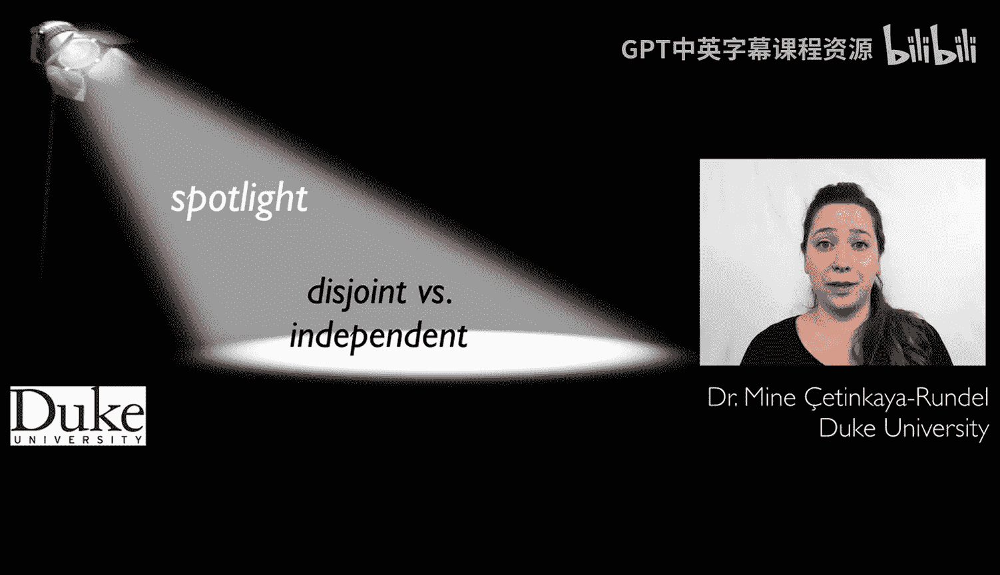
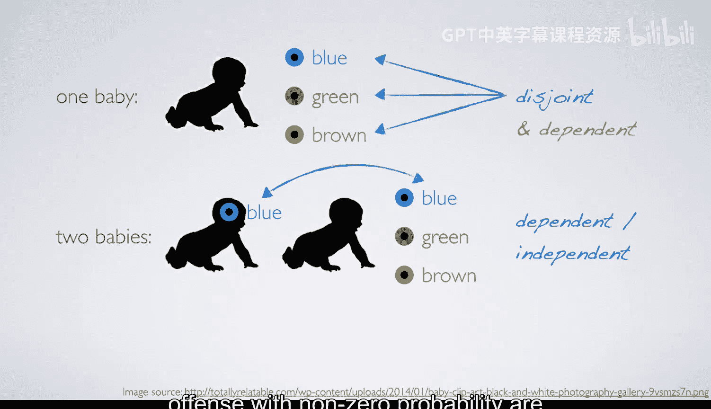
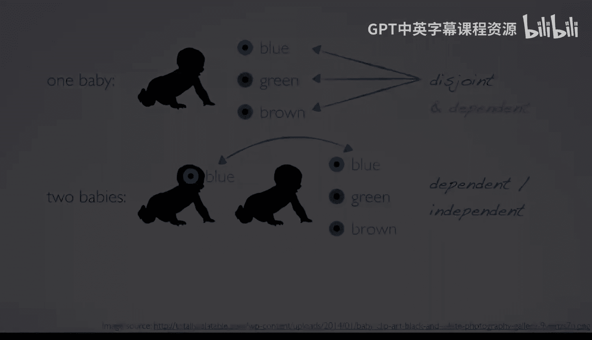

#  019：互斥与独立辨析 🔍

在本节聚焦视频中，我们将讨论互斥事件与独立事件。这两个术语听起来相似，且经常被混淆。因此，我们将重新定义它们，并通过一些例子来阐明它们为何并非同一概念。

## 核心概念回顾 📚

首先，让我们快速回顾一下定义。

*   **互斥事件**：也称为不相容事件，指两个事件**不可能同时发生**。
*   **独立事件**：指两个事件的发生互不影响，知道其中一个事件的结果，**不会提供任何关于另一个事件结果的有用信息**。

因此，互斥性关注的是事件能否**同时发生**。如果事件A和B互斥，则它们同时发生的概率为0，即 **P(A ∩ B) = 0**。

而独立性关注的是过程是否**相互影响**。如果事件A和B独立，则在已知B发生的条件下，A发生的概率就等于A本身发生的概率，即 **P(A|B) = P(A)**。

## 通过实例辨析 👶

为了更好地理解，我们来看一个关于婴儿眼睛颜色的例子。

假设我们只考虑蓝色、绿色和棕色三种眼睛颜色（为简化，忽略如异色瞳等其他可能性）。对于一个婴儿，其可能的眼睛颜色结果是：蓝色、绿色、棕色。这些结果是**互斥**的，因为一个婴儿不可能同时拥有两种颜色的眼睛。

现在，假设有两个婴儿。我们知道第一个婴儿的眼睛是蓝色的。那么第二个婴儿的眼睛颜色可能性仍然是：蓝色、绿色、棕色。对于第二个婴儿自身而言，这三种结果同样是互斥的。

然而，第一个婴儿和第二个婴儿的眼睛颜色之间是**独立**还是**依赖**，则取决于具体情况：

*   如果两个婴儿是**亲属**（例如兄弟姐妹），并且我们知道其中一个有蓝眼睛，那么另一个也更可能有蓝眼睛（由于遗传）。此时，两个事件是**依赖**的。
*   如果两个婴儿是从总体中**随机抽取**、毫无关联的个体，那么第一个婴儿有蓝眼睛这一事实，**不会**提供任何关于第二个婴儿眼睛颜色的有用信息。此时，两个事件是**独立**的。

## 一个重要推论 💡

最后需要注意一点：对于同一个婴儿的眼睛颜色结果（蓝、绿、棕），这些互斥的结果之间也是**相互依赖**的。因为如果我们知道这个婴儿的眼睛是蓝色的，我们就同时知道他/她的眼睛**不是**绿色或棕色的。

我们可以将这一观察推广为：**具有非零概率的互斥事件总是相互依赖的**。因为如果我们知道其中一个事件发生了，我们就知道其他事件不可能发生。

## 总结 ✨

本节课我们一起学习了互斥事件与独立事件的核心区别：
*   **互斥** 关乎事件能否**同时发生**，其数学表达为 **P(A ∩ B) = 0**。
*   **独立** 关乎事件是否**相互影响**，其数学表达为 **P(A|B) = P(A)**。
*   关键点在于：**非零概率的互斥事件必然是依赖的**，因为一者的发生排除了另一者发生的可能性。

理解这一区别对于正确进行概率计算和数据分析至关重要。